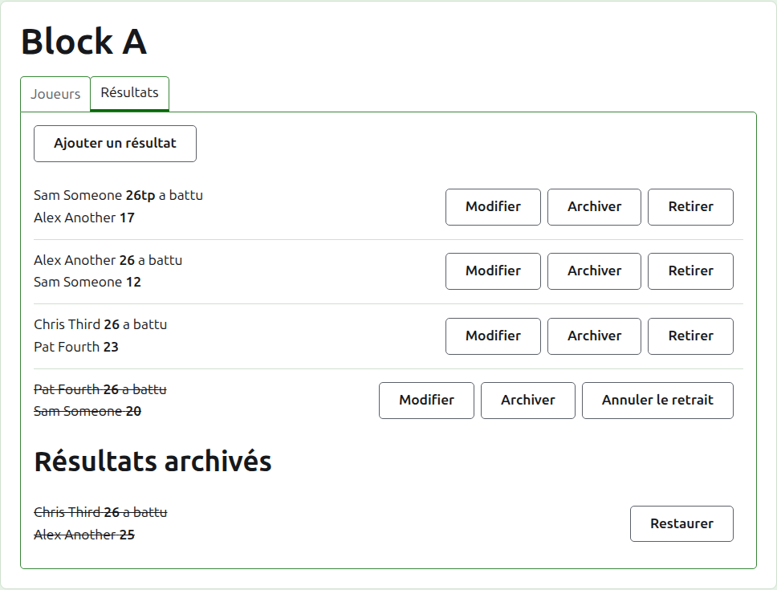
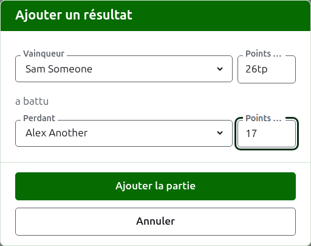
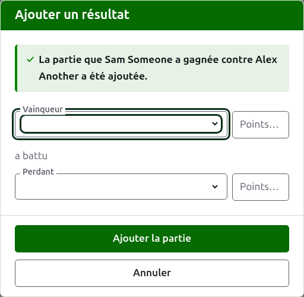
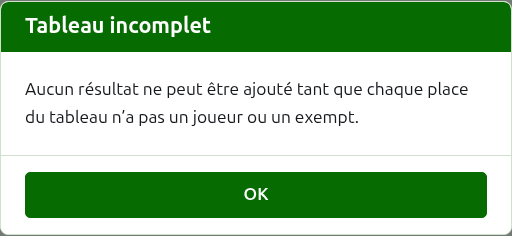
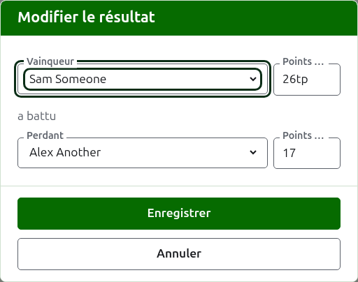

# Scores

L’onglet **Scores** de la page d’une compétition est l’endroit où ses parties sont saisies, corrigées et mises de côté. Un marqueur ne voit que cet onglet, et peut y faire tout ce qu’un organisateur peut faire.

## Saisir un résultat

Appuyez sur **Ajouter un score**, au-dessus de la liste. La boîte de dialogue se lit comme on annonce un résultat à voix haute : le vainqueur et ses points, puis « a battu », puis le perdant et ses points.

Le vainqueur et le perdant se choisissent chacun parmi les joueurs de la compétition qui jouent encore, dans l’ordre de la compétition. Personne n’est choisi au départ, pour qu’une partie ne soit jamais mise au compte d’un joueur que vous n’avez pas choisi. Dans une élimination directe, choisir le vainqueur choisit comme perdant celui contre qui il est tiré, là où vous pouvez le voir et en choisir un autre.

Les points se tapent tels que le marqueur les a notés : le nombre de points, et ce qui suit, qui est gardé et affiché tel que tapé, comme « 26tp » pour 26 arceaux et un triple peel. Le nombre est formé des chiffres par lesquels commence le résultat ; un résultat qui ne commence pas par un chiffre est refusé.

Une partie gagnée à points égaux, comme lorsqu’elle est arrêtée au temps et départagée autrement, dit qui l’a gagnée par une marque après les points du vainqueur : « 6w » a battu « 6 ». Sur Croquet Scores, les marques sont « w », « won » et « winner » ; Gateball Scores accepte aussi « cb » et « so ». Les points du vainqueur doivent dépasser ceux du perdant, ou porter une marque, sauf si le tournoi autorise les matchs nuls, auquel cas des points égaux sans marque sont gardés comme un match nul.

Appuyez sur **Ajouter la partie**. La partie est ajoutée, la boîte de dialogue dit laquelle, et les champs se vident pour la suivante, puisque les résultats arrivent par séries, lus sur un tableau à la fin d’un tour. Appuyez sur **Annuler** une fois qu’ils sont tous saisis.

Ce qui est refusé est dit sous le champ concerné : un vainqueur ou un perdant non choisi, des points non tapés ou ne commençant pas par un chiffre, le même joueur des deux côtés, les points du perdant marqués comme gagnés, ou les points du vainqueur derrière ceux du perdant. Dans une élimination directe, deux joueurs qui ne sont pas tirés l’un contre l’autre sont refusés au-dessus des champs.

## Le tableau d’une élimination directe doit d’abord être rempli

Une élimination directe ne se joue qu’une fois que chaque place de son tableau tient un joueur ou un exempt. Jusque-là, Ajouter un résultat explique pourquoi les résultats ne peuvent pas être ajoutés, plutôt que d’ouvrir la boîte de dialogue.

## La liste des résultats

Les résultats en service sont listés dans l’ordre où ils ont été saisis, le plus ancien en premier, pour que la liste se lise comme la compétition s’est jouée. Chacun dit le vainqueur et ses points, puis le perdant et les siens, et offre **Modifier** et **Archiver**.

## Corriger un résultat

**Modifier** ouvre la même boîte de dialogue sur ce résultat, intitulée Modifier le résultat, avec ses joueurs choisis et ses points tels qu’ils ont été tapés. Appuyez sur **Enregistrer** pour garder la correction et fermer la boîte de dialogue.

Une correction garde l’issue : une partie gagnée reste gagnée, et une partie nulle reste nulle. Une partie dont l’issue était fausse s’archive et se saisit de nouveau.

Là où un résultat pourrait être archivé, ses joueurs peuvent être changés aussi bien que ses points. Dans une élimination directe, un résultat dont le vainqueur a déjà joué au tour suivant garde ses joueurs, puisque changer qui l’a gagné laisserait la partie suivante jouée par quelqu’un qui n’y serait pas arrivé ; seuls ses points peuvent être corrigés.

## Archiver un résultat

**Archiver** met un résultat de côté pour qu’il ne compte plus pour rien. Il est listé sous **Scores archivés**, barré, et n’offre plus que **Restaurer**. Aucun des deux ne demande d’abord, puisque chacun annule l’autre.

Dans une élimination directe, le vainqueur d’une rencontre passe au tour suivant ; le résultat d’une rencontre dont le vainqueur a joué au tour suivant n’a donc pas d’Archiver. La partie du tour suivant s’archive d’abord, et ensuite celles d’avant peuvent l’être. Quand un tour se joue au meilleur des 3 ou des 5, chaque partie de la rencontre est tenue de la même façon. Une poule et un système suisse n’ont pas de tours qui dépendent l’un de l’autre, de sorte que chacun de leurs résultats peut être archivé.

## Retirer un résultat

Un joueur qui quitte une compétition est d’ordinaire déclaré forfait, sur l’onglet Joueurs, et cela suffit : il ne joue plus, et les parties qu’il a jouées restent, mais elles ne comptent plus dans les victoires, les défaites et les arceaux. Retirer un résultat est pour le cas plus rare où une partie qui a été jouée ne doit pas compter. Dans les President’s Eights australiens, par exemple, les résultats du premier tour restent quand un joueur se retire, et seules ses parties du second tour sortent du décompte : retirez ces parties.

Dans une poule ou un système suisse, un résultat qui a été joué mais ne doit pas compter se retire plutôt que de s’archiver. **Retirer** le garde parmi les résultats en service, à sa place, mais barré et ne comptant pour rien sur les pages publiques. **Réintégrer** le fait compter de nouveau. Aucun des deux ne demande d’abord. Les résultats d’une élimination directe n’ont pas de Retirer, puisque là un résultat décide de plus que le classement.

Suite : [Notes](notes.md).
