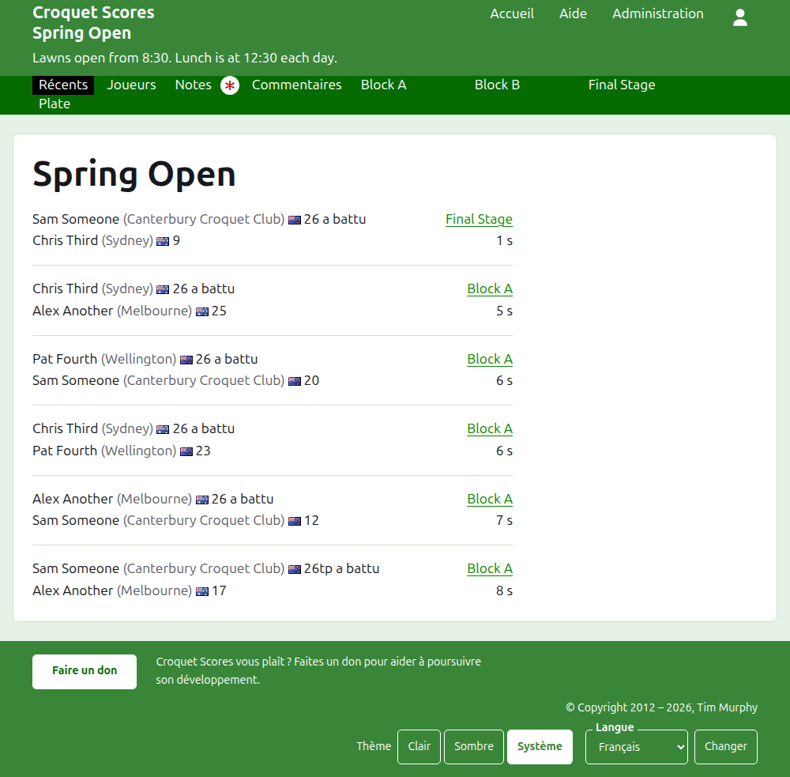
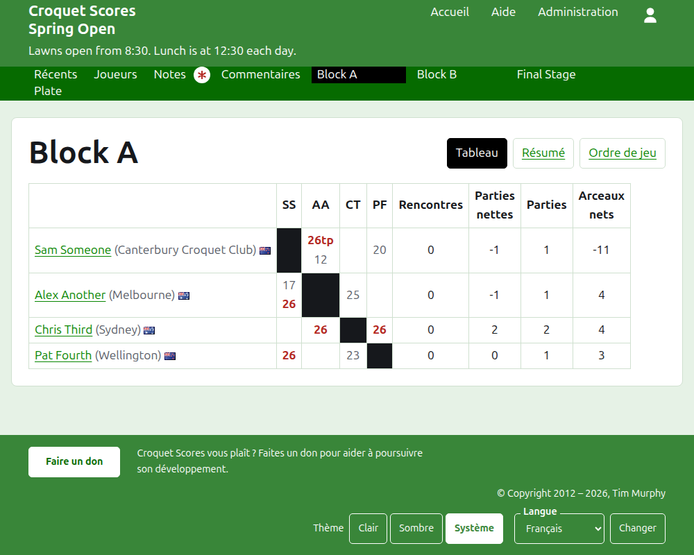
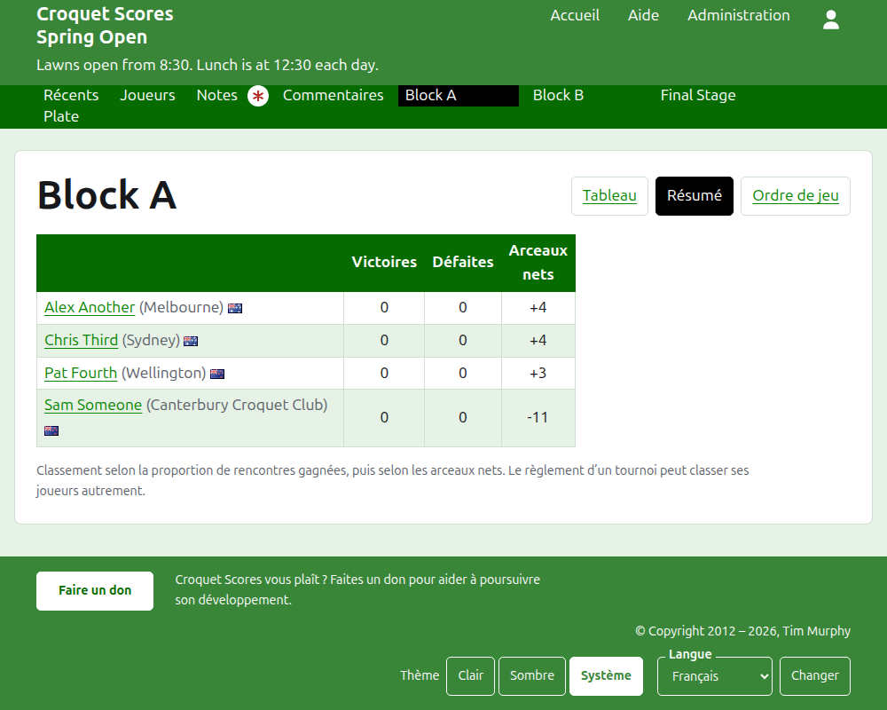
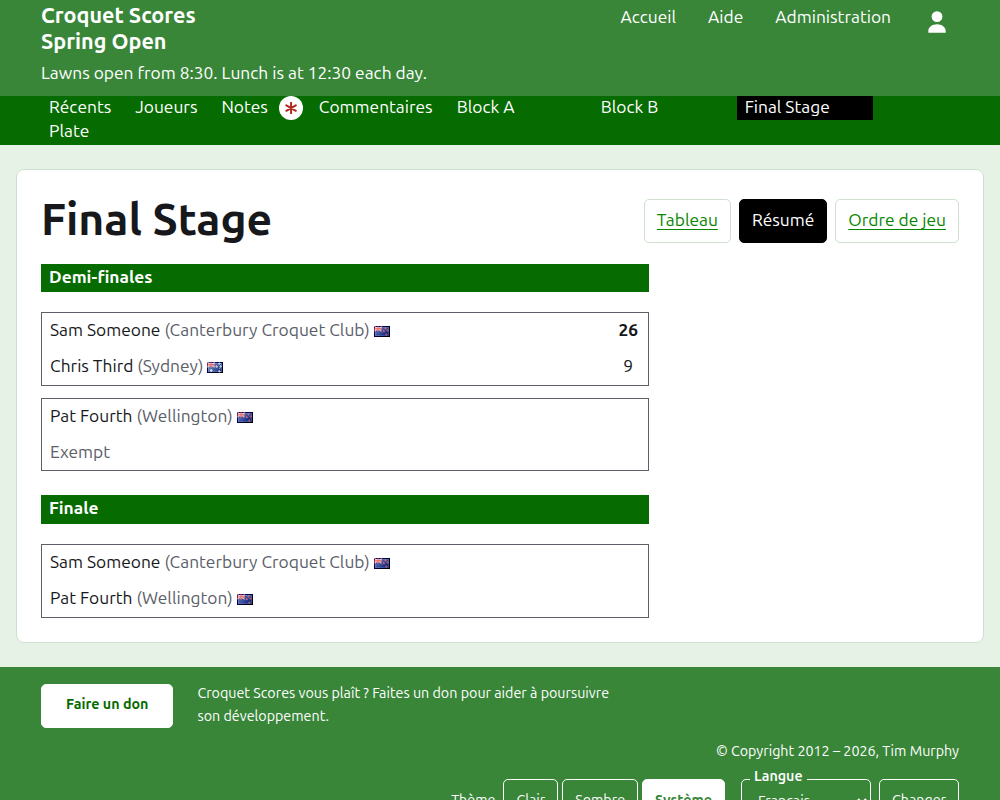
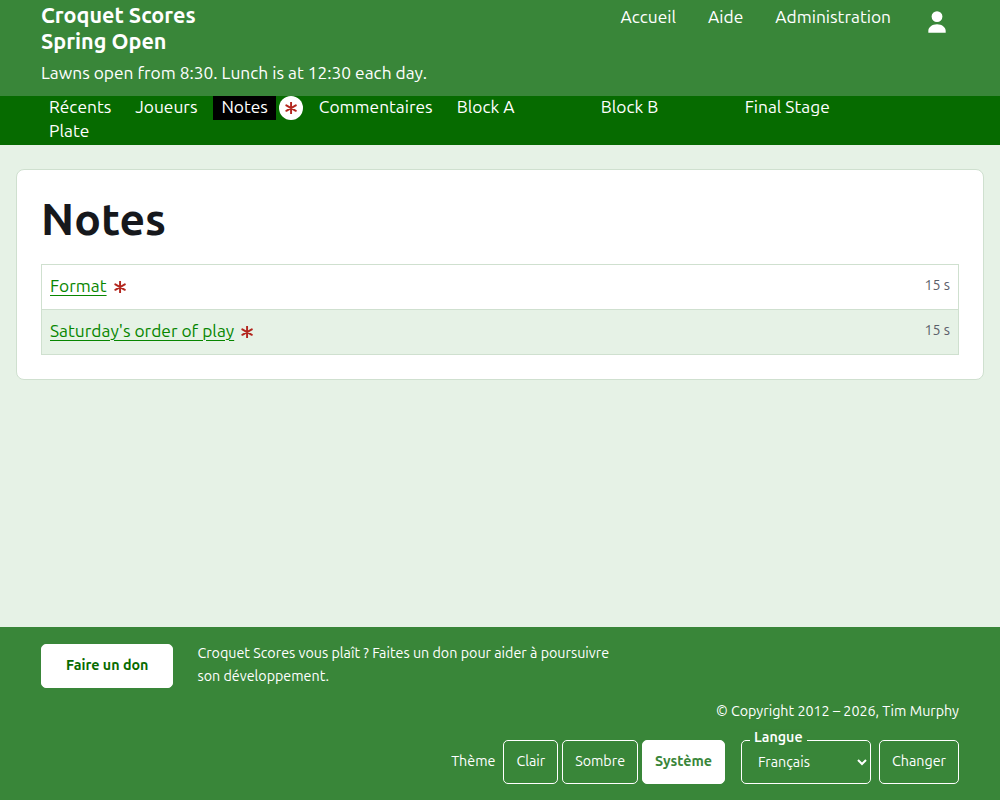

# Ce que voit le public

Rien n’est publié : les pages publiques sont tirées de ce que contient l’administration, de sorte qu’un résultat saisi y est aussitôt. Elles ne demandent ni compte ni JavaScript, et sont mises en page pour un téléphone.

## La page du tournoi

La page du tournoi est à son année, son sport et son nom, comme `/2026/ac/spring-open`. Elle est coiffée du nom du tournoi, avec son sous-titre dessous. Elle liste chaque partie en service, la plus récemment ajoutée en premier, pour qu’un lecteur qui revient voie ce qui s’est passé depuis. Chaque partie dit le vainqueur, ce qu’il représente, son drapeau et ses points, puis le perdant et les siens, avec la compétition où elle s’est jouée et depuis combien de temps elle a été ajoutée.

La barre vert foncé propose les rubriques du tournoi : **Récent**, qui est cette page, **Joueurs**, **Notes** et **Commentaires**, puis chaque compétition en service, dans l’ordre de l’onglet Compétitions. Notes est marquée d’un astérisque rouge tant qu’il y a une note que le lecteur n’a pas lue.

## Une poule

La page d’une poule montre ses résultats en grille : une ligne et une colonne pour chaque joueur dans l’ordre de la poule, avec les parties entre deux joueurs là où la ligne croise la colonne, chacune marquée gagnée, perdue ou nulle pour le joueur de la ligne. Après les colonnes des joueurs viennent les totaux de chaque joueur. Quand chaque rencontre est une seule partie, ce sont les victoires et les arceaux nets ; quand une rencontre se joue au meilleur de plusieurs, ce sont les rencontres, les parties nettes, les parties et les arceaux nets.

Une poule se présente de trois façons, proposées sur la ligne de son nom : **Grille**, **Récapitulatif** et **Ordre de jeu**. Le récapitulatif est celui qui convient à un téléphone : les joueurs classés, avec leurs victoires, leurs défaites et leurs arceaux nets. L’ordre de jeu liste chaque partie, la plus ancienne en premier. Un lecteur qui choisit une vue la garde pour chaque compétition jusqu’à ce qu’il en choisisse une autre.

La ligne d’un joueur forfait le dit. Un résultat retiré est affiché barré et ne compte pour rien. Un résultat archivé n’est pas affiché.

## Une élimination directe

La page d’une élimination directe dessine son tableau tour par tour, une colonne pour chaque tour du premier à la finale, les deux camps de chaque rencontre l’un au-dessus de l’autre et une case pour chaque partie au meilleur desquelles la rencontre se joue. La rencontre d’un tour suivant se tient à côté des deux rencontres dont elle oppose les vainqueurs. Sur un téléphone, le tableau défile en largeur, avec des flèches vers la finale et retour.

## Un système suisse

La page d’un système suisse classe ses joueurs dans une table : leurs parties, leurs victoires, leur pourcentage de victoires, et leurs résultats, chacun dit comme l’adversaire et l’écart, comme « +4 » pour une partie gagnée de quatre.

## Joueurs

La page Joueurs liste chaque joueur du tournoi qui n’est pas archivé, par ordre alphabétique, avec ce qu’il représente et son drapeau.

## Notes

La page Notes liste les notes du tournoi, la plus récemment écrite en premier, chacune menant à sa propre page et disant depuis combien de temps elle a été écrite. Une note que le lecteur n’a pas lue est marquée d’un astérisque rouge jusqu’à ce qu’il l’ouvre.

## Les adresses qui changent

Un tournoi garde son adresse quand son nom est corrigé. Quand il déménage, parce que son année ou son sport a changé, son ancienne adresse mène à la nouvelle, pour qu’un lien gardé d’avant fonctionne encore. Les pages d’un tournoi archivé sont introuvables jusqu’à ce qu’il soit restauré.
