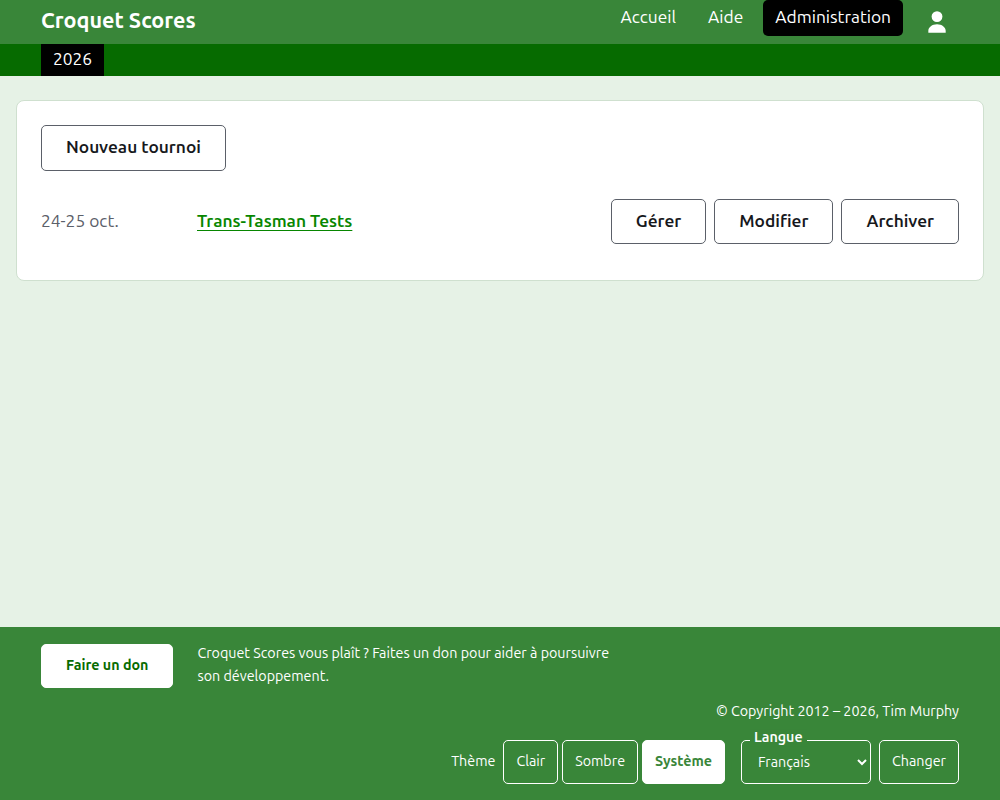
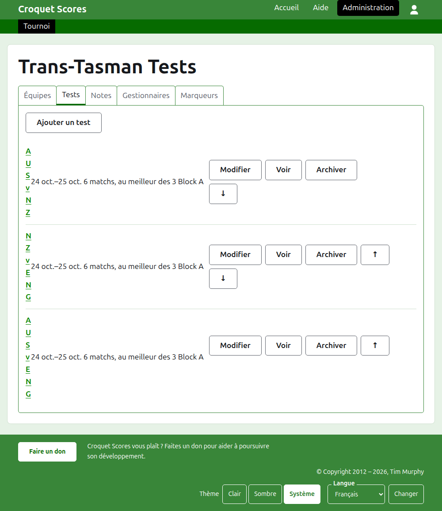

# Organiser un tournoi par équipes

Un tournoi par équipes est un tournoi où des camps s’affrontent, plutôt que des joueurs inscrits un par un : une série de rencontres entre deux pays, un interstate shield, un championnat du monde par équipes. Ses équipes sont constituées avec leurs joueurs, les rencontres entre équipes sont ajoutées, et les parties de chaque rencontre sont publiées à mesure qu’elles se jouent. Ce guide accompagne un organisateur de la connexion jusqu’à un tournoi dont les résultats sont visibles du public.

Il se suffit à lui-même. Rien n’y dépend du guide du tournoi standard, qui est écrit à part.

## Avant de commencer

Il vous faut un compte. Cliquez [ici](/account/register) pour en créer un.

Tout ce que fait un organisateur se fait dans la partie administration du site. Les pages publiques, où joueurs et spectateurs suivent le tournoi, sont tirées de ce que contient l’administration, si bien qu’il n’y a rien à publier : un résultat saisi est aussitôt sur les pages publiques.

## Les mots

Une **équipe** est un camp, comme l’Australie, avec un nom, un nom court comme « AUS », et un drapeau. Une équipe a ses propres **joueurs**, qui jouent pour elle et pour personne d’autre. Une **rencontre** est une confrontation entre deux équipes, désignée par leurs noms courts, comme « AUS v ENG », faite d’un certain nombre de **matchs** entre un joueur de chaque équipe, chaque match se jouant au meilleur d’un certain nombre de **parties**. Les rencontres peuvent être réunies en **groupes**, comme « Block A », quand beaucoup d’équipes jouent entre elles.

## Les pages dans l’ordre

1. [Créer un tournoi](creating-a-tournament.md) : son nom, ses dates, son sport, son format, et le lieu où il se joue.
2. [Équipes](teams.md) : ajouter les équipes, avec leurs noms courts et leurs drapeaux.
3. [Les joueurs d’une équipe](team-players.md) : inscrire les joueurs de chaque équipe sur la page de l’équipe.
4. [Rencontres](tests.md) : ajouter les rencontres entre équipes, leurs dates, le nombre de matchs de chacune, et leurs groupes.
5. [Scores](scores.md) : saisir les parties d’une rencontre, les corriger, et mettre de côté celles saisies par erreur.
6. [Notes](notes.md) : dire aux joueurs ce qu’ils ont besoin de savoir au fil du tournoi.
7. [Organisateurs et marqueurs](managers-and-scorers.md) : partager l’organisation du tournoi, et laisser quelqu’un saisir les résultats sans pouvoir rien changer d’autre.
8. [Classements](rankings.md) : le fichier envoyé au classement mondial, et ce qu’il vous reste à y remplir.
9. [Modifier, archiver et restaurer un tournoi](changing-and-archiving.md) : corriger les détails du tournoi, et mettre un tournoi de côté.
10. [Ce que voit le public](what-the-public-sees.md) : les pages que vos joueurs suivent, et comment ce que vous saisissez y apparaît.

## Comment l’administration est organisée

La page d’entrée de l’administration liste les tournois auxquels vous participez, une année à la fois.

Appuyer sur le nom d’un tournoi, ou sur **Gérer**, ouvre sa page. Tout ce qu’il y a à organiser tient dans six onglets sous son nom : **Équipes**, **Rencontres**, **Notes**, **Organisateurs**, **Marqueurs** et **Classements**. La page s’ouvre sur Équipes, puisque les équipes sont la première chose que l’on constitue.

La barre vert foncé sous l’en-tête sert à passer d’une page à l’autre. Sur la page du tournoi et sur celle d’une rencontre, elle mène au tournoi, sous **Tournoi**, et à chaque rencontre par son nom. Sur la page d’une équipe, elle mène au tournoi et à chaque équipe par son nom court, puisqu’un organisateur sur la page d’une équipe inscrit les joueurs équipe par équipe. La page où vous êtes est marquée en noir.

## Ce qui vaut partout

**Rien n’est supprimé pour de bon, sauf une note.** Les équipes, les joueurs, les rencontres, les résultats et le tournoi lui-même sont archivés plutôt que supprimés : mis de côté, barrés, et listés sous un titre à part, avec **Restaurer** pour les ramener. Archiver, restaurer et monter ou descendre ne demandent jamais confirmation, parce que chacun s’annule en appuyant dans l’autre sens. Ce qui ne peut pas être annulé, comme supprimer une note ou retirer un organisateur, demande d’abord.

**Une boîte de dialogue ouverte sur la page n’enregistre rien tant que vous n’appuyez pas sur son bouton.** Annuler, ou la touche Échap, la ferme et laisse tout comme c’était. Les boîtes de dialogue qui ajoutent des choses, comme Ajouter une équipe et Ajouter un résultat, restent ouvertes après chaque ajout, pour qu’une liste puisse être saisie d’une traite.

**Ce qui est refusé est dit à côté du champ concerné.** Rien de ce qui est refusé n’est enregistré, et ce que vous avez saisi reste saisi, pour pouvoir être corrigé plutôt que retapé.

**L’administration fonctionne sur un téléphone.** Chaque bouton est assez grand pour être pressé du pouce, et rien n’est plus large que l’écran.

Suite : [Créer un tournoi](creating-a-tournament.md).
