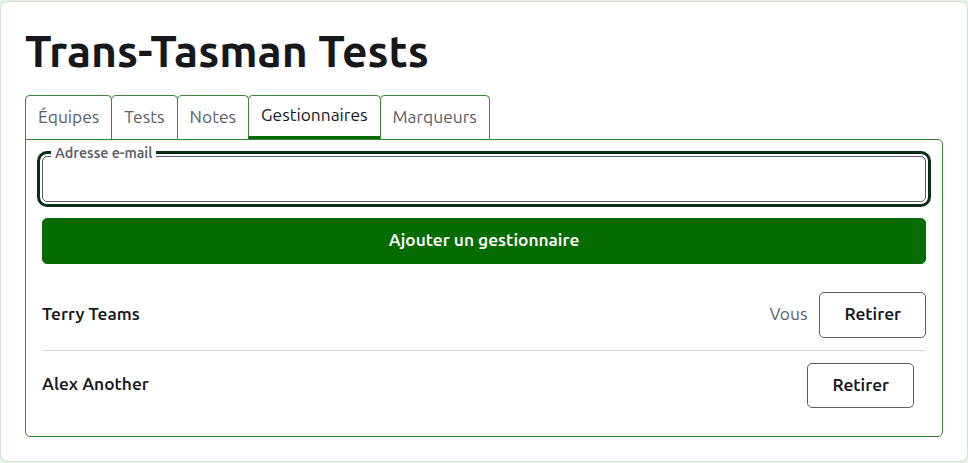
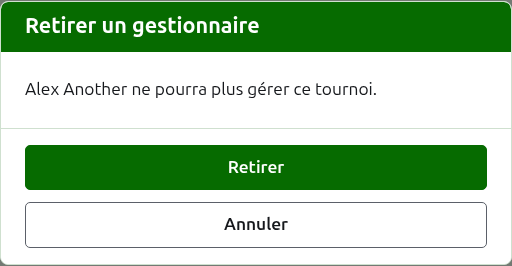
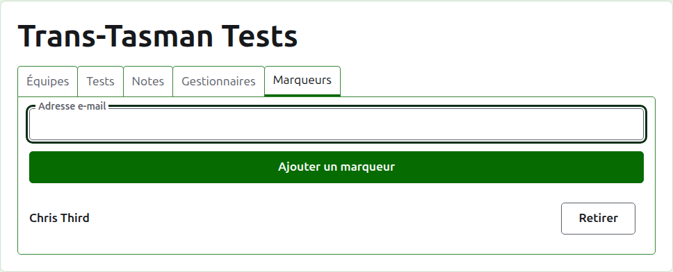
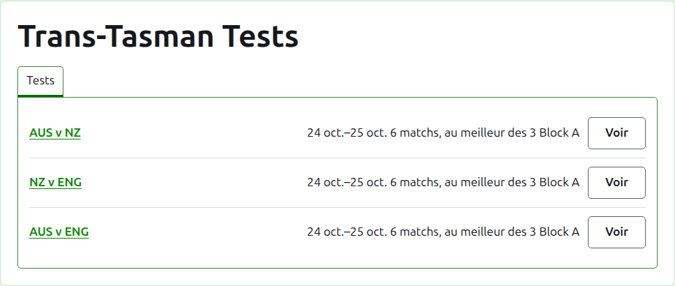

# Organisateurs et marqueurs

Un tournoi a des organisateurs, qui peuvent faire tout ce qui peut lui être fait, et peut avoir des marqueurs, qui saisissent ses résultats et rien d’autre. La personne qui a créé le tournoi est son premier organisateur.

## Organisateurs

L’onglet **Organisateurs** liste ceux qui organisent le tournoi, dans l’ordre où ils ont été nommés, votre propre nom marqué comme le vôtre. C’est là qu’un tournoi se partage, ou se transmet.

Quelqu’un devient organisateur par son adresse e-mail. Tapez-la dans le champ au-dessus de la liste et appuyez sur **Ajouter un organisateur**. L’adresse doit appartenir à un compte inscrit et confirmé ; une adresse qui n’en a pas est refusée sous le champ, et le site n’en dit pas plus. Un marqueur nommé organisateur cesse d’être marqueur.

**Retirer** enlève un organisateur. Rien d’un organisateur retiré n’est gardé ; Retirer demande donc d’abord. On le renomme organisateur par son adresse si l’on veut le faire revenir. Un tournoi a toujours un organisateur ; le dernier n’a donc pas de Retirer.

Vous pouvez vous retirer vous-même. La question dit alors ce que cela signifie : vous perdez votre propre accès au tournoi, et personne sur la page ne peut l’annuler pour vous. Un autre organisateur peut vous redonner ce rôle.

## Marqueurs

L’onglet **Marqueurs** est l’onglet Organisateurs des marqueurs, et fonctionne de la même façon : une adresse e-mail et **Ajouter un marqueur** au-dessus de la liste, et **Retirer** sur chacun.

Un marqueur voit le tournoi dans sa propre liste dans l’administration, avec **Scores** à la place de Gérer, et on ne lui propose que ses rencontres : ni équipes, ni notes, ni organisateurs, ni marqueurs, ni classements. Il ne peut pas ouvrir la page d’une équipe, puisque qui joue pour une équipe, c’est aux organisateurs d’en décider. Sur la page d’une rencontre, il peut saisir, corriger, archiver, restaurer et réordonner les résultats comme un organisateur.

Un organisateur ne devient pas marqueur, puisqu’un organisateur peut déjà faire tout ce qu’un marqueur peut faire. Un tournoi n’a pas besoin de marqueur ; chaque marqueur peut donc être retiré, le dernier y compris.

Suite : [Classements](rankings.md).
