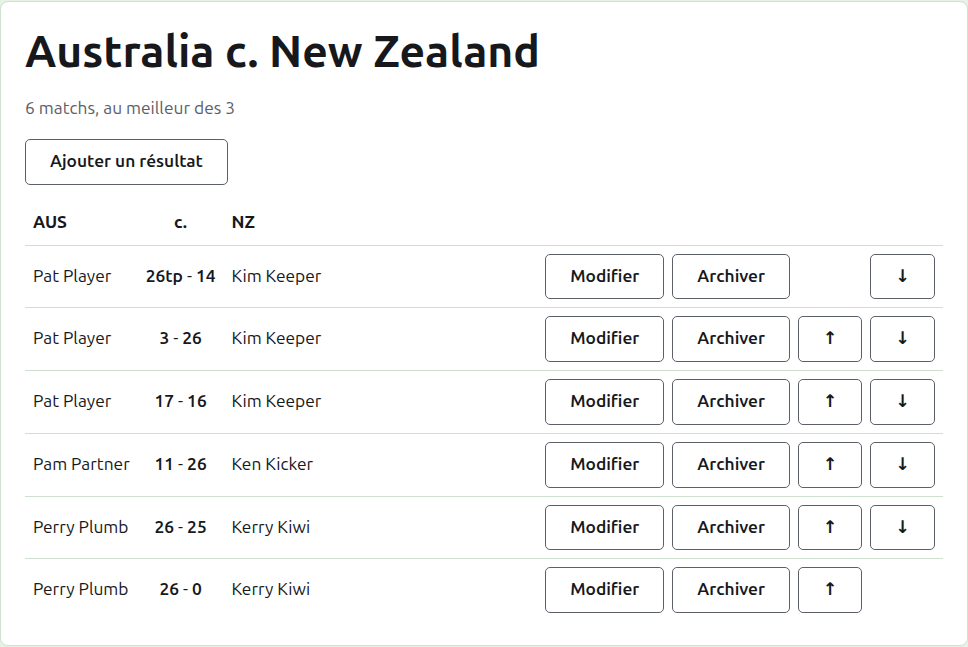
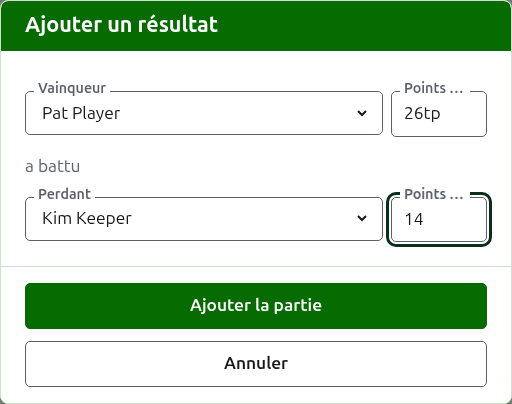

# Scores

La page d’une rencontre s’ouvre depuis son nom sur l’onglet Rencontres, ou depuis la barre vert foncé. Elle est coiffée des noms complets de ses équipes, comme « Australia v New Zealand », avec dessous le nombre de matchs qu’elle doit avoir et au meilleur de combien de parties se joue chacun. Ses résultats sont la page, sans onglets. Un organisateur et un marqueur voient la même page, puisqu’un marqueur peut faire à un résultat tout ce qu’un organisateur peut faire.

## Comment les résultats sont présentés

Les résultats sont présentés par équipe plutôt que par vainqueur, dans une table coiffée du nom court de la première équipe, de « v », et de celui de la seconde. Chaque résultat est une ligne : le joueur de la première équipe, puis les deux scores, celui de la première équipe en premier, comme « 26tp - 14 », puis le joueur de la seconde équipe, quel que soit celui des deux qui a gagné. Les résultats archivés sont présentés de la même façon dessous.

## Saisir un résultat

Appuyez sur **Ajouter un score**, au-dessus de la liste. La boîte de dialogue se lit comme on annonce un résultat à voix haute : le vainqueur et ses points, puis « a battu », puis le perdant et ses points.

Le vainqueur se choisit parmi les joueurs en service des deux équipes, sous le nom de chaque équipe, les joueurs de la première équipe en premier et ceux de chaque équipe dans l’ordre de l’équipe. Personne n’est choisi au départ. Une fois le vainqueur choisi, le perdant n’est proposé que dans l’autre équipe, puisqu’une partie entre deux joueurs de la même équipe n’est pas une partie entre les équipes. Un joueur archivé n’est pas proposé.

Les points se tapent tels que le marqueur les a notés : le nombre de points, et ce qui suit, qui est gardé et affiché tel que tapé, comme « 26tp » pour 26 arceaux et un triple peel. Le nombre est formé des chiffres par lesquels commence le résultat ; un résultat qui ne commence pas par un chiffre est refusé.

Une partie gagnée à points égaux, comme lorsqu’elle est arrêtée au temps et départagée autrement, dit qui l’a gagnée par une marque après les points du vainqueur : « 6w » a battu « 6 ». Les marques sont « w », « won » et « winner ». Les points du vainqueur doivent dépasser ceux du perdant, ou porter une marque, sauf si le tournoi autorise les matchs nuls, auquel cas des points égaux sans marque sont gardés comme un match nul.

Appuyez sur **Ajouter la partie**. La partie est ajoutée, la boîte de dialogue dit laquelle, et les champs se vident pour la suivante, puisque les résultats arrivent par séries, lus sur un tableau à la fin d’une session. Appuyez sur **Annuler** une fois qu’ils sont tous saisis.

## Matchs

Deux joueurs qui se rencontrent jouent un match au nombre de parties de la rencontre. Les parties entre eux sont les parties de ce match, et une partie entre deux joueurs dont le match est déjà décidé est refusée : l’un d’eux a gagné plus de parties que l’autre ne pourrait encore en gagner, ou toutes les parties du match ont été jouées.

Un match commence quand ses deux joueurs ont une partie en service. Une rencontre ne commence pas plus de matchs qu’elle ne doit en avoir : une fois qu’autant ont commencé, une partie entre deux joueurs qui ne se sont pas rencontrés est refusée, tandis qu’une autre partie d’un match déjà commencé est acceptée. Si la rencontre doit avoir plus de matchs, modifiez-la sur l’onglet Rencontres pour les prévoir.

## Corriger un résultat

**Modifier** ouvre la même boîte de dialogue sur ce résultat, intitulée Modifier le résultat, avec ses joueurs choisis et ses points tels qu’ils ont été tapés. Ses joueurs peuvent être changés aussi bien que ses points, choisis comme à l’ajout. Appuyez sur **Enregistrer** pour garder la correction et fermer la boîte de dialogue. Une correction garde l’issue : une partie gagnée reste gagnée, et une partie nulle reste nulle. Une partie dont l’issue était fausse s’archive et se saisit de nouveau.

## Mettre les résultats en ordre

Les résultats arrivent dans l’ordre où on les saisit ; chaque résultat en service offre donc **Monter** et **Descendre**, qui l’échangent avec le résultat voisin, pour que la liste puisse être mise dans l’ordre où les parties se sont jouées.

## Archiver un résultat

**Archiver** met un résultat de côté pour qu’il ne compte plus pour rien. Il est listé sous **Scores archivés**, barré, et n’offre plus que **Restaurer**. Aucun des deux ne demande d’abord, puisque chacun annule l’autre. Chaque résultat d’une rencontre peut être archivé, puisqu’une rencontre n’a pas de tours qui dépendent l’un de l’autre.

Un résultat dont le joueur a été archivé depuis n’est pas restauré tant que le joueur ne l’est pas, et la page le dit.

Suite : [Notes](notes.md).
