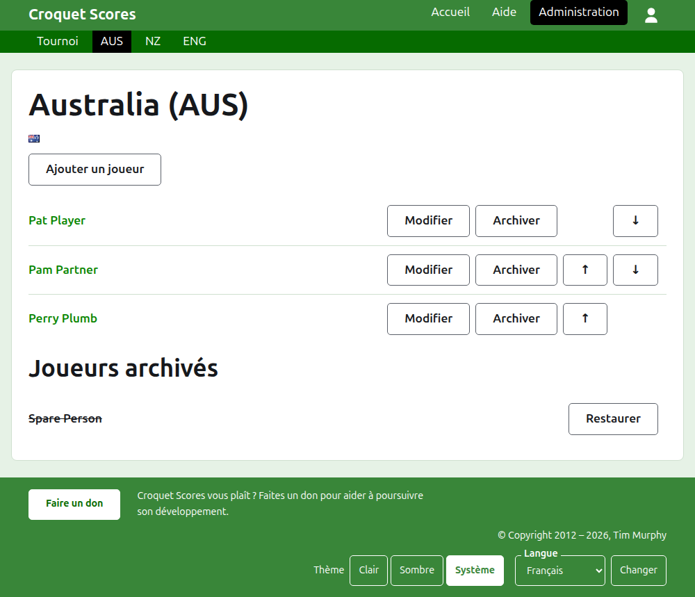
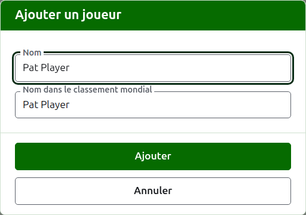

# Les joueurs d’une équipe

La page d’une équipe s’ouvre depuis son nom, ou son **Voir**, sur l’onglet Équipes. Elle est coiffée du nom de l’équipe avec son nom court entre parenthèses, et de son drapeau, pour qu’un organisateur arrivé sur la mauvaise équipe s’en aperçoive aussitôt. Elle n’a qu’une chose à montrer, les joueurs de l’équipe ; la liste est donc la page.

La barre vert foncé sur la page d’une équipe mène au tournoi et à chaque équipe en service par son nom court, pour que les joueurs s’inscrivent équipe par équipe sans repasser par l’onglet Équipes.

Un joueur d’une équipe appartient à cette seule équipe, la représente, et arbore le drapeau de l’équipe plutôt qu’un drapeau à lui. La même personne qui joue pour deux équipes, ou dans deux tournois, est un joueur dans chacun.

## Ajouter un joueur

Appuyez sur **Ajouter un joueur**, au-dessus de la liste. Une boîte de dialogue s’ouvre sur la page.

**Nom** est obligatoire, entre 3 et 254 caractères. Deux joueurs d’une même équipe ne peuvent pas porter le même nom, quelles qu’en soient les majuscules ; un joueur d’une autre équipe peut le partager.

**Nom du joueur dans le classement mondial** est le nom sous lequel le classement mondial connaît le joueur. Il n’est demandé que dans un tournoi de croquet association ou de croquet golf, les deux sports dont le classement mondial tient une liste de joueurs. Le classement connaît les joueurs de croquet américain à 6 arceaux par leur propre nom ; il n’est donc pas demandé là, et le nom dans le classement mondial de chaque joueur y est toujours son nom. Pendant que vous ajoutez un joueur, il suit le nom à mesure que vous le tapez, et cesse de le suivre dès que vous y tapez quelque chose. Laissé vide, il est enregistré comme le nom du joueur. À mesure que vous tapez, les joueurs connus du classement mondial dont le nom commence ainsi vous sont proposés, et à côté du nom dans le classement mondial une coche dit que le classement connaît ce nom, et un point d’interrogation qu’il ne le connaît pas. Ce n’est qu’une indication : un nom inconnu du classement est enregistré aussi volontiers qu’un nom connu.

Un joueur ne s’appelle jamais « Bye » (le mot anglais pour exempt) : un nom dont le premier mot est « bye » est refusé.

Appuyez sur **Ajouter**. Le joueur est ajouté, la boîte de dialogue le dit, et ses champs se vident pour le suivant, le curseur revenu dans le nom. Ajoutez toute l’équipe ainsi, puis appuyez sur **Annuler** pour fermer la boîte de dialogue.

## Corriger un joueur

Appuyez sur le nom d’un joueur, ou sur son **Modifier**, pour ouvrir la même boîte de dialogue sur ce joueur, intitulée Modifier le joueur. Appuyez sur **Enregistrer** pour garder la modification. Un joueur dont le nom est corrigé garde le nom dans le classement mondial qu’il avait, sauf dans le croquet américain à 6 arceaux, où le nom d’un joueur dans le classement mondial est toujours son nom.

## Ordre

Les joueurs sont listés dans l’ordre de l’équipe, qui est l’ordre dans lequel ils sont proposés quand le résultat d’une rencontre est saisi. **Monter** et **Descendre** déplacent un joueur d’une place au sein de l’équipe.

## Archiver un joueur

**Archiver** met un joueur de côté : inscrit par erreur, ou qui n’est plus dans l’équipe. Un joueur archivé est listé sous **Joueurs archivés**, barré, après les joueurs en service, et n’offre plus que **Restaurer**. Archiver ne demande jamais d’abord, puisqu’un joueur d’une équipe n’est inscrit nulle part ailleurs et que le restaurer remet tout en place.

Un joueur qui a joué une partie en service dans une rencontre ne peut pas être archivé, puisque ses parties seraient alors contre quelqu’un qui n’est plus là ; un tel joueur n’a donc pas d’Archiver. Un joueur dont toutes les parties sont archivées peut l’être.

Suite : [Rencontres](tests.md).
