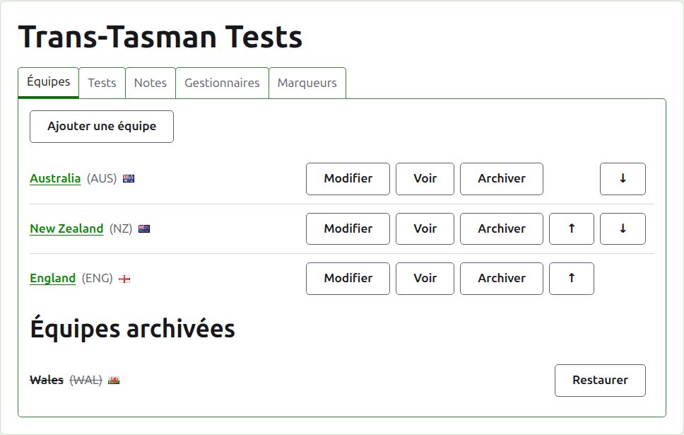
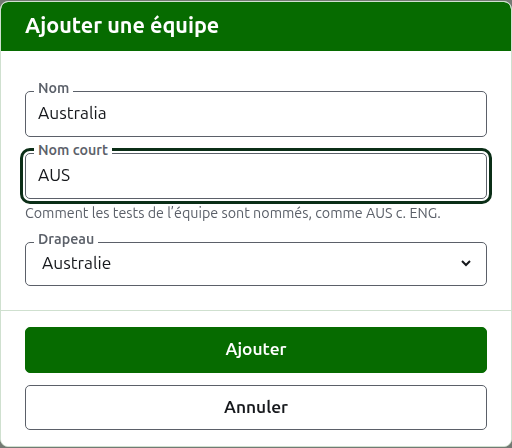
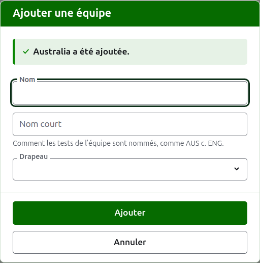
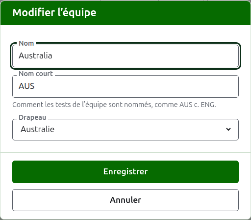

# Équipes

L’onglet **Équipes** de la page d’un tournoi est l’endroit où ses équipes sont ajoutées, corrigées, mises en ordre et mises de côté. C’est l’onglet sur lequel la page s’ouvre, puisque les équipes sont la première chose que l’on constitue. Un test oppose deux équipes ; il en faut donc au moins deux avant de pouvoir ajouter un test.

## Ajouter une équipe

Appuyez sur **Ajouter une équipe**, au-dessus de la liste. Une boîte de dialogue s’ouvre sur la page.

**Nom** est obligatoire : le nom complet de l’équipe, comme « Australia », qui coiffe la page de l’équipe et les tables des pages publiques. Deux équipes d’un même tournoi ne peuvent pas porter le même nom.

**Nom court** est obligatoire aussi : ce par quoi les tests de l’équipe sont désignés, comme « AUS v ENG », et ce que la barre vert foncé appelle l’équipe. Il compte au plus 10 caractères, et pas plus que le nom, puisqu’un nom court plus long que le nom qu’il abrège, c’est les deux tapés à l’envers. Deux équipes ne peuvent pas non plus avoir le même nom court.

**Drapeau** s’affiche à côté du nom de l’équipe partout où il apparaît. Il peut rester à aucun, comme pour une équipe de club ou de région.

Appuyez sur **Ajouter**. L’équipe est ajoutée, la boîte de dialogue le dit, et ses champs se vident pour la suivante. Ajoutez toute la liste ainsi, puis appuyez sur **Annuler** pour fermer la boîte de dialogue. Annuler ne garde rien qui n’ait déjà été ajouté.

## Corriger une équipe

Appuyez sur le **Modifier** d’une équipe pour ouvrir la même boîte de dialogue sur cette équipe, intitulée Modifier l’équipe. Changez ce qui est faux et appuyez sur **Enregistrer**. Une équipe dont le nom court change est désignée par le nouveau partout ; ses tests sont donc renommés avec elle.

## Ordre

Les équipes sont listées dans l’ordre du tournoi, qui est l’ordre dans lequel elles sont proposées quand un test est ajouté, l’ordre dans lequel la barre vert foncé les présente, et l’ordre dans lequel la page publique Joueurs les liste. **Monter** et **Descendre**, les flèches au bout de chaque ligne, déplacent une équipe d’une place.

## Aller à une équipe

Le nom d’une équipe, ou **Voir**, ouvre la page de l’équipe, où ses joueurs sont inscrits. Voir [Les joueurs d’une équipe](team-players.md).

## Archiver une équipe

**Archiver** met une équipe de côté. Ses joueurs restent avec elle et reviennent quand elle est restaurée ; archiver ne demande donc pas d’abord. Une équipe archivée est listée sous **Équipes archivées**, barrée, n’offre plus que **Restaurer**, et sa page est fermée jusqu’à ce qu’elle soit restaurée.

Une équipe qui joue dans un test en service ne peut pas être archivée, puisque le test serait alors contre une équipe qui n’est plus là ; une telle équipe n’a donc pas d’Archiver. Une équipe dont tous les tests sont archivés peut l’être.

Suite : [Les joueurs d’une équipe](team-players.md).
