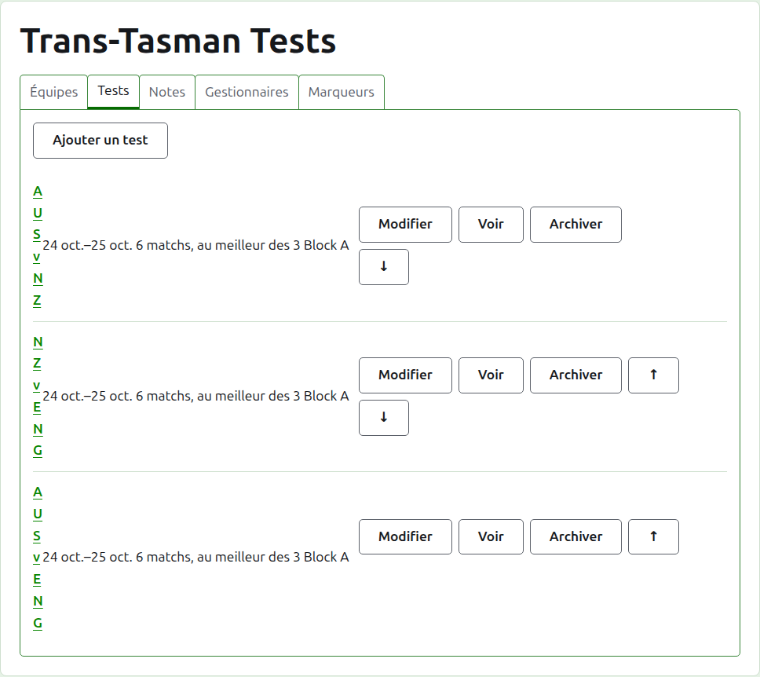
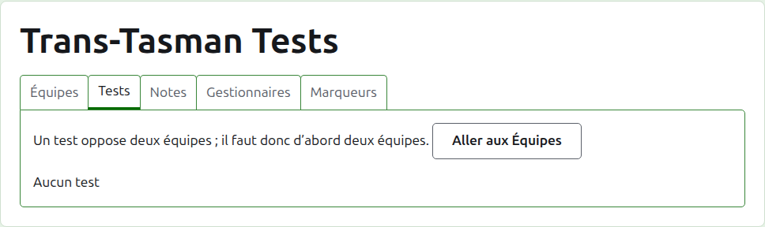
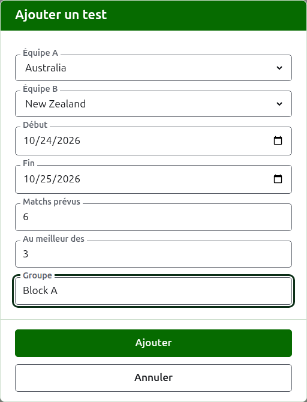
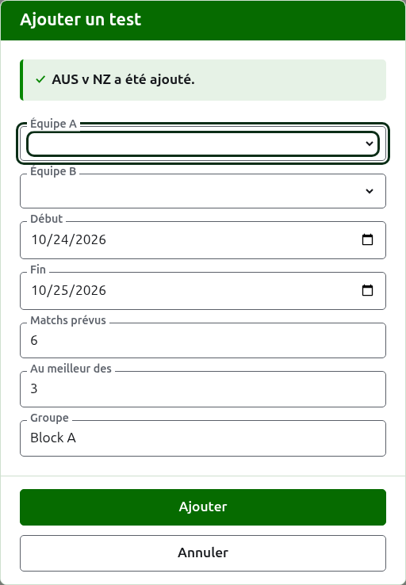
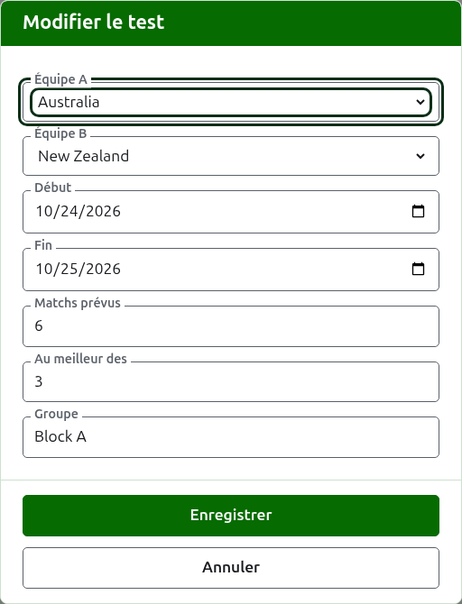

# Rencontres

L’onglet **Rencontres** de la page d’un tournoi est l’endroit où les rencontres entre ses équipes sont ajoutées, modifiées, mises en ordre et mises de côté. Une rencontre est l’une des compétitions du tournoi : une confrontation entre deux équipes, désignée par leurs noms courts, comme « AUS v NZ », jouée sous forme d’un certain nombre de matchs entre un joueur de chaque équipe. Chaque rencontre a sa propre page, où ses résultats sont saisis.

Chaque rencontre dit son nom, les jours où elle se joue, le nombre de matchs qu’elle doit avoir et au meilleur de combien de parties se joue chacun, comme « 6 matchs, au meilleur des 3 », et son groupe quand il en a un.

## Deux équipes d’abord

Une rencontre oppose deux équipes en service ; tant que le tournoi en a moins de deux, l’onglet le dit là où serait Ajouter une rencontre, et mène à l’onglet Équipes.

## Ajouter une rencontre {#adding-a-test}

Appuyez sur **Ajouter une rencontre**, au-dessus de la liste. Une boîte de dialogue s’ouvre sur la page, dans l’ordre où l’on annonce une rencontre à voix haute.

**Équipe A** et **Équipe B** se choisissent chacune parmi les équipes en service du tournoi, par leur nom, dans l’ordre du tournoi. Aucune n’est choisie au départ, pour qu’une rencontre ne soit jamais ajoutée entre des équipes que vous n’avez pas choisies. Équipe B propose chaque équipe sauf celle choisie comme Équipe A, puisqu’une équipe ne joue pas de rencontre contre elle-même. Équipe A est la première équipe : ses joueurs sont à gauche sur la page de la rencontre et sur la page publique. Une rencontre n’a pas de nom à taper ; elle est désignée par les noms courts de ses équipes.

**Début** et **Fin** sont les jours où la rencontre se joue, qui commencent au premier jour du tournoi. Une rencontre se joue au sein de son tournoi ; des jours avant le début du tournoi ou après sa fin sont donc refusés.

**Matchs prévus** est le nombre de matchs que la rencontre doit avoir, fixé par l’épreuve avant qu’elle ne commence, pour que celui qui lit ses résultats voie où il en est. C’est un nombre entier à partir de 1. C’est aussi une limite : une fois qu’autant de matchs ont commencé que la rencontre doit en avoir, une partie qui en commencerait un autre est refusée, tandis que les matchs déjà commencés se jouent jusqu’au bout. Une rencontre qui doit en avoir plus se modifie pour les prévoir.

**Meilleur des** est le nombre de parties au meilleur desquelles se joue chaque match. Il peut être pair, puisqu’un match peut être partagé.

**Joué avec handicaps**, **Autorise les matchs nuls** et **Compte pour les classements mondiaux** se demandent comme pour toute compétition. La dernière n’est demandée que là où cela peut compter : une rencontre de croquet association ou de croquet golf qui n’est ni jouée avec handicaps ni ouverte aux matchs nuls. La case est cochée au départ.

**Groupe** est le groupe où se trouve la rencontre, quand l’épreuve se joue en groupes, comme « Block A ». Il est facultatif : laissé vide, la rencontre n’est dans aucun groupe. Les rencontres d’un groupe ont leur propre page sur le site public, montrant où en sont les équipes du groupe.

Appuyez sur **Ajouter**. La rencontre est ajoutée, la boîte de dialogue dit laquelle par son nom, et les équipes se vident pour la suivante, les jours, les matchs prévus, le nombre de parties et le groupe restant tels quels : les rencontres s’ajoutent par tour, entre des équipes qui se rencontrent le même jour, de sorte que la rencontre suivante du tour n’est que ses deux équipes. Appuyez sur **Annuler** une fois qu’elles sont toutes saisies.

## Modifier une rencontre {#changing-a-test}

**Modifier** ouvre la même boîte de dialogue sur la rencontre, intitulée Modifier la rencontre, remplie telle que la rencontre est. Appuyez sur **Enregistrer** pour garder la modification.

Une rencontre qui a des parties en service garde ses équipes : la boîte de dialogue les montre, mais elles ne peuvent pas être changées. Le reste peut l’être, dans les limites de ce qui a été joué : des matchs prévus moins nombreux que les matchs déjà commencés sont refusés, de même qu’un nombre de parties inférieur au plus grand nombre de parties que deux joueurs ont déjà jouées.

## Ordre

Les rencontres sont listées dans l’ordre du tournoi, qui est l’ordre dans lequel elles apparaissent sur les pages publiques et dans la barre vert foncé. **Monter** et **Descendre** déplacent une rencontre d’une place.

## Aller à une rencontre

Le nom d’une rencontre, ou **Voir**, ouvre sa page, où ses résultats sont saisis. La barre vert foncé y mène aussi, depuis la page du tournoi ou celle de n’importe quelle autre rencontre.

## Archiver une rencontre

**Archiver** met une rencontre de côté, et **Restaurer** l’annule ; aucun des deux ne demande donc d’abord. Une rencontre archivée est listée sous **Rencontres archivées**, barrée, n’offre plus que Restaurer, et n’est pas sur les pages publiques.

Une rencontre qui a des parties en service a été jouée, et ne peut pas être archivée tant que ses parties ne le sont pas. Une rencontre dont toutes les parties sont archivées peut l’être, puisqu’une partie archivée ne compte pour rien. Une rencontre dont l’équipe a été archivée depuis n’est pas restaurée tant que l’équipe ne l’est pas, et l’onglet le dit.

Suite : [Scores](scores.md).
