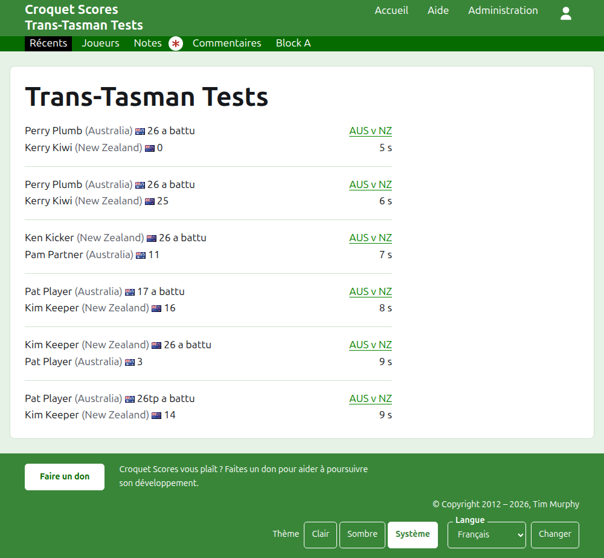
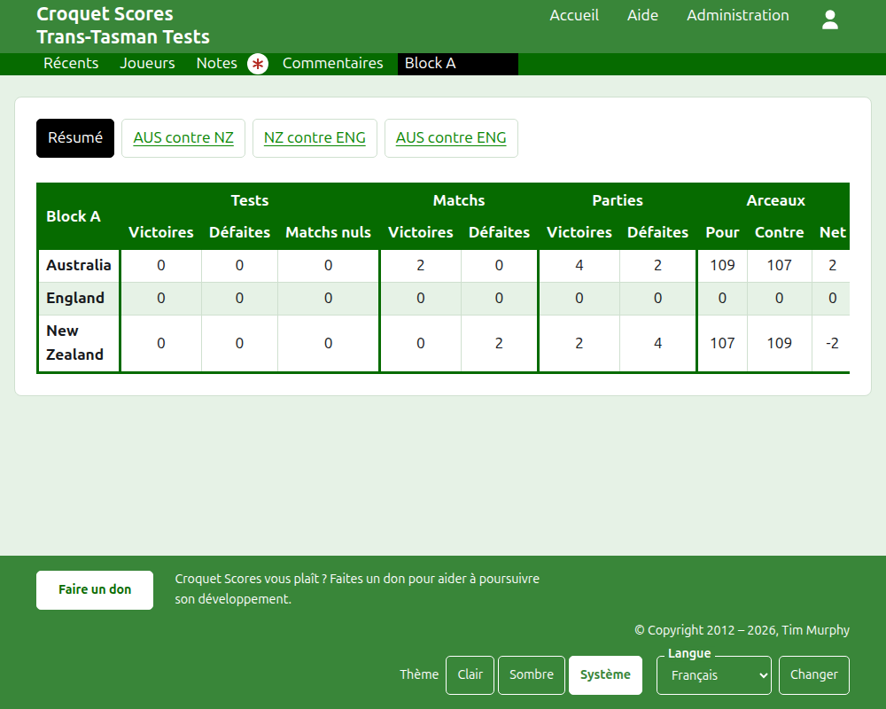
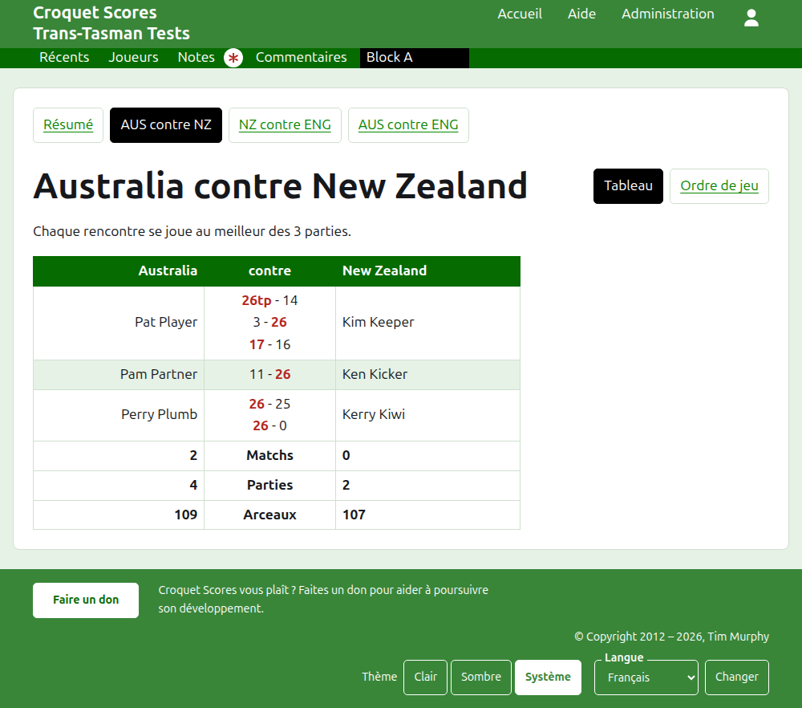
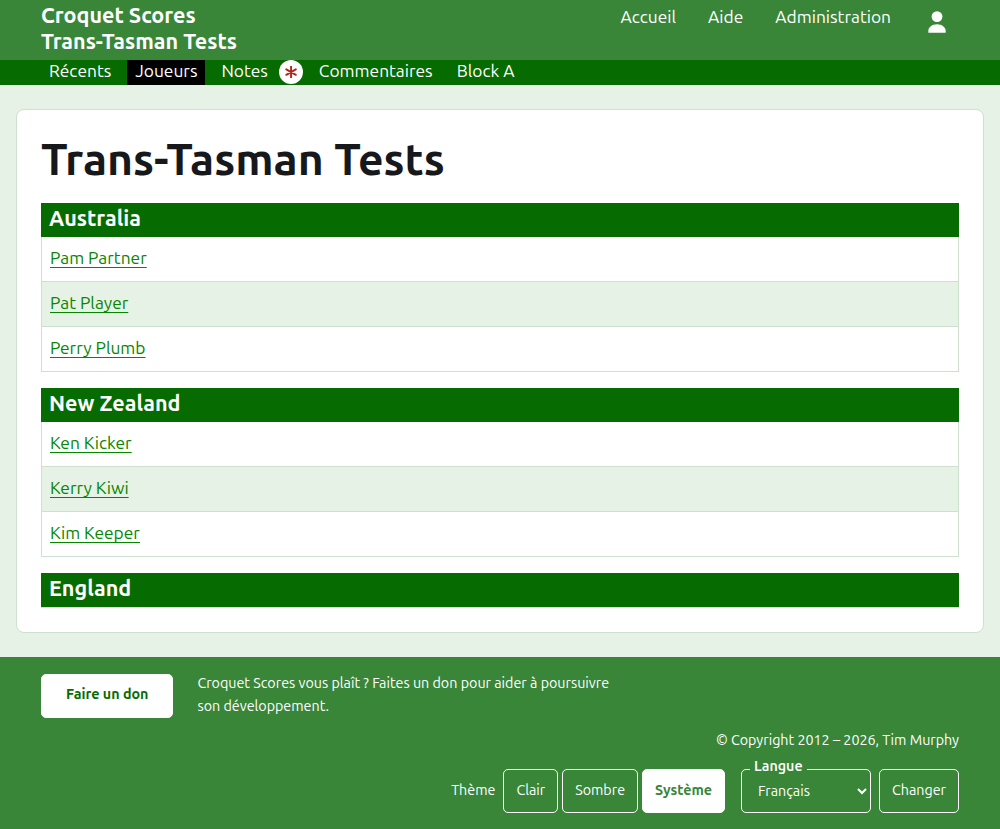

# Ce que voit le public

Rien n’est publié : les pages publiques sont tirées de ce que contient l’administration, de sorte qu’un résultat saisi y est aussitôt. Elles ne demandent ni compte ni JavaScript, et sont mises en page pour un téléphone.

## La page du tournoi

La page du tournoi est à son année, son sport et son nom, comme `/2026/ac/trans-tasman-tests`. Elle est coiffée du nom du tournoi, avec son sous-titre dessous. Elle liste chaque partie en service, la plus récemment ajoutée en premier, pour qu’un lecteur qui revient voie ce qui s’est passé depuis. Chaque partie dit le vainqueur, son équipe et ses points, puis le perdant et les siens, avec la rencontre où elle s’est jouée et depuis combien de temps elle a été ajoutée.

La barre vert foncé propose les rubriques du tournoi : **Récent**, qui est cette page, **Récapitulatif**, **Joueurs**, **Notes** et **Commentaires**, puis les rencontres. Une rencontre est désignée par les noms courts de ses équipes avec « contre » entre eux, comme « AUS contre NZ ». Les rencontres d’un groupe ne sont pas proposées une par une : le groupe est une seule rubrique, nommée comme le groupe, à la place où serait sa première rencontre. Notes est marquée d’un astérisque rouge tant qu’il y a une note que le lecteur n’a pas lue.

## Le récapitulatif

Un tournoi dont les rencontres ne sont dans aucun groupe a un **Récapitulatif** : une seule table de toutes les équipes, classées, avec les rencontres gagnées, perdues et nulles, les parties gagnées et perdues, et les arceaux pour, contre et nets. Quand les matchs d’une rencontre se jouent au meilleur de plusieurs parties, les matchs gagnés et perdus viennent après les rencontres. Le résumé est là où un lecteur cherche chaque équipe dans son ensemble.

Un tournoi qui a une rencontre dans un groupe n’a pas de Récapitulatif. La page de chaque groupe montre à la place où en sont les équipes de ce groupe, puisqu’une seule table d’équipes de groupes différents qui ne se sont jamais rencontrées ne classerait rien.

## Un groupe

La page d’un groupe montre où en sont les équipes du groupe, en comptant les seules rencontres du groupe, dans la table qu’utilise le récapitulatif. Au-dessus de la table, sur une rangée à part, elle propose **Récapitulatif**, qui est cette page, et chacune des rencontres du groupe, menant à la page de la rencontre.

## Une rencontre

La page d’une rencontre est coiffée des noms complets de ses équipes, comme « Australia contre New Zealand », et dit au meilleur de combien de parties se joue chaque match. Sa table est coiffée des deux équipes, la première à gauche. Chaque match joué est une ligne, dans l’ordre où il a commencé, avec le joueur de la première équipe à gauche, celui de la seconde à droite, et les parties du match entre eux, chacune avec les points du premier camp puis ceux du second, ceux du vainqueur marqués. Sous les matchs se trouvent les parties et les arceaux de chaque équipe, et, quand chaque match se joue au meilleur de plusieurs parties, ses matchs gagnés, chacun de son côté.

Une rencontre se présente de deux façons, proposées sur la ligne de son nom : **Grille**, qui est cette table, et **Ordre de jeu**, qui liste chaque partie de la rencontre, la plus ancienne en premier. Une rencontre d’un groupe propose le Récapitulatif et les rencontres de son groupe sur une rangée au-dessus de son titre, cette rencontre étant marquée.

## Joueurs

La page Joueurs liste les joueurs équipe par équipe : chaque équipe sous un titre à son nom, dans l’ordre des équipes du tournoi, et ses joueurs dessous par ordre alphabétique.

## Notes

La page Notes liste les notes du tournoi, la plus récemment écrite en premier, chacune menant à sa propre page et disant depuis combien de temps elle a été écrite. Une note que le lecteur n’a pas lue est marquée d’un astérisque rouge jusqu’à ce qu’il l’ouvre.

## Les adresses qui changent

Un tournoi garde son adresse quand son nom est corrigé. Quand il déménage, parce que son année ou son sport a changé, son ancienne adresse mène à la nouvelle, pour qu’un lien gardé d’avant fonctionne encore. Les pages d’un tournoi archivé sont introuvables jusqu’à ce qu’il soit restauré.
