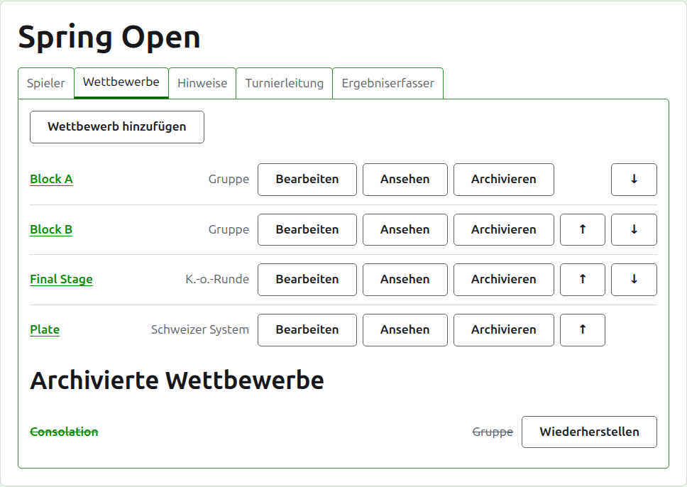
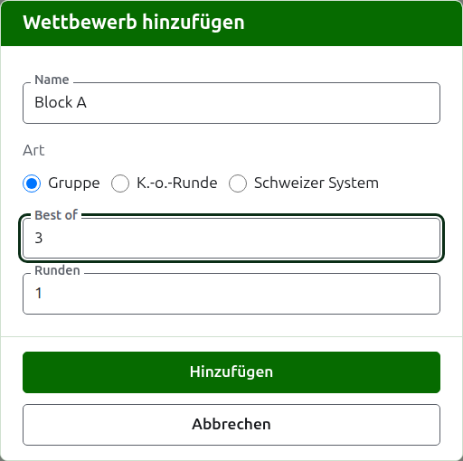
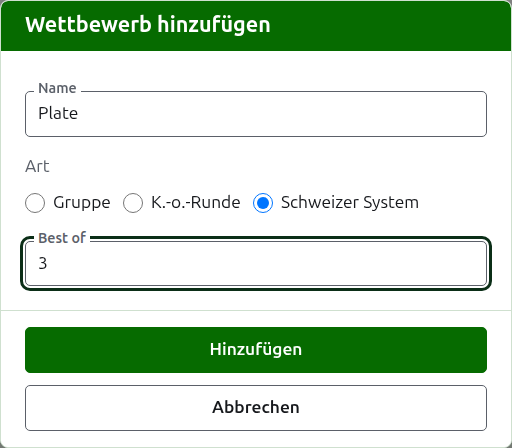
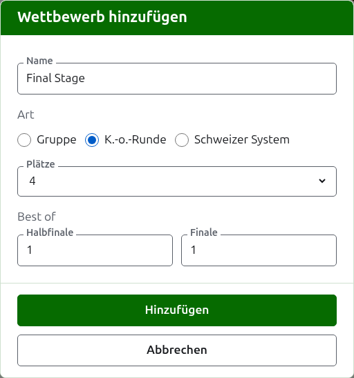

# Wettbewerbe

Auf dem Reiter **Wettbewerbe** der Turnierseite werden die Wettbewerbe des Turniers hinzugefügt, geordnet und beiseitegelegt. Ein Wettbewerb ist eine Gruppe, eine K.-o.-Runde oder ein Schweizer System. Jeder hat eine eigene Seite, auf der seine Spieler aufgenommen und seine Ergebnisse eingegeben werden.

## Einen Wettbewerb hinzufügen {#adding-a-competition}

Drücken Sie **Wettbewerb hinzufügen** über der Liste. Ein Dialog öffnet sich über der Seite und fragt nach dem Namen des Wettbewerbs, seiner Art und der Gestalt, die seine Art hat.

**Name** ist das, wonach die Spieler auf der Turnierseite suchen, um ihre Spiele zu finden. Er ist zwischen 1 und 254 Zeichen lang, und ein einzelner Buchstabe genügt, weil eine Gruppe oft nur so heißt. Zwei Wettbewerbe eines Turniers können nicht denselben Namen haben.

**Art** ist Gruppe, K.-o.-Runde oder Schweizer System. Der Dialog beginnt auf Gruppe, was die meisten Wettbewerbe sind.

### Eine Gruppe

Eine Gruppe fragt, über wie viele Spiele jede Begegnung höchstens geht, das **Best of**, und in wie vielen **Runden** sie gespielt wird.

**Best of** beginnt auf 1. Ein Best of 3 gewinnt, wer zwei Spiele gewinnt. Die Zahl darf gerade sein, weil in einer Gruppe ein Spieler nach den Spielen gereiht wird, die er gewinnt, und eine Begegnung über zwei Spiele, die sich beide eines teilen, ein Ergebnis wie jedes andere ist.

**Runden** ist, wie oft jedes Spielerpaar der Gruppe aufeinandertrifft, mit einer Begegnung in jeder Runde. Es beginnt auf 1, und 1 ist fast immer das, was eine Gruppe will: Jeder Spieler spielt einmal gegen jeden anderen. Erhöhen Sie es nur für eine Gruppe, in der man wieder aufeinandertrifft, etwa eine doppelte Jeder-gegen-jeden-Runde, in der 2 jedes Paar zwei Begegnungen spielen lässt.

### Ein Schweizer System

Ein Schweizer System fragt nur, über wie viele Spiele jede Begegnung höchstens geht, das **Best of**, das wie bei einer Gruppe auf 1 beginnt. Ein Best of 3 gewinnt, wer zwei Spiele gewinnt. Die Zahl darf gerade sein, weil in einem Schweizer System ein Spieler nach den Spielen gereiht wird, die er gewinnt, und eine Begegnung über zwei Spiele, die sich beide eines teilen, ein Ergebnis wie jedes andere ist.

### Eine K.-o.-Runde

Eine K.-o.-Runde fragt, wie viele **Plätze** ihre Auslosung hat und über wie viele Spiele jede Runde höchstens geht. Die Plätze werden als 2, 4, 8, 16, 32, 64 und 128 angeboten, weil sich keine andere Zahl Runde um Runde bis zu einem Finale halbieren ließe, und der Dialog beginnt auf 8. Plätze, die nach dem Aufnehmen der Spieler übrig bleiben, werden mit Freilosen gefüllt, die dort hinzugefügt werden, wo die Spieler sind.

Eine Auslosung hat so viele Runden, wie es braucht, um ihre Plätze auf einen zu halbieren; eine Auslosung mit 8 Plätzen hat also drei Runden. Der Dialog fragt für jede, über wie viele Spiele sie höchstens geht, zusammen unter **Best of je Runde**, in der Reihenfolge, in der sie gespielt werden. Die letzten drei heißen so, wie man von den Runden einer Auslosung spricht, **Viertelfinale**, **Halbfinale** und **Finale**, und alle davor nach ihrer Nummer, Runde 1 zuerst. Mehr Plätze zu wählen fügt Runden am Anfang der Auslosung hinzu, und weniger zu wählen nimmt sie am Anfang weg, sodass das, was für das Finale eingegeben wurde, weiterhin das des Finales ist. Jede Runde geht über eine ungerade Zahl von Spielen, weil eine Begegnung in einer K.-o.-Runde einen Sieger braucht.

### Wie gespielt und gezählt wird

Jede Art fragt unter ihrer Gestalt dasselbe dreifach.

**Mit Vorgaben gespielt.** Haken Sie das für einen Wettbewerb an, der mit Vorgaben gespielt wird.

**Lässt Unentschieden zu.** Haken Sie das an, wenn ein Spiel enden kann, ohne dass einer der Spieler gewinnt. Die meisten Wettbewerbe erlauben das nicht. Ist es angehakt, wird ein Ergebnis mit gleichen Punkten und ohne Markierung als Unentschieden gespeichert; ist es nicht angehakt, muss ein Spiel mit gleichen Punkten durch eine Markierung hinter den Punkten des Siegers sagen, wer gewonnen hat, etwa „6w“. Das Match einer K.-o.-Runde hat immer einen Sieger, ein unentschiedenes Spiel entscheidet es also nicht.

**Zählt für die Weltranglisten.** Wird nur gefragt, wo es zählen kann: bei einem Wettbewerb im Association Croquet oder Golf Croquet, der weder mit Vorgaben gespielt wird noch Unentschieden zulässt. Es ist zu Beginn angehakt, nehmen Sie den Haken also weg bei einem Wettbewerb, der nicht zählen soll.

### Mehrere auf einmal hinzufügen

Drücken Sie **Hinzufügen**. Der Wettbewerb wird hinzugefügt, der Dialog sagt es, und der Name wird für den nächsten geleert, während die Art und ihre Gestalt bleiben, wie sie waren: Zusammen hinzugefügte Wettbewerbe gleichen sich meist, „Block B“ nach „Block A“ ist also nur sein Name. Drücken Sie **Abbrechen**, um den Dialog zu schließen, wenn alle drin sind.

## Einen Wettbewerb ändern {#changing-a-competition}

**Bearbeiten** öffnet denselben Dialog für den Wettbewerb, mit dem Titel Wettbewerb bearbeiten, mit seinem Namen, seiner Gestalt und der Art, wie er gespielt und gezählt wird, wie sie sind. Nach seiner Art wird nicht gefragt, weil aus einer Gruppe durch Ändern keine K.-o.-Runde wird: Ein Wettbewerb der falschen Art wird archiviert und neu hinzugefügt. Drücken Sie **Speichern**, um die Änderung zu speichern und den Dialog zu schließen.

Eine K.-o.-Runde mit einem Spiel hat Spieler, die in ihrer Auslosung platziert sind, und eine Änderung ihrer Plätze würde sie verschieben; sie wird deshalb abgelehnt, sobald ein Spiel eingegeben ist. Die Best of ihrer Runden lassen sich weiterhin ändern.

## Reihenfolge

Die Wettbewerbe sind in der Reihenfolge des Turniers aufgeführt; das ist die Reihenfolge, in der sie auf den öffentlichen Seiten und in der dunkelgrünen Leiste erscheinen. **Nach oben** und **Nach unten** verschieben einen Wettbewerb um einen Platz.

## Zu einem Wettbewerb gehen

Der Name eines Wettbewerbs oder **Ansehen** öffnet seine Seite, auf der seine Spieler aufgenommen und seine Ergebnisse eingegeben werden. Die dunkelgrüne Leiste unter der Kopfzeile führt von jeder Seite des Turniers ebenfalls dorthin.

## Einen Wettbewerb archivieren

**Archivieren** legt einen Wettbewerb beiseite, ob er Spiele hat oder nicht; sie bleiben bei ihm und kommen zurück, wenn er wiederhergestellt wird. Ein archivierter Wettbewerb steht unter **Archivierte Wettbewerbe**, durchgestrichen, bietet nur **Wiederherstellen** an und ist nicht auf den öffentlichen Seiten. Archivieren fragt nicht zuerst, weil das Wiederherstellen es rückgängig macht.

Weiter: [Spieler in einen Wettbewerb aufnehmen](entering-players-in-a-competition.md).
