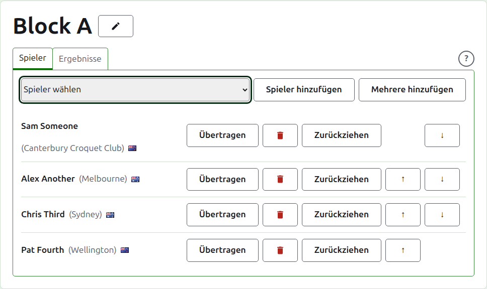
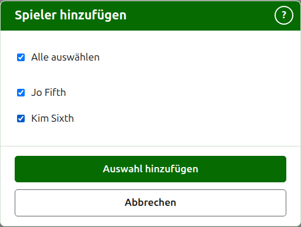
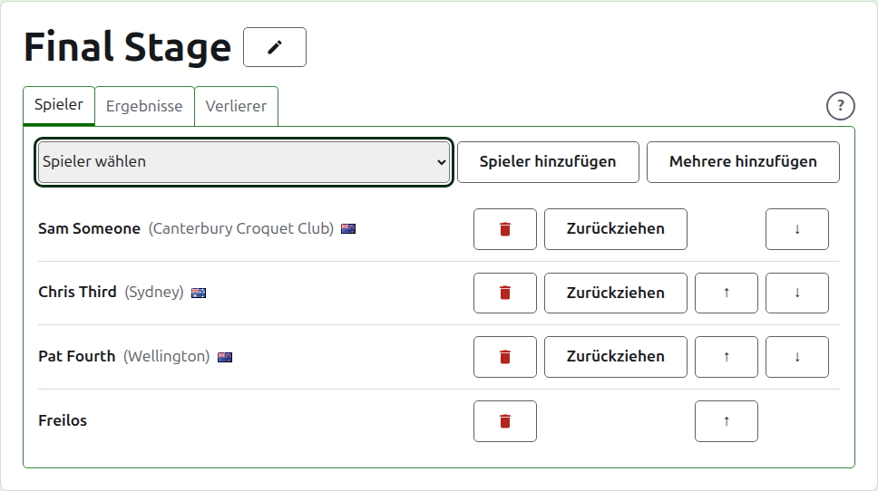
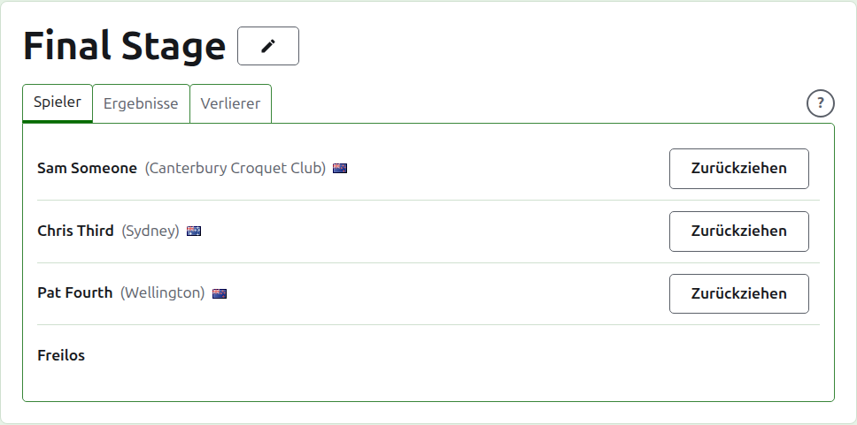
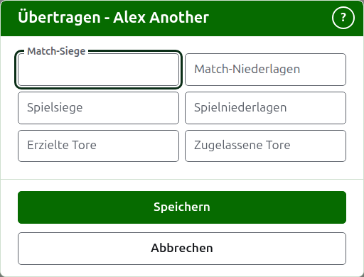
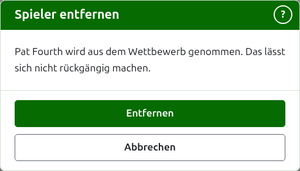
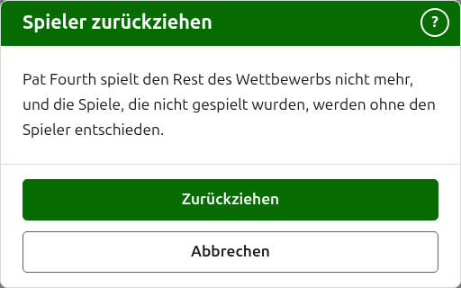
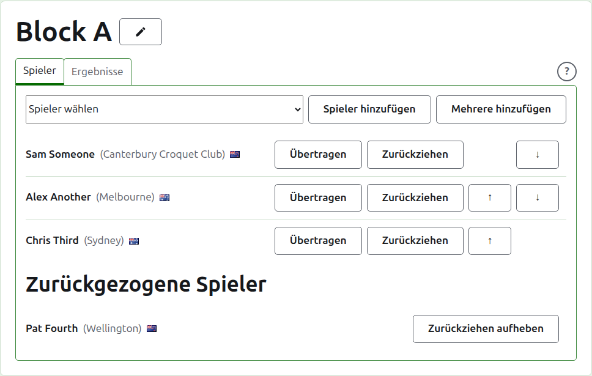

# Spieler in einen Wettbewerb aufnehmen

Die Seite eines Wettbewerbs wird über seinen Namen auf dem Reiter Wettbewerbe oder über die dunkelgrüne Leiste geöffnet. Ihre Überschrift ist der Name des Wettbewerbs, mit zwei Reitern darunter: **Spieler** und **Ergebnisse**. Ein K.-o.-Turnier hat einen dritten, **Verlierer**, der unter [Ein K.-o.-Turnier der Verlierer](competitions.md#losers-knockout) beschrieben ist. Sie öffnet sich auf Spieler, weil die Spieler aufgenommen werden, bevor etwas gespielt wird.

Ein Spieler in einem Wettbewerb ist einer der Spieler des Turniers, er wird also durch Auswählen aufgenommen und nicht durch Eintippen. Alles an ihm außer seinem Platz im Wettbewerb und dem, was er in ihn überträgt, wird auf dem Reiter Spieler des Turniers geändert.

## Einen Spieler hinzufügen

Über der Liste bietet eine Auswahlliste jeden Spieler des Turniers an, der noch nicht im Wettbewerb ist, in der Reihenfolge des Turniers. Wählen Sie einen und drücken Sie **Spieler hinzufügen**. Der Spieler wird in der Reihenfolge des Turniers unter die schon aufgenommenen gesetzt, die Auswahlliste bietet ihn nicht mehr an, und der Cursor geht in die Auswahlliste zurück, damit der nächste mit der Tastatur gewählt werden kann. Sind alle Spieler des Turniers im Wettbewerb, wird die Auswahlliste nicht gezeigt, und der Reiter sagt das.

Archivierte Spieler des Turniers werden nicht angeboten.

## Mehrere Spieler hinzufügen {#adding-several}

Um einen Wettbewerb schnell einzurichten, drücken Sie **Mehrere hinzufügen** neben **Spieler hinzufügen**. Die Schaltfläche wird angeboten, wenn zwei oder mehr Spieler zur Auswahl stehen. Sie öffnet einen Dialog, der jeden Spieler des Turniers auflistet, der noch nicht im Wettbewerb ist, in der Reihenfolge des Turniers, jeden mit einem Kästchen zum Ankreuzen. Das Kästchen über der Liste kreuzt alle an.

Kreuzen Sie die gewünschten Spieler an und drücken Sie **Auswahl hinzufügen**. Alle werden auf einmal aufgenommen und in die Reihenfolge des Turniers gesetzt, gleich in welcher Reihenfolge Sie sie angekreuzt haben. Mit **Abbrechen** schließen Sie den Dialog, ohne jemanden hinzuzufügen. Wer **Auswahl hinzufügen** drückt, ohne dass jemand angekreuzt ist, bewirkt nichts.

Manchmal kann ein angekreuzter Spieler nicht aufgenommen werden: Jemand anderes kann ihn in den Wettbewerb gesetzt haben, während der Dialog offen war, oder ein K.-o.-Turnier hat weniger freie Plätze, als Spieler angekreuzt sind. Dann wird niemand aufgenommen. Ein zweiter Dialog listet die Spieler auf, die nicht hinzugefügt werden können, jeden mit dem Grund, und fragt, ob die übrigen angekreuzten hinzugefügt werden sollen. Mit **Übrige hinzufügen** nehmen Sie die auf, die aufgenommen werden können, mit **Abbrechen** gehen Sie zu den Häkchen zurück, die so sind, wie Sie sie gelassen haben, und ändern sie. Kann keiner der angekreuzten Spieler aufgenommen werden, gibt es nichts zu entscheiden, und die Gründe werden über der Liste gezeigt.

Die Freilose eines K.-o.-Turniers gehören nicht dazu. Sie werden einzeln aus der Auswahlliste hinzugefügt, wie unter [Freilose in einem K.-o.-Turnier](#byes-in-a-knockout) beschrieben.

## Freilose in einem K.-o.-Turnier {#byes-in-a-knockout}

Ein K.-o.-Turnier wird erst gespielt, wenn jeder Platz seiner Auslosung gefüllt ist, und die Plätze, die seine Spieler übrig lassen, werden mit Freilosen gefüllt. In einem K.-o.-Turnier bietet die Auswahlliste deshalb zuerst **Freilos** an, vor den Spielern, und bietet es weiter an, so viele Freilose auch hinzugefügt werden, weil eine Auslosung mehrere brauchen kann.

Ein Freilos wird in der Auslosung platziert wie ein Spieler: Es lässt sich nach oben und unten verschieben und entfernen, aber nicht zurückziehen, weil es nichts spielt. Ein Spieler, der in ein K.-o.-Turnier aufgenommen wird, dessen Plätze alle gefüllt sind, wird abgelehnt, und der Reiter sagt das unter der Auswahlliste.

Die Reihenfolge der Spieler eines K.-o.-Turniers ist seine Auslosung. Die ersten beiden Plätze treffen sich in der ersten Begegnung, die nächsten beiden in der nächsten und so weiter. Bringen Sie die Spieler in die Reihenfolge, in der die Auslosung gespielt werden soll, bevor ein Ergebnis eingegeben wird, denn sobald das K.-o.-Turnier ein Spiel in Gebrauch hat, stehen seine Spieler fest: Niemand kann hinzugefügt, entfernt oder verschoben werden. Ein Spieler kann weiterhin zurückgezogen werden.

## Die Spieler eines K.-o.-Turniers der Verlierer

Die Spieler eines K.-o.-Turniers der Verlierer werden nicht von Hand aufgenommen. Sie werden eingetragen, sobald die Spiele entschieden sind, deren Verlierer es übernimmt, daher führt sein Reiter **Spieler** sie nur auf und sagt, warum.

## Reihenfolge

Die Spieler sind in der Reihenfolge des Wettbewerbs aufgeführt; das ist die Reihenfolge, in der ein K.-o.-Turnier ausgelost wird und ein Block auf seiner öffentlichen Seite aufgeführt ist. **Nach oben** und **Nach unten** verschieben einen Spieler um einen Platz.

## Übertrag {#carry-forward}

**Übertragen** sagt, was ein Spieler aus Spielen, die der Wettbewerb nicht erfasst hat, in ihn mitbringt: die Ergebnisse einer früheren Stufe oder von Spielen, die gespielt wurden, bevor der Wettbewerb hier erfasst wurde. Er wird in einem Block und einem Schweizer System angeboten, die eine Tabelle haben, in der er zählen kann, und nicht in einem K.-o.-Turnier.

Der Dialog fragt nach sechs Zahlen: gewonnene und verlorene Begegnungen, gewonnene und verlorene Spiele, erzielte und gegnerische Tore. Jede Zahl ist freiwillig. Eine leer gelassene Zahl überträgt nichts, was nicht dasselbe ist wie 0 zu übertragen, damit, wer sie später ändert, sie so sieht, wie sie gelassen wurde. Drücken Sie **Speichern**, um alle sechs zu speichern.

## Einen Spieler entfernen {#removing-a-player}

**Entfernen** nimmt einen versehentlich aufgenommenen Spieler heraus. Er bleibt einer der Spieler des Turniers und wird in der Auswahlliste wieder angeboten, aber von seinem Platz im Wettbewerb wird nichts behalten, deshalb fragt Entfernen zuerst.

Ein Spieler, der im Wettbewerb irgendein Spiel in Gebrauch hat, kann nicht entfernt werden, weil die Spiele dann gegen jemanden wären, den es nicht mehr gibt; ihm wird Entfernen nicht angeboten. Ein Spieler, dessen Spiele alle archiviert sind, kann entfernt werden, und seine archivierten Ergebnisse gehen mit ihm.

## Einen Spieler zurückziehen {#withdrawing-a-player}

**Zurückziehen** ist für einen Spieler, der im Wettbewerb nicht weiterspielt. Er bleibt darin, mit den Spielen, die er gespielt hat, und steht unter **Zurückgezogene Spieler** hinter denen, die noch spielen. In einem K.-o.-Turnier kommt sein Gegner in einer noch nicht entschiedenen Begegnung weiter.

Zurückziehen fragt zuerst, weil es den Ausgang des Wettbewerbs verändert: Die Spiele, die der Spieler nicht gespielt hat, werden ohne ihn entschieden.

Ein zurückgezogener Spieler bietet nur **Zurückziehen aufheben** an, was ihn ohne Nachfrage wieder unter die Spielenden setzt, hinter die, die geblieben sind.

Weiter: [Ergebnisse](scores.md).
