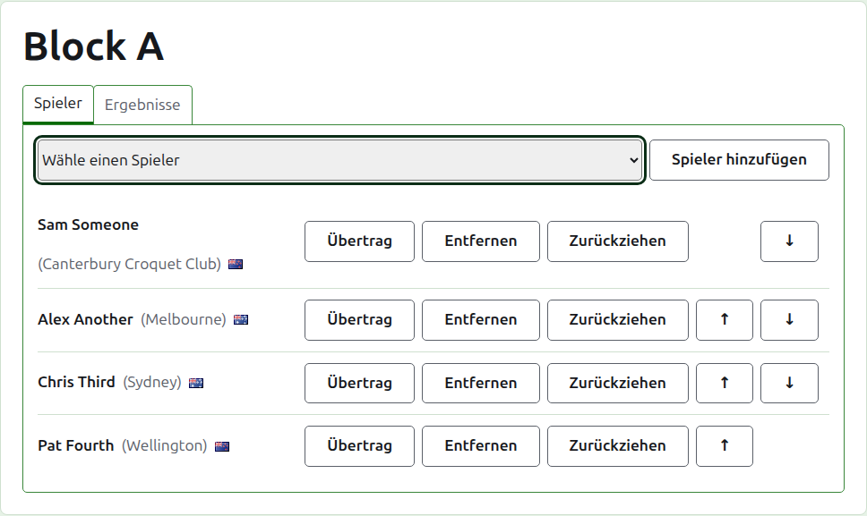
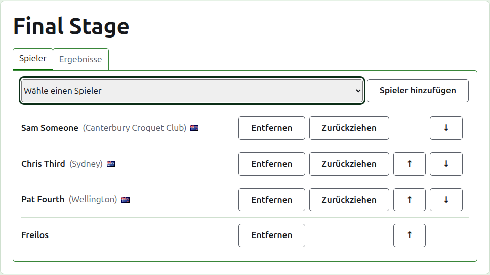
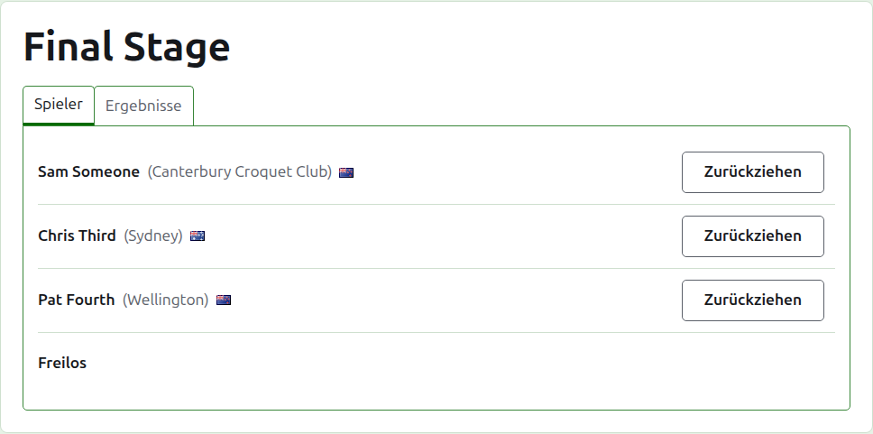
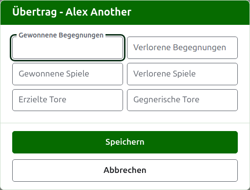
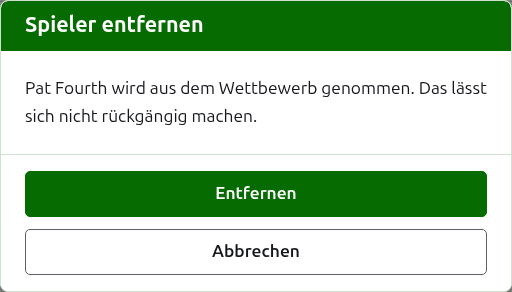
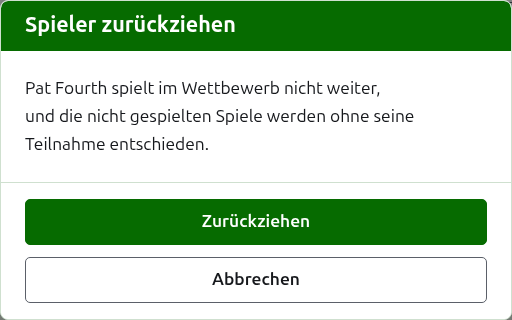
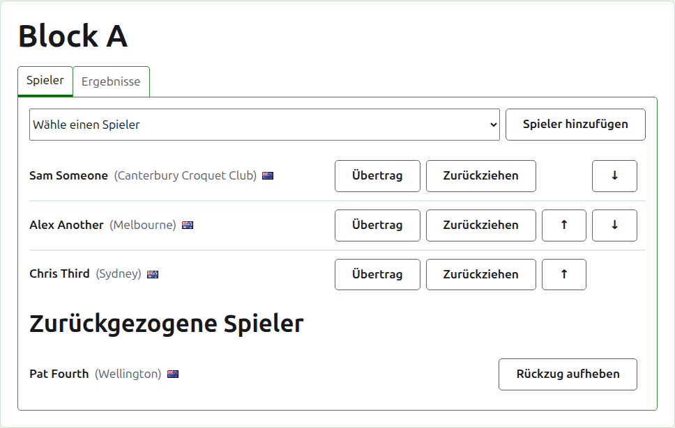

# Spieler in einen Wettbewerb aufnehmen

Die Seite eines Wettbewerbs wird über seinen Namen auf dem Reiter Wettbewerbe oder über die dunkelgrüne Leiste geöffnet. Ihre Überschrift ist der Name des Wettbewerbs, mit zwei Reitern darunter: **Spieler** und **Ergebnisse**. Sie öffnet sich auf Spieler, weil die Spieler aufgenommen werden, bevor etwas gespielt wird.

Ein Spieler in einem Wettbewerb ist einer der Spieler des Turniers, er wird also durch Auswählen aufgenommen und nicht durch Eintippen. Alles an ihm außer seinem Platz im Wettbewerb und dem, was er in ihn überträgt, wird auf dem Reiter Spieler des Turniers geändert.

## Einen Spieler hinzufügen

Über der Liste bietet eine Auswahlliste jeden Spieler des Turniers an, der noch nicht im Wettbewerb ist, in der Reihenfolge des Turniers. Wählen Sie einen und drücken Sie **Spieler hinzufügen**. Der Spieler wird in der Reihenfolge des Turniers unter die schon aufgenommenen gesetzt, die Auswahlliste bietet ihn nicht mehr an, und der Cursor geht in die Auswahlliste zurück, damit der nächste mit der Tastatur gewählt werden kann. Sind alle Spieler des Turniers im Wettbewerb, wird die Auswahlliste nicht gezeigt, und der Reiter sagt das.

Archivierte Spieler des Turniers werden nicht angeboten.

## Freilose in einer K.-o.-Runde

Eine K.-o.-Runde wird erst gespielt, wenn jeder Platz ihrer Auslosung gefüllt ist, und die Plätze, die ihre Spieler übrig lassen, werden mit Freilosen gefüllt. In einer K.-o.-Runde bietet die Auswahlliste deshalb zuerst **Freilos** an, vor den Spielern, und bietet es weiter an, so viele Freilose auch hinzugefügt werden, weil eine Auslosung mehrere brauchen kann.

Ein Freilos wird in der Auslosung platziert wie ein Spieler: Es lässt sich nach oben und unten verschieben und entfernen, aber nicht zurückziehen, weil es nichts spielt. Ein Spieler, der in eine K.-o.-Runde aufgenommen wird, deren Plätze alle gefüllt sind, wird abgelehnt, und der Reiter sagt das unter der Auswahlliste.

Die Reihenfolge der Spieler einer K.-o.-Runde ist ihre Auslosung. Die ersten beiden Plätze treffen sich in der ersten Begegnung, die nächsten beiden in der nächsten und so weiter. Bringen Sie die Spieler in die Reihenfolge, in der die Auslosung gespielt werden soll, bevor ein Ergebnis eingegeben wird, denn sobald die K.-o.-Runde ein Spiel in Gebrauch hat, stehen ihre Spieler fest: Niemand kann hinzugefügt, entfernt oder verschoben werden. Ein Spieler kann weiterhin zurückgezogen werden.

## Reihenfolge

Die Spieler sind in der Reihenfolge des Wettbewerbs aufgeführt; das ist die Reihenfolge, in der eine K.-o.-Runde ausgelost wird und eine Gruppe auf ihrer öffentlichen Seite aufgeführt ist. **Nach oben** und **Nach unten** verschieben einen Spieler um einen Platz.

## Übertrag

**Übertragen** sagt, was ein Spieler aus Spielen, die der Wettbewerb nicht erfasst hat, in ihn mitbringt: die Ergebnisse einer früheren Stufe oder von Spielen, die gespielt wurden, bevor der Wettbewerb hier erfasst wurde. Er wird in einer Gruppe und einem Schweizer System angeboten, die eine Tabelle haben, in der er zählen kann, und nicht in einer K.-o.-Runde.

Der Dialog fragt nach sechs Zahlen: gewonnene und verlorene Begegnungen, gewonnene und verlorene Spiele, erzielte und gegnerische Tore. Jede Zahl ist freiwillig. Eine leer gelassene Zahl überträgt nichts, was nicht dasselbe ist wie 0 zu übertragen, damit, wer sie später ändert, sie so sieht, wie sie gelassen wurde. Drücken Sie **Speichern**, um alle sechs zu speichern.

## Einen Spieler entfernen

**Entfernen** nimmt einen versehentlich aufgenommenen Spieler heraus. Er bleibt einer der Spieler des Turniers und wird in der Auswahlliste wieder angeboten, aber von seinem Platz im Wettbewerb wird nichts behalten, deshalb fragt Entfernen zuerst.

Ein Spieler, der im Wettbewerb irgendein Spiel in Gebrauch hat, kann nicht entfernt werden, weil die Spiele dann gegen jemanden wären, den es nicht mehr gibt; ihm wird Entfernen nicht angeboten. Ein Spieler, dessen Spiele alle archiviert sind, kann entfernt werden, und seine archivierten Ergebnisse gehen mit ihm.

## Einen Spieler zurückziehen

**Zurückziehen** ist für einen Spieler, der im Wettbewerb nicht weiterspielt. Er bleibt darin, mit den Spielen, die er gespielt hat, und steht unter **Zurückgezogene Spieler** hinter denen, die noch spielen. In einer K.-o.-Runde kommt sein Gegner in einer noch nicht entschiedenen Begegnung weiter.

Zurückziehen fragt zuerst, weil es den Ausgang des Wettbewerbs verändert: Die Spiele, die der Spieler nicht gespielt hat, werden ohne ihn entschieden.

Ein zurückgezogener Spieler bietet nur **Zurückziehen aufheben** an, was ihn ohne Nachfrage wieder unter die Spielenden setzt, hinter die, die geblieben sind.

Weiter: [Ergebnisse](scores.md).
