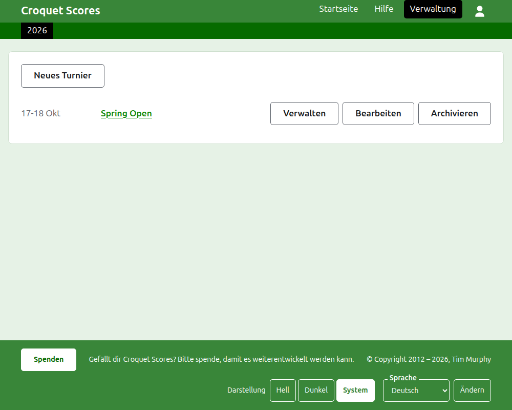
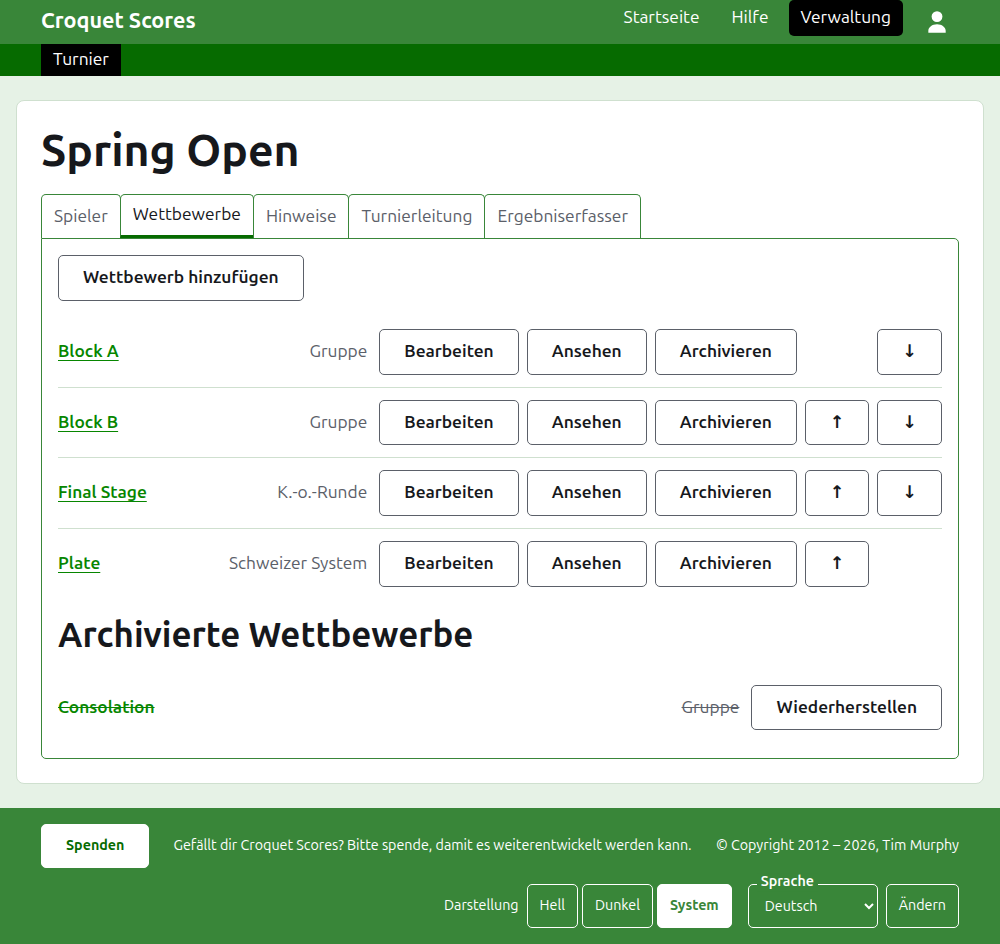

# Ein Standardturnier leiten

Ein Standardturnier wird zwischen einzeln gemeldeten Spielern gespielt: ein Vereinswochenende, ein offenes Turnier, eine Meisterschaft. Seine Spieler werden in Gruppen, K.-o.-Runden und Schweizer Systeme aufgenommen, und seine Ergebnisse erscheinen, sobald gespielt wird. Diese Anleitung begleitet einen Verantwortlichen vom Anmelden bis zu einem Turnier, dessen Ergebnisse öffentlich zu sehen sind.

Sie steht für sich. Nichts darin hängt von der Anleitung zu einem Mannschaftsturnier ab, die eigens geschrieben ist.

## Bevor Sie beginnen

Sie brauchen ein Konto. Klicken Sie [hier](/account/register), um eines zu registrieren.

Alles, was ein Verantwortlicher tut, geschieht im Verwaltungsbereich der Website. Die öffentlichen Seiten, auf denen Spieler und Zuschauer das Turnier verfolgen, werden aus dem gezeichnet, was die Verwaltung enthält, es muss also nichts veröffentlicht werden: Ein eingegebenes Ergebnis steht sofort auf den öffentlichen Seiten.

## Die Seiten in ihrer Reihenfolge

1. [Ein Turnier anlegen](creating-a-tournament.md): sein Name, seine Tage, seine Sportart, wo es gespielt wird und ob es eine nationale oder internationale Veranstaltung ist.
2. [Spieler](players.md): die Spieler des Turniers eingeben, korrigieren und die versehentlich eingegebenen beiseitelegen.
3. [Wettbewerbe](competitions.md): Gruppen, K.-o.-Runden und Schweizer Systeme hinzufügen und ordnen.
4. [Spieler in einen Wettbewerb aufnehmen](entering-players-in-a-competition.md): wer in welchem Wettbewerb spielt, Freilose in einer K.-o.-Runde, Überträge, Entfernen und Zurückziehen.
5. [Ergebnisse](scores.md): Ergebnisse eingeben, korrigieren und die versehentlich eingegebenen beiseitelegen.
6. [Notizen](notes.md): den Spielern sagen, was sie im Lauf des Turniers wissen müssen.
7. [Verantwortliche und Ergebniserfasser](managers-and-scorers.md): die Leitung des Turniers teilen und jemanden Ergebnisse eingeben lassen, ohne dass er sonst etwas ändern kann.
8. [Ranglisten](rankings.md): die Datei, die an die Weltrangliste geschickt wird, und was für Sie noch auszufüllen bleibt.
9. [Ein Turnier ändern, archivieren und wiederherstellen](changing-and-archiving.md): die Angaben zum Turnier korrigieren und ein Turnier beiseitelegen.
10. [Was die Öffentlichkeit sieht](what-the-public-sees.md): die Seiten, die Ihre Spieler verfolgen, und wie das, was Sie eingeben, dort erscheint.

## Wie die Verwaltung aufgebaut ist

Die Eingangsseite der Verwaltung listet die Turniere, an denen Sie beteiligt sind, jeweils für ein Jahr.

Ein Druck auf den Namen eines Turniers oder auf **Verwalten** öffnet seine Seite. Alles, was zu tun ist, liegt in sechs Reitern unter seinem Namen: **Spieler**, **Wettbewerbe**, **Notizen**, **Verantwortliche**, **Ergebniserfasser** und **Ranglisten**. Die Seite öffnet sich auf Spieler, weil die Spieler als Erstes eingegeben werden.

Die dunkelgrüne Leiste unter der Kopfzeile dient dem Wechsel zwischen Seiten. Sie führt zum Turnier, als **Turnier**, und zu jedem seiner Wettbewerbe mit Namen, sodass Sie vom Turnier zu einem Wettbewerb und zwischen Wettbewerben wechseln können, ohne über den Reiter Wettbewerbe zurückzugehen. Die Seite, auf der Sie sind, ist schwarz markiert.

## Was überall gilt

**Außer einer Notiz wird nichts endgültig gelöscht.** Spieler, Wettbewerbe, Ergebnisse und das Turnier selbst werden archiviert statt gelöscht: beiseitegelegt, durchgestrichen und unter einer eigenen Überschrift aufgeführt, mit **Wiederherstellen**, um sie zurückzuholen. Archivieren, Wiederherstellen und das Verschieben nach oben und unten fragen nie nach einer Bestätigung, weil sich jedes davon durch einen Druck in die Gegenrichtung rückgängig machen lässt. Was sich nicht rückgängig machen lässt, etwa einen Spieler aus einem Wettbewerb zu entfernen oder eine Notiz zu löschen, fragt zuerst.

**Ein Dialog über der Seite speichert nichts, bis Sie seine Schaltfläche drücken.** Abbrechen oder die Escape-Taste schließt ihn und lässt alles, wie es war. Dialoge, die etwas hinzufügen, etwa Spieler hinzufügen und Ergebnis hinzufügen, bleiben nach jedem Hinzufügen offen, damit sich eine Liste in einem Zug eingeben lässt.

**Was abgelehnt wird, steht neben dem Feld, um das es geht.** Nichts Abgelehntes wird gespeichert, und was Sie eingegeben haben, bleibt stehen, damit Sie es berichtigen können, statt es neu einzugeben.

**Die Verwaltung funktioniert auf dem Telefon.** Jede Schaltfläche ist groß genug für einen Daumen, und nichts ist breiter als der Bildschirm.

Weiter: [Ein Turnier anlegen](creating-a-tournament.md).
