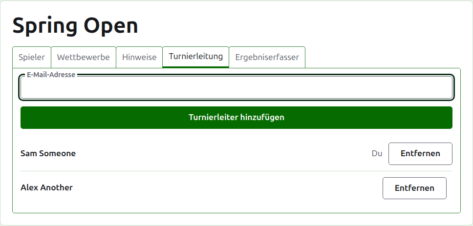
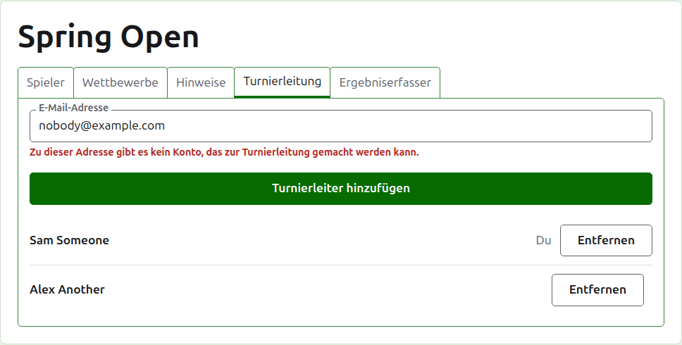
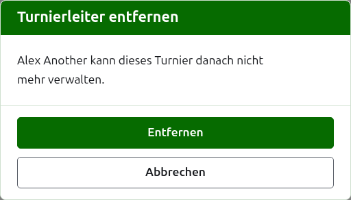
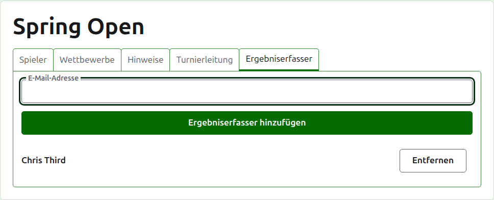
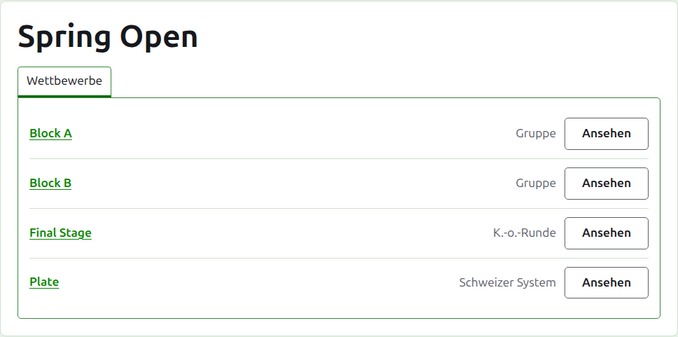

# Turnierleitung und Ergebniserfasser

Ein Turnier hat Turnierleiter, die alles tun können, was sich mit ihm tun lässt, und kann Ergebniserfasser haben, die seine Ergebnisse eingeben und sonst nichts. Wer das Turnier angelegt hat, ist sein erster Turnierleiter.

## Turnierleitung

Der Reiter **Turnierleitung** listet, wer das Turnier leitet, in der Reihenfolge, in der sie dazu gemacht wurden, mit deinem eigenen Namen als deinem markiert. Hier wird ein Turnier geteilt oder weitergegeben.

Jemand wird über seine E-Mail-Adresse zum Turnierleiter gemacht. Gib sie in das Feld über der Liste ein und drücke **Turnierleiter hinzufügen**. Die Adresse muss zu einem registrierten und bestätigten Konto gehören; eine Adresse ohne eines wird unter dem Feld abgelehnt, und mehr sagt die Website nicht dazu. Ein Ergebniserfasser, der zum Turnierleiter gemacht wird, hört auf, Ergebniserfasser zu sein.

**Entfernen** nimmt einen Turnierleiter heraus. Von einem entfernten Turnierleiter wird nichts behalten, deshalb fragt Entfernen zuerst; wenn er zurückgewollt wird, wird er über seine Adresse wieder zum Turnierleiter gemacht. Ein Turnier hat immer einen Turnierleiter, deshalb wird dem letzten Entfernen nicht angeboten.

Du kannst dich selbst herausnehmen. Die Frage sagt dann, was das bedeutet: Du verlierst deinen eigenen Weg zurück zum Turnier, und niemand auf der Seite kann das für dich rückgängig machen. Ein anderer Turnierleiter kann dich wieder zum Turnierleiter machen.

## Ergebniserfasser

Der Reiter **Ergebniserfasser** ist der Reiter Turnierleitung für Ergebniserfasser und funktioniert genauso: eine E-Mail-Adresse und **Ergebniserfasser hinzufügen** über der Liste, und **Entfernen** bei jedem.

Ein Ergebniserfasser sieht das Turnier in seiner eigenen Liste in der Verwaltung, mit **Ergebnisse** an der Stelle von Verwalten, und bekommt nur seine Wettbewerbe angeboten: keine Spieler, Hinweise, Turnierleitung, Ergebniserfasser oder Ranglisten. Auf der Seite eines Wettbewerbs sieht er nur den Reiter Ergebnisse, auf dem er Ergebnisse eingeben, korrigieren, archivieren und wiederherstellen kann wie ein Turnierleiter. Wer in einem Wettbewerb spielt, entscheidet die Turnierleitung.

Ein Turnierleiter wird nicht zum Ergebniserfasser gemacht, weil ein Turnierleiter schon alles kann, was ein Ergebniserfasser kann. Ein Turnier braucht keinen Ergebniserfasser, deshalb kann jeder Ergebniserfasser entfernt werden, auch der letzte.

Weiter: [Ranglisten](rankings.md).
