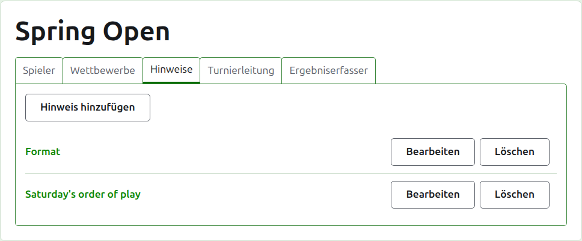
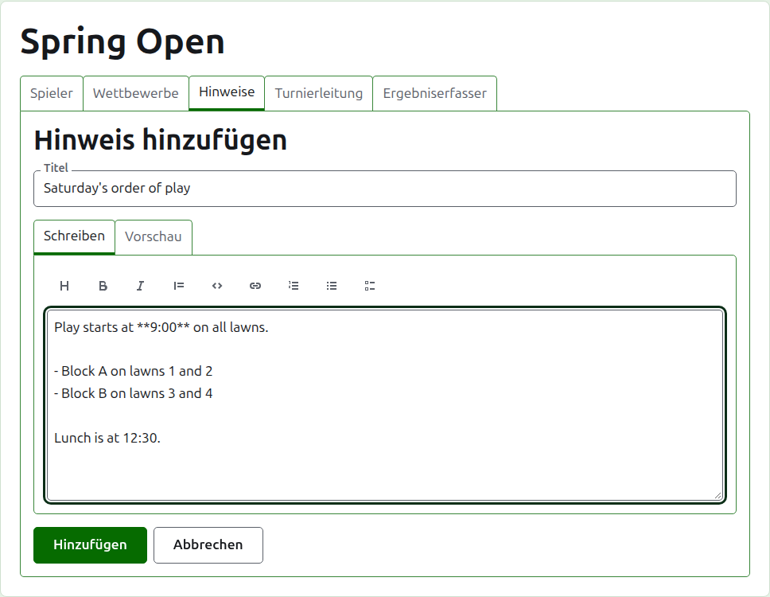
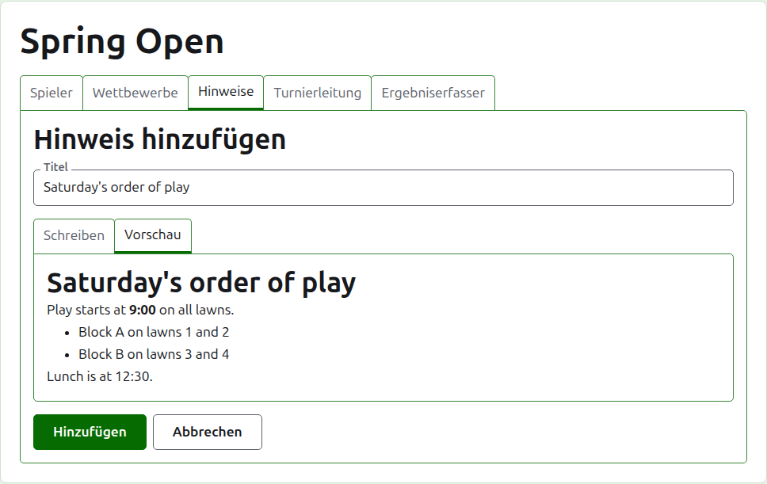
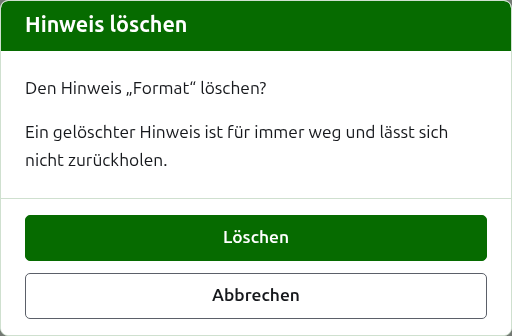

# Notizen

Auf dem Reiter **Notizen** der Turnierseite schreiben die Verantwortlichen, was die Spieler im Lauf des Turniers wissen müssen: das Format, eine Änderung des Spielplans, die Zeit des Mittagessens. Leser finden sie auf der öffentlichen Seite Notizen des Turniers, und eine Notiz, die sie nicht gelesen haben, ist dort mit einem roten Sternchen markiert, das auch den Bereich Notizen auf jeder Seite des Turniers markiert, bis sie ihn öffnen.

## Eine Notiz schreiben

Drücken Sie **Notiz hinzufügen** über der Liste. Ein Bereich tritt an die Stelle der Liste, weil eine Notiz ausführlich geschrieben wird und den Platz braucht.

**Titel** ist Pflicht und ist das, womit die Notiz aufgeführt wird. Er ist reiner Text.

**Beschreibung** wird in Markdown geschrieben und kann leer bleiben, wenn der Titel schon alles sagt. Die Werkzeugleiste über dem Feld schreibt das Markdown für Sie: Überschrift, Fett, Kursiv, Zitat, Code, Link, Nummerierte Liste, Aufzählung und Aufgabenliste. Jedes wirkt auf das Markierte, oder am Anfang jeder markierten Zeile, oder setzt den Cursor dorthin, wo die Wörter hingehören.

**Vorschau** zeigt die Notiz so, wie ein Leser sie auf ihrer Seite sehen wird.

Drücken Sie **Hinzufügen**. Die Notiz wird gespeichert, die Liste kommt mit ihr ganz oben zurück, und sie steht sofort auf der öffentlichen Seite Notizen.

## Eine Notiz bearbeiten

Drücken Sie den Titel einer Notiz oder ihr **Bearbeiten**, um den Bereich für diese Notiz zu öffnen. Drücken Sie **Speichern**, um die Änderung zu speichern. Eine Notiz, die bearbeitet wurde, seit ein Leser sie gelesen hat, wird für ihn wieder markiert.

## Eine Notiz löschen {#deleting-a-note}

Eine Notiz, die nicht mehr gilt, wird gelöscht. Eine gelöschte Notiz ist für immer weg, deshalb fragt **Löschen** zuerst.

Weiter: [Verantwortliche und Ergebniserfasser](managers-and-scorers.md).
