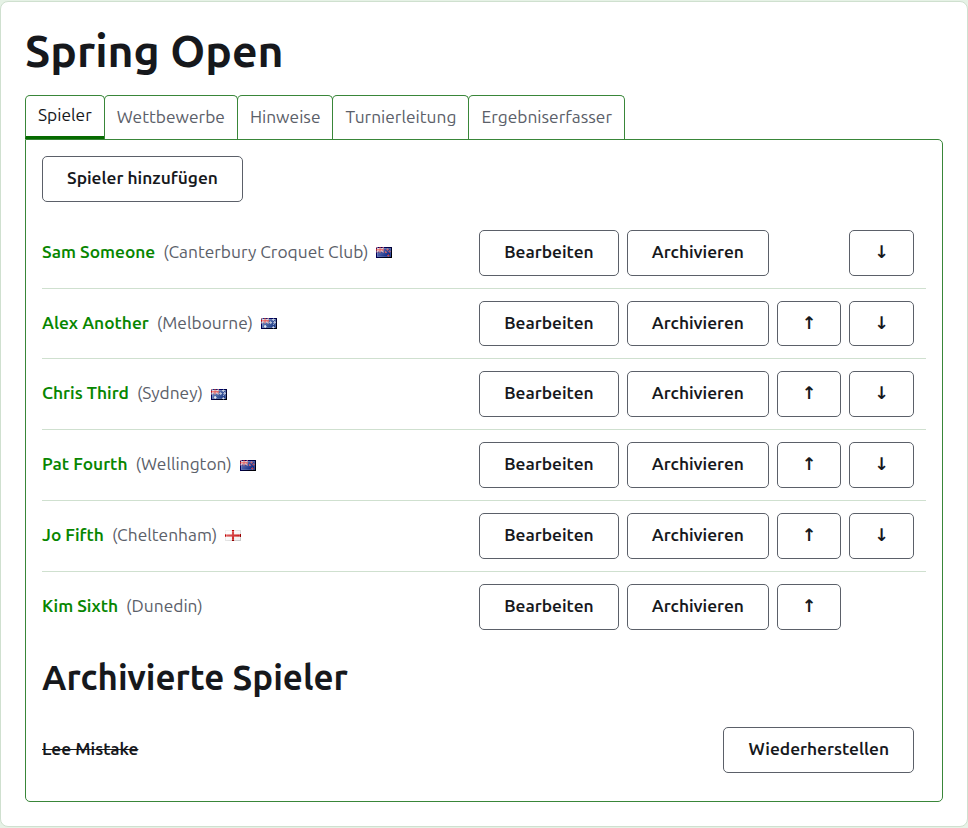
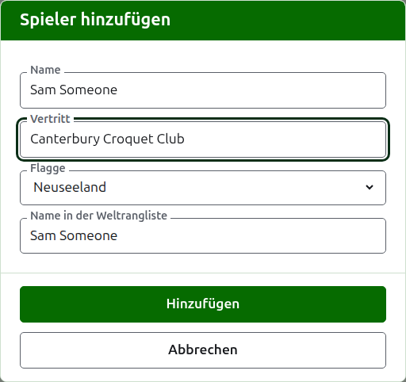
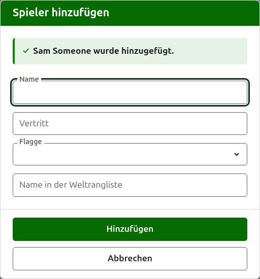
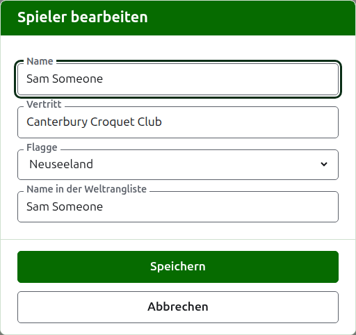
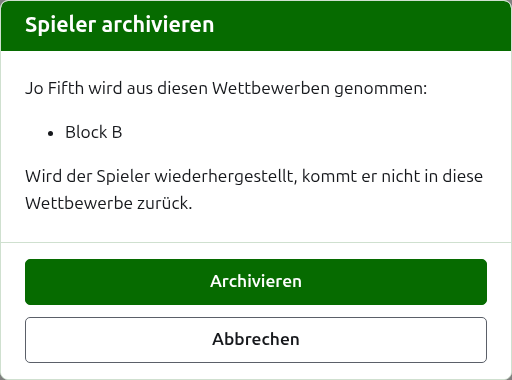

# Spieler

Auf dem Reiter **Spieler** der Turnierseite werden die Spieler des Turniers eingegeben, korrigiert, geordnet und beiseitegelegt. Es ist der Reiter, auf dem sich die Seite öffnet, weil die Spieler das Erste sind, was zu einem Turnier eingegeben wird.

Spieler werden hier einmal eingegeben, in das Turnier. In welchen Wettbewerben jeder spielt, wird danach entschieden, auf der Seite jedes Wettbewerbs, aus den hier eingegebenen Spielern. Siehe [Spieler in einen Wettbewerb aufnehmen](entering-players-in-a-competition.md).



## Spieler hinzufügen {#add-a-player}

Drücken Sie **Spieler hinzufügen** über der Liste. Ein Dialog öffnet sich über der Seite.



**Name** ist Pflicht. Es ist der Name des Spielers, wie er auf jeder Seite gezeigt wird, zwischen 3 und 254 Zeichen lang. Zwei Spieler eines Turniers können nicht denselben Namen haben, wie auch immer er groß- und kleingeschrieben ist; teilen zwei Spieler wirklich einen Namen, unterscheiden Sie sie im Namen selbst, etwa „Andrew Hobbs (2)“.

**Vertritt** ist das, wofür der Spieler spielt, so geschrieben, wie ein Leser es sagen würde: ein Verein, eine Region oder ein Land, etwa „Canterbury Croquet Club“. Es steht in Klammern hinter dem Namen. Es kann leer bleiben.

**Flagge** ist die Flagge, die neben dem Namen des Spielers gezeigt wird. Sie kann auf „keine“ bleiben, was bei den meisten Spielern so ist. Was ein Spieler vertritt und welche Flagge er führt, wird getrennt gehalten, weil ein Spieler für einen Verein in einem Land spielen und die Flagge eines anderen führen kann.

**Name des Weltranglistenspielers** ist der Name, unter dem die Weltrangliste den Spieler kennt. Danach wird nur bei einem Turnier im Association Croquet oder Golf Croquet gefragt, den beiden Sportarten, deren Spieler die Weltrangliste in einer Liste führt. Die Spieler im American 6 Wicket sind der Rangliste unter ihrem eigenen Namen bekannt; danach wird dort also nicht gefragt, und der Name in der Weltrangliste ist bei jedem Spieler immer sein Name. Während Sie einen Spieler hinzufügen, folgt er dem Namen, während Sie ihn tippen, weil die meisten Spieler der Rangliste unter ihrem eigenen Namen bekannt sind, und hört auf zu folgen, sobald Sie in ihm selbst tippen. Bleibt er leer, wird der Name des Spielers gespeichert.

Während Sie einen Namen tippen, werden die Spieler angeboten, die die Weltrangliste kennt und deren Namen so beginnen, damit Sie einen Namen so übernehmen können, wie die Rangliste ihn schreibt, statt ihn auszutippen. Neben dem Namen in der Weltrangliste sagt ein Haken, dass die Rangliste den Namen kennt, und ein Fragezeichen, dass sie ihn nicht kennt: Vielleicht ist er falsch geschrieben, oder der Spieler ist neu in der Rangliste. Das ist nur ein Hinweis. Ein Name, den die Rangliste nicht kennt, wird genauso bereitwillig gespeichert wie einer, den sie kennt.

Drücken Sie **Hinzufügen**. Der Spieler wird hinzugefügt, der Dialog sagt es, und seine Felder werden für den nächsten Spieler geleert, mit dem Cursor wieder im Namen. Geben Sie so die ganze Liste ein und drücken Sie dann **Abbrechen**, um den Dialog zu schließen. Abbrechen speichert nichts, was nicht schon hinzugefügt war.



Ein Spieler heißt nie „Bye“, das englische Wort für Freilos. Die Freilose einer K.-o.-Runde werden in der K.-o.-Runde selbst hinzugefügt, dort, wo ihre Spieler aufgenommen werden; ein Name, dessen erstes Wort „bye“ ist, wird deshalb abgelehnt, und der Dialog erklärt, warum.

## Mehrere Spieler hinzufügen {#adding-multiple-players}

Um eine ganze Liste auf einmal hinzuzufügen, drücken Sie **Mehrere Spieler hinzufügen** neben **Spieler hinzufügen**. Ein Dialog öffnet sich über der Seite mit einem einzigen Feld, das mehrere Textzeilen aufnimmt. Sie können die Liste aus einer Tabellenkalkulation kopieren und in das Feld einfügen.

**Die erste Zeile nennt die Felder**, getrennt durch Kommas oder Tabulatoren: **Name** und beliebige von **Representing**, **Flag**, **Handicap** und **WorldRankingPlayerName**, in beliebiger Reihenfolge. Diese Namen werden auf Englisch getippt, in welcher Sprache die Website auch ist. **Name** muss dabei sein. **Jede weitere Zeile ist ein Spieler**, mit einem Wert für jedes Feld in derselben Reihenfolge, auf dieselbe Weise getrennt. Hat ein Spieler für ein Feld nichts, bleibt es leer, aber das Komma oder der Tabulator bleibt stehen. Zum Beispiel mit Kommas:

```
Name,Representing,Flag
Sam Someone,Canterbury Croquet Club,New Zealand
Alex Another,,England
```

- **Name, Vertritt und Name des Weltranglistenspielers** unterliegen denselben Regeln wie beim Hinzufügen eines einzelnen Spielers (siehe [Spieler hinzufügen](players.md#add-a-player)). Ein Name ist zwischen 3 und 254 Zeichen lang, ist nicht schon im Turnier, wie auch immer er groß- und kleingeschrieben ist, und ist nicht „Bye“.
- **Flagge** ist der Name des Landes oder Ortes, in Ihrer Sprache, so wie ihn die Liste im Dialog Spieler hinzufügen anbietet, etwa Neuseeland.
- **Handicap** ist eine Zahl mit Vorzeichen, mit bis zu zwei Ziffern und einer Nachkommastelle, etwa 4, +4 oder -1.5.
- Ein Spieler ohne **WorldRankingPlayerName** ist unter seinem Namen bekannt, wie beim einzelnen Hinzufügen.
- **Kommas oder Tabulatoren.** Aus einer Tabellenkalkulation kopierte Zellen sind durch Tabulatoren getrennt, eine von Hand getippte Liste meist durch Kommas. Beides geht. Enthält die erste Zeile einen Tabulator, wird die ganze Liste mit Tabulatoren gelesen, sonst mit Kommas.
- Ein Wert, der das Trennzeichen enthält, steht in doppelten Anführungszeichen, wie eine Tabellenkalkulation ihn schreibt: "Smith, John" in einer durch Kommas getrennten Liste. Ein Anführungszeichen innerhalb eines Werts wird doppelt geschrieben.
- Bei jedem Wert werden die Leerzeichen an den Enden entfernt, und eine Zeile ohne Inhalt wird übergangen.
- Eine Liste enthält höchstens 500 Spieler. Fügen Sie den Rest in einer weiteren Liste hinzu.

Drücken Sie **Hinzufügen**. Die ganze Liste wird geprüft, bevor etwas davon gespeichert wird; eine Liste mit einem Fehler fügt also niemanden hinzu. Was nicht stimmt, steht unter dem Feld, in der Zeile, in der es steht, wobei die erste Zeile als Zeile 1 zählt. Jeder Fehler wird aufgeführt, nicht nur der erste, und was Sie getippt haben, bleibt stehen, damit Sie es berichtigen können. Sobald die Liste gespeichert ist, schließt sich der Dialog, und der Tab Spieler führt die neuen Spieler auf, in der Reihenfolge, in der Sie sie geschrieben haben. Anders als bei **Spieler hinzufügen**, das für den nächsten Spieler offen bleibt, gibt es hier keinen nächsten: Die Liste war der nächste.

Das **?** in der Titelleiste des Dialogs führt hierher.

## Einen Spieler korrigieren {#correcting-a-player}

Drücken Sie den Namen eines Spielers oder sein **Bearbeiten**, um denselben Dialog für diesen Spieler zu öffnen, mit dem Titel Spieler bearbeiten. Ändern Sie, was falsch ist, und drücken Sie **Speichern**, was die Änderung speichert und den Dialog schließt. Ein Spieler, dessen Name korrigiert wird, behält den Namen in der Weltrangliste, den er hatte, weil die Rangliste ihn weiterhin unter ihm kennt. Im American 6 Wicket ist der Name eines Spielers in der Weltrangliste immer sein Name, daher wird er mit dem Namen auch korrigiert.



Ein hier korrigierter Spieler ist überall korrigiert: in jedem Wettbewerb, in dem er ist, und auf jeder öffentlichen Seite.

## Spieler ordnen

Die Spieler sind in der Reihenfolge des Turniers aufgeführt; das ist die Reihenfolge, in der sie angeboten werden, wenn sie in Wettbewerbe aufgenommen werden, und die Reihenfolge, in der eine K.-o.-Runde ausgelost wird. **Nach oben** und **Nach unten**, die Pfeile am Ende jeder Zeile, verschieben einen Spieler um einen Platz. Dem ersten Spieler wird Nach oben nicht angeboten und dem letzten nicht Nach unten.

## Einen Spieler archivieren {#archiving-a-player}

**Archivieren** legt einen Spieler beiseite: versehentlich eingegeben oder vom ganzen Turnier zurückgetreten. Ein archivierter Spieler steht unter **Archivierte Spieler**, durchgestrichen, hinter den Spielern in Gebrauch, und bietet nur **Wiederherstellen** an. Ein archivierter Spieler ist in keinem Wettbewerb und erscheint auf keiner öffentlichen Seite.

Ein Spieler, der irgendein Spiel gespielt hat, kann nicht archiviert werden, weil die Spiele dann gegen jemanden wären, den es nicht mehr gibt; einem solchen Spieler wird Archivieren deshalb nicht angeboten. Ein Spieler, dessen Spiele alle archiviert sind, kann archiviert werden.

Einen Spieler zu archivieren, der in keinem Wettbewerb ist, fragt nicht zuerst, weil das Wiederherstellen alles zurückbringt. Einen Spieler zu archivieren, der in einem Wettbewerb ist, fragt zuerst, weil das Archivieren ihn aus jedem Wettbewerb nimmt, in dem er ist, und das Wiederherstellen ihn nicht zurückbringt.



Weiter: [Wettbewerbe](competitions.md).
