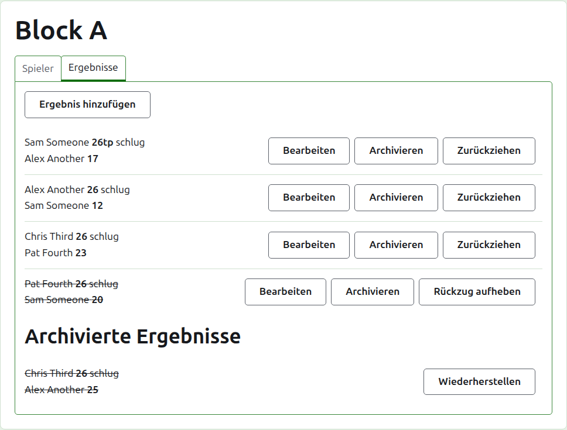
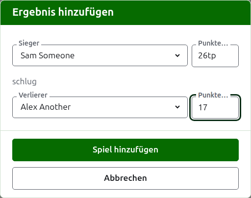
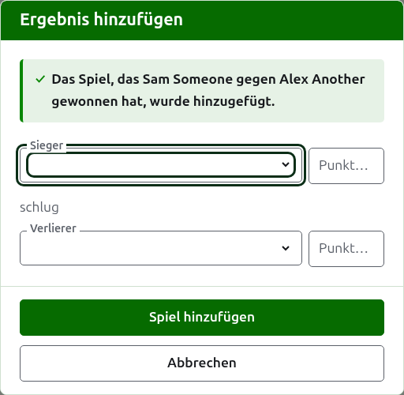
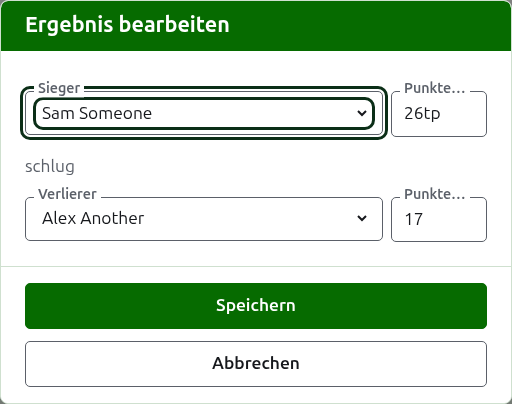

# Ergebnisse

Auf dem Reiter **Ergebnisse** der Wettbewerbsseite werden die Spiele des Wettbewerbs eingegeben, korrigiert und beiseitegelegt. Ein Ergebniserfasser sieht nur diesen Reiter und kann dort alles tun, was ein Verantwortlicher kann.

## Ein Ergebnis eingeben {#entering-a-score}

Drücken Sie **Ergebnis hinzufügen** über der Liste. Der Dialog liest sich, wie ein Ergebnis gesagt wird: der Sieger und seine Punkte, dann „schlug“, dann der Verlierer und seine Punkte.

Sieger und Verlierer werden jeweils aus den spielenden Spielern des Wettbewerbs gewählt, in der Reihenfolge des Wettbewerbs. Zu Beginn ist niemand gewählt, damit ein Spiel nie einem Spieler zugeschrieben wird, den Sie nicht gewählt haben. In einer K.-o.-Runde wählt die Wahl des Siegers den, gegen den er gelost ist, als Verlierer, wo Sie es sehen und einen anderen wählen können.

Punkte werden so eingegeben, wie der Erfasser sie aufgeschrieben hat: ihre Zahl und was darauf folgt, was so gespeichert und gezeigt wird, wie es eingegeben wurde, etwa „26tp“ für 26 Tore und einen Triple Peel. Die Zahl sind die Ziffern, mit denen die Punkte beginnen; Punkte, die nicht mit einer Ziffer beginnen, werden abgelehnt.

Ein Spiel, das bei gleichen Punkten gewonnen wurde, etwa weil es durch die Zeit beendet und anders entschieden wurde, sagt durch eine Markierung hinter den Punkten des Siegers, wer gewonnen hat: „6w“ schlug „6“. Auf Croquet Scores sind die Markierungen „w“, „won“ und „winner“; Gateball Scores nimmt auch „cb“ und „so“. Die Punkte des Siegers müssen höher sein als die des Verlierers oder markiert, es sei denn, das Turnier erlaubt Unentschieden; dann werden gleiche Punkte ohne Markierung als Unentschieden gespeichert.

Drücken Sie **Spiel hinzufügen**. Das Spiel wird hinzugefügt, der Dialog sagt welches, und die Felder werden für das nächste geleert, weil Ergebnisse am Ende einer Runde im Schwung von einer Tafel abgelesen werden. Drücken Sie **Abbrechen**, wenn alle drin sind.

Was abgelehnt wird, steht unter dem Feld, um das es geht: ein nicht gewählter Sieger oder Verlierer, nicht eingegebene oder nicht mit einer Ziffer beginnende Punkte, derselbe Spieler als beides, als gewonnen markierte Punkte des Verlierers oder Punkte des Siegers, die hinter denen des Verlierers liegen. In einer K.-o.-Runde werden zwei Spieler, die nicht gegeneinander gelost sind, über den Feldern abgelehnt.

## Die Auslosung einer K.-o.-Runde muss zuerst gefüllt sein {#draw-filled-first}

Eine K.-o.-Runde wird erst gespielt, wenn jeder Platz ihrer Auslosung einen Spieler oder ein Freilos hat. Bis dahin erklärt Ergebnis hinzufügen, warum keine Ergebnisse hinzugefügt werden können, statt den Dialog zu öffnen.

## Die Liste der Ergebnisse

Die Ergebnisse in Gebrauch sind in der Reihenfolge ihrer Eingabe aufgeführt, das älteste zuerst, damit sich die Liste so liest, wie der Wettbewerb gespielt wurde. Jedes nennt den Sieger und seine Punkte, dann den Verlierer und seine, und bietet **Bearbeiten** und **Archivieren** an.

## Ein Ergebnis korrigieren {#correcting-a-score}

**Bearbeiten** öffnet denselben Dialog für dieses Ergebnis, mit dem Titel Ergebnis bearbeiten, mit seinen Spielern gewählt und seinen Punkten, wie sie eingegeben wurden. Drücken Sie **Speichern**, um die Korrektur zu speichern und den Dialog zu schließen.

Eine Korrektur behält das Ergebnis bei: Ein gewonnenes Spiel bleibt gewonnen, und ein unentschiedenes bleibt unentschieden. Ein Spiel, dessen Ergebnis falsch war, wird archiviert und neu eingegeben.

Wo ein Ergebnis archiviert werden könnte, lassen sich neben seinen Punkten auch seine Spieler ändern. In einer K.-o.-Runde behält ein Ergebnis, dessen Sieger schon in der nächsten Runde gespielt hat, seine Spieler, weil eine Änderung des Siegers das nächste Spiel von jemandem gespielt ließe, der nicht dorthin gekommen war; nur seine Punkte lassen sich korrigieren.

## Ein Ergebnis archivieren

**Archivieren** legt ein Ergebnis beiseite, sodass es für nichts zählt. Es steht unter **Archivierte Ergebnisse**, durchgestrichen, und bietet nur **Wiederherstellen** an. Keines von beiden fragt zuerst, weil jedes das andere rückgängig macht.

In einer K.-o.-Runde kommt der Sieger einer Begegnung in die nächste Runde, deshalb wird einem Ergebnis einer Begegnung, deren Sieger in der nächsten Runde gespielt hat, Archivieren nicht angeboten. Zuerst wird das Spiel in der nächsten Runde archiviert, dann können es die davor. Geht eine Runde über ein Best of 3 oder 5, wird jedes Spiel der Begegnung gleich behandelt. Eine Gruppe und ein Schweizer System haben keine Runden, die voneinander abhängen, deshalb kann dort jedes Ergebnis archiviert werden.

## Ein Ergebnis zurückziehen

Ein Spieler, der einen Wettbewerb verlässt, wird gewöhnlich auf dem Reiter Spieler aus ihm zurückgezogen, und mehr ist nicht nötig: Er spielt nicht weiter, und die Spiele, die er gespielt hat, bleiben stehen, zählen aber nicht mehr für Siege, Niederlagen und Tore. Ein Ergebnis zurückzuziehen ist für den seltenen Fall, dass ein gespieltes Spiel nicht zählen soll. In den australischen President's Eights zum Beispiel bleiben die Ergebnisse der ersten Runde stehen, wenn ein Spieler zurücktritt, und nur seine Spiele der zweiten Runde werden aus der Wertung genommen: Ziehen Sie diese Spiele zurück.

In einer Gruppe oder einem Schweizer System wird ein Ergebnis, das gespielt wurde, aber nicht zählen soll, zurückgezogen statt archiviert. **Zurückziehen** lässt es an seinem Platz unter den Ergebnissen in Gebrauch, aber durchgestrichen und auf den öffentlichen Seiten für nichts zählend. **Zurückziehen aufheben** lässt es wieder zählen. Keines von beiden fragt zuerst. Den Ergebnissen einer K.-o.-Runde wird Zurückziehen nicht angeboten, weil dort ein Ergebnis mehr entscheidet als die Tabelle.

Weiter: [Notizen](notes.md).
