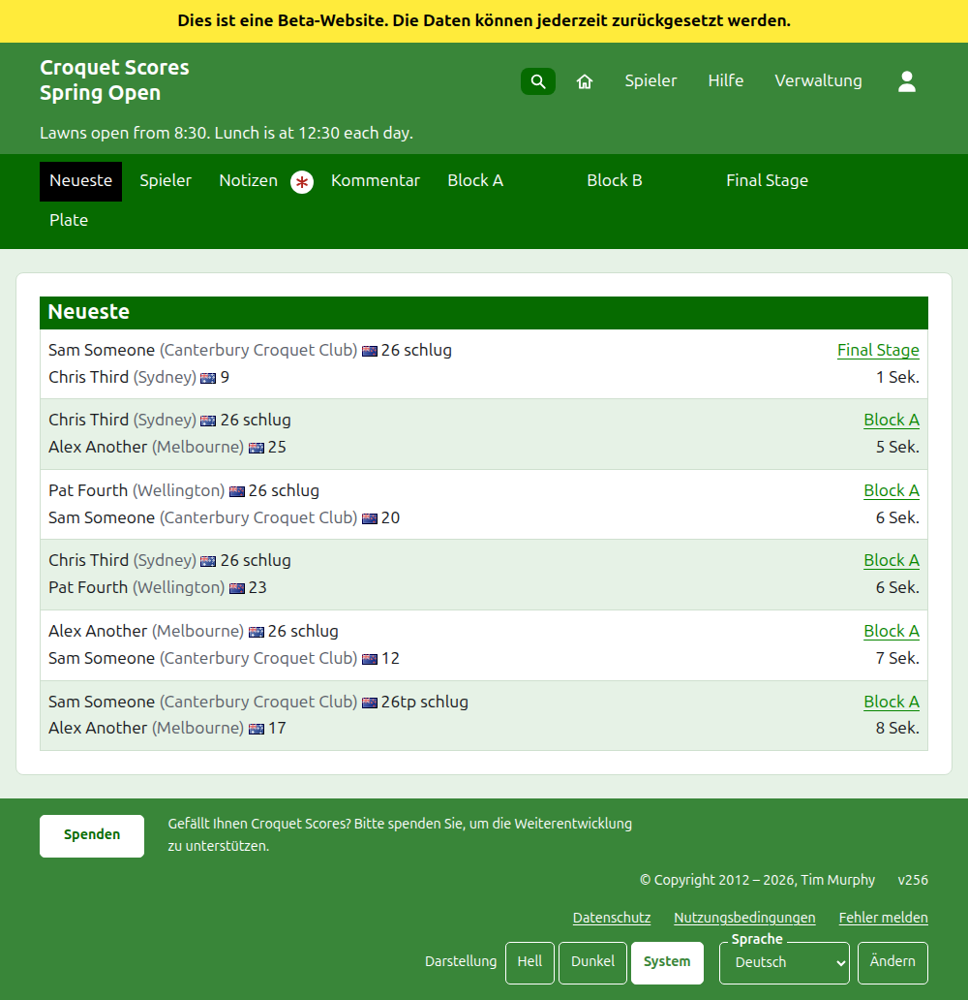
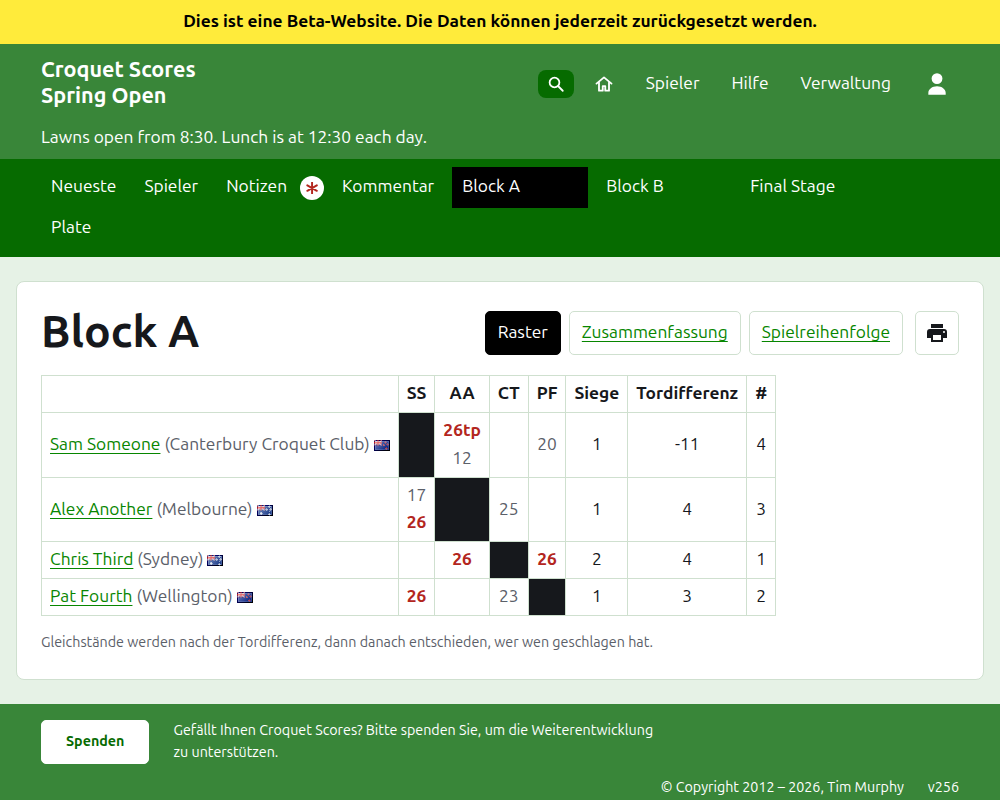
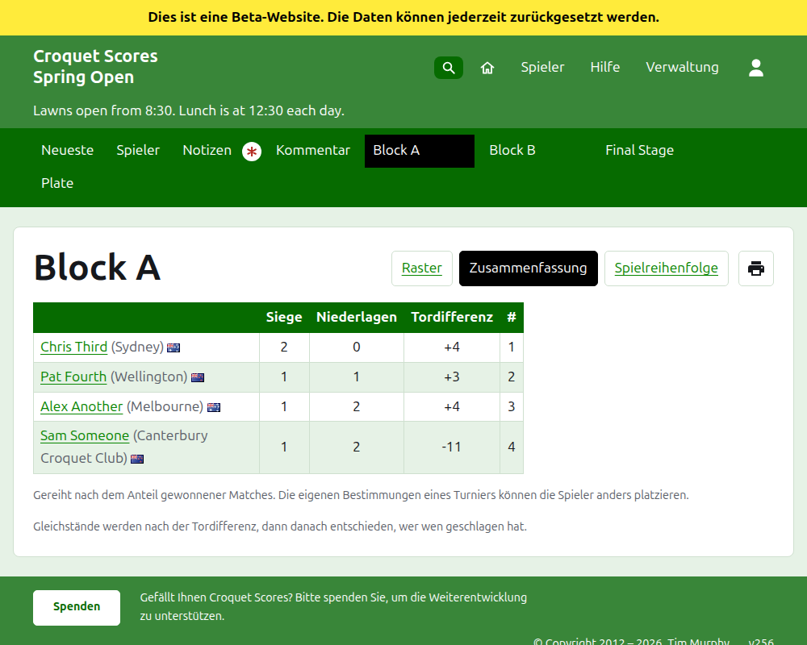
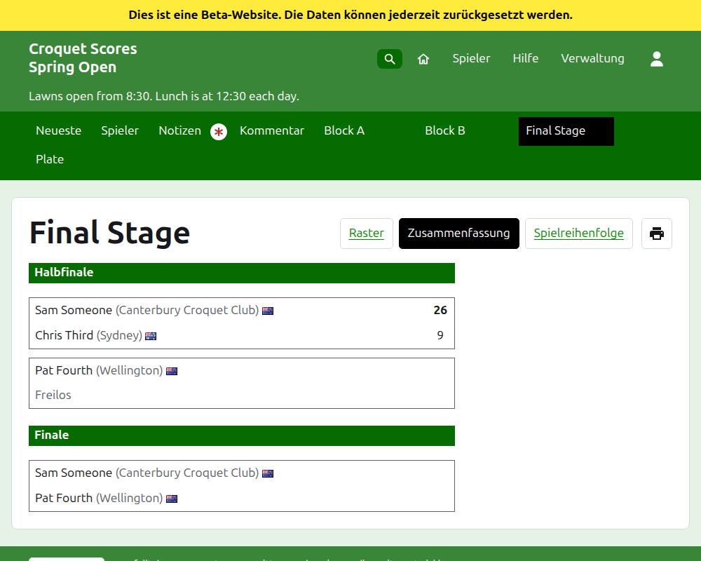
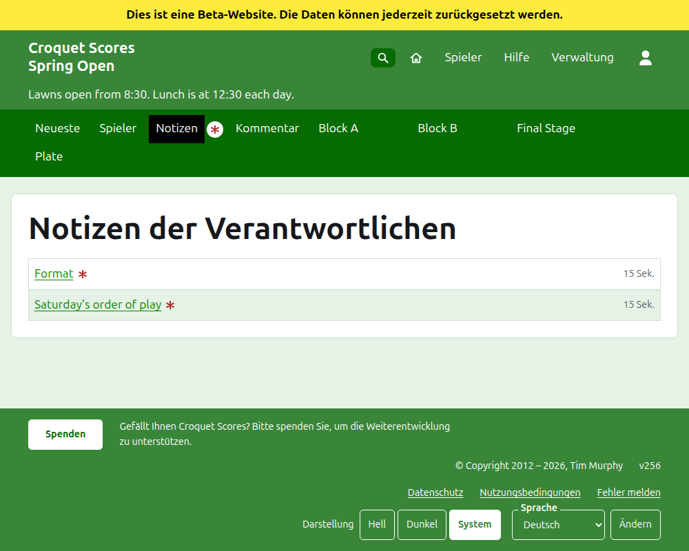

# Was die Öffentlichkeit sieht

Nichts wird veröffentlicht: Die öffentlichen Seiten werden aus dem gezeichnet, was die Verwaltung enthält, ein eingegebenes Ergebnis steht also sofort darauf. Sie brauchen weder ein Konto noch Skripte und sind für das Telefon gestaltet.

## Die Seite des Turniers

Die Seite des Turniers liegt unter seinem Jahr, seiner Sportart und seinem Namen, etwa `/2026/ac/spring-open`. Ihre Überschrift ist der Name des Turniers, mit seinem Untertitel darunter. Sie listet jedes Spiel in Gebrauch, das zuletzt hinzugefügte zuerst, damit ein Leser, der zurückkommt, sieht, was seither passiert ist. Jedes Spiel nennt den Sieger, seine Vorgabe und was er vertritt, seine Flagge und seine Punkte, dann den Verlierer und seine, mit dem Wettbewerb, in dem es gespielt wurde, und wie lange es her ist, dass es hinzugefügt wurde.

Die dunkelgrüne Leiste bietet die Bereiche des Turniers an: **Neueste**, was diese Seite ist, **Spieler**, **Notizen** und **Kommentar**, dann jeden Wettbewerb in Gebrauch, in der Reihenfolge des Reiters Wettbewerbe. Notizen ist mit einem roten Sternchen markiert, solange es eine Notiz gibt, die der Leser nicht gelesen hat.

## Ein Block

Die Seite eines Blocks zeigt seine Ergebnisse als Tabelle: eine Zeile und eine Spalte für jeden Spieler in der Reihenfolge des Blocks, mit den Spielen zwischen zwei Spielern dort, wo Zeile und Spalte sich treffen, jedes für den Spieler der Zeile als gewonnen, verloren oder unentschieden markiert. Nach den Spalten der Spieler kommen die Summen jedes Spielers. Besteht jede Begegnung aus einem einzigen Spiel, sind das Siege und Tordifferenz; geht eine Begegnung über mehr als ein Spiel, sind es Begegnungen, Spieldifferenz, Spiele und Tordifferenz. Die letzte Spalte, überschrieben mit **#**, ist der Platz jedes Spielers: 1 für den ersten und =2, wo sich Spieler nicht unterscheiden lassen und sich den zweiten teilen. Haben Spieler gleich viele ihrer Begegnungen gewonnen, sagt eine Zeile unter dem Raster, wie sie unterschieden werden, so wie es die Regelung des Blocks bei Gleichstand vorsieht (siehe Wettbewerbe).

Ein Block, ein K.-o.-Turnier und ein Schweizer System werden je auf drei Arten gezeigt, angeboten in der Zeile des Namens des Wettbewerbs: **Raster**, **Zusammenfassung** und **Spielreihenfolge**. Daneben steht eine Druckerschaltfläche, die den Namen des Turniers, den Namen des Wettbewerbs und seine Ergebnisse druckt und sonst nichts. Die Zusammenfassung ist die für das Telefon: bei einem Block die Spieler gereiht, mit ihren Siegen, Niederlagen, ihrer Tordifferenz und ihrem Platz; bei einem K.-o.-Turnier die Begegnungen, Runde für Runde aufgelistet; bei einem Schweizer System die Tabelle des Rasters ohne seine Ergebnisse. Die Spielreihenfolge listet jedes Spiel, zunächst das älteste zuerst. Sie ist mit **Spiel** und **Datum** überschrieben: Ein Druck auf **Spiel** sortiert die Spiele nach dem Namen des Siegers und dann dem des Verlierers, ein Druck auf **Datum** sortiert sie ältestes oder neuestes zuerst, und ein Druck auf die Überschrift, nach der eine Liste sortiert ist, dreht sie um. Wie ein Leser sortiert hat, wird auf seinem Gerät gemerkt. Ein Leser, der eine Ansicht wählt, behält sie für jeden Wettbewerb, bis er eine andere wählt.

Ein Wettbewerb, der bis zu einer anderen als der für seine Sportart üblichen Zahl von Toren gespielt wird, sagt das unter seinem Namen, als „Gespielt bis 14 Tore“ (siehe [Wettbewerbe](competitions.md#adding-a-competition)).

Die Zeile eines zurückgezogenen Spielers sagt das. Ein zurückgezogenes Ergebnis wird durchgestrichen gezeigt und zählt für nichts. Ein archiviertes Ergebnis wird nicht gezeigt.

## Ein K.-o.-Turnier

Die Seite eines K.-o.-Turniers zeichnet seine Auslosung Runde für Runde, eine Spalte für jede Runde von der ersten bis zum Finale, mit den beiden Seiten jeder Begegnung übereinander und einer Zelle für jedes Spiel, über das die Begegnung höchstens geht. Die Begegnung einer späteren Runde steht neben den beiden Begegnungen, zwischen deren Siegern sie ausgetragen wird. Auf dem Telefon lässt sich die Auslosung seitwärts verschieben, mit Pfeilen zum Finale und zurück.

## Ein Schweizer System

Die Seite eines Schweizer Systems reiht seine Spieler in einer Tabelle: ihre Spiele, ihre Siege, ihre Siegquote und ihre Ergebnisse, jedes als Gegner und Abstand gesagt, etwa „+4“ für ein mit vier Toren gewonnenes Spiel.

## Spieler

Die Seite Spieler listet jeden nicht archivierten Spieler des Turniers in alphabetischer Reihenfolge, mit seiner Vorgabe und dem, was er vertritt, in Klammern, und seiner Flagge.

## Notizen

Die Seite Notizen, überschrieben mit „Notizen der Verantwortlichen“, listet die Notizen des Turniers, die zuletzt geschriebene zuerst; jede führt zu ihrer eigenen Seite und sagt, wie lange es her ist, dass sie geschrieben wurde. Eine Notiz, die der Leser nicht gelesen hat, ist mit einem roten Sternchen markiert, bis er sie öffnet. Ein Turnier ohne Notizen sagt „Noch keine Notizen.“

## Wo das Turnier aufgeführt ist

Ein Turnier steht auf der Startseite, solange es gespielt wird oder kurz bevorsteht. Die Seite seines Jahres, etwa `/2026`, listet die Monate des Jahres, und jeder von ihnen listet, sobald er gedrückt wird, die Turniere, die in ihm beginnen. Ein Bedienelement unter der Überschrift, **Alle anzeigen** und dann **Alle ausblenden**, öffnet oder schließt jeden Monat. Ein als national oder international angehaktes Turnier steht in seiner Zeile fett.

## Adressen, die sich ändern

Ein Turnier behält seine Adresse, wenn sein Name korrigiert wird. Ändert sie sich, weil sich sein Jahr oder seine Sportart geändert hat, führt die alte Adresse zur neuen, damit ein von früher aufbewahrter Link noch funktioniert. Die Seiten eines archivierten Turniers werden nicht gefunden, bis es wiederhergestellt ist.
