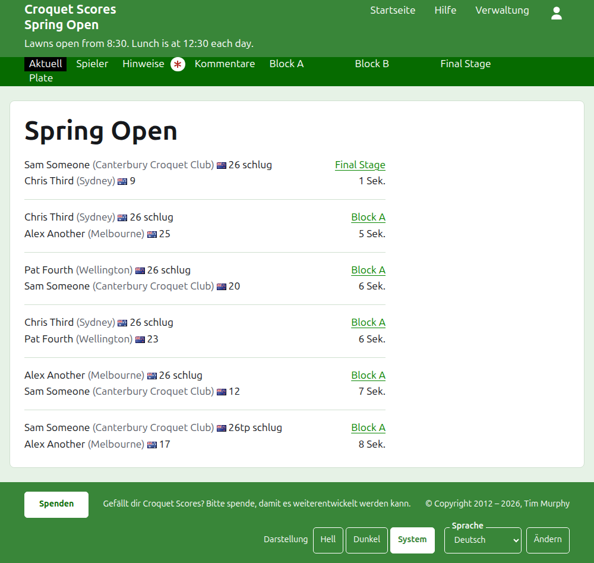
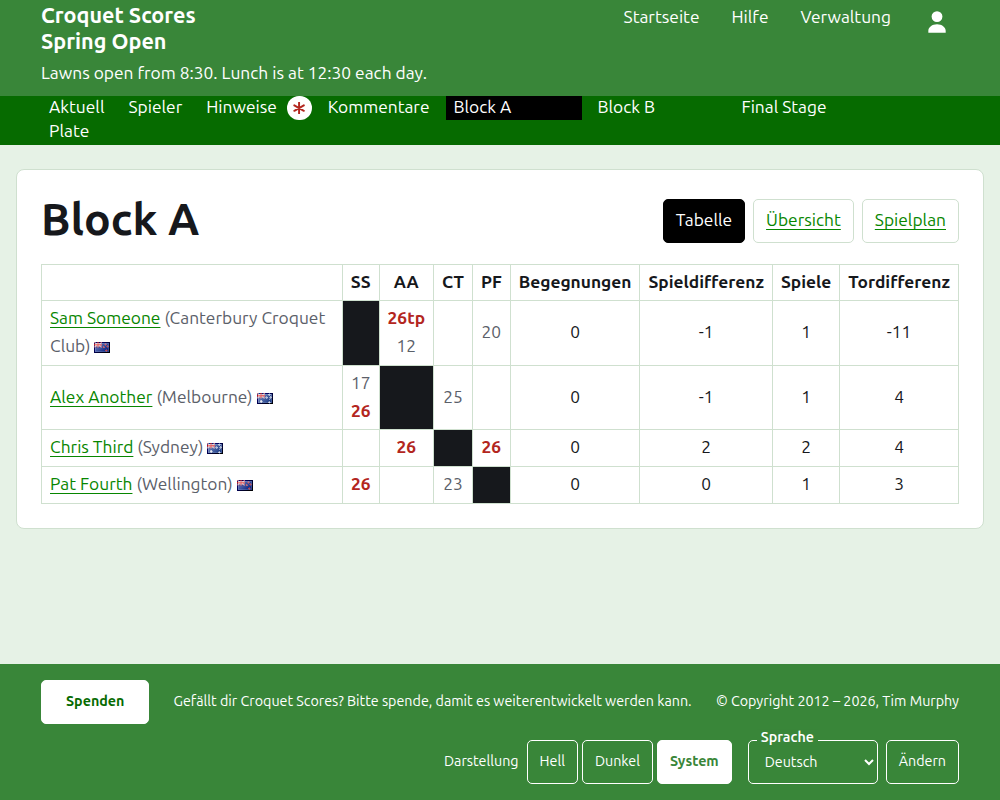
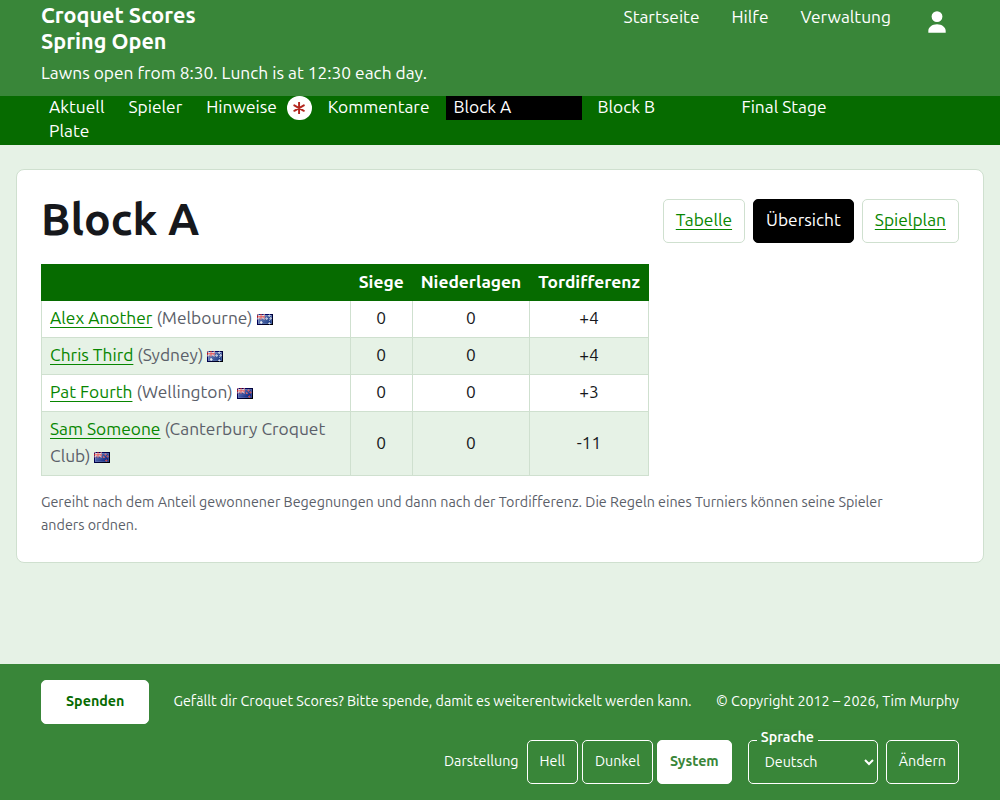
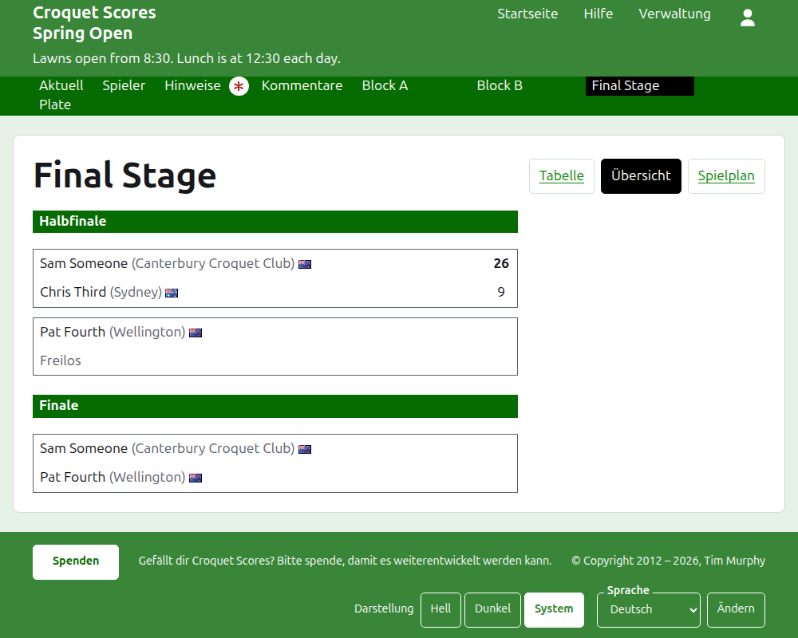
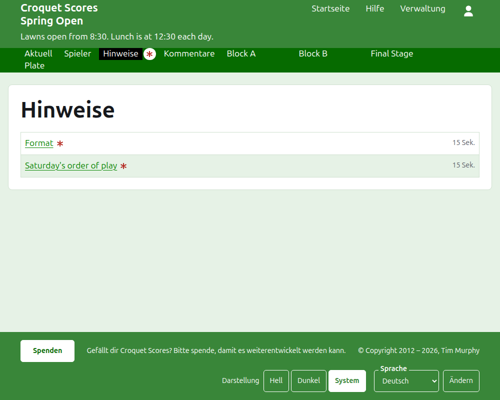

# Was die Öffentlichkeit sieht

Nichts wird veröffentlicht: Die öffentlichen Seiten werden aus dem gezeichnet, was die Verwaltung enthält, ein eingegebenes Ergebnis steht also sofort darauf. Sie brauchen weder ein Konto noch JavaScript und sind für das Telefon gestaltet.

## Die Seite des Turniers

Die Seite des Turniers liegt unter seinem Jahr, seiner Sportart und seinem Namen, etwa `/2026/ac/spring-open`. Ihre Überschrift ist der Name des Turniers, mit seinem Untertitel darunter. Sie listet jedes Spiel in Gebrauch, das zuletzt hinzugefügte zuerst, damit ein Leser, der zurückkommt, sieht, was seither passiert ist. Jedes Spiel nennt den Sieger, was er vertritt, seine Flagge und seine Punkte, dann den Verlierer und seine, mit dem Wettbewerb, in dem es gespielt wurde, und wie lange es her ist, dass es hinzugefügt wurde.

Die dunkelgrüne Leiste bietet die Bereiche des Turniers an: **Neueste**, was diese Seite ist, **Spieler**, **Notizen** und **Kommentar**, dann jeden Wettbewerb in Gebrauch, in der Reihenfolge des Reiters Wettbewerbe. Notizen ist mit einem roten Sternchen markiert, solange es eine Notiz gibt, die der Leser nicht gelesen hat.

## Eine Gruppe

Die Seite einer Gruppe zeigt ihre Ergebnisse als Tabelle: eine Zeile und eine Spalte für jeden Spieler in der Reihenfolge der Gruppe, mit den Spielen zwischen zwei Spielern dort, wo Zeile und Spalte sich treffen, jedes für den Spieler der Zeile als gewonnen, verloren oder unentschieden markiert. Nach den Spalten der Spieler kommen die Summen jedes Spielers. Besteht jede Begegnung aus einem einzigen Spiel, sind das Siege und Tordifferenz; geht eine Begegnung über mehr als ein Spiel, sind es Begegnungen, Spieldifferenz, Spiele und Tordifferenz.

Eine Gruppe wird auf drei Arten gezeigt, angeboten in der Zeile ihres Namens: **Raster**, **Zusammenfassung** und **Spielreihenfolge**. Die Zusammenfassung ist die für das Telefon: die Spieler gereiht, mit ihren Siegen, Niederlagen und ihrer Tordifferenz. Die Spielreihenfolge listet jedes Spiel, das älteste zuerst. Ein Leser, der eine Ansicht wählt, behält sie für jeden Wettbewerb, bis er eine andere wählt.

Die Zeile eines zurückgezogenen Spielers sagt das. Ein zurückgezogenes Ergebnis wird durchgestrichen gezeigt und zählt für nichts. Ein archiviertes Ergebnis wird nicht gezeigt.

## Eine K.-o.-Runde

Die Seite einer K.-o.-Runde zeichnet ihre Auslosung Runde für Runde, eine Spalte für jede Runde von der ersten bis zum Finale, mit den beiden Seiten jeder Begegnung übereinander und einer Zelle für jedes Spiel, über das die Begegnung höchstens geht. Die Begegnung einer späteren Runde steht neben den beiden Begegnungen, zwischen deren Siegern sie ausgetragen wird. Auf dem Telefon lässt sich die Auslosung seitwärts verschieben, mit Pfeilen zum Finale und zurück.

## Ein Schweizer System

Die Seite eines Schweizer Systems reiht seine Spieler in einer Tabelle: ihre Spiele, ihre Siege, ihre Siegquote und ihre Ergebnisse, jedes als Gegner und Abstand gesagt, etwa „+4“ für ein mit vier Toren gewonnenes Spiel.

## Spieler

Die Seite Spieler listet jeden nicht archivierten Spieler des Turniers in alphabetischer Reihenfolge, mit dem, was er vertritt, und seiner Flagge.

## Notizen

Die Seite Notizen listet die Notizen des Turniers, die zuletzt geschriebene zuerst; jede führt zu ihrer eigenen Seite und sagt, wie lange es her ist, dass sie geschrieben wurde. Eine Notiz, die der Leser nicht gelesen hat, ist mit einem roten Sternchen markiert, bis er sie öffnet.

## Adressen, die sich ändern

Ein Turnier behält seine Adresse, wenn sein Name korrigiert wird. Ändert sie sich, weil sich sein Jahr oder seine Sportart geändert hat, führt die alte Adresse zur neuen, damit ein von früher aufbewahrter Link noch funktioniert. Die Seiten eines archivierten Turniers werden nicht gefunden, bis es wiederhergestellt ist.
