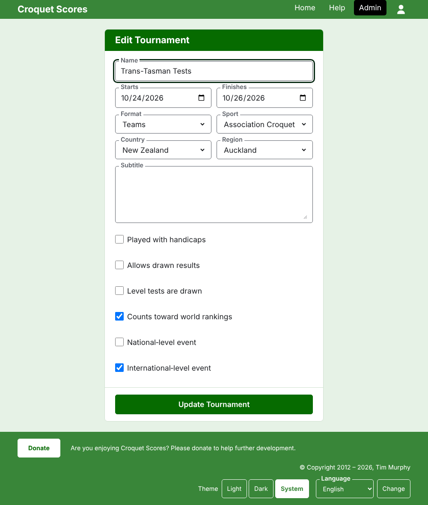

# Ein Turnier ändern, archivieren und wiederherstellen

## Die Angaben zum Turnier ändern

Drücke in der Liste der Turniere in der Verwaltung **Bearbeiten** beim Turnier. Das Formular ist das, mit dem es angelegt wurde, so vorbelegt, wie das Turnier ist. Ändere, was falsch ist, und drücke **Turnier aktualisieren**.

Die Tage des Turniers lassen sich hier erweitern, wenn ein Test einen Tag außerhalb braucht, weil ein Test innerhalb seines Turniers gespielt wird. Ein Format für Mannschaften lässt sich gegen ein anderes tauschen, weil das Turnier in jedem dasselbe enthält. Sobald das Turnier eine Mannschaft oder einen Test enthält, archivierte mitgezählt, kann es nicht mehr zum Format Standard geändert werden, das stattdessen Spieler und Wettbewerbe hat.

Ein Turnier behält seine Adresse, wenn sein Name korrigiert wird, damit ein Link, den jemand schon verschickt hat, es noch findet. Sie ändert sich nur, wenn sich das Jahr seines Beginns oder seine Sportart ändert, und dann führt die alte Adresse zur neuen. Nach dem Speichern kommst du zum Turnier, wo immer es jetzt zu finden ist.

Nur ein Turnierleiter kann ein Turnier ändern. Einem Ergebniserfasser oder sonst jemandem wird das gesagt, statt dass er das Formular sieht.

## Die Liste der Turniere

Die Verwaltung listet jeweils ein Jahr, beginnend mit diesem, das neueste Turnier zuerst. Die Jahre, in denen du ein Turnier hast, sind Reiter in der dunkelgrünen Leiste, das neueste zuerst; passen mehr nicht auf ein Telefon, stehen die ältesten in einer Auswahlliste am Ende der Zeile. Das Jahr steht in der Adresse, ein Jahr lässt sich also verlinken.

## Ein Turnier archivieren

**Archivieren** bei einem Turnier in der Liste legt es beiseite. Es wird weiterhin aufgeführt, durchgestrichen und hinter den Turnieren in Gebrauch, bietet aber nur **Wiederherstellen** an: Seine Seite in der Verwaltung und seine öffentlichen Seiten sind geschlossen, bis es wiederhergestellt wird. Archivieren fragt nicht zuerst, weil das Wiederherstellen es rückgängig macht.

Weiter: [Was die Öffentlichkeit sieht](what-the-public-sees.md).
