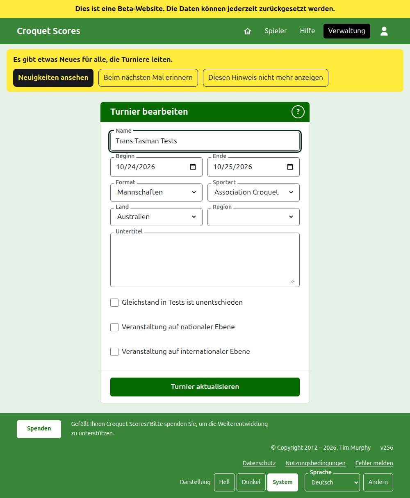
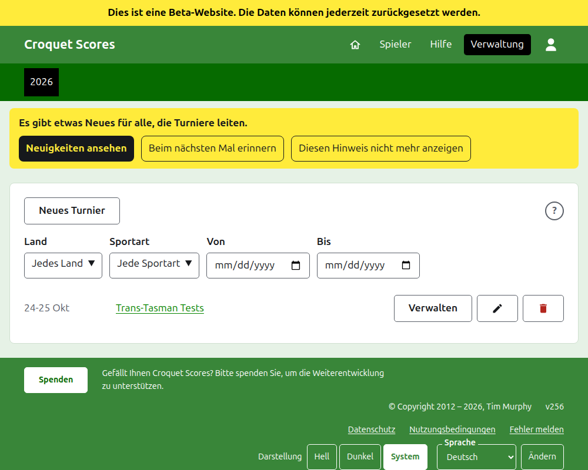

# Ein Turnier ändern, archivieren und wiederherstellen

## Die Angaben zum Turnier ändern

Drücken Sie in der Liste der Turniere in der Verwaltung **Bearbeiten** beim Turnier. Das Formular ist das, mit dem es angelegt wurde, so vorbelegt, wie das Turnier ist. Ändern Sie, was falsch ist, und drücken Sie **Turnier aktualisieren**.

Die Tage des Turniers lassen sich hier erweitern, wenn ein Test einen Tag außerhalb braucht, weil ein Test innerhalb seines Turniers gespielt wird. Sobald das Turnier eine Mannschaft oder einen Test enthält, archivierte mitgezählt, lässt sich sein **Format** überhaupt nicht mehr ändern: weder zum Format Standard, das stattdessen Spieler und Wettbewerbe hat, noch zu einem anderen Format für Mannschaften, weil ein Test in einer Gruppe sein kann, die das andere Format nicht hat. Wählen Sie das Format, wenn das Turnier angelegt wird.

Ein Turnier behält seine Adresse, wenn sein Name korrigiert wird, damit ein Link, den jemand schon verschickt hat, es noch findet. Sie ändert sich nur, wenn sich das Jahr seines Beginns oder seine Sportart ändert, und dann führt die alte Adresse zur neuen. Nach dem Speichern kommen Sie zum Turnier, wo immer es jetzt zu finden ist.

Nur ein Verantwortlicher kann ein Turnier ändern. Einem Ergebniserfasser oder sonst jemandem wird das gesagt, statt dass er das Formular sieht.

## Die Liste der Turniere

Die Verwaltung listet jeweils ein Jahr, beginnend mit diesem, das neueste Turnier zuerst. Die Jahre, in denen Sie ein Turnier haben, sind Reiter in der dunkelgrünen Leiste, das neueste zuerst; passen mehr nicht auf ein Telefon, stehen die ältesten in einer Auswahlliste am Ende der Zeile. Das Jahr steht in der Adresse, ein Jahr lässt sich also verlinken. Unter den Schaltflächen lässt sich die Liste nach **Land**, **Region** und **Sportart** eingrenzen und nach den Tagen, an denen sie Turniere enthält, **Von** und **Bis**. Ein rundes **?** neben **Neues Turnier** führt zur Hilfe.

## Ein Turnier archivieren

**Archivieren** bei einem Turnier in der Liste legt es beiseite. Es wird weiterhin aufgeführt, durchgestrichen und hinter den Turnieren in Gebrauch, bietet aber nur **Wiederherstellen** an: Seine Seite in der Verwaltung und seine öffentlichen Seiten sind geschlossen, bis es wiederhergestellt wird. Archivieren fragt nicht zuerst, weil das Wiederherstellen es rückgängig macht.

Weiter: [Was die Öffentlichkeit sieht](what-the-public-sees.md).
