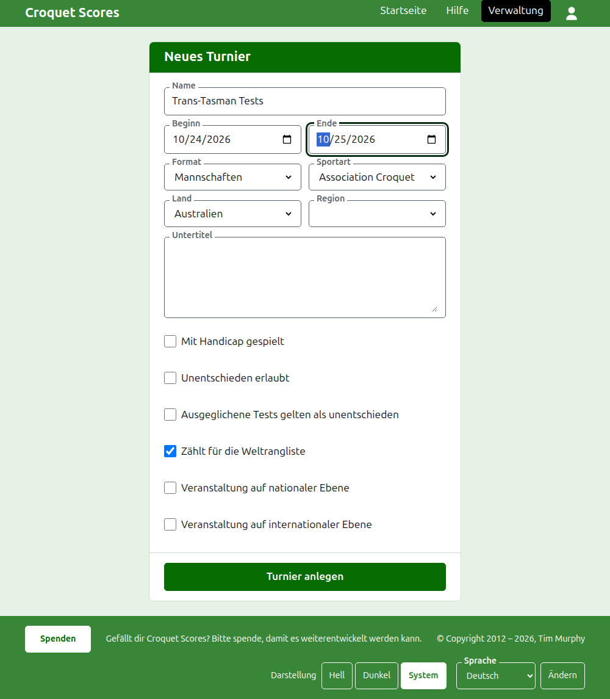
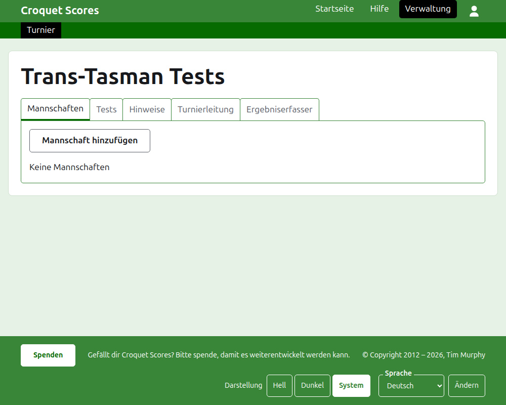

# Ein Turnier anlegen

Drücken Sie **Neues Turnier** über der Liste der Turniere in der Verwaltung. Die Schaltfläche steht über der Liste und nicht darunter, damit eine lange Liste sie nicht vom Bildschirm eines Telefons schiebt.

Das Formular fragt nach allem, womit ein Turnier beginnt. Am wichtigsten ist hier das **Format**, denn es macht ein Turnier zu einem Mannschaftsturnier.

## Wonach das Formular fragt

**Name.** Wonach Leser suchen, um das Turnier zu finden, etwa „Trans-Tasman Tests“. Er ist zwischen 3 und 254 Zeichen lang. Ein Name ganz in Kleinbuchstaben oder ganz in Großbuchstaben wird abgelehnt, weil er auf jeder Seite, die ihn zeigt, wie ein Fehler aussähe. Zwei Turniere dürfen denselben Namen haben, weil dasselbe Turnier jedes Jahr gespielt wird.

**Beginn** und **Ende.** Die Tage, an denen das Turnier läuft. Jeder Test wird innerhalb dieser Tage gespielt, legen Sie sie also so, dass sie die ganze Veranstaltung abdecken. Ein Turnier kann nicht enden, bevor es beginnt, und weder nach dem Ende des nächsten Jahres beginnen noch enden. Ein Turnier gehört zu dem Jahr, in dem es beginnt, das auch das Jahr in seiner Adresse ist.

**Format.** Wählen Sie eines der Formate für Mannschaften:

- **Mannschaften** ist das allgemeine Format für jede Veranstaltung zwischen Mannschaften.
- **Eire Cup**, **Interstate Shield** und **GC-Mannschaftsweltmeisterschaft** sind bestimmte Veranstaltungen, jede als eigenes Format geführt, damit sie so ausgetragen werden kann, wie diese Veranstaltung ausgetragen wird.

Standard ist das einzige Format, das nicht von Mannschaften gespielt wird, und nicht das, was Sie hier wollen. Gateball Scores bietet kein Format an, weil jedes Turnier dort ein Standardturnier im Gateball ist; ein Mannschaftsturnier wird auf Croquet Scores angelegt.

**Sportart.** Die Sportarten, die die Website anbietet, in ihrer Reihenfolge: Association Croquet, Golf Croquet, American 6 Wicket und Ricochet.

**Land** und **Region.** Wo das Turnier gespielt wird. Nach einer Region wird nur gefragt, wenn das gewählte Land in Regionen geteilt ist, wie Australien in Bundesstaaten, und auch dann muss keine gewählt werden.

**Untertitel.** Alles, was Leser wissen sollen und kein eigenes Feld hat: wo man parkt, wann es Mittagessen gibt, wen man anruft. Er steht auf jeder öffentlichen Seite unter dem Namen des Turniers. Er wird in Markdown geschrieben, ein Wort wird also mit Sternchen darum fett, und eine Liste entsteht mit einem Strich am Anfang jeder Zeile. Er darf bis zu 2000 Zeichen lang sein und kann leer bleiben.

Wie die Tests gespielt und gezählt werden, mit Vorgaben, mit Unentschieden und für die Weltranglisten, sagt jeder Test selbst, wenn er hinzugefügt wird.

**Veranstaltung auf nationaler Ebene** und **Veranstaltung auf internationaler Ebene.** Ein Turnier kann das eine, das andere oder keines von beiden sein, aber nie beides: Wer das eine anhakt, nimmt beim anderen den Haken weg.

## Anlegen

Drücken Sie **Turnier anlegen**. Sie kommen auf die Seite des Turniers in der Verwaltung, geöffnet auf dem Reiter Mannschaften, und Sie sind sein erster Verantwortlicher. Es wird in der Verwaltung unter dem Jahr aufgeführt, in dem es beginnt.

Die öffentliche Adresse des Turniers wird aus seinem Jahr, seiner Sportart und seinem Namen gebildet, etwa `/2026/ac/trans-tasman-tests`. Es behält diese Adresse, wenn sein Name später korrigiert wird, damit ein schon verschickter Link es noch findet; sie ändert sich nur, wenn sich das Jahr seines Beginns oder seine Sportart ändert.

## Wenn etwas abgelehnt wird

Was abgelehnt wird, steht unter dem Feld, um das es geht, und was Sie eingegeben haben, bleibt stehen. Nichts wird gespeichert, bevor jedes Feld angenommen ist. Am häufigsten abgelehnt werden ein Name ganz in Kleinbuchstaben, ein Ende vor dem Beginn und ein nicht gewähltes Land.

Weiter: [Mannschaften](teams.md).
