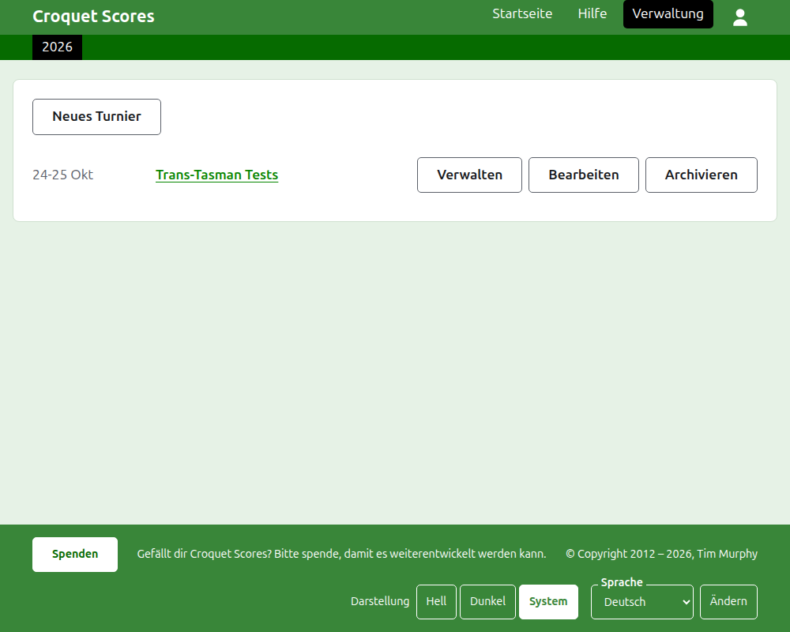
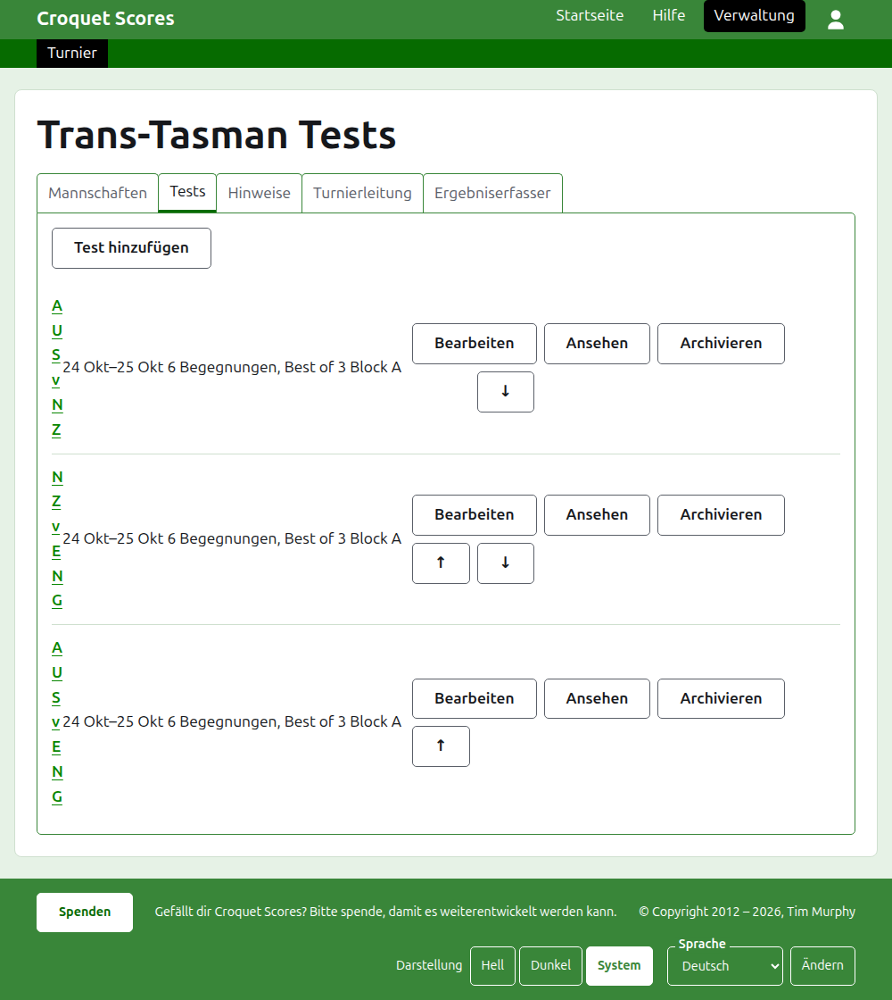

# Ein Mannschaftsturnier leiten

Ein Mannschaftsturnier ist eines, in dem Seiten aufeinandertreffen statt einzeln gemeldeter Spieler: eine Testserie zwischen zwei Ländern, ein Interstate Shield, eine Mannschaftsweltmeisterschaft. Seine Mannschaften werden mit ihren Spielern angelegt, die Tests zwischen den Mannschaften hinzugefügt, und die Spiele jedes Tests erscheinen, sobald sie gespielt werden. Diese Anleitung begleitet einen Verantwortlichen vom Anmelden bis zu einem Turnier, dessen Ergebnisse öffentlich zu sehen sind.

Sie steht für sich. Nichts darin hängt von der Anleitung zu einem Standardturnier ab, die eigens geschrieben ist.

## Bevor Sie beginnen

Sie brauchen ein Konto. Klicken Sie [hier](/account/register), um eines zu registrieren.

Alles, was ein Verantwortlicher tut, geschieht im Verwaltungsbereich der Website. Die öffentlichen Seiten, auf denen Spieler und Zuschauer das Turnier verfolgen, werden aus dem gezeichnet, was die Verwaltung enthält, es muss also nichts veröffentlicht werden: Ein eingegebenes Ergebnis steht sofort auf den öffentlichen Seiten.

## Die Begriffe

Eine **Mannschaft** ist eine Seite, etwa Australien, mit einem Namen, einem Kurznamen wie „AUS“ und einer Flagge. Eine Mannschaft hat eigene **Spieler**, die für sie und für niemanden sonst spielen. Ein **Test** ist ein Wettkampf zwischen zwei Mannschaften, nach ihren Kurznamen benannt, etwa „AUS v ENG“, der aus einer Anzahl von **Begegnungen** zwischen je einem Spieler jeder Mannschaft besteht, wobei jede Begegnung über eine bestimmte Zahl von **Spielen** höchstens geht. Tests können in **Gruppen** zusammengefasst werden, etwa „Block A“, wo viele Mannschaften untereinander spielen.

## Die Seiten in ihrer Reihenfolge

1. [Ein Turnier anlegen](creating-a-tournament.md): sein Name, seine Tage, seine Sportart, sein Format und wo es gespielt wird.
2. [Mannschaften](teams.md): die Mannschaften hinzufügen, mit ihren Kurznamen und Flaggen.
3. [Die Spieler einer Mannschaft](team-players.md): die Spieler jeder Mannschaft auf der Seite der Mannschaft eingeben.
4. [Tests](tests.md): die Tests zwischen Mannschaften hinzufügen, ihre Tage, wie viele Begegnungen jeder hat, und ihre Gruppen.
5. [Ergebnisse](scores.md): die Spiele eines Tests eingeben, korrigieren und die versehentlich eingegebenen beiseitelegen.
6. [Notizen](notes.md): den Spielern sagen, was sie im Lauf des Turniers wissen müssen.
7. [Verantwortliche und Ergebniserfasser](managers-and-scorers.md): die Leitung des Turniers teilen und jemanden Ergebnisse eingeben lassen, ohne dass er sonst etwas ändern kann.
8. [Ranglisten](rankings.md): die Datei, die an die Weltrangliste geschickt wird, und was für Sie noch auszufüllen bleibt.
9. [Ein Turnier ändern, archivieren und wiederherstellen](changing-and-archiving.md): die Angaben zum Turnier korrigieren und ein Turnier beiseitelegen.
10. [Was die Öffentlichkeit sieht](what-the-public-sees.md): die Seiten, die Ihre Spieler verfolgen, und wie das, was Sie eingeben, dort erscheint.

## Wie die Verwaltung aufgebaut ist

Die Eingangsseite der Verwaltung listet die Turniere, an denen Sie beteiligt sind, jeweils für ein Jahr.

Ein Druck auf den Namen eines Turniers oder auf **Verwalten** öffnet seine Seite. Alles, was zu tun ist, liegt in sechs Reitern unter seinem Namen: **Mannschaften**, **Tests**, **Notizen**, **Verantwortliche**, **Ergebniserfasser** und **Ranglisten**. Die Seite öffnet sich auf Mannschaften, weil die Mannschaften als Erstes angelegt werden.

Die dunkelgrüne Leiste unter der Kopfzeile dient dem Wechsel zwischen Seiten. Auf der Turnierseite und auf der Seite eines Tests führt sie zum Turnier, als **Turnier**, und zu jedem Test mit seinem Namen. Auf der Seite einer Mannschaft führt sie stattdessen zum Turnier und zu jeder Mannschaft mit ihrem Kurznamen, weil ein Verantwortlicher auf der Seite einer Mannschaft Spieler Mannschaft für Mannschaft eingibt. Die Seite, auf der Sie sind, ist schwarz markiert.

## Was überall gilt

**Außer einer Notiz wird nichts endgültig gelöscht.** Mannschaften, Spieler, Tests, Ergebnisse und das Turnier selbst werden archiviert statt gelöscht: beiseitegelegt, durchgestrichen und unter einer eigenen Überschrift aufgeführt, mit **Wiederherstellen**, um sie zurückzuholen. Archivieren, Wiederherstellen und das Verschieben nach oben und unten fragen nie nach einer Bestätigung, weil sich jedes davon durch einen Druck in die Gegenrichtung rückgängig machen lässt. Was sich nicht rückgängig machen lässt, etwa eine Notiz zu löschen oder einen Verantwortlichen zu entfernen, fragt zuerst.

**Ein Dialog über der Seite speichert nichts, bis Sie seine Schaltfläche drücken.** Abbrechen oder die Escape-Taste schließt ihn und lässt alles, wie es war. Dialoge, die etwas hinzufügen, etwa Mannschaft hinzufügen und Ergebnis hinzufügen, bleiben nach jedem Hinzufügen offen, damit sich eine Liste in einem Zug eingeben lässt.

**Was abgelehnt wird, steht neben dem Feld, um das es geht.** Nichts Abgelehntes wird gespeichert, und was Sie eingegeben haben, bleibt stehen, damit Sie es berichtigen können, statt es neu einzugeben.

**Die Verwaltung funktioniert auf dem Telefon.** Jede Schaltfläche ist groß genug für einen Daumen, und nichts ist breiter als der Bildschirm.

Weiter: [Ein Turnier anlegen](creating-a-tournament.md).
