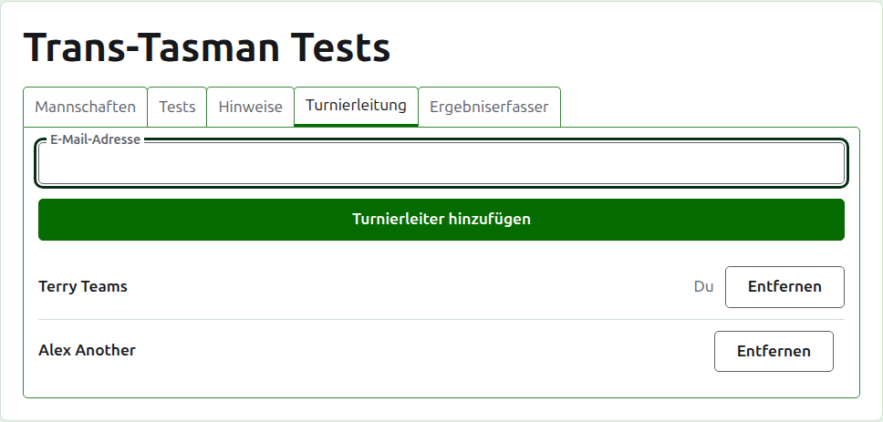
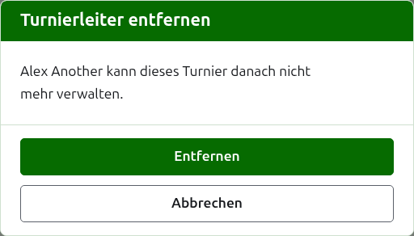
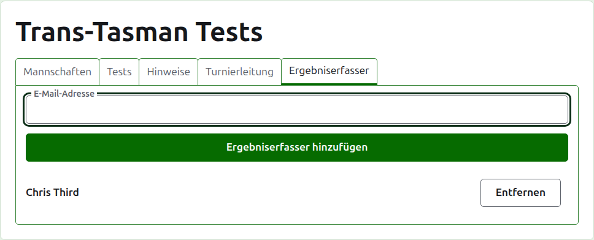
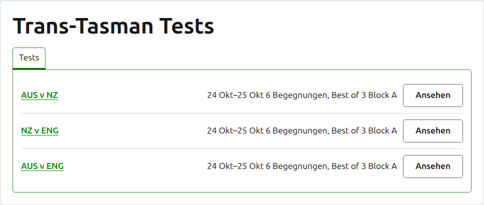

# Verantwortliche und Ergebniserfasser

Ein Turnier hat Verantwortliche, die alles tun können, was sich mit ihm tun lässt, und kann Ergebniserfasser haben, die seine Ergebnisse eingeben und sonst nichts. Wer das Turnier angelegt hat, ist sein erster Verantwortlicher.

## Verantwortliche {#managers}

Der Reiter **Verantwortliche** listet, wer das Turnier leitet, in der Reihenfolge, in der sie dazu gemacht wurden, mit Ihrem eigenen Namen als Ihrem markiert. Hier wird ein Turnier geteilt oder weitergegeben.

Jemand wird über seine E-Mail-Adresse zum Verantwortlichen gemacht. Geben Sie sie in das Feld über der Liste ein und drücken Sie **Verantwortlichen hinzufügen**. Die Adresse muss zu einem registrierten und bestätigten Konto gehören; eine Adresse ohne eines wird unter dem Feld abgelehnt, und mehr sagt die Website nicht dazu. Ein Ergebniserfasser, der zum Verantwortlichen gemacht wird, hört auf, Ergebniserfasser zu sein.

**Entfernen** nimmt einen Verantwortlichen heraus. Von einem entfernten Verantwortlichen wird nichts behalten, deshalb fragt Entfernen zuerst; wenn er zurückgewollt wird, wird er über seine Adresse wieder zum Verantwortlichen gemacht. Ein Turnier hat immer einen Verantwortlichen, deshalb wird dem letzten Entfernen nicht angeboten.

Sie können sich selbst herausnehmen. Die Frage sagt dann, was das bedeutet: Sie verlieren Ihren eigenen Weg zurück zum Turnier, und niemand auf der Seite kann das für Sie rückgängig machen. Ein anderer Verantwortlicher kann Sie wieder zum Verantwortlichen machen.

## Ergebniserfasser {#scorers}

Der Reiter **Ergebniserfasser** ist der Reiter Verantwortliche für Ergebniserfasser und funktioniert genauso: eine E-Mail-Adresse und **Ergebniserfasser hinzufügen** über der Liste, und **Entfernen** bei jedem.

Ein Ergebniserfasser sieht das Turnier in seiner eigenen Liste in der Verwaltung, mit **Ergebnisse** an der Stelle von Verwalten, und bekommt nur seine Tests angeboten: keine Mannschaften, Notizen, Verantwortliche, Ergebniserfasser oder Ranglisten. Die Seite einer Mannschaft kann er nicht öffnen, weil die Verantwortlichen entscheiden, wer für eine Mannschaft spielt. Auf der Seite eines Tests kann er Ergebnisse eingeben, korrigieren, archivieren, wiederherstellen und ordnen wie ein Verantwortlicher.

Ein Verantwortlicher wird nicht zum Ergebniserfasser gemacht, weil ein Verantwortlicher schon alles kann, was ein Ergebniserfasser kann. Ein Turnier braucht keinen Ergebniserfasser, deshalb kann jeder Ergebniserfasser entfernt werden, auch der letzte.

Weiter: [Ranglisten](rankings.md).
