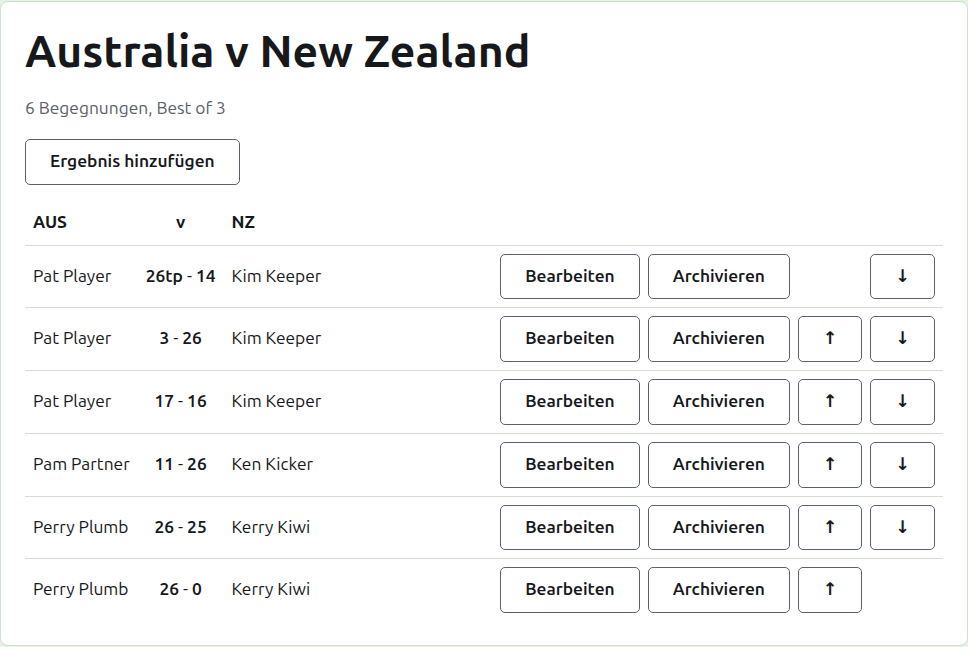
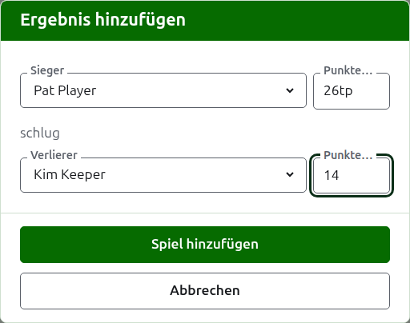

# Ergebnisse

Die Seite eines Tests wird über seinen Namen auf dem Reiter Tests oder über die dunkelgrüne Leiste geöffnet. Ihre Überschrift sind die vollen Namen seiner Mannschaften, etwa „Australia v New Zealand“, mit der Zahl der erwarteten Begegnungen und dem Best of jeder darunter. Seine Ergebnisse sind die Seite, ohne Reiter. Ein Verantwortlicher und ein Ergebniserfasser sehen dieselbe Seite, weil ein Ergebniserfasser mit einem Ergebnis alles tun kann, was ein Verantwortlicher kann.

## Wie die Ergebnisse angeordnet sind

Die Ergebnisse sind nach Mannschaft angeordnet und nicht danach, wer gewonnen hat, in einer Tabelle, deren Überschrift der Kurzname der ersten Mannschaft, „v“ und der der zweiten ist. Jedes Ergebnis ist eine Zeile: der Spieler der ersten Mannschaft, dann beide Punktzahlen mit der der ersten Mannschaft zuerst, etwa „26tp - 14“, dann der Spieler der zweiten Mannschaft, wer von ihnen auch gewonnen hat. Die archivierten Ergebnisse sind darunter genauso angeordnet.

## Ein Ergebnis eingeben

Drücken Sie **Ergebnis hinzufügen** über der Liste. Der Dialog liest sich, wie ein Ergebnis gesagt wird: der Sieger und seine Punkte, dann „schlug“, dann der Verlierer und seine Punkte.

Der Sieger wird aus den Spielern beider Mannschaften in Gebrauch gewählt, unter dem Namen jeder Mannschaft, die Spieler der ersten Mannschaft zuerst und die jeder Mannschaft in ihrer Reihenfolge. Zu Beginn ist niemand gewählt. Sobald der Sieger gewählt ist, wird der Verlierer nur aus der anderen Mannschaft angeboten, weil ein Spiel zwischen zwei Spielern derselben Mannschaft kein Spiel zwischen den Mannschaften ist. Ein archivierter Spieler wird nicht angeboten.

Punkte werden so eingegeben, wie der Erfasser sie aufgeschrieben hat: ihre Zahl und was darauf folgt, was so gespeichert und gezeigt wird, wie es eingegeben wurde, etwa „26tp“ für 26 Tore und einen Triple Peel. Die Zahl sind die Ziffern, mit denen die Punkte beginnen; Punkte, die nicht mit einer Ziffer beginnen, werden abgelehnt.

Ein Spiel, das bei gleichen Punkten gewonnen wurde, etwa weil es durch die Zeit beendet und anders entschieden wurde, sagt durch eine Markierung hinter den Punkten des Siegers, wer gewonnen hat: „6w“ schlug „6“. Die Markierungen sind „w“, „won“ und „winner“. Die Punkte des Siegers müssen höher sein als die des Verlierers oder markiert, es sei denn, das Turnier erlaubt Unentschieden; dann werden gleiche Punkte ohne Markierung als Unentschieden gespeichert.

Drücken Sie **Spiel hinzufügen**. Das Spiel wird hinzugefügt, der Dialog sagt welches, und die Felder werden für das nächste geleert, weil Ergebnisse am Ende einer Sitzung im Schwung von einer Tafel abgelesen werden. Drücken Sie **Abbrechen**, wenn alle drin sind.

## Begegnungen

Zwei Spieler, die aufeinandertreffen, spielen eine Begegnung über das Best of des Tests. Die Spiele zwischen ihnen sind die Spiele dieser Begegnung, und ein Spiel zwischen zwei Spielern, deren Begegnung schon entschieden ist, wird abgelehnt: Einer von ihnen hat mehr Spiele gewonnen, als der andere noch gewinnen könnte, oder jedes Spiel der Begegnung ist gespielt.

Eine Begegnung hat begonnen, wenn ihre beiden Spieler ein Spiel in Gebrauch haben. Ein Test beginnt nicht mehr Begegnungen, als er erwartet: Sobald so viele begonnen haben, wird ein Spiel zwischen zwei Spielern, die sich noch nicht getroffen haben, abgelehnt, während ein weiteres Spiel einer schon begonnenen Begegnung angenommen wird. Soll der Test mehr Begegnungen haben, ändern Sie ihn auf dem Reiter Tests, sodass er sie erwartet.

## Ein Ergebnis korrigieren

**Bearbeiten** öffnet denselben Dialog für dieses Ergebnis, mit dem Titel Ergebnis bearbeiten, mit seinen Spielern gewählt und seinen Punkten, wie sie eingegeben wurden. Neben seinen Punkten lassen sich auch seine Spieler ändern, gewählt wie beim Hinzufügen. Drücken Sie **Speichern**, um die Korrektur zu speichern und den Dialog zu schließen. Eine Korrektur behält das Ergebnis bei: Ein gewonnenes Spiel bleibt gewonnen, und ein unentschiedenes bleibt unentschieden. Ein Spiel, dessen Ergebnis falsch war, wird archiviert und neu eingegeben.

## Die Ergebnisse ordnen

Ergebnisse kommen in der Reihenfolge, in der sie eingegeben werden, deshalb bietet jedes Ergebnis in Gebrauch **Nach oben** und **Nach unten** an, was es mit dem Ergebnis daneben tauscht, damit die Liste in die Reihenfolge gebracht werden kann, in der die Spiele gespielt wurden.

## Ein Ergebnis archivieren

**Archivieren** legt ein Ergebnis beiseite, sodass es für nichts zählt. Es steht unter **Archivierte Ergebnisse**, durchgestrichen, und bietet nur **Wiederherstellen** an. Keines von beiden fragt zuerst, weil jedes das andere rückgängig macht. Jedes Ergebnis eines Tests kann archiviert werden, weil ein Test keine Runden hat, die voneinander abhängen.

Ein Ergebnis, dessen Spieler seither archiviert wurde, wird nicht wiederhergestellt, bevor der Spieler es ist, und die Seite sagt das.

Weiter: [Notizen](notes.md).
