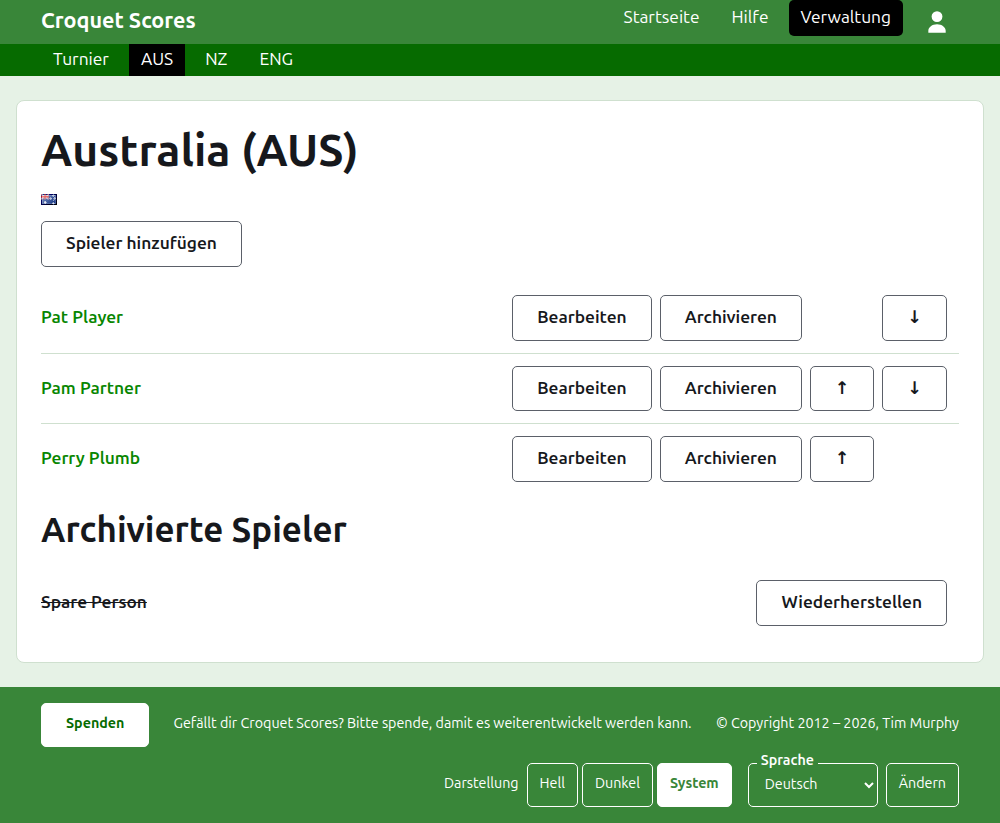
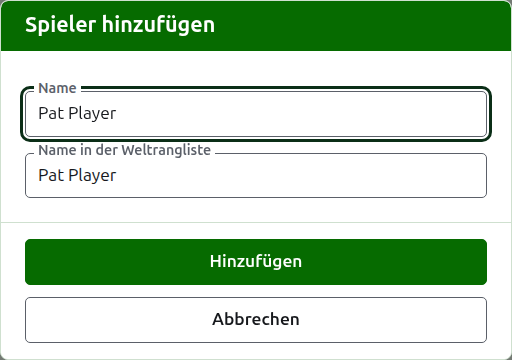

# Die Spieler einer Mannschaft

Die Seite einer Mannschaft wird über ihren Namen oder ihr **Ansehen** auf dem Reiter Mannschaften geöffnet. Ihre Überschrift ist der Name der Mannschaft mit dem Kurznamen in Klammern und ihrer Flagge, damit ein Verantwortlicher, der zur falschen Mannschaft gekommen ist, es sofort sieht. Sie hat nur eines zu zeigen, die Spieler der Mannschaft, die Liste ist also die Seite.

Die dunkelgrüne Leiste auf der Seite einer Mannschaft führt zum Turnier und zu jeder Mannschaft in Gebrauch mit ihrem Kurznamen, damit die Spieler Mannschaft für Mannschaft eingegeben werden können, ohne zum Reiter Mannschaften zurückzugehen.

Ein Spieler einer Mannschaft gehört allein zu dieser Mannschaft, vertritt die Mannschaft und führt ihre Flagge statt einer eigenen. Dieselbe Person, die für zwei Mannschaften oder in zwei Turnieren spielt, ist in jedem ein eigener Spieler.

## Einen Spieler hinzufügen {#adding-a-player}

Drücken Sie **Spieler hinzufügen** über der Liste. Ein Dialog öffnet sich über der Seite.

**Name** ist Pflicht, zwischen 3 und 254 Zeichen lang. Zwei Spieler einer Mannschaft können nicht denselben Namen haben, wie auch immer er groß- und kleingeschrieben ist; ein Spieler einer anderen Mannschaft darf ihn teilen.

**Name des Weltranglistenspielers** ist der Name, unter dem die Weltrangliste den Spieler kennt. Danach wird nur bei einem Turnier im Association Croquet oder Golf Croquet gefragt, den beiden Sportarten, deren Spieler die Weltrangliste in einer Liste führt. Die Spieler im American 6 Wicket sind der Rangliste unter ihrem eigenen Namen bekannt; danach wird dort also nicht gefragt, und der Name in der Weltrangliste ist bei jedem Spieler immer sein Name. Während Sie einen Spieler hinzufügen, folgt er dem Namen, während Sie ihn tippen, und hört auf zu folgen, sobald Sie in ihm selbst tippen. Bleibt er leer, wird der Name des Spielers gespeichert. Während Sie tippen, werden die Spieler angeboten, die die Weltrangliste kennt und deren Namen so beginnen, und neben dem Namen in der Weltrangliste sagt ein Haken, dass die Rangliste den Namen kennt, und ein Fragezeichen, dass sie ihn nicht kennt. Das ist nur ein Hinweis: Ein Name, den die Rangliste nicht kennt, wird genauso bereitwillig gespeichert wie einer, den sie kennt.

Ein Spieler heißt nie „Bye“, das englische Wort für Freilos: Ein Name, dessen erstes Wort „bye“ ist, wird abgelehnt.

Drücken Sie **Hinzufügen**. Der Spieler wird hinzugefügt, der Dialog sagt es, und seine Felder werden für den nächsten geleert, mit dem Cursor wieder im Namen. Geben Sie so die ganze Mannschaft ein und drücken Sie dann **Abbrechen**, um den Dialog zu schließen.

## Einen Spieler korrigieren {#correcting-a-player}

Drücken Sie den Namen eines Spielers oder sein **Bearbeiten**, um denselben Dialog für diesen Spieler zu öffnen, mit dem Titel Spieler bearbeiten. Drücken Sie **Speichern**, um die Änderung zu speichern. Ein Spieler, dessen Name korrigiert wird, behält den Namen in der Weltrangliste, den er hatte, außer im American 6 Wicket, wo der Name eines Spielers in der Weltrangliste immer sein Name ist.

## Reihenfolge

Die Spieler sind in der Reihenfolge der Mannschaft aufgeführt; das ist die Reihenfolge, in der sie angeboten werden, wenn das Ergebnis eines Tests eingegeben wird. **Nach oben** und **Nach unten** verschieben einen Spieler innerhalb der Mannschaft um einen Platz.

## Einen Spieler archivieren

**Archivieren** legt einen Spieler beiseite: versehentlich eingegeben oder nicht mehr bei der Mannschaft. Ein archivierter Spieler steht unter **Archivierte Spieler**, durchgestrichen, hinter den Spielern in Gebrauch, und bietet nur **Wiederherstellen** an. Archivieren fragt nie zuerst, weil ein Spieler einer Mannschaft in nichts anderem aufgenommen ist und das Wiederherstellen alles zurückbringt.

Ein Spieler, der in einem Test irgendein Spiel in Gebrauch gespielt hat, kann nicht archiviert werden, weil die Spiele dann gegen jemanden wären, den es nicht mehr gibt; einem solchen Spieler wird Archivieren deshalb nicht angeboten. Ein Spieler, dessen Spiele alle archiviert sind, kann archiviert werden.

Weiter: [Tests](tests.md).
