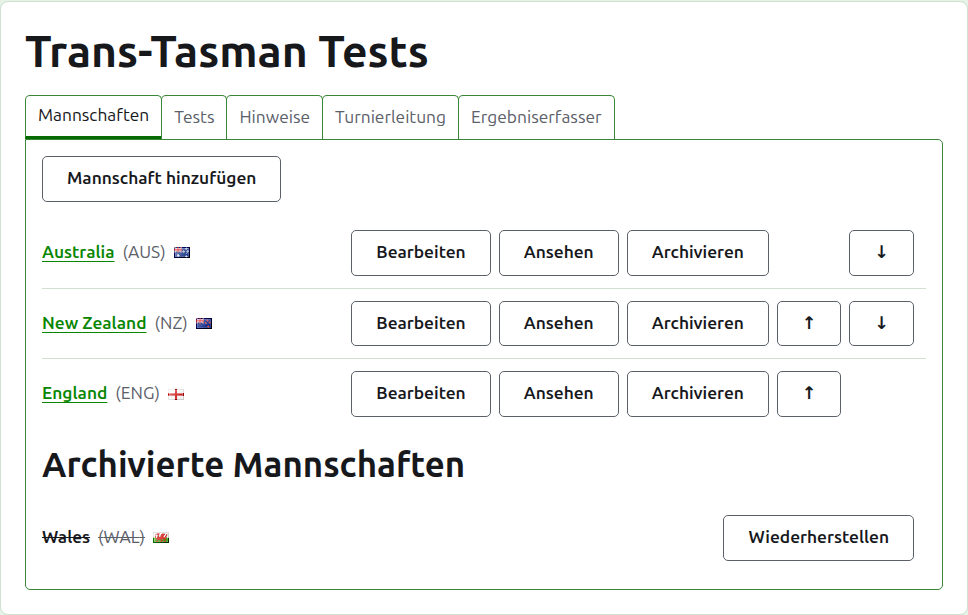
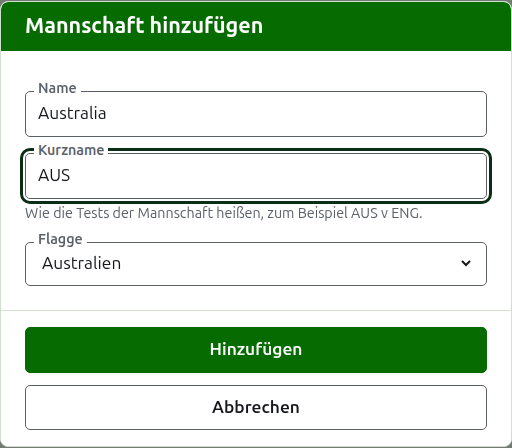
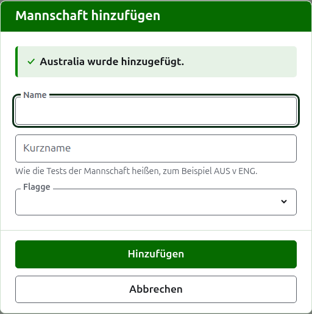
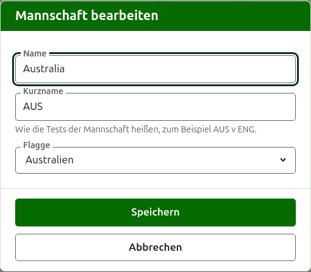

# Mannschaften

Auf dem Reiter **Mannschaften** der Turnierseite werden die Mannschaften des Turniers hinzugefügt, korrigiert, geordnet und beiseitegelegt. Es ist der Reiter, auf dem sich die Seite öffnet, weil die Mannschaften als Erstes angelegt werden. Ein Test findet zwischen zwei Mannschaften statt, es braucht also mindestens zwei, bevor ein Test hinzugefügt werden kann.

## Eine Mannschaft hinzufügen {#adding-a-team}

Drücken Sie **Mannschaft hinzufügen** über der Liste. Ein Dialog öffnet sich über der Seite.

**Name** ist Pflicht: der volle Name der Mannschaft, etwa „Australia“, der die Seite der Mannschaft und die Tabellen der öffentlichen Seiten überschreibt. Zwei Mannschaften eines Turniers können nicht denselben Namen haben.

**Kurzname** ist ebenfalls Pflicht: wie die Tests der Mannschaft heißen, etwa „AUS v ENG“, und wie die dunkelgrüne Leiste die Mannschaft nennt. Er ist höchstens 10 Zeichen lang und nicht länger als der Name, weil ein Kurzname, der länger ist als der Name, den er abkürzt, die beiden vertauscht eingegeben sind. Zwei Mannschaften können auch nicht denselben Kurznamen haben.

**Flagge** wird überall neben dem Namen der Mannschaft gezeigt. Sie kann auf „keine“ bleiben, etwa bei der Mannschaft eines Vereins oder einer Region.

Drücken Sie **Hinzufügen**. Die Mannschaft wird hinzugefügt, der Dialog sagt es, und seine Felder werden für die nächste geleert. Geben Sie so die ganze Liste ein und drücken Sie dann **Abbrechen**, um den Dialog zu schließen. Abbrechen speichert nichts, was nicht schon hinzugefügt war.

## Eine Mannschaft korrigieren {#correcting-a-team}

Drücken Sie das **Bearbeiten** einer Mannschaft, um denselben Dialog für diese Mannschaft zu öffnen, mit dem Titel Mannschaft bearbeiten. Ändern Sie, was falsch ist, und drücken Sie **Speichern**. Eine Mannschaft, deren Kurzname sich ändert, heißt überall nach dem neuen, ihre Tests werden also mit ihm umbenannt.

## Reihenfolge

Die Mannschaften sind in der Reihenfolge des Turniers aufgeführt; das ist die Reihenfolge, in der sie beim Hinzufügen eines Tests angeboten werden, die Reihenfolge der dunkelgrünen Leiste und die Reihenfolge, in der die öffentliche Seite Spieler sie listet. **Nach oben** und **Nach unten**, die Pfeile am Ende jeder Zeile, verschieben eine Mannschaft um einen Platz.

## Zu einer Mannschaft gehen

Der Name einer Mannschaft oder **Ansehen** öffnet die eigene Seite der Mannschaft, auf der ihre Spieler eingegeben werden. Siehe [Die Spieler einer Mannschaft](team-players.md).

## Eine Mannschaft archivieren

**Archivieren** legt eine Mannschaft beiseite. Ihre Spieler bleiben bei ihr und kommen zurück, wenn sie wiederhergestellt wird, deshalb fragt Archivieren nicht zuerst. Eine archivierte Mannschaft steht unter **Archivierte Mannschaften**, durchgestrichen, bietet nur **Wiederherstellen** an, und ihre Seite ist geschlossen, bis sie wiederhergestellt wird.

Eine Mannschaft, die in einem Test in Gebrauch spielt, kann nicht archiviert werden, weil der Test dann gegen eine Mannschaft wäre, die es nicht mehr gibt; einer solchen Mannschaft wird Archivieren deshalb nicht angeboten. Eine Mannschaft, deren Tests alle archiviert sind, kann archiviert werden.

Weiter: [Die Spieler einer Mannschaft](team-players.md).
