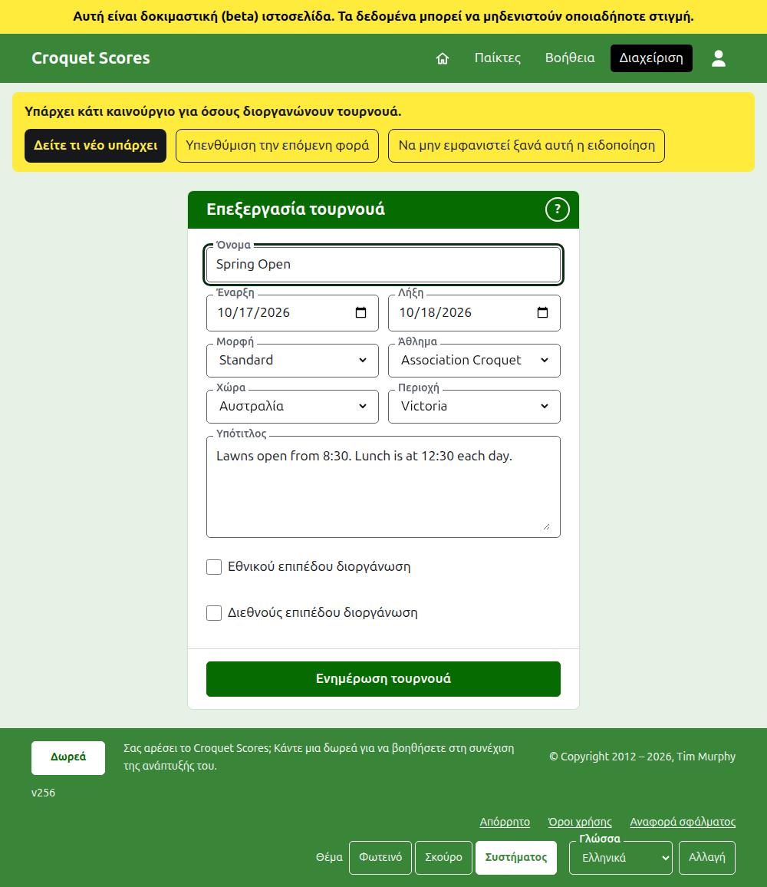
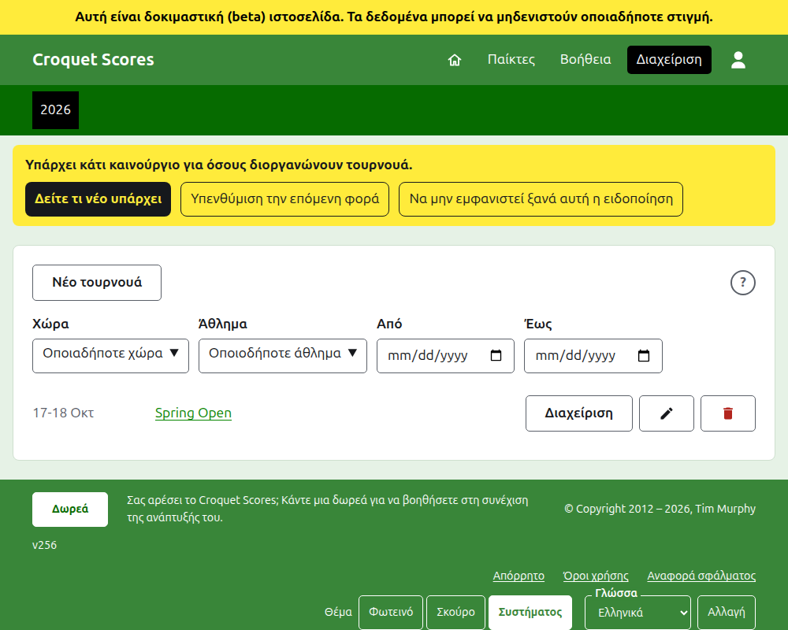
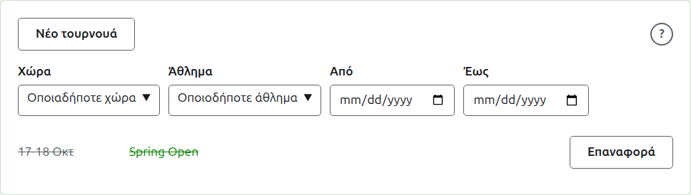

# Αλλαγή, αρχειοθέτηση και επαναφορά ενός τουρνουά

## Αλλαγή των στοιχείων του τουρνουά

Στη λίστα τουρνουά στη διαχείριση, πατήστε **Επεξεργασία** στο τουρνουά. Η φόρμα είναι αυτή που το δημιούργησε, συμπληρωμένη όπως είναι το τουρνουά. Αλλάξτε ό,τι είναι λάθος και πατήστε **Ενημέρωση τουρνουά**.

Μόλις το τουρνουά έχει οποιονδήποτε παίκτη ή αγώνισμα, μετρώντας και τα αρχειοθετημένα, η μορφή του δεν μπορεί να αλλάξει σε μορφή που παίζεται από ομάδες, η οποία έχει αντί για αυτά ομάδες και τεστ.

Ένα τουρνουά κρατά τη διεύθυνσή του όταν διορθωθεί το όνομά του, ώστε ένας σύνδεσμος που έχει ήδη στείλει κάποιος να το βρίσκει ακόμα. Αλλάζει μόνο όταν αλλάξει η χρονιά που ξεκινά ή το άθλημά του και τότε η παλιά διεύθυνσή του οδηγεί στη νέα. Η αποθήκευση σας πηγαίνει στο τουρνουά όπου βρίσκεται τώρα.

Μόνο ένας υπεύθυνος μπορεί να αλλάξει ένα τουρνουά. Ένας καταχωρητής, ή οποιοσδήποτε άλλος, ενημερώνεται γι' αυτό αντί να δει τη φόρμα.

## Η λίστα τουρνουά

Η διαχείριση παραθέτει μία χρονιά τη φορά, ξεκινώντας με τη φετινή, με το νεότερο τουρνουά πρώτο. Οι χρονιές στις οποίες έχετε ένα τουρνουά είναι καρτέλες στη σκούρα πράσινη γραμμή, με τις νεότερες πρώτες· όπου είναι περισσότερες από όσες χωρούν σε τηλέφωνο, οι παλαιότερες βρίσκονται σε μια αναπτυσσόμενη λίστα στο τέλος της σειράς. Η χρονιά βρίσκεται στη διεύθυνση, γι' αυτό μπορείτε να συνδεθείτε σε μια χρονιά.

Πάνω από τη λίστα, οι **Χώρα**, **Περιοχή**, **Άθλημα**, **Από** και **Έως** την περιορίζουν καθώς επιλέγονται, χωρίς κουμπί να πατήσετε. Προσφέρονται μόνο επιλογές που θα παρέθεταν κάτι και μια περιοχή προσφέρεται μόλις επιλεγεί μια χώρα. Το **Από** και το **Έως** είναι ημέρες: η λίστα είναι των τουρνουά που ξεκινούν από τη μία έως την άλλη, και τις δύο συμπεριλαμβανομένες, και πρέπει να επιλεγούν και οι δύο για να περιοριστεί η λίστα με ημέρες. Ό,τι επιλέγεται βρίσκεται στη διεύθυνση, γι' αυτό μια περιορισμένη λίστα μπορεί να συνδεθεί· η επιλογή άλλης χρονιάς την καθαρίζει. Μια χρονιά με περισσότερα από εκατό τουρνουά παρατίθεται εκατό ανά σελίδα, με **Προηγούμενη** και **Επόμενη** από κάτω. Ένα εθνικό ή διεθνές τουρνουά εμφανίζεται με έντονα γράμματα σε ολόκληρη τη γραμμή του.

## Αρχειοθέτηση ενός τουρνουά

Η **Αρχειοθέτηση** σε ένα τουρνουά στη λίστα το παραμερίζει. Παρατίθεται ακόμα, διαγραμμισμένο και μετά τα τουρνουά που χρησιμοποιούνται, αλλά προσφέρει μόνο **Επαναφορά**: η σελίδα του στη διαχείριση, και οι δημόσιες σελίδες του, είναι κλειστές μέχρι να επαναφερθεί. Η αρχειοθέτηση δεν ρωτά πρώτα, αφού η επαναφορά την αναιρεί.

Επόμενο: [Τι βλέπει το κοινό](what-the-public-sees.md).
