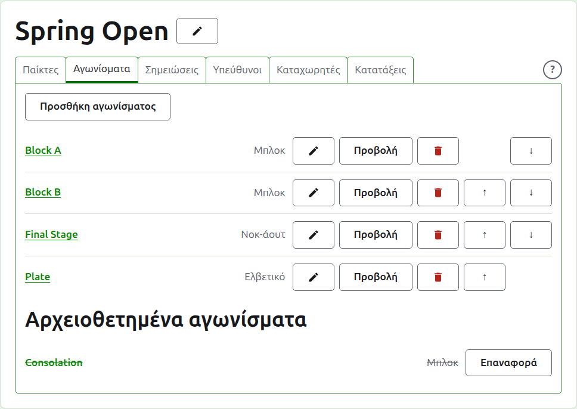
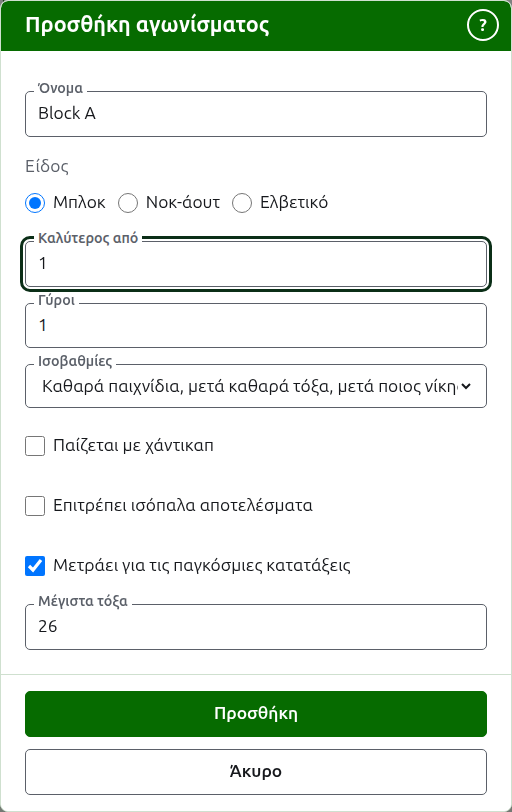
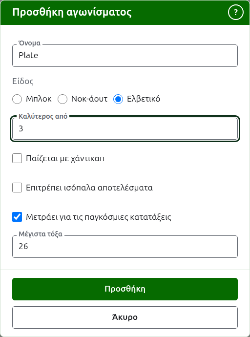
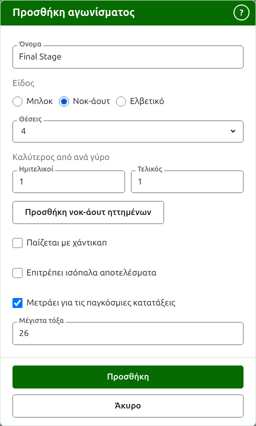

# Αγωνίσματα

Η καρτέλα **Αγωνίσματα** της σελίδας ενός τουρνουά είναι εκεί όπου τα αγωνίσματά του προστίθενται, μπαίνουν σε σειρά και παραμερίζονται. Ένα αγώνισμα είναι ένα μπλοκ, ένα νοκ-άουτ ή ένα ελβετικό. Το καθένα έχει δική του σελίδα, όπου καταχωρίζονται οι παίκτες του και μπαίνουν τα αποτελέσματά του.

## Προσθήκη ενός αγωνίσματος {#adding-a-competition}

Πατήστε **Προσθήκη αγωνίσματος**, πάνω από τη λίστα. Ένα παράθυρο ανοίγει πάνω από τη σελίδα και ζητά το όνομα του αγωνίσματος, το είδος του και το σχήμα που έχει το είδος του.

Το **Όνομα** είναι αυτό που ψάχνουν οι παίκτες στη σελίδα του τουρνουά για να βρουν τα παιχνίδια τους. Έχει από 1 έως 254 χαρακτήρες και αρκεί ένα γράμμα, αφού ένα μπλοκ συχνά λέγεται με ένα. Δύο αγωνίσματα στο ίδιο τουρνουά δεν μπορούν να έχουν το ίδιο όνομα.

Το **Είδος** είναι ένα μπλοκ, ένα νοκ-άουτ ή ένα ελβετικό. Το παράθυρο ξεκινά σε μπλοκ, που είναι τα περισσότερα αγωνίσματα.

### Ένα μπλοκ

Ένα μπλοκ ρωτά ποιος είναι ο **καλύτερος από** για κάθε αγώνα, σε πόσους **γύρους** παίζεται και πώς ξεχωρίζουν οι παίκτες με ίσο αριθμό νικών από τις **Ισοβαθμίες** του.

Το **Καλύτερος από** ξεκινά στο 1. Ο καλύτερος από 3 κερδίζεται από όποιον κερδίσει δύο παιχνίδια. Μπορεί να είναι ζυγός αριθμός, αφού σε ένα μπλοκ ο παίκτης κατατάσσεται με βάση τα παιχνίδια που κερδίζει και ένας αγώνας δύο παιχνιδιών που μοιράστηκαν ένα στο καθένα είναι ένα αποτέλεσμα όπως κάθε άλλο.

Οι **Γύροι** είναι πόσες φορές συναντιέται κάθε ζευγάρι παικτών στο μπλοκ, με έναν αγώνα σε κάθε γύρο. Ξεκινά στο 1 και το 1 είναι σχεδόν πάντα αυτό που θέλει ένα μπλοκ: κάθε παίκτης παίζει με κάθε άλλον μία φορά. Αυξήστε το μόνο για ένα μπλοκ όπου συναντιούνται ξανά, όπως ένα διπλό πρωτάθλημα όλων με όλους, όπου το 2 κάνει κάθε ζευγάρι να παίξει δύο αγώνες.

Οι **Ισοβαθμίες** είναι πώς ξεχωρίζουν οι παίκτες που έχουν κερδίσει το ίδιο ποσοστό των αγώνων τους. Υπάρχουν τρεις τρόποι και τα μπλοκ ενός τουρνουά μπορούν να χρησιμοποιούν διαφορετικούς, αφού οι κανονισμοί διαφέρουν. Το **Καθαρά παιχνίδια, μετά καθαρά τόξα, μετά ποιος νίκησε ποιον** είναι ο τρόπος που κατατάσσονται πάντα τα μπλοκ και είναι εκεί όπου ξεκινά ένα νέο μπλοκ: οι παίκτες με ίσο αριθμό νικών ξεχωρίζουν από τα καθαρά παιχνίδια τους, όσοι εξακολουθούν να είναι ίσοι από τα καθαρά τόξα τους και όσοι εξακολουθούν να είναι ίσοι από το ποιος νίκησε ποιον ανάμεσά τους. Όπου κάθε αγώνας είναι ένα μόνο παιχνίδι, τα καθαρά παιχνίδια παραλείπονται. Το **Ποιος νίκησε ποιον** κοιτάζει μόνο τους αγώνες που έπαιξαν μεταξύ τους οι παίκτες που είναι ίσοι. Το **Άλλο** είναι για κανονισμούς που δεν γνωρίζει η ιστοσελίδα και δεν ξεχωρίζει κανέναν. Οι παίκτες που δεν μπορούν να ξεχωριστούν μοιράζονται μια θέση, που εμφανίζεται ως =2, και η σελίδα λέει κάτω από το πλέγμα πώς ξεχωρίζουν οι παίκτες που είναι ίσοι.

### Ένα ελβετικό

Ένα ελβετικό ρωτά μόνο ποιος είναι ο **καλύτερος από** για κάθε αγώνα, που ξεκινά στο 1, ακριβώς όπως ένα μπλοκ. Ο καλύτερος από 3 κερδίζεται από όποιον κερδίσει δύο παιχνίδια. Μπορεί να είναι ζυγός αριθμός, αφού σε ένα ελβετικό ο παίκτης κατατάσσεται με βάση τα παιχνίδια που κερδίζει και ένας αγώνας δύο παιχνιδιών που μοιράστηκαν ένα στο καθένα είναι ένα αποτέλεσμα όπως κάθε άλλο.

### Ένα νοκ-άουτ

Ένα νοκ-άουτ ρωτά πόσες **θέσεις** έχει η κλήρωσή του και ποιος είναι ο καλύτερος από σε κάθε γύρο. Οι θέσεις προσφέρονται ως 2, 4, 8, 16, 32, 64 και 128, αφού οποιοσδήποτε άλλος αριθμός δεν θα μπορούσε να υποδιπλασιάζεται γύρο με γύρο μέχρι έναν τελικό, και το παράθυρο ξεκινά στο 8. Οι θέσεις που μένουν αφού καταχωριστούν οι παίκτες συμπληρώνονται με bye, που προστίθενται εκεί όπου μπαίνουν οι παίκτες.

Μια κλήρωση έχει τόσους γύρους όσους χρειάζονται για να υποδιπλασιαστούν οι θέσεις της σε μία, γι' αυτό μια κλήρωση 8 θέσεων έχει τρεις γύρους. Το παράθυρο ρωτά ποιος είναι ο καλύτερος από σε καθέναν, όλους μαζί κάτω από τον **Καλύτερος από ανά γύρο**, με τη σειρά που παίζονται. Οι τελευταίοι τρεις ονομάζονται όπως λέγονται οι γύροι μιας κλήρωσης, **Προημιτελικοί**, **Ημιτελικοί** και **Τελικός**, και οι προηγούμενοι με τον αριθμό τους, με τον Γύρο 1 πρώτο. Η επιλογή περισσότερων θέσεων προσθέτει γύρους στην αρχή της κλήρωσης και η επιλογή λιγότερων τους αφαιρεί από την αρχή, ώστε ό,τι πληκτρολογήθηκε για τον τελικό να είναι ακόμα του τελικού. Κάθε γύρος είναι ο καλύτερος από περιττό αριθμό παιχνιδιών, αφού ο αγώνας ενός νοκ-άουτ πρέπει να έχει νικητή.

### Ένα νοκ-άουτ ηττημένων {#losers-knockout}

Ένα νοκ-άουτ μπορεί να στέλνει όσους χάνουν έναν γύρο σε ένα δικό τους νοκ-άουτ, ένα νοκ-άουτ ηττημένων. Κάτω από τον **Καλύτερος από ανά γύρο** ενός νοκ-άουτ, πατήστε **Προσθήκη νοκ-άουτ ηττημένων**. Ένα παράθυρο ρωτά τους **Ηττημένοι του**, τον γύρο του οποίου οι ηττημένοι συνεχίζουν, από κάθε γύρο εκτός από τον τελικό, και το **Όνομα νοκ-άουτ ηττημένων**. Πατήστε **Προσθήκη** για να μπει στη λίστα κάτω από το κουμπί, όπου η **Αφαίρεση** το βγάζει ξανά. Προστίθεται μαζί με το νοκ-άουτ όταν προστεθεί εκείνο και, αν απορριφθεί το ένα από τα δύο, δεν προστίθεται κανένα.

Ένα νοκ-άουτ ηττημένων έχει μια θέση για κάθε αγώνα αυτού του γύρου και κάθε γύρος του είναι ο καλύτερος από 1, κάτι που μπορεί να αλλάξει η **Επεξεργασία**. Οι παίκτες του μπαίνουν καθώς κρίνονται οι αγώνες αυτού του γύρου, με τη σειρά με την οποία κληρώθηκαν, γι' αυτό η καρτέλα **Παίκτες** του τους δείχνει μόνο. Αν ένα παιχνίδι διορθωθεί ή παραμεριστεί, ο ηττημένος μετακινείται ή αφαιρείται ξανά, εκτός αν έχει παίξει παρακάτω.

Η σελίδα ενός νοκ-άουτ έχει μια τρίτη καρτέλα, τους **Ηττημένους**, μετά τους Παίκτες και τα Αποτελέσματα, που παραθέτει τα νοκ-άουτ που παίρνουν τους ηττημένους του, καθένα από τα οποία οδηγεί στη σελίδα του. Η **Προσθήκη νοκ-άουτ ηττημένων** βρίσκεται και εκεί και ρωτά τα ίδια δύο πράγματα· εδώ ένα νοκ-άουτ ηττημένων προστίθεται αμέσως. Μόνο ένα νοκ-άουτ έχει την καρτέλα και σε έναν καταχωρητή δεν προσφέρεται.

Σε ένα νοκ-άουτ που έχει ήδη προστεθεί, η **Επεξεργασία** δείχνει το ίδιο κουμπί και το νοκ-άουτ ηττημένων προστίθεται αμέσως, όπως από την καρτέλα Ηττημένοι. Ένα νοκ-άουτ του οποίου τους ηττημένους παίρνει άλλο σε χρήση δεν μπορεί να αρχειοθετηθεί ούτε να αλλάξουν οι θέσεις του: αρχειοθετήστε πρώτα το νοκ-άουτ ηττημένων.

### Πώς παίζεται και μετράται

Κάθε είδος ρωτά τα ίδια τέσσερα πράγματα κάτω από το σχήμα του.

**Παίζεται με χάντικαπ.** Κάντε τικ σε αυτό για ένα αγώνισμα που παίζεται με χάντικαπ.

**Επιτρέπει ισόπαλα αποτελέσματα.** Κάντε τικ σε αυτό όπου ένα παιχνίδι μπορεί να τελειώσει χωρίς κανέναν παίκτη νικητή. Τα περισσότερα αγωνίσματα δεν το επιτρέπουν. Όπου έχει τικ, ένα αποτέλεσμα που καταχωρίζεται με ίσους πόντους και χωρίς σήμανση κρατιέται ως ισοπαλία· όπου δεν έχει, ένα παιχνίδι με ίσους πόντους πρέπει να λέει ποιος το κέρδισε με μια σήμανση μετά το σκορ του νικητή, όπως "6w". Ο αγώνας ενός νοκ-άουτ έχει πάντα νικητή, γι' αυτό ένα ισόπαλο παιχνίδι δεν αποφασίζει έναν.

**Μετράει για τις παγκόσμιες κατατάξεις.** Ζητείται μόνο όπου μπορεί να μετρήσει: ένα αγώνισμα σε Association Croquet ή Golf Croquet που ούτε παίζεται με χάντικαπ ούτε επιτρέπει ισόπαλα αποτελέσματα. Έχει τικ στην αρχή, γι' αυτό αφαιρέστε το τικ για ένα αγώνισμα που δεν πρέπει να μετρήσει.

**Μέγιστα τόξα.** Τα περισσότερα τόξα μέχρι τα οποία παίζεται ένα παιχνίδι στο αγώνισμα, ένας ακέραιος αριθμός τουλάχιστον 1. Ξεκινά στον συνηθισμένο για το άθλημα, 26, ή 13 στο Golf Croquet, γι' αυτό αλλάξτε το για ένα αγώνισμα που παίζεται πιο σύντομα, όπως ένα μπλοκ παιχνιδιών 14 τόξων. Αδειάστε το για ένα αγώνισμα του οποίου τα παιχνίδια δεν παίζονται μέχρι έναν αριθμό τόξων. Ένα αγώνισμα που παίζεται σε αριθμό διαφορετικό από τον συνηθισμένο το λέει στη δημόσια σελίδα του, ως "Παίζεται μέχρι 14 τόξα".

### Προσθήκη πολλών ταυτόχρονα

Πατήστε **Προσθήκη**. Το αγώνισμα προστίθεται, το παράθυρο το λέει και το όνομα αδειάζει για το επόμενο, με το είδος και το σχήμα του να μένουν όπως ήταν: τα αγωνίσματα που προστίθενται μαζί μοιάζουν ως επί το πλείστον, γι' αυτό το "Block B" μετά το "Block A" είναι μόνο το όνομά του. Πατήστε **Άκυρο** για να κλείσει το παράθυρο όταν έχουν μπει όλα.

## Αλλαγή ενός αγωνίσματος {#changing-a-competition}

Η **Επεξεργασία** ανοίγει το ίδιο παράθυρο για το αγώνισμα, με τίτλο Επεξεργασία αγωνίσματος, με το όνομά του, το σχήμα του και τον τρόπο που παίζεται και μετράται όπως είναι. Το είδος του δεν ζητείται, αφού ένα μπλοκ δεν γίνεται νοκ-άουτ αλλάζοντάς το: ένα αγώνισμα λάθος είδους αρχειοθετείται και προστίθεται ξανά. Πατήστε **Αποθήκευση** για να κρατήσετε την αλλαγή και να κλείσετε το παράθυρο.

Ένα νοκ-άουτ που έχει ένα παιχνίδι έχει παίκτες τοποθετημένους στην κλήρωσή του και μια αλλαγή στις θέσεις του θα τους μετακινούσε, γι' αυτό απορρίπτεται μόλις καταχωριστεί ένα παιχνίδι. Οι καλύτεροι από των γύρων του μπορούν ακόμα να αλλάξουν.

## Σειρά

Τα αγωνίσματα παρατίθενται με τη σειρά του τουρνουά, που είναι η σειρά με την οποία εμφανίζονται στις δημόσιες σελίδες και στη σκούρα πράσινη γραμμή. Τα **Πάνω** και **Κάτω** μετακινούν ένα αγώνισμα μία θέση.

## Μετάβαση σε ένα αγώνισμα

Το όνομα ενός αγωνίσματος, ή η **Προβολή**, ανοίγει τη σελίδα του, όπου καταχωρίζονται οι παίκτες του και μπαίνουν τα αποτελέσματά του. Η σκούρα πράσινη γραμμή κάτω από την κεφαλίδα οδηγεί και αυτή εκεί, από οποιαδήποτε σελίδα του τουρνουά.

## Αρχειοθέτηση ενός αγωνίσματος

Η **Αρχειοθέτηση** παραμερίζει ένα αγώνισμα, είτε έχει παιχνίδια είτε όχι, τα οποία κρατιούνται μαζί του και επιστρέφουν όταν επαναφερθεί. Ένα αρχειοθετημένο αγώνισμα παρατίθεται κάτω από τα **Αρχειοθετημένα αγωνίσματα**, διαγραμμισμένο, προσφέρει μόνο **Επαναφορά** και δεν βρίσκεται στις δημόσιες σελίδες. Η αρχειοθέτηση δεν ρωτά πρώτα, αφού η επαναφορά την αναιρεί.

Επόμενο: [Καταχώριση παικτών σε ένα αγώνισμα](entering-players-in-a-competition.md).
