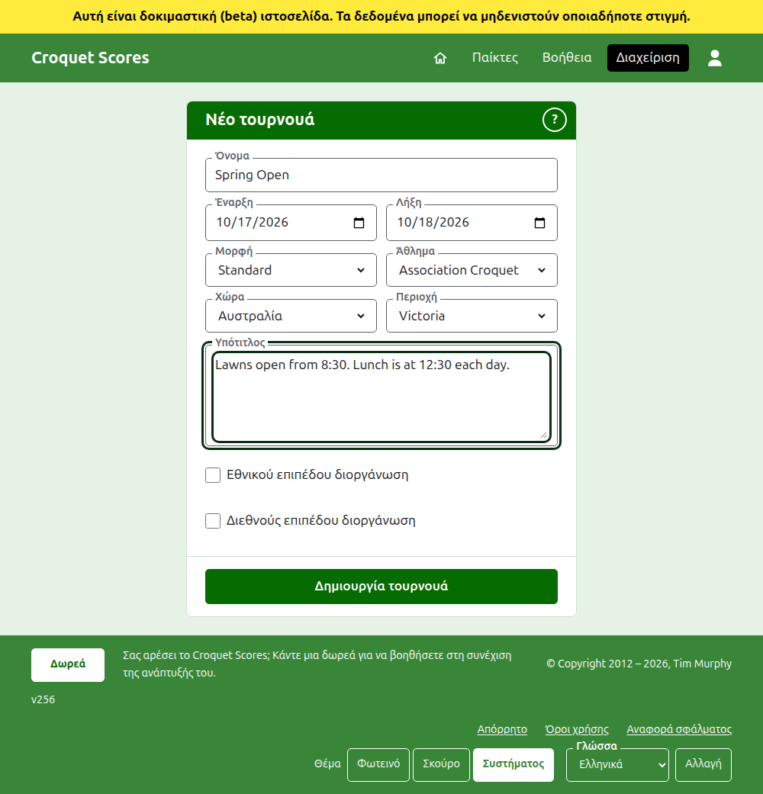

# Δημιουργία ενός τουρνουά

Πατήστε **Νέο τουρνουά** πάνω από τη λίστα τουρνουά στη διαχείριση. Βρίσκεται πάνω από τη λίστα και όχι κάτω, ώστε μια μακριά λίστα να μην το σπρώχνει έξω από την οθόνη ενός τηλεφώνου.

Η φόρμα ζητά ό,τι χρειάζεται για να ξεκινήσει ένα τουρνουά. Ένα τουρνουά του συνηθισμένου είδους απέχει ένα όνομα, δύο ημέρες και μια χώρα: τα υπόλοιπα αποφασίζονται για εσάς και μπορούν να αλλάξουν.

## Τι ζητά η φόρμα

**Όνομα.** Ό,τι ψάχνουν οι αναγνώστες για να βρουν το τουρνουά, όπως "Spring Open". Έχει από 3 έως 254 χαρακτήρες. Ένα όνομα όλο με πεζά, ή όλο με κεφαλαία, απορρίπτεται, αφού θα έμοιαζε με λάθος σε κάθε σελίδα όπου εμφανίζεται. Δύο τουρνουά μπορεί να έχουν το ίδιο όνομα, αφού το ίδιο τουρνουά παίζεται κάθε χρόνο.

**Έναρξη** και **Λήξη.** Οι ημέρες που διαρκεί το τουρνουά. Ένα τουρνουά δεν μπορεί να λήξει πριν από την έναρξή του και δεν μπορεί να ξεκινήσει ή να λήξει μετά το τέλος του επόμενου έτους. Ένα τουρνουά ανήκει στη χρονιά που ξεκινά, που είναι και η χρονιά στη διεύθυνσή του, γι' αυτό ένα που διαρκεί πέρα από την αλλαγή του έτους παρατίθεται στη χρονιά που ξεκινά.

**Μορφή.** Επιλέξτε **Standard** για ένα τουρνουά που παίζεται ανάμεσα σε παίκτες. Οι άλλες μορφές είναι για τουρνουά που παίζονται ανάμεσα σε ομάδες, τα οποία έχουν δικό τους οδηγό.

**Άθλημα.** Τα αθλήματα που προσφέρει η ιστοσελίδα, με τη σειρά της: Association Croquet, Golf Croquet, Αμερικανικό 6 τόξων και Ricochet στο Croquet Scores. Το **Άθλημα**, η **Χώρα** και η **Περιοχή** είναι αναπτυσσόμενες λίστες: επιλέξτε από τη λίστα ή πληκτρολογήστε την αρχή ενός ονόματος για να μετακινηθείτε σε αυτό. Το Gateball Scores δεν ζητά ούτε άθλημα ούτε μορφή, αφού κάθε τουρνουά εκεί είναι ένα standard τουρνουά gateball.

**Χώρα** και **Περιοχή.** Πού παίζεται το τουρνουά. Οι χώρες στις οποίες παίζονται τα περισσότερα τουρνουά παρατίθενται πρώτες. Μια περιοχή ζητείται μόνο όπου η χώρα που επιλέγετε χωρίζεται σε περιοχές, όπως οι πολιτείες της Αυστραλίας· μια χώρα που είναι η ίδια μία περιοχή δεν ζητά καμία. Δεν χρειάζεται να επιλεγεί περιοχή ακόμα και όπου προσφέρεται μία.

**Υπότιτλος.** Ό,τι θέλετε να γνωρίζουν οι αναγνώστες και δεν έχει δικό του πεδίο: πού να παρκάρουν, πότε είναι το γεύμα, ποιον να πάρουν τηλέφωνο. Εμφανίζεται κάτω από το όνομα του τουρνουά σε κάθε δημόσια σελίδα. Γράφεται σε Markdown, γι' αυτό μια λέξη μπορεί να γίνει έντονη με αστερίσκους γύρω της και μια λίστα να γίνει με μια παύλα στην αρχή κάθε γραμμής. Μπορεί να έχει έως 2000 χαρακτήρες και μπορεί να μείνει κενός.

Πώς παίζονται και μετρούνται τα αγωνίσματά του, αν με χάντικαπ, με ισόπαλα αποτελέσματα και προς τις παγκόσμιες κατατάξεις, το λέει κάθε αγώνισμα όταν προστίθεται.

**Εθνικού επιπέδου διοργάνωση** και **Διεθνούς επιπέδου διοργάνωση.** Ένα τουρνουά μπορεί να είναι το ένα, το άλλο ή κανένα, αλλά ποτέ και τα δύο: το τικ στο ένα αφαιρεί το τικ από το άλλο. Ένα τουρνουά που έχει τικ σε κάποιο από τα δύο εμφανίζεται με έντονα γράμματα, σε ολόκληρη τη γραμμή του, στις λίστες τουρνουά.

## Δημιουργία

Πατήστε **Δημιουργία τουρνουά**. Μεταφέρεστε στη σελίδα του τουρνουά στη διαχείριση, από όπου διοργανώνεται, και είστε ο πρώτος υπεύθυνός του. Παρατίθεται στη διαχείριση κάτω από τη χρονιά που ξεκινά.

Η δημόσια διεύθυνση του τουρνουά φτιάχνεται από τη χρονιά, το άθλημα και το όνομά του, όπως `/2026/ac/spring-open`. Κρατά αυτή τη διεύθυνση όταν το όνομά του διορθωθεί αργότερα, ώστε ένας σύνδεσμος που έχει ήδη σταλεί να το βρίσκει ακόμα· αλλάζει μόνο όταν αλλάξει η χρονιά που ξεκινά ή το άθλημά του.

## Αν κάτι απορριφθεί

Ό,τι απορρίπτεται λέγεται κάτω από το πεδίο στο οποίο αναφέρεται και ό,τι πληκτρολογήσατε μένει πληκτρολογημένο. Τίποτα δεν κρατιέται μέχρι να γίνει δεκτό κάθε πεδίο. Τα πράγματα που απορρίπτονται συχνότερα είναι ένα όνομα πληκτρολογημένο όλο με πεζά, μια λήξη πριν από την έναρξη και μια χώρα που δεν επιλέχθηκε.

Επόμενο: [Παίκτες](players.md).
