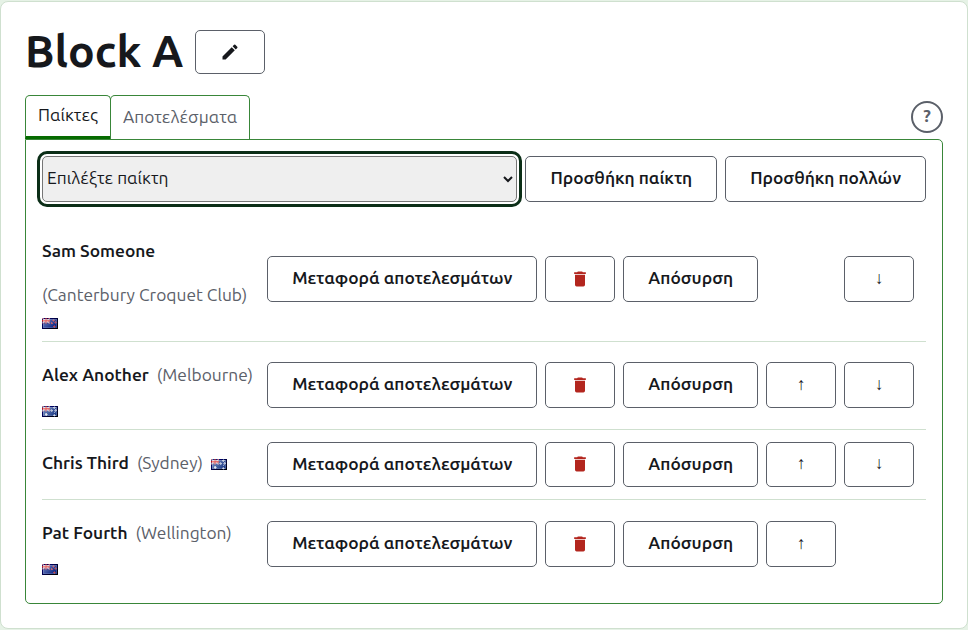
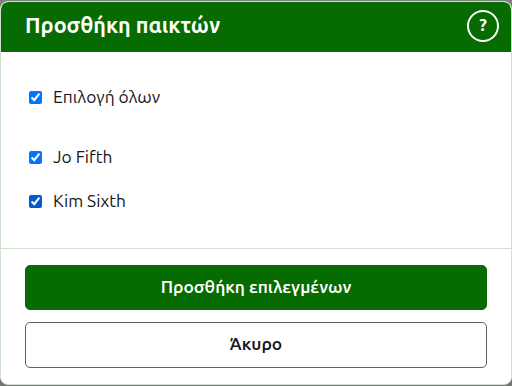
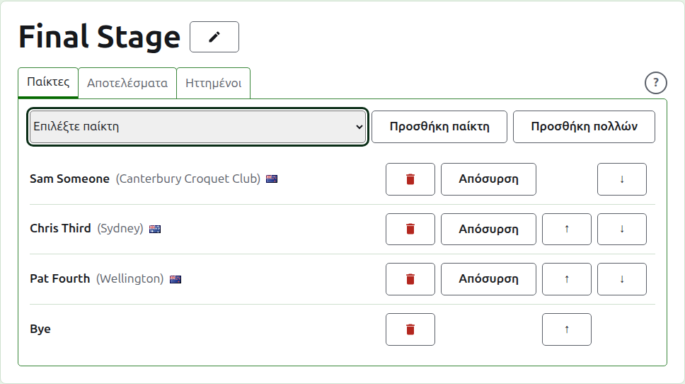
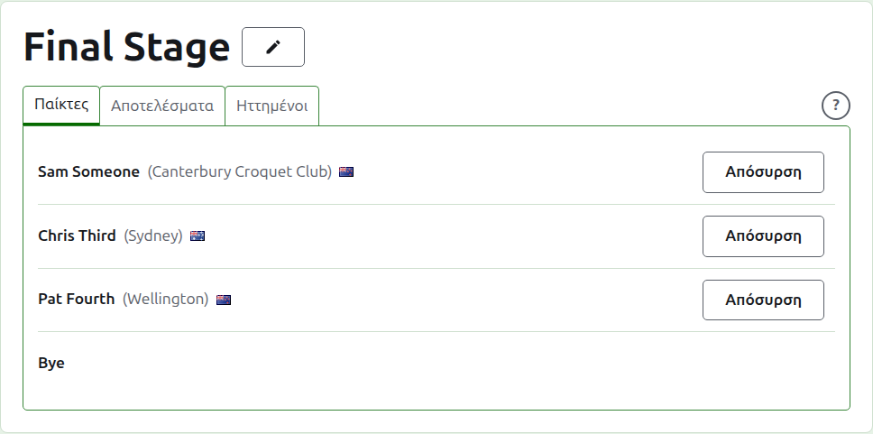
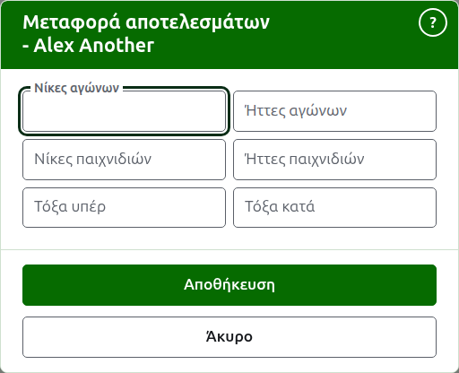
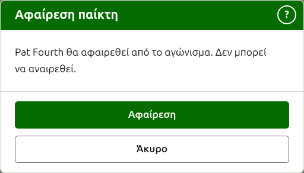
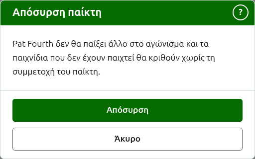
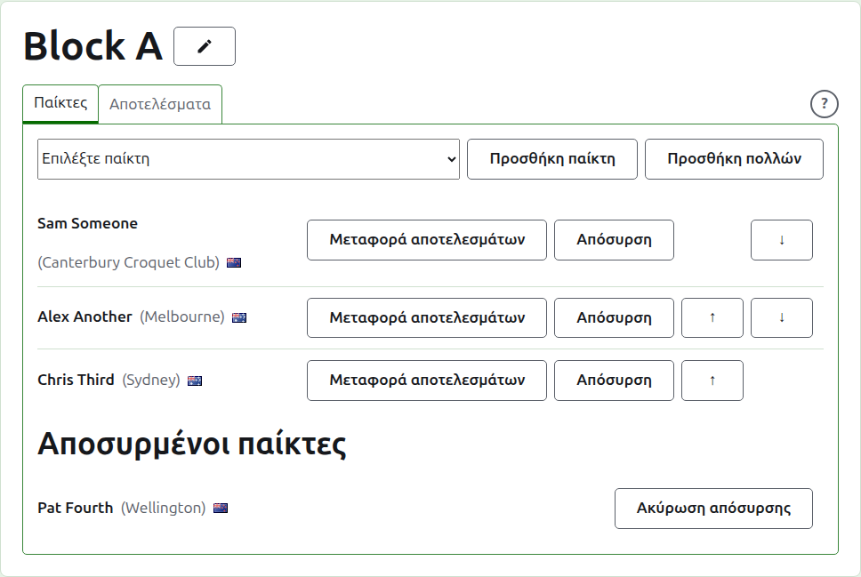

# Καταχώριση παικτών σε ένα αγώνισμα

Η σελίδα ενός αγωνίσματος ανοίγει από το όνομά του στην καρτέλα Αγωνίσματα ή από τη σκούρα πράσινη γραμμή. Έχει ως επικεφαλίδα το όνομα του αγωνίσματος, με δύο καρτέλες από κάτω: **Παίκτες** και **Αποτελέσματα**. Ένα νοκ-άουτ έχει και τρίτη, τους **Ηττημένους**, που περιγράφεται στο [Ένα νοκ-άουτ ηττημένων](competitions.md#losers-knockout). Ανοίγει στους Παίκτες, αφού οι παίκτες καταχωρίζονται πριν παιχτεί οτιδήποτε.

Ένας παίκτης σε ένα αγώνισμα είναι ένας από τους παίκτες του τουρνουά, γι' αυτό καταχωρίζεται επιλέγοντάς τον αντί να πληκτρολογηθεί. Ό,τι αφορά τον παίκτη, εκτός από τη θέση του στο αγώνισμα και ό,τι μεταφέρει σε αυτό, αλλάζει στην καρτέλα Παίκτες του τουρνουά.

## Προσθήκη ενός παίκτη

Πάνω από τη λίστα, μια αναπτυσσόμενη λίστα προσφέρει κάθε παίκτη του τουρνουά που δεν συμμετέχει ήδη στο αγώνισμα, με τη σειρά του τουρνουά. Επιλέξτε έναν και πατήστε **Προσθήκη παίκτη**. Ο παίκτης τοποθετείται με τη σειρά του τουρνουά ανάμεσα σε όσους έχουν ήδη καταχωριστεί, η αναπτυσσόμενη λίστα δεν τον προσφέρει πια και ο δρομέας επιστρέφει στην αναπτυσσόμενη λίστα ώστε να επιλεγεί ο επόμενος από το πληκτρολόγιο. Όπου κάθε παίκτης του τουρνουά συμμετέχει στο αγώνισμα, η αναπτυσσόμενη λίστα δεν εμφανίζεται και η καρτέλα το λέει.

Οι αρχειοθετημένοι παίκτες του τουρνουά δεν προσφέρονται.

## Προσθήκη πολλών παικτών {#adding-several}

Για να στήσετε γρήγορα ένα αγώνισμα, πατήστε **Προσθήκη πολλών**, δίπλα στο **Προσθήκη παίκτη**. Προσφέρεται όταν υπάρχουν δύο ή περισσότεροι παίκτες για να διαλέξετε. Ανοίγει έναν διάλογο που απαριθμεί κάθε παίκτη του τουρνουά που δεν συμμετέχει στο αγώνισμα, με τη σειρά του τουρνουά, με ένα πλαίσιο για επιλογή δίπλα σε καθέναν. Το πλαίσιο πάνω από τη λίστα τους επιλέγει όλους.

Επιλέξτε τους παίκτες που θέλετε και πατήστε **Προσθήκη επιλεγμένων**. Καταχωρίζονται όλοι μαζί και τοποθετούνται με τη σειρά του τουρνουά, με όποια σειρά κι αν τους επιλέξατε. Πατήστε **Άκυρο** για να κλείσετε τον διάλογο χωρίς να προσθέσετε κανέναν. Αν πατήσετε **Προσθήκη επιλεγμένων** χωρίς να έχει επιλεγεί κανείς, δεν γίνεται τίποτα.

Μερικές φορές ένας επιλεγμένος παίκτης δεν μπορεί να καταχωριστεί: κάποιος άλλος μπορεί να τον έβαλε στο αγώνισμα όσο ο διάλογος ήταν ανοιχτός, ή ένα νοκ-άουτ μπορεί να έχει λιγότερες θέσεις από τους παίκτες που επιλέχθηκαν. Τότε δεν καταχωρίζεται κανείς. Ένας δεύτερος διάλογος απαριθμεί τους παίκτες που δεν μπορούν να προστεθούν, με τον λόγο για καθέναν, και ρωτά αν θα προστεθούν οι υπόλοιποι από όσους επιλέξατε. Πατήστε **Προσθήκη των υπολοίπων** για να καταχωριστούν όσοι μπορούν, ή **Άκυρο** για να επιστρέψετε στις επιλογές, που είναι όπως τις αφήσατε, και να τις αλλάξετε. Όπου κανένας από τους επιλεγμένους παίκτες δεν μπορεί να καταχωριστεί, δεν υπάρχει τίποτα να αποφασιστεί και οι λόγοι εμφανίζονται πάνω από τη λίστα.

Τα bye ενός νοκ-άουτ δεν αφορούν αυτή τη λειτουργία. Προστίθενται ένα ένα από την αναπτυσσόμενη λίστα, όπως περιγράφει η ενότητα [Bye σε ένα νοκ-άουτ](#byes-in-a-knockout).

## Bye σε ένα νοκ-άουτ {#byes-in-a-knockout}

Ένα νοκ-άουτ παίζεται μόνο όταν συμπληρωθεί κάθε θέση της κλήρωσής του και οι θέσεις που αφήνουν οι παίκτες του συμπληρώνονται με bye. Έτσι σε ένα νοκ-άουτ η αναπτυσσόμενη λίστα προσφέρει πρώτο το **Bye**, πριν από τους παίκτες, και συνεχίζει να το προσφέρει όσα bye και αν προστεθούν, αφού μια κλήρωση μπορεί να χρειάζεται αρκετά.

Ένα bye τοποθετείται στην κλήρωση όπως ένας παίκτης: μπορεί να μετακινηθεί πάνω και κάτω και να αφαιρεθεί, αλλά δεν μπορεί να αποσυρθεί, αφού δεν παίζει τίποτα. Ένας παίκτης που καταχωρίζεται σε ένα νοκ-άουτ του οποίου κάθε θέση είναι συμπληρωμένη απορρίπτεται και η καρτέλα το λέει κάτω από την αναπτυσσόμενη λίστα.

Η σειρά των παικτών ενός νοκ-άουτ είναι η κλήρωσή του. Οι πρώτες δύο θέσεις συναντιούνται στον πρώτο αγώνα, οι επόμενες δύο στον επόμενο και ούτω καθεξής. Βάλτε τους παίκτες με τη σειρά με την οποία θα παιχτεί η κλήρωση πριν καταχωριστεί οποιοδήποτε αποτέλεσμα, αφού μόλις το νοκ-άουτ έχει ένα παιχνίδι σε χρήση οι παίκτες του είναι σταθεροί: κανείς δεν μπορεί να προστεθεί, να αφαιρεθεί ή να μετακινηθεί. Ένας παίκτης μπορεί ακόμα να αποσυρθεί.

## Οι παίκτες ενός νοκ-άουτ ηττημένων

Οι παίκτες ενός νοκ-άουτ ηττημένων δεν καταχωρίζονται με το χέρι. Μπαίνουν καθώς κρίνονται οι αγώνες των οποίων τους ηττημένους παίρνει, γι' αυτό η καρτέλα **Παίκτες** του απλώς τους παραθέτει και λέει γιατί.

## Σειρά

Οι παίκτες παρατίθενται με τη σειρά του αγωνίσματος, που είναι η σειρά με την οποία κληρώνεται ένα νοκ-άουτ και παρατίθεται ένα μπλοκ στη δημόσια σελίδα του. Τα **Πάνω** και **Κάτω** μετακινούν έναν παίκτη μία θέση.

## Μεταφορά αποτελεσμάτων {#carry-forward}

Η **Μεταφορά αποτελεσμάτων** λέει τι φέρνει ένας παίκτης σε ένα αγώνισμα από παιχνίδι που δεν καταχωρίστηκε εδώ: τα αποτελέσματα ενός προηγούμενου σταδίου ή παιχνιδιών που παίχτηκαν πριν το αγώνισμα αρχίσει να καταχωρίζεται εδώ. Προσφέρεται σε ένα μπλοκ και σε ένα ελβετικό, που έχουν βαθμολογίες για να μετρήσει, και όχι σε ένα νοκ-άουτ.

Το παράθυρο ρωτά έξι αριθμούς: νίκες και ήττες αγώνων, νίκες και ήττες παιχνιδιών, και τόξα υπέρ και κατά. Κάθε αριθμός είναι προαιρετικός. Ένας αριθμός που μένει κενός δεν μεταφέρει τίποτα, κάτι που δεν είναι το ίδιο με τη μεταφορά του 0, ώστε όποιος τον αλλάξει αργότερα να τον δει όπως αφέθηκε. Πατήστε **Αποθήκευση** για να κρατήσετε και τους έξι.

## Αφαίρεση ενός παίκτη {#removing-a-player}

Η **Αφαίρεση** βγάζει έναν παίκτη που καταχωρίστηκε κατά λάθος. Παραμένει ένας από τους παίκτες του τουρνουά και προσφέρεται ξανά στην αναπτυσσόμενη λίστα, αλλά τίποτα δεν κρατιέται από τη θέση του στο αγώνισμα, γι' αυτό η Αφαίρεση ρωτά πρώτα.

Ένας παίκτης που έχει οποιοδήποτε παιχνίδι σε χρήση στο αγώνισμα δεν μπορεί να αφαιρεθεί, αφού τα παιχνίδια θα ήταν τότε ενάντια σε κάποιον που δεν είναι πια εκεί, και δεν του προσφέρεται Αφαίρεση. Ένας παίκτης του οποίου τα μόνα παιχνίδια είναι αρχειοθετημένα μπορεί και τα αρχειοθετημένα αποτελέσματά του φεύγουν μαζί του.

## Απόσυρση ενός παίκτη {#withdrawing-a-player}

Η **Απόσυρση** είναι για έναν παίκτη που δεν θα παίξει άλλο στο αγώνισμα. Παραμένει σε αυτό, με τα παιχνίδια που έχει παίξει, και παρατίθεται κάτω από τους **Αποσυρμένους παίκτες** μετά από όσους παίζουν ακόμα. Σε ένα νοκ-άουτ, ο αντίπαλός του σε έναν αγώνα που δεν έχει κριθεί προχωρά.

Η Απόσυρση ρωτά πρώτα, αφού αλλάζει το αποτέλεσμα του αγωνίσματος: τα παιχνίδια που δεν έχει παίξει ο παίκτης κρίνονται χωρίς αυτόν.

Ένας αποσυρμένος παίκτης προσφέρει μόνο **Ακύρωση απόσυρσης**, που τον επαναφέρει ανάμεσα σε όσους παίζουν, μετά από όσους έμειναν, χωρίς να ρωτήσει.

Επόμενο: [Αποτελέσματα](scores.md).
