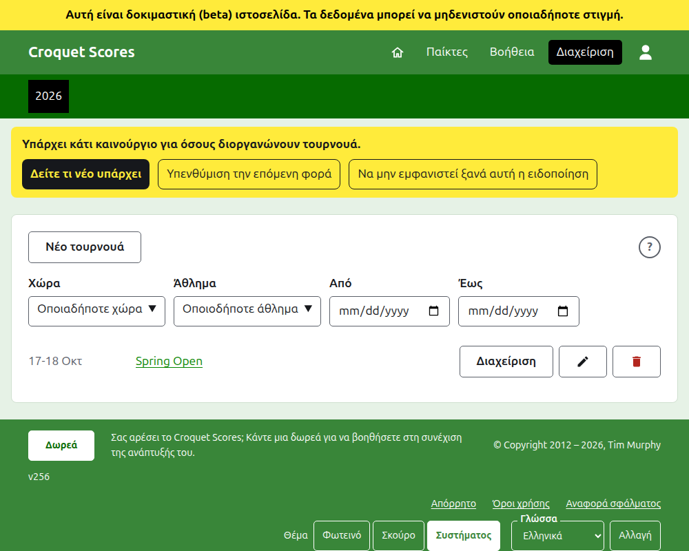
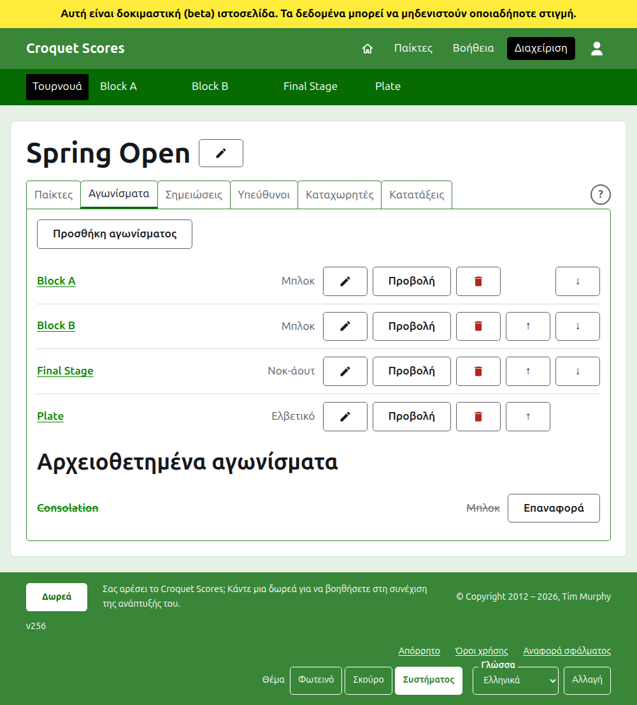

# Διοργάνωση ενός standard τουρνουά

Ένα standard τουρνουά είναι αυτό που παίζεται ανάμεσα σε παίκτες που καταχωρίζονται έναν έναν: ένα σαββατοκύριακο συλλόγου, ένα ανοιχτό, ένα πρωτάθλημα. Οι παίκτες του καταχωρίζονται σε μπλοκ, νοκ-άουτ και ελβετικά και τα αποτελέσματά του ανεβαίνουν καθώς παίζονται. Αυτός ο οδηγός συνοδεύει έναν υπεύθυνο από τη σύνδεση μέχρι ένα τουρνουά με αποτελέσματα διαθέσιμα στο κοινό.

Στέκεται μόνος του. Τίποτα σε αυτόν δεν εξαρτάται από τον οδηγό για ένα τουρνουά που παίζεται από ομάδες, ο οποίος είναι γραμμένος χωριστά.

## Πριν ξεκινήσετε

Χρειάζεστε έναν λογαριασμό. Πατήστε [εδώ](/account/register) για να εγγραφείτε.

Ό,τι κάνει ένας υπεύθυνος γίνεται στο τμήμα διαχείρισης της ιστοσελίδας. Οι δημόσιες σελίδες, όπου οι παίκτες και οι θεατές παρακολουθούν το τουρνουά, σχεδιάζονται από ό,τι κρατά η διαχείριση, γι' αυτό τίποτα δεν χρειάζεται να δημοσιευτεί: ένα αποτέλεσμα που καταχωρίζεται βρίσκεται αμέσως στις δημόσιες σελίδες.

## Οι σελίδες με τη σειρά

1. [Δημιουργία ενός τουρνουά](creating-a-tournament.md): το όνομά του, οι ημέρες του, το άθλημά του, πού παίζεται και αν είναι εθνική ή διεθνής διοργάνωση.
2. [Παίκτες](players.md): καταχώριση των παικτών του τουρνουά, διόρθωσή τους και παραμερισμός όσων καταχωρίστηκαν κατά λάθος.
3. [Αγωνίσματα](competitions.md): προσθήκη μπλοκ, νοκ-άουτ και ελβετικών και τοποθέτησή τους σε σειρά.
4. [Καταχώριση παικτών σε ένα αγώνισμα](entering-players-in-a-competition.md): ποιος παίζει σε κάθε αγώνισμα, bye σε ένα νοκ-άουτ, μεταφορές αποτελεσμάτων, αφαίρεση και απόσυρση.
5. [Αποτελέσματα](scores.md): καταχώριση αποτελεσμάτων, διόρθωσή τους και παραμερισμός όσων καταχωρίστηκαν κατά λάθος.
6. [Σημειώσεις](notes.md): ενημέρωση των παικτών για ό,τι πρέπει να γνωρίζουν καθώς προχωρά το τουρνουά.
7. [Υπεύθυνοι και καταχωρητές](managers-and-scorers.md): μοίρασμα της διοργάνωσης του τουρνουά και παραχώρηση σε κάποιον να καταχωρίζει αποτελέσματα χωρίς να μπορεί να αλλάξει τίποτα άλλο.
8. [Κατατάξεις](rankings.md): το αρχείο που στέλνεται στις παγκόσμιες κατατάξεις και τι μένει για να συμπληρώσετε.
9. [Αλλαγή, αρχειοθέτηση και επαναφορά ενός τουρνουά](changing-and-archiving.md): διόρθωση των στοιχείων του τουρνουά και παραμερισμός ενός τουρνουά.
10. [Τι βλέπει το κοινό](what-the-public-sees.md): οι σελίδες που παρακολουθούν οι παίκτες σας και πώς εμφανίζεται σε αυτές ό,τι καταχωρίζετε.

## Πώς είναι διαρρυθμισμένη η διαχείριση

Η εξώπορτα της διαχείρισης παραθέτει τα τουρνουά στα οποία έχετε μέρος, μία χρονιά τη φορά.

Το πάτημα του ονόματος ενός τουρνουά, ή της **Διαχείρισης**, ανοίγει τη σελίδα του. Ό,τι υπάρχει να διαχειριστείτε βρίσκεται σε έξι καρτέλες κάτω από το όνομά του: **Παίκτες**, **Αγωνίσματα**, **Σημειώσεις**, **Υπεύθυνοι**, **Καταχωρητές** και **Κατατάξεις**. Η σελίδα ανοίγει στους Παίκτες, αφού οι παίκτες είναι το πρώτο που καταχωρίζεται. Στο τέλος της σειράς των καρτελών, και στη γραμμή τίτλου ενός παραθύρου, υπάρχει ένα στρογγυλό **;** που ανοίγει τη βοήθεια για ό,τι βλέπετε, σε άλλη καρτέλα ώστε να διατηρείται η θέση σας. Υπάρχει ένα και δίπλα στο **Νέο τουρνουά**.

Η σκούρα πράσινη γραμμή κάτω από την κεφαλίδα είναι για μετακίνηση ανάμεσα σε σελίδες. Οδηγεί στο τουρνουά, ως **Τουρνουά**, και σε καθένα από τα αγωνίσματά του με το όνομά του, ώστε να μπορείτε να πηγαίνετε από το τουρνουά σε ένα αγώνισμα και ανάμεσα σε αγωνίσματα χωρίς να επιστρέφετε μέσα από την καρτέλα Αγωνίσματα. Η σελίδα στην οποία βρίσκεστε σημειώνεται με μαύρο.

## Πράγματα που ισχύουν παντού

**Τίποτα δεν διαγράφεται οριστικά εκτός από μια σημείωση.** Οι παίκτες, τα αγωνίσματα, τα αποτελέσματα και το ίδιο το τουρνουά αρχειοθετούνται αντί να διαγράφονται: παραμερίζονται, διαγράφονται με γραμμή και παρατίθενται κάτω από δική τους επικεφαλίδα, με την **Επαναφορά** για να επιστρέψουν. Η αρχειοθέτηση, η επαναφορά και η μετακίνηση πάνω και κάτω δεν ζητούν ποτέ επιβεβαίωση, επειδή καθεμία αναιρείται πατώντας την άλλη. Όσα δεν μπορούν να αναιρεθούν, όπως η αφαίρεση ενός παίκτη από ένα αγώνισμα ή η διαγραφή μιας σημείωσης, ρωτούν πρώτα.

**Ένα παράθυρο πάνω από τη σελίδα δεν κρατά τίποτα μέχρι να πατήσετε το κουμπί του.** Το Άκυρο, ή το πλήκτρο Escape, το κλείνει και αφήνει τα πάντα όπως ήταν. Τα παράθυρα που προσθέτουν πράγματα, όπως η Προσθήκη παίκτη και η Προσθήκη αποτελέσματος, μένουν ανοιχτά μετά την προσθήκη κάθε ενός, ώστε μια λίστα να μπορεί να πληκτρολογηθεί ένα προς ένα.

**Ό,τι απορρίπτεται λέγεται δίπλα στο πεδίο στο οποίο αναφέρεται.** Τίποτα που απορρίφθηκε δεν κρατιέται και ό,τι πληκτρολογήσατε μένει πληκτρολογημένο, ώστε να διορθωθεί αντί να πληκτρολογηθεί ξανά.

**Η διαχείριση λειτουργεί σε τηλέφωνο.** Κάθε κουμπί είναι αρκετά μεγάλο για να πατηθεί με τον αντίχειρα και τίποτα δεν είναι πλατύτερο από την οθόνη.

Επόμενο: [Δημιουργία ενός τουρνουά](creating-a-tournament.md).
