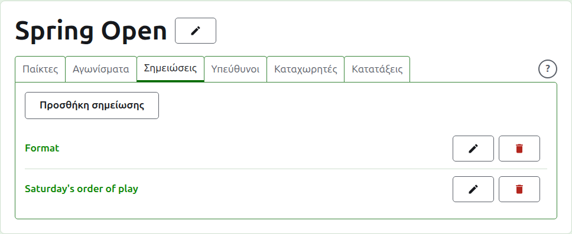
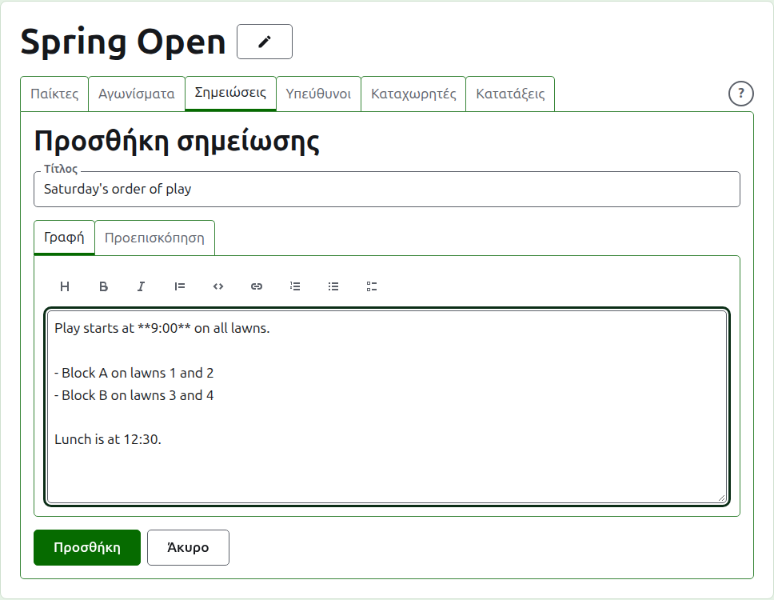
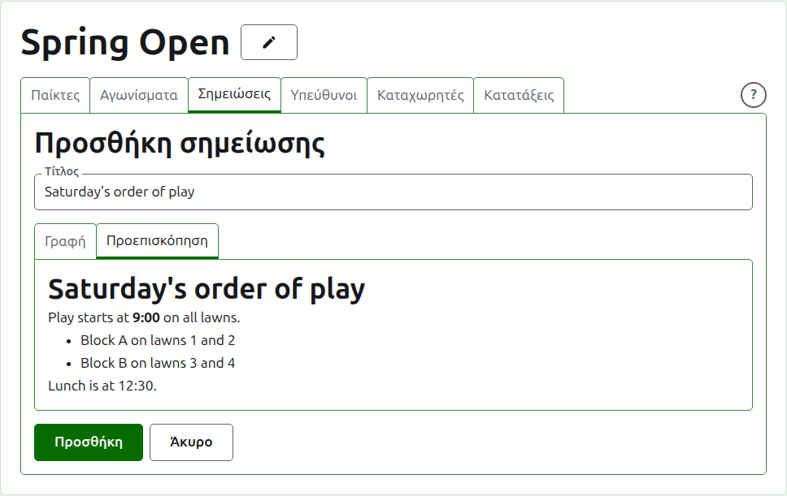
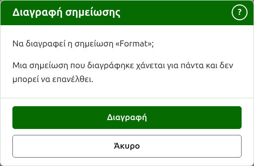

# Σημειώσεις

Η καρτέλα **Σημειώσεις** της σελίδας ενός τουρνουά είναι εκεί όπου οι υπεύθυνοί του γράφουν ό,τι πρέπει να γνωρίζουν οι παίκτες καθώς προχωρά το τουρνουά: τη μορφή, μια αλλαγή στη σειρά των παιχνιδιών, την ώρα του γεύματος. Οι αναγνώστες τις βρίσκουν στη δημόσια σελίδα Σημειώσεις του τουρνουά, με επικεφαλίδα Σημειώσεις υπευθύνων, και μια σημείωση που δεν έχουν διαβάσει σημαδεύεται εκεί με έναν κόκκινο αστερίσκο, που σημαδεύει και την ενότητα Σημειώσεις σε κάθε σελίδα του τουρνουά μέχρι να την ανοίξουν.

## Γράψιμο μιας σημείωσης

Πατήστε **Προσθήκη σημείωσης**, πάνω από τη λίστα. Ένα πάνελ παίρνει τη θέση της λίστας, αφού μια σημείωση γράφεται εκτενώς και χρειάζεται χώρο.

Ο **Τίτλος** είναι υποχρεωτικός και είναι αυτός με τον οποίο παρατίθεται η σημείωση. Είναι απλό κείμενο.

Η **Περιγραφή** γράφεται σε Markdown και μπορεί να μείνει κενή όπου ο τίτλος λέει όλα όσα υπάρχουν να ειπωθούν. Η γραμμή εργαλείων πάνω από το πλαίσιο γράφει το Markdown για εσάς: Επικεφαλίδα, Έντονα, Πλάγια, Παράθεση, Κώδικας, Σύνδεσμος, Αριθμημένη λίστα, Λίστα με κουκκίδες και Λίστα εργασιών. Το καθένα λειτουργεί σε ό,τι είναι επιλεγμένο, ή στην αρχή κάθε επιλεγμένης γραμμής, ή βάζει τον δρομέα εκεί που πάνε οι λέξεις.

Μια κενή γραμμή ανάμεσα σε δύο παραγράφους τις χωρίζει και ένας αναγνώστης βλέπει μια ολόκληρη κενή γραμμή ανάμεσά τους. Η **Προεπισκόπηση** δείχνει τη σημείωση όπως θα τη δει ένας αναγνώστης στη σελίδα της.

Πατήστε **Προσθήκη**. Η σημείωση κρατιέται, η λίστα επιστρέφει με αυτή στην κορυφή και βρίσκεται αμέσως στη δημόσια σελίδα Σημειώσεις.

## Επεξεργασία μιας σημείωσης

Πατήστε τον τίτλο μιας σημείωσης, ή την **Επεξεργασία** της, για να ανοίξει το πάνελ για αυτή τη σημείωση. Πατήστε **Αποθήκευση** για να κρατήσετε την αλλαγή. Μια σημείωση που έχει επεξεργαστεί αφότου την διάβασε ένας αναγνώστης σημαδεύεται ξανά για αυτόν.

## Διαγραφή μιας σημείωσης {#deleting-a-note}

Μια σημείωση που δεν ισχύει πια διαγράφεται. Μια σημείωση που διαγράφηκε χάνεται για πάντα, γι' αυτό η **Διαγραφή** ρωτά πρώτα.

Επόμενο: [Υπεύθυνοι και καταχωρητές](managers-and-scorers.md).
