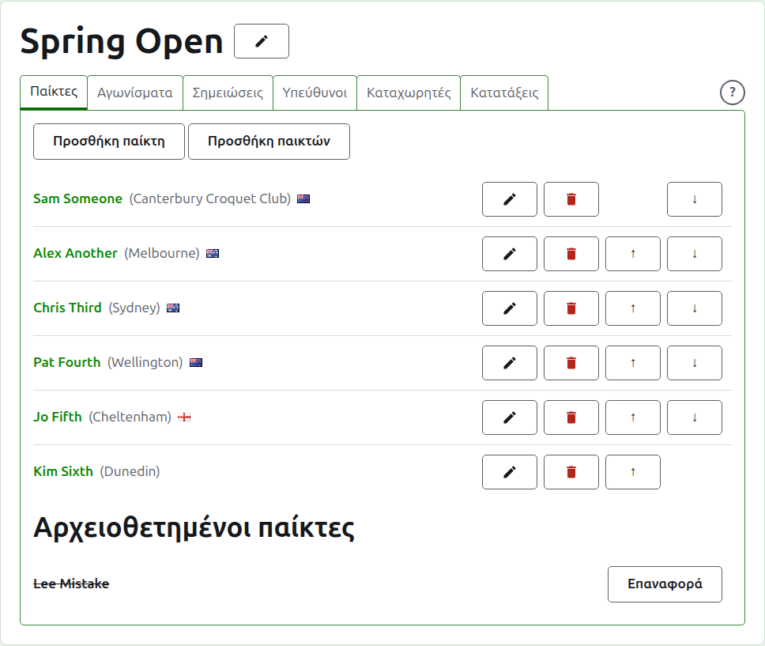
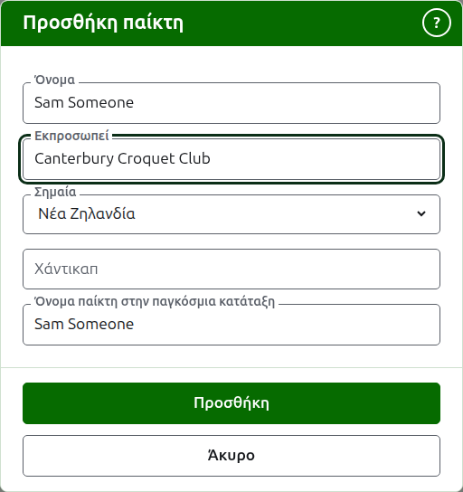
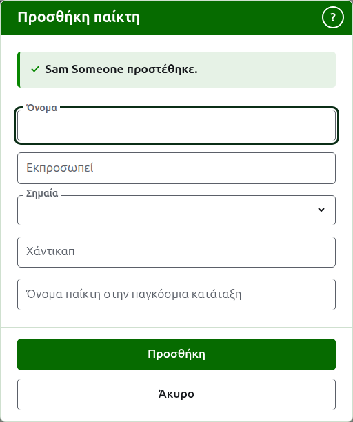
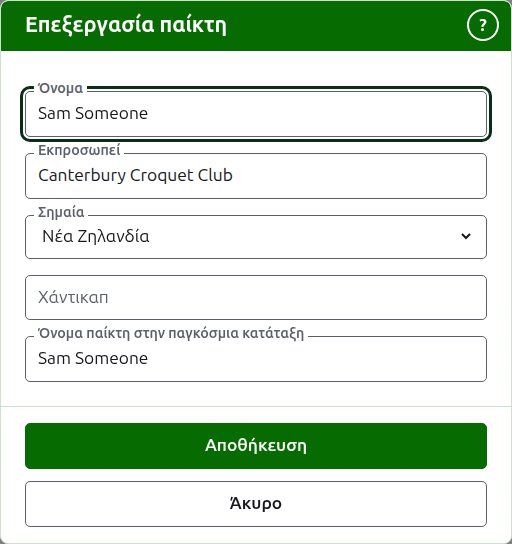
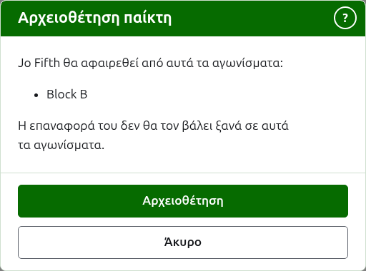

# Παίκτες

Η καρτέλα **Παίκτες** της σελίδας ενός τουρνουά είναι εκεί όπου οι παίκτες του καταχωρίζονται, διορθώνονται, μπαίνουν σε σειρά και παραμερίζονται. Είναι η καρτέλα στην οποία ανοίγει η σελίδα, αφού η καταχώριση των παικτών είναι το πρώτο που γίνεται σε ένα τουρνουά.

Οι παίκτες καταχωρίζονται εδώ μία φορά, στο τουρνουά. Σε ποια αγωνίσματα παίζει ο καθένας επιλέγεται μετά, στη δική του σελίδα κάθε αγωνίσματος, από τους παίκτες που καταχωρίστηκαν εδώ. Δείτε [Καταχώριση παικτών σε ένα αγώνισμα](entering-players-in-a-competition.md).



## Προσθήκη ενός παίκτη {#add-a-player}

Πατήστε **Προσθήκη παίκτη**, πάνω από τη λίστα. Ένα παράθυρο ανοίγει πάνω από τη σελίδα.



Το **Όνομα** είναι υποχρεωτικό. Είναι το όνομα του παίκτη όπως θα εμφανίζεται σε κάθε σελίδα, από 3 έως 254 χαρακτήρες. Δύο παίκτες στο ίδιο τουρνουά δεν μπορούν να έχουν το ίδιο όνομα, όπως και αν γράφεται με κεφαλαία· όπου δύο παίκτες έχουν πραγματικά το ίδιο όνομα, ξεχωρίστε τους μέσα στο ίδιο το όνομα, όπως "Andrew Hobbs (2)".

Το **Εκπροσωπεί** είναι αυτό που παίζει ο παίκτης για λογαριασμό του, γραμμένο όπως θα το έλεγε ένας αναγνώστης: ένας σύλλογος, μια περιοχή ή μια χώρα, όπως "Canterbury Croquet Club". Εμφανίζεται σε παρένθεση μετά το όνομα. Μπορεί να μείνει κενό. Καθώς πληκτρολογείτε, προσφέρεται ό,τι έχει προστεθεί ως εκπροσώπηση παικτών σε οποιοδήποτε τουρνουά της ιστοσελίδας, όπου μια λέξη του αρχίζει με ό,τι πληκτρολογήσατε, ώστε ένας σύλλογος να γράφεται όπως έχει γραφτεί και πριν· το πλήκτρο tab παίρνει αυτό που εμφανίζεται μετά τον δρομέα.

Η **Σημαία** είναι η σημαία που εμφανίζεται δίπλα στο όνομα του παίκτη. Είναι μια αναπτυσσόμενη λίστα με τα μέρη με το όνομά τους, πρώτο το κανένα, μετά τα μέρη όπου παίζονται τα περισσότερα τουρνουά· πληκτρολογήστε την αρχή ενός ονόματος για να μετακινηθείτε σε αυτό. Μπορεί να μείνει σε κανένα, που ισχύει για τους περισσότερους παίκτες. Ό,τι εκπροσωπεί ένας παίκτης και ποια σημαία φέρει κρατιούνται χωριστά, αφού ένας παίκτης μπορεί να παίζει για έναν σύλλογο σε μια χώρα και να φέρει τη σημαία μιας άλλης.

Το **Χάντικαπ** είναι το χάντικαπ του παίκτη, αν έχει: ένα πρόσημο, έως δύο ψηφία και ένα κλάσμα ενός ψηφίου, όπως 4, +4 ή -1.5. Κρατιέται όπως το γράφετε και εμφανίζεται σε παρένθεση με ό,τι εκπροσωπεί ο παίκτης, πριν από αυτό. Μπορεί να μείνει κενό.

Το **Όνομα παίκτη στην παγκόσμια κατάταξη** είναι το όνομα με το οποίο οι παγκόσμιες κατατάξεις γνωρίζουν τον παίκτη. Ζητείται μόνο σε ένα τουρνουά Association Croquet ή Golf Croquet, τα δύο αθλήματα των οποίων τους παίκτες κρατούν λίστα οι παγκόσμιες κατατάξεις. Οι παίκτες του Αμερικανικού 6 τόξων είναι γνωστοί στις κατατάξεις με τα δικά τους ονόματα, γι' αυτό δεν ζητείται εκεί και το όνομα παγκόσμιας κατάταξης κάθε παίκτη είναι πάντα το όνομά του. Όσο προσθέτετε έναν παίκτη ακολουθεί το όνομα καθώς το πληκτρολογείτε, αφού οι περισσότεροι παίκτες είναι γνωστοί στις κατατάξεις με το δικό τους όνομα, και πάψει να το ακολουθεί μόλις πληκτρολογήσετε μέσα σε αυτό. Αν μείνει κενό, κρατιέται ως το όνομα του παίκτη.

Καθώς πληκτρολογείτε ένα όνομα, προσφέρονται οι παίκτες που γνωρίζουν οι παγκόσμιες κατατάξεις και των οποίων τα ονόματα αρχίζουν έτσι, ώστε να μπορείτε να πάρετε ένα όνομα όπως το γράφουν οι κατατάξεις αντί να το πληκτρολογήσετε ολόκληρο. Δίπλα στο όνομα παγκόσμιας κατάταξης, ένα τικ λέει ότι οι κατατάξεις γνωρίζουν το όνομα και ένα ερωτηματικό λέει ότι δεν το γνωρίζουν: το όνομα μπορεί να είναι γραμμένο λάθος ή ο παίκτης να είναι καινούργιος στις κατατάξεις. Είναι μόνο συμβουλή. Ένα όνομα που δεν γνωρίζουν οι κατατάξεις κρατιέται το ίδιο εύκολα με ένα που γνωρίζουν.

Πατήστε **Προσθήκη**. Ο παίκτης προστίθεται, το παράθυρο το λέει και τα πεδία του αδειάζουν για τον επόμενο παίκτη, με τον δρομέα πίσω στο όνομα. Προσθέστε ολόκληρη τη λίστα έτσι και μετά πατήστε **Άκυρο** για να κλείσει το παράθυρο. Το Άκυρο δεν κρατά τίποτα που δεν είχε ήδη προστεθεί.



Ένας παίκτης δεν λέγεται ποτέ "Bye". Τα bye ενός νοκ-άουτ προστίθενται στο ίδιο το νοκ-άουτ, όπου καταχωρίζονται οι παίκτες του, γι' αυτό ένα όνομα που είναι "Bye", ή "Bye" με έναν αριθμό, όπως "Bye 2", "Bye-2" ή "Bye (2)", απορρίπτεται και το παράθυρο εξηγεί γιατί. Η λέξη αυτή είναι η αγγλική, επειδή είναι αυτή που αρνείται η ιστοσελίδα.

## Προσθήκη πολλών παικτών {#adding-multiple-players}

Για να προσθέσετε μια ολόκληρη λίστα ταυτόχρονα, πατήστε **Προσθήκη παικτών**, δίπλα στην **Προσθήκη παίκτη**. Ένα παράθυρο ανοίγει πάνω από τη σελίδα με ένα πλαίσιο, που δέχεται πολλές γραμμές κειμένου. Μπορείτε να αντιγράψετε τη λίστα από ένα υπολογιστικό φύλλο και να την επικολλήσετε στο πλαίσιο.

**Η πρώτη γραμμή ονομάζει τα πεδία** (μια λίστα της οποίας η πρώτη γραμμή δεν ονομάζει κανένα απορρίπτεται, με το "First row must be field names"), χωρισμένα με κόμματα ή με tab: **Name**, και οποιοδήποτε από τα **Representing**, **Flag**, **Handicap** και **WorldRankingPlayerName**, με οποιαδήποτε σειρά. Αυτά τα ονόματα πληκτρολογούνται στα αγγλικά, όποια γλώσσα και αν μιλά η ιστοσελίδα. Το **Name** πρέπει να είναι ένα από αυτά. **Κάθε γραμμή μετά από αυτή είναι ένας παίκτης**, με μια τιμή για κάθε πεδίο με την ίδια σειρά, χωρισμένες με τον ίδιο τρόπο. Ένας παίκτης χωρίς τιμή για ένα πεδίο το αφήνει κενό, αλλά κρατά το κόμμα ή το tab. Για παράδειγμα, με κόμματα:

```
Name,Representing,Flag
Sam Someone,Canterbury Croquet Club,New Zealand
Alex Another,,England
```

- Το **Name, το Representing και το WorldRankingPlayerName** υπόκεινται στους ίδιους κανόνες όπως όταν προσθέτετε έναν παίκτη (δείτε [Προσθήκη ενός παίκτη](players.md#add-a-player)). Ένα όνομα έχει από 3 έως 254 χαρακτήρες, δεν υπάρχει ήδη στο τουρνουά, όπως και αν γράφεται με κεφαλαία, και δεν είναι "Bye".
- Το **Flag** είναι το όνομα της χώρας ή του μέρους, στη γλώσσα σας, όπως το προσφέρει η λίστα στο παράθυρο Προσθήκη παίκτη, όπως Νέα Ζηλανδία.
- Το **Handicap** είναι ένα πρόσημο, έως δύο ψηφία και ένα κλάσμα ενός ψηφίου, όπως 4, +4 ή -1.5.
- Ένας παίκτης που δεν έχει **WorldRankingPlayerName** είναι γνωστός με το όνομά του, όπως όταν προστίθεται ένας ένας.
- **Κόμματα ή tab.** Τα κελιά που αντιγράφονται από ένα υπολογιστικό φύλλο χωρίζονται με tab και μια λίστα που πληκτρολογείται με το χέρι χωρίζεται συνήθως με κόμματα. Δουλεύουν και τα δύο. Αν η πρώτη γραμμή έχει ένα tab, ολόκληρη η λίστα διαβάζεται με tab και αλλιώς με κόμματα.
- Μια τιμή που περιέχει τον διαχωριστή γράφεται σε διπλά εισαγωγικά, όπως τη γράφει ένα υπολογιστικό φύλλο: "Smith, John" σε μια λίστα χωρισμένη με κόμματα. Ένα εισαγωγικό μέσα σε μια τιμή γράφεται δύο φορές.
- Από κάθε τιμή αφαιρούνται τα κενά στις άκρες της και μια γραμμή χωρίς τίποτα αγνοείται.
- Μια λίστα χωρά το πολύ 500 παίκτες. Προσθέστε τους υπόλοιπους σε άλλη λίστα.

Πατήστε **Προσθήκη**. Ολόκληρη η λίστα ελέγχεται πριν κρατηθεί οποιοδήποτε μέρος της, γι' αυτό μια λίστα με κάτι λάθος δεν προσθέτει κανέναν. Ό,τι είναι λάθος λέγεται κάτω από το πλαίσιο, στη γραμμή όπου βρίσκεται, μετρώντας την πρώτη γραμμή ως γραμμή 1. Παρατίθεται κάθε σφάλμα, όχι μόνο το πρώτο, και ό,τι πληκτρολογήσατε μένει ώστε να το διορθώσετε. Όταν η λίστα κρατηθεί, το παράθυρο κλείνει και η καρτέλα Παίκτες παραθέτει τους νέους παίκτες, με τη σειρά που τους γράψατε. Σε αντίθεση με την **Προσθήκη παίκτη**, που μένει ανοιχτή για τον επόμενο παίκτη, δεν υπάρχει επόμενος: η λίστα ήταν ο επόμενος.

Το **;** στη γραμμή τίτλου του παραθύρου οδηγεί εδώ. Και αυτό το παράθυρο και η Προσθήκη παίκτη μένουν μέσα στο παράθυρο του περιηγητή όπου και αν έχει κυλήσει η σελίδα.

## Διόρθωση ενός παίκτη {#correcting-a-player}

Πατήστε το όνομα ενός παίκτη, ή την **Επεξεργασία** του, για να ανοίξει το ίδιο παράθυρο για αυτόν τον παίκτη, με τίτλο Επεξεργασία παίκτη. Αλλάξτε ό,τι είναι λάθος και πατήστε **Αποθήκευση**, που κρατά την αλλαγή και κλείνει το παράθυρο. Ένας παίκτης του οποίου το όνομα διορθώνεται κρατά το όνομα παγκόσμιας κατάταξης που είχε, αφού οι κατατάξεις τον γνωρίζουν ακόμα με αυτό. Στο Αμερικανικό 6 τόξων το όνομα παγκόσμιας κατάταξης ενός παίκτη είναι πάντα το όνομά του, γι' αυτό η διόρθωση του ονόματος το διορθώνει και αυτό.



Ένας παίκτης που διορθώνεται εδώ διορθώνεται παντού: σε κάθε αγώνισμα όπου συμμετέχει και σε κάθε δημόσια σελίδα.

## Τοποθέτηση των παικτών σε σειρά

Οι παίκτες παρατίθενται με τη σειρά του τουρνουά, που είναι η σειρά με την οποία προσφέρονται όταν καταχωρίζονται σε αγωνίσματα και η σειρά με την οποία κληρώνεται ένα νοκ-άουτ. Τα **Πάνω** και **Κάτω**, τα βέλη στο τέλος κάθε γραμμής, μετακινούν έναν παίκτη μία θέση. Στον πρώτο παίκτη δεν προσφέρεται το Πάνω και στον τελευταίο δεν προσφέρεται το Κάτω.

## Αρχειοθέτηση ενός παίκτη {#archiving-a-player}

Η **Αρχειοθέτηση** παραμερίζει έναν παίκτη: που καταχωρίστηκε κατά λάθος ή αποσύρθηκε από ολόκληρο το τουρνουά. Ένας αρχειοθετημένος παίκτης παρατίθεται κάτω από τους **Αρχειοθετημένους παίκτες**, διαγραμμισμένος, μετά τους παίκτες που χρησιμοποιούνται, και προσφέρει μόνο **Επαναφορά**. Ένας αρχειοθετημένος παίκτης δεν είναι σε κανένα αγώνισμα και δεν εμφανίζεται σε καμία δημόσια σελίδα.

Ένας παίκτης που έχει παίξει οποιοδήποτε παιχνίδι δεν μπορεί να αρχειοθετηθεί, αφού τα παιχνίδια θα ήταν τότε ενάντια σε κάποιον που δεν είναι πια εκεί, γι' αυτό σε έναν τέτοιο παίκτη δεν προσφέρεται Αρχειοθέτηση. Ένας παίκτης του οποίου τα μόνα παιχνίδια είναι αρχειοθετημένα μπορεί.

Η αρχειοθέτηση ενός παίκτη που δεν είναι σε κανένα αγώνισμα δεν ρωτά πρώτα, αφού η επαναφορά του βάζει τα πάντα πίσω. Η αρχειοθέτηση ενός παίκτη που είναι σε οποιοδήποτε αγώνισμα ρωτά πρώτα, επειδή η αρχειοθέτηση τον αφαιρεί από κάθε αγώνισμα όπου συμμετέχει και η επαναφορά του δεν τον βάζει ξανά.



Επόμενο: [Αγωνίσματα](competitions.md).
