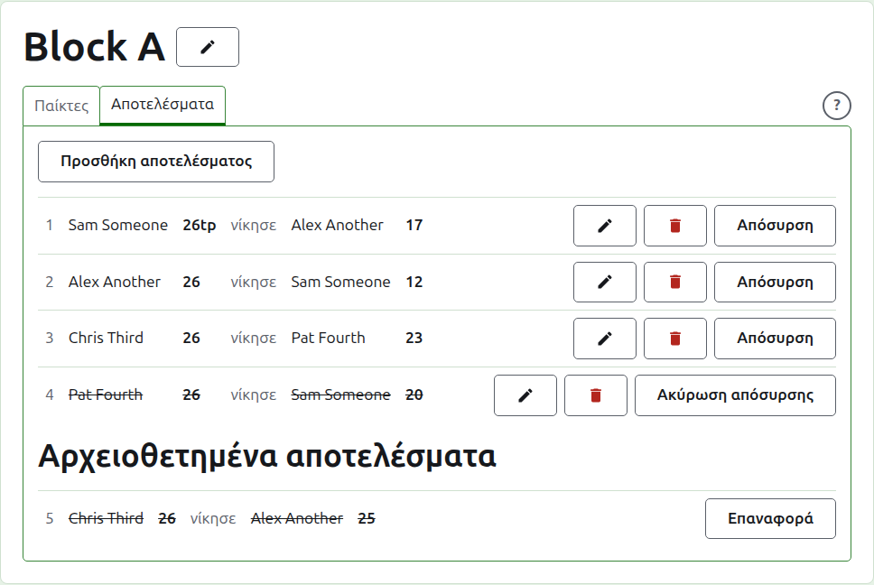
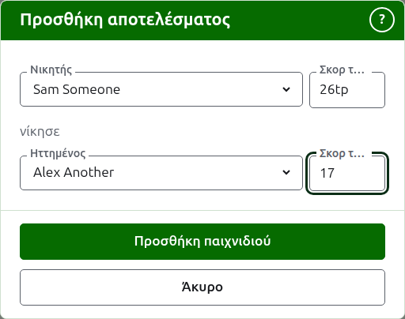
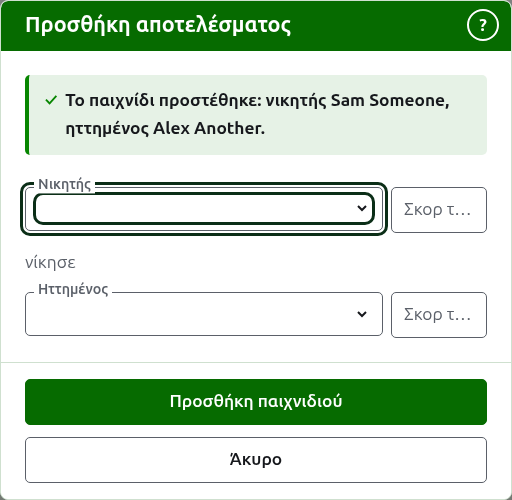
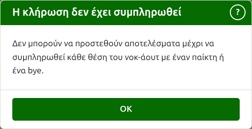
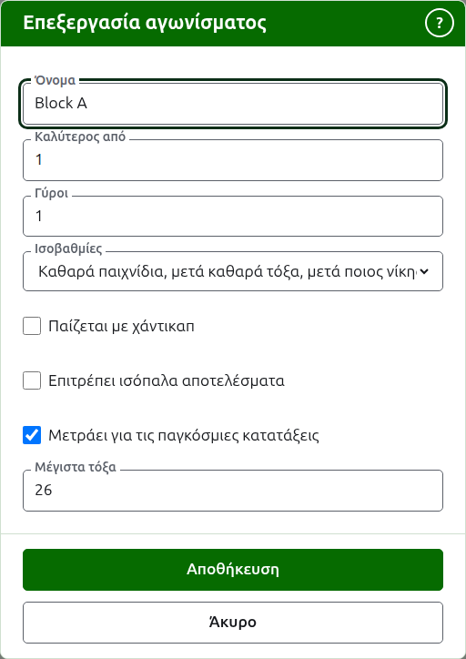

# Αποτελέσματα

Η καρτέλα **Αποτελέσματα** της σελίδας ενός αγωνίσματος είναι εκεί όπου τα παιχνίδια του καταχωρίζονται, διορθώνονται και παραμερίζονται. Ένας καταχωρητής βλέπει μόνο αυτή την καρτέλα και μπορεί να κάνει σε αυτή ό,τι μπορεί ένας υπεύθυνος.

## Καταχώριση ενός αποτελέσματος {#entering-a-score}

Πατήστε **Προσθήκη αποτελέσματος**, πάνω από τη λίστα. Το παράθυρο διαβάζεται όπως λέγεται φωναχτά ένα αποτέλεσμα: ο νικητής και το σκορ του, μετά το "νίκησε", μετά ο ηττημένος και το σκορ του.

Ο νικητής και ο ηττημένος επιλέγονται ο καθένας από τους παίκτες του αγωνίσματος που παίζουν, με τη σειρά του αγωνίσματος. Κανείς δεν είναι επιλεγμένος στην αρχή, ώστε ένα παιχνίδι να μη γράφεται ποτέ ενάντια σε έναν παίκτη που δεν επιλέξατε. Σε ένα νοκ-άουτ, η επιλογή του νικητή επιλέγει ποιον έχει κληρωθεί να αντιμετωπίσει ως ηττημένο, όπου μπορείτε να το δείτε και να επιλέξετε άλλον.

Ένα σκορ πληκτρολογείται όπως το έγραψε ο καταχωρητής: ο αριθμός των πόντων του και ό,τι ακολουθεί, που κρατιέται και εμφανίζεται όπως πληκτρολογήθηκε, όπως "26tp" για 26 τόξα και ένα τριπλό peel. Ο αριθμός είναι τα ψηφία με τα οποία αρχίζει το σκορ· ένα σκορ που δεν αρχίζει με ψηφίο απορρίπτεται.

Ένα παιχνίδι που κερδίζεται με ίσους πόντους, όπως όταν διακόπτεται λόγω χρόνου και κρίνεται με άλλον τρόπο, λέει ποιος το κέρδισε με μια σήμανση μετά το σκορ του νικητή: "6w" νίκησε το "6". Στο Croquet Scores οι σημάνσεις είναι "w", "won" και "winner"· το Gateball Scores δέχεται επίσης "cb" και "so". Το σκορ του νικητή πρέπει να είναι μεγαλύτερο από του ηττημένου, ή σημασμένο, εκτός αν το τουρνουά επιτρέπει ισόπαλα αποτελέσματα, οπότε οι ίσοι πόντοι χωρίς σήμανση κρατιούνται ως ισοπαλία. Οι σημάνσεις είναι οι αγγλικές λέξεις, επειδή αυτές αναγνωρίζει η ιστοσελίδα.

Πατήστε **Προσθήκη παιχνιδιού**. Το παιχνίδι προστίθεται, το παράθυρο λέει ποιο και τα πεδία αδειάζουν για το επόμενο, αφού τα αποτελέσματα έρχονται σε παρτίδα διαβασμένα από έναν πίνακα στο τέλος ενός γύρου. Πατήστε **Άκυρο** όταν έχουν μπει όλα.

Αν το παράθυρο δεν μπορεί να διαβάσει τους παίκτες του αγωνίσματος, λέει "Οι παίκτες δεν μπόρεσαν να διαβαστούν. Κλείστε αυτό το παράθυρο και ανοίξτε το ξανά." Κάντε το.

Ό,τι απορρίπτεται λέγεται κάτω από το πεδίο στο οποίο αναφέρεται: ένας νικητής ή ηττημένος που δεν επιλέχθηκε, ένα σκορ που δεν πληκτρολογήθηκε ή δεν αρχίζει με ψηφίο, ο ίδιος παίκτης και στις δύο θέσεις, ένα σκορ ηττημένου σημασμένο ως νίκη ή ένα σκορ νικητή πίσω από του ηττημένου. Σε ένα νοκ-άουτ, δύο παίκτες που δεν έχουν κληρωθεί να συναντηθούν απορρίπτονται πάνω από τα πεδία.

## Η κλήρωση ενός νοκ-άουτ πρέπει να συμπληρωθεί πρώτα {#draw-filled-first}

Ένα νοκ-άουτ παίζεται μόνο όταν κάθε θέση της κλήρωσής του έχει έναν παίκτη ή ένα bye. Μέχρι τότε, η Προσθήκη αποτελέσματος εξηγεί γιατί δεν μπορούν να προστεθούν αποτελέσματα αντί να ανοίξει το παράθυρο.

## Η λίστα των αποτελεσμάτων

Τα αποτελέσματα σε χρήση παρατίθενται με τη σειρά που καταχωρίστηκαν, τα παλαιότερα πρώτα, ώστε η λίστα να διαβάζεται όπως παίχτηκε το αγώνισμα. Η λίστα είναι ένας πίνακας με μια γραμμή για κάθε παιχνίδι και χωρίς επικεφαλίδες στηλών. Μια γραμμή λέει τον αριθμό του παιχνιδιού, τον νικητή και το σκορ του, τη λέξη "νίκησε", μετά τον ηττημένο και το σκορ του, και προσφέρει **Επεξεργασία** και **Αρχειοθέτηση**.

Ο αριθμός ενός παιχνιδιού είναι η θέση του ανάμεσα στα παιχνίδια που καταχωρίστηκαν, με το πρώτο να είναι το 1, μετρώντας και τα αρχειοθετημένα παιχνίδια. Η αρχειοθέτηση ενός παιχνιδιού δεν αλλάζει τον αριθμό κανενός άλλου, γι' αυτό ένα κενό στους αριθμούς λέει ότι ένα παιχνίδι έχει αρχειοθετηθεί.

## Διόρθωση ενός αποτελέσματος {#correcting-a-score}

Η **Επεξεργασία** ανοίγει το ίδιο παράθυρο για αυτό το αποτέλεσμα, με τίτλο Επεξεργασία αποτελέσματος, με τους παίκτες του επιλεγμένους και τα σκορ του όπως πληκτρολογήθηκαν. Πατήστε **Αποθήκευση** για να κρατήσετε τη διόρθωση και να κλείσετε το παράθυρο.

Μια διόρθωση κρατά το αποτέλεσμα: ένα παιχνίδι που κερδήθηκε μένει κερδισμένο και ένα ισόπαλο παιχνίδι μένει ισόπαλο. Ένα παιχνίδι του οποίου το αποτέλεσμα ήταν λάθος αρχειοθετείται και καταχωρίζεται ξανά.

Όπου ένα αποτέλεσμα μπορεί να αρχειοθετηθεί, μπορούν να αλλάξουν και οι παίκτες του εκτός από τα σκορ του. Σε ένα νοκ-άουτ, ένα αποτέλεσμα του οποίου ο νικητής έχει ήδη παίξει στον επόμενο γύρο κρατά τους παίκτες του, αφού η αλλαγή του ποιος το κέρδισε θα άφηνε το επόμενο παιχνίδι να το παίζει κάποιος που δεν είχε φτάσει εκεί· μόνο τα σκορ του μπορούν να διορθωθούν.

## Αρχειοθέτηση ενός αποτελέσματος

Η **Αρχειοθέτηση** παραμερίζει ένα αποτέλεσμα ώστε να μη μετράει για τίποτα. Παρατίθεται κάτω από τα **Αρχειοθετημένα αποτελέσματα**, διαγραμμισμένο, και προσφέρει μόνο **Επαναφορά**. Κανένα από τα δύο δεν ρωτά πρώτα, αφού το καθένα αναιρεί το άλλο.

Σε ένα νοκ-άουτ, ο νικητής ενός αγώνα προχωρά στον επόμενο γύρο, γι' αυτό ένα αποτέλεσμα ενός αγώνα του οποίου ο νικητής έχει παίξει στον επόμενο γύρο δεν προσφέρει Αρχειοθέτηση. Το παιχνίδι στον επόμενο γύρο αρχειοθετείται πρώτα και μετά μπορούν όσα είναι πριν από αυτό. Όπου ένας γύρος είναι ο καλύτερος από 3 ή 5, κάθε παιχνίδι του αγώνα κρατιέται με τον ίδιο τρόπο. Ένα μπλοκ και ένα ελβετικό δεν έχουν γύρους που να εξαρτώνται ο ένας από τον άλλον, γι' αυτό κάθε αποτέλεσμα σε αυτά μπορεί να αρχειοθετηθεί.

## Απόσυρση ενός αποτελέσματος

Ένας παίκτης που φεύγει από ένα αγώνισμα συνήθως αποσύρεται από αυτό, στην καρτέλα Παίκτες, και αυτό είναι το μόνο που χρειάζεται: δεν παίζει άλλο και τα παιχνίδια που έπαιξε μένουν αλλά τα παιχνίδια του δεν μετράνε πια για νίκες/ήττες και τόξα. Η απόσυρση ενός αποτελέσματος είναι για την πιο σπάνια περίπτωση όπου ένα παιχνίδι που παίχτηκε δεν πρέπει να μετρήσει. Στο Australian President's Eights, για παράδειγμα, τα αποτελέσματα του πρώτου γύρου μένουν όταν ένας παίκτης αποσύρεται και μόνο τα παιχνίδια του δεύτερου γύρου βγαίνουν από τον υπολογισμό: αποσύρετε εκείνα τα παιχνίδια.

Σε ένα μπλοκ ή ένα ελβετικό, ένα αποτέλεσμα που παίχτηκε αλλά δεν πρέπει να μετρήσει αποσύρεται αντί να αρχειοθετηθεί. Η **Απόσυρση** το κρατά ανάμεσα στα αποτελέσματα σε χρήση, στη θέση του, αλλά διαγραμμισμένο και χωρίς να μετράει για τίποτα στις δημόσιες σελίδες. Η **Ακύρωση απόσυρσης** το κάνει να μετράει ξανά. Καμία δεν ρωτά πρώτα. Στα αποτελέσματα ενός νοκ-άουτ δεν προσφέρεται Απόσυρση, αφού εκεί ένα αποτέλεσμα αποφασίζει περισσότερα από τις βαθμολογίες.

Επόμενο: [Σημειώσεις](notes.md).
