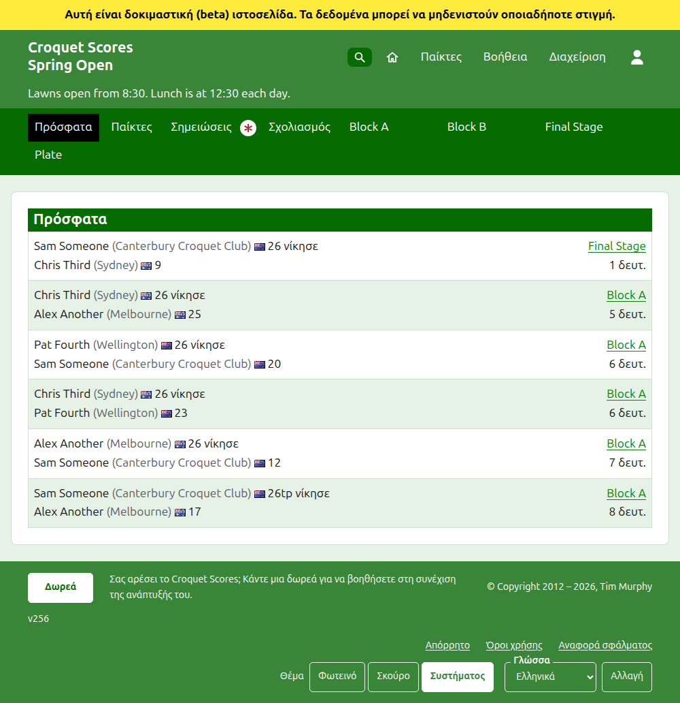
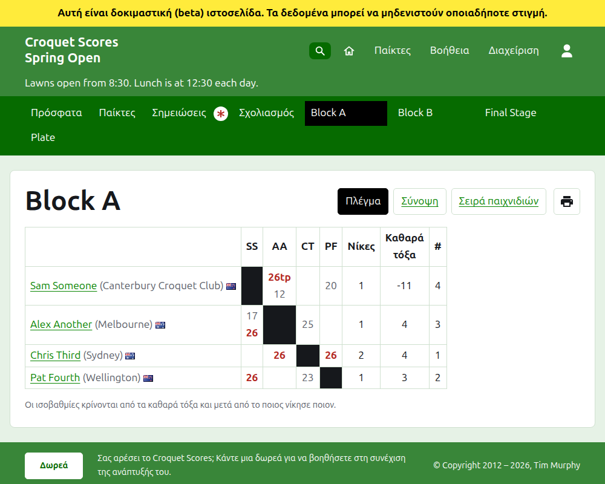
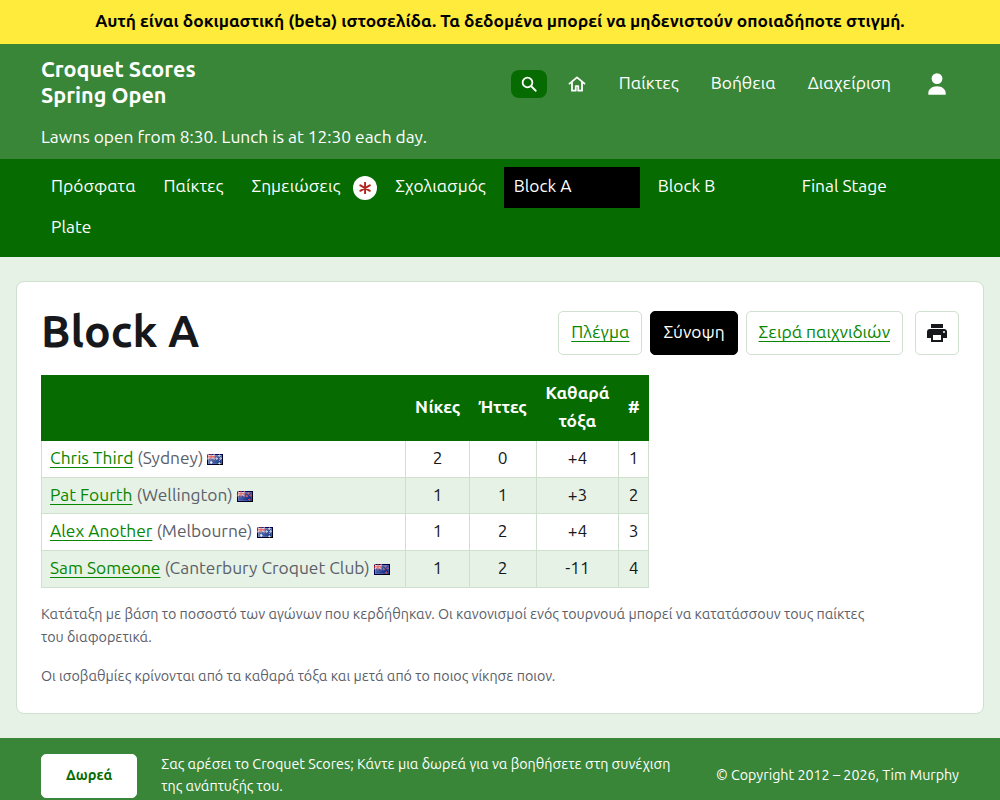
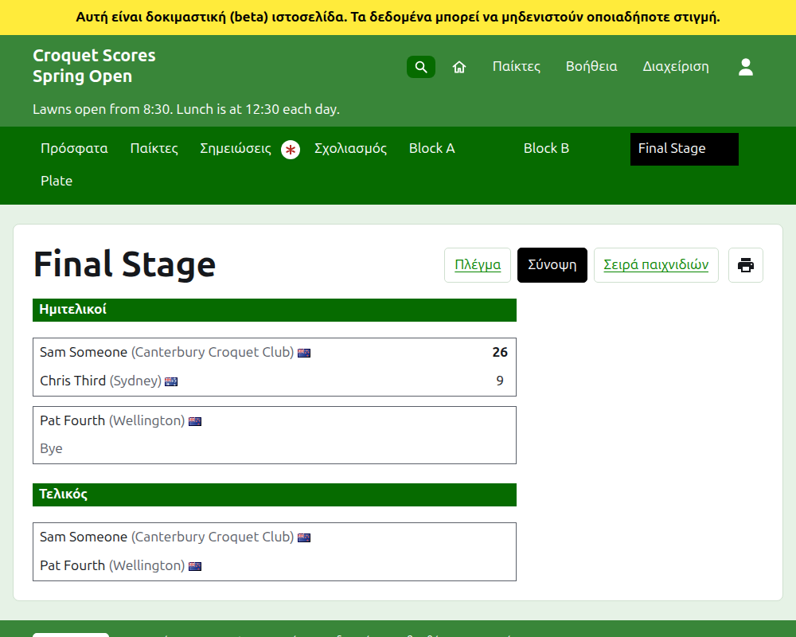
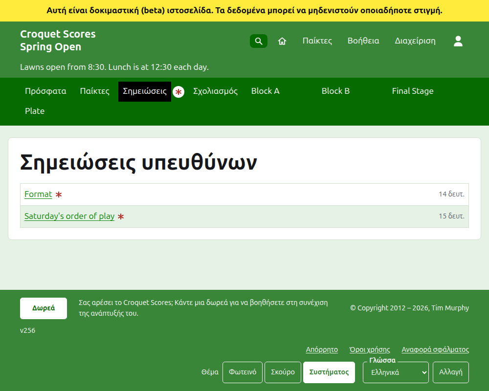

# Τι βλέπει το κοινό

Τίποτα δεν δημοσιεύεται: οι δημόσιες σελίδες σχεδιάζονται από ό,τι κρατά η διαχείριση, γι' αυτό ένα αποτέλεσμα που καταχωρίζεται βρίσκεται σε αυτές αμέσως. Δεν χρειάζονται λογαριασμό ούτε σενάρια (JavaScript) και είναι διαρρυθμισμένες για τηλέφωνο.

## Η σελίδα του τουρνουά

Η σελίδα του τουρνουά βρίσκεται στη χρονιά, το άθλημα και το όνομά του, όπως `/2026/ac/spring-open`. Έχει ως επικεφαλίδα το όνομα του τουρνουά, με τον υπότιτλό του από κάτω. Παραθέτει κάθε παιχνίδι σε χρήση, το πιο πρόσφατα προστεθέν πρώτο, ώστε ένας αναγνώστης που επιστρέφει να βλέπει τι έχει συμβεί έκτοτε. Κάθε παιχνίδι λέει τον νικητή, το χάντικαπ και ό,τι εκπροσωπεί, τη σημαία και το σκορ του, μετά τον ηττημένο και τα δικά του, με το αγώνισμα στο οποίο παίχτηκε και πριν από πόση ώρα προστέθηκε.

Η σκούρα πράσινη γραμμή προσφέρει τις ενότητες του τουρνουά: **Πρόσφατα**, που είναι αυτή η σελίδα, **Παίκτες**, **Σημειώσεις** και **Σχολιασμός**, και μετά κάθε αγώνισμα σε χρήση, με τη σειρά που τα έχει η καρτέλα Αγωνίσματα. Οι Σημειώσεις σημαδεύονται με κόκκινο αστερίσκο όσο υπάρχει μια σημείωση που ο αναγνώστης δεν έχει διαβάσει.

## Ένα μπλοκ

Η σελίδα ενός μπλοκ δείχνει τα αποτελέσματά του ως πλέγμα: μια γραμμή και μια στήλη για κάθε παίκτη με τη σειρά του μπλοκ, με τα παιχνίδια ανάμεσα σε δύο παίκτες εκεί όπου η γραμμή συναντά τη στήλη, το καθένα σημασμένο ως κερδισμένο, χαμένο ή ισόπαλο για τον παίκτη της γραμμής. Μετά τις στήλες των παικτών έρχονται τα σύνολα κάθε παίκτη. Όπου κάθε αγώνας είναι ένα μόνο παιχνίδι, αυτά είναι νίκες και καθαρά τόξα· όπου ένας αγώνας είναι ο καλύτερος από περισσότερα του ενός, είναι αγώνες, καθαρά παιχνίδια, παιχνίδια και καθαρά τόξα. Η τελευταία στήλη, με επικεφαλίδα **#**, είναι η θέση κάθε παίκτη: 1 για τον πρώτο και =2 όπου οι παίκτες δεν μπορούν να ξεχωριστούν και μοιράζονται τη δεύτερη. Όπου οποιοιδήποτε παίκτες έχουν κερδίσει το ίδιο ποσοστό των αγώνων τους, μια γραμμή κάτω από το πλέγμα λέει πώς ξεχωρίζουν, όπως το έχει η ισοβαθμία του μπλοκ (δείτε τα Αγωνίσματα).

Ένα μπλοκ, ένα νοκ-άουτ και ένα ελβετικό εμφανίζονται το καθένα με τρεις τρόπους, που προσφέρονται στη γραμμή με το όνομα του αγωνίσματος: **Πλέγμα**, **Σύνοψη** και **Σειρά παιχνιδιών**. Δίπλα τους υπάρχει ένα κουμπί εκτυπωτή, που εκτυπώνει το όνομα του τουρνουά, το όνομα του αγωνίσματος και τα αποτελέσματά του, και τίποτα άλλο. Η σύνοψη είναι αυτή για τηλέφωνο: για ένα μπλοκ, οι παίκτες κατατεταγμένοι, με τις νίκες, τις ήττες, τα καθαρά τόξα και τη θέση τους· για ένα νοκ-άουτ, οι αγώνες παρατεθειμένοι γύρο με γύρο· για ένα ελβετικό, ο πίνακας του πλέγματος χωρίς τα αποτελέσματά του. Η σειρά παιχνιδιών παραθέτει κάθε παιχνίδι, το παλαιότερο πρώτο στην αρχή. Έχει επικεφαλίδες **Παιχνίδι** και **Ημερομηνία**: το πάτημα του **Παιχνίδι** ταξινομεί τα παιχνίδια με το όνομα του νικητή και μετά του ηττημένου, και το πάτημα της **Ημερομηνία** τα ταξινομεί από το παλαιότερο ή το νεότερο, και το πάτημα της επικεφαλίδας με την οποία έχει ταξινομηθεί μια λίστα την αντιστρέφει. Ο τρόπος που ταξινόμησε ένας αναγνώστης διατηρείται στη συσκευή του. Ένας αναγνώστης που επιλέγει μια προβολή την κρατά για κάθε αγώνισμα μέχρι να επιλέξει άλλη.

Ένα αγώνισμα που παίζεται σε αριθμό τόξων διαφορετικό από τον συνηθισμένο για το άθλημά του το λέει κάτω από το όνομά του, ως "Παίζεται μέχρι 14 τόξα" (δείτε [Αγωνίσματα](competitions.md#adding-a-competition)).

Η γραμμή ενός αποσυρμένου παίκτη το λέει. Ένα αποσυρμένο αποτέλεσμα εμφανίζεται διαγραμμισμένο και δεν μετράει για τίποτα. Ένα αρχειοθετημένο αποτέλεσμα δεν εμφανίζεται.

## Ένα νοκ-άουτ

Η σελίδα ενός νοκ-άουτ σχεδιάζει την κλήρωσή του γύρο με γύρο, μια στήλη για κάθε γύρο από τον πρώτο μέχρι τον τελικό, με τις δύο πλευρές κάθε αγώνα η μία πάνω από την άλλη και ένα κελί για καθένα από τα παιχνίδια του αγώνα. Ο αγώνας ενός επόμενου γύρου στέκεται δίπλα στους δύο αγώνες των οποίων οι νικητές συναντιούνται σε αυτόν. Σε τηλέφωνο η κλήρωση κυλά προς τα πλάγια, με βέλη προς τον τελικό και πίσω.

## Ένα ελβετικό

Η σελίδα ενός ελβετικού κατατάσσει τους παίκτες του σε έναν πίνακα: τα παιχνίδια τους, τις νίκες τους, το ποσοστό νικών τους και τα αποτελέσματά τους, το καθένα λεγόμενο ως ο αντίπαλος και η διαφορά, όπως "+4" για ένα παιχνίδι που κερδήθηκε με τέσσερα.

## Παίκτες

Η σελίδα Παίκτες παραθέτει κάθε παίκτη του τουρνουά που δεν είναι αρχειοθετημένος, με αλφαβητική σειρά, με το χάντικαπ και ό,τι εκπροσωπεί σε παρένθεση, και τη σημαία του.

## Σημειώσεις

Η σελίδα Σημειώσεις, με επικεφαλίδα Σημειώσεις υπευθύνων, παραθέτει τις σημειώσεις του τουρνουά, την πιο πρόσφατα γραμμένη πρώτη, καθεμία από τις οποίες οδηγεί στη δική της σελίδα και λέει πριν από πόση ώρα γράφτηκε. Μια σημείωση που ο αναγνώστης δεν έχει διαβάσει σημαδεύεται με κόκκινο αστερίσκο μέχρι να την ανοίξει. Ένα τουρνουά χωρίς σημειώσεις λέει "Καμία σημείωση ακόμα."

## Πού παρατίθεται το τουρνουά

Ένα τουρνουά βρίσκεται στην αρχική σελίδα όσο παίζεται ή πρόκειται να ξεκινήσει. Η σελίδα της χρονιάς του, όπως `/2026`, παραθέτει τους μήνες της χρονιάς, καθένας από τους οποίους, μόλις πατηθεί, παραθέτει τα τουρνουά που ξεκινούν σε αυτόν. Ένα στοιχείο ελέγχου κάτω από την επικεφαλίδα, **Εμφάνιση όλων** και μετά **Απόκρυψη όλων**, ανοίγει ή κλείνει κάθε μήνα. Ένα τουρνουά που έχει τικ ως εθνικό ή διεθνές εμφανίζεται με έντονα γράμματα σε ολόκληρη τη γραμμή του.

## Διευθύνσεις που μετακινούνται

Ένα τουρνουά κρατά τη διεύθυνσή του όταν διορθωθεί το όνομά του. Όπου μετακινείται, επειδή άλλαξε η χρονιά ή το άθλημά του, η παλιά διεύθυνσή του οδηγεί στη νέα, ώστε ένας σύνδεσμος που κρατήθηκε από πριν να λειτουργεί ακόμα. Οι σελίδες ενός αρχειοθετημένου τουρνουά δεν βρίσκονται μέχρι να επαναφερθεί.
