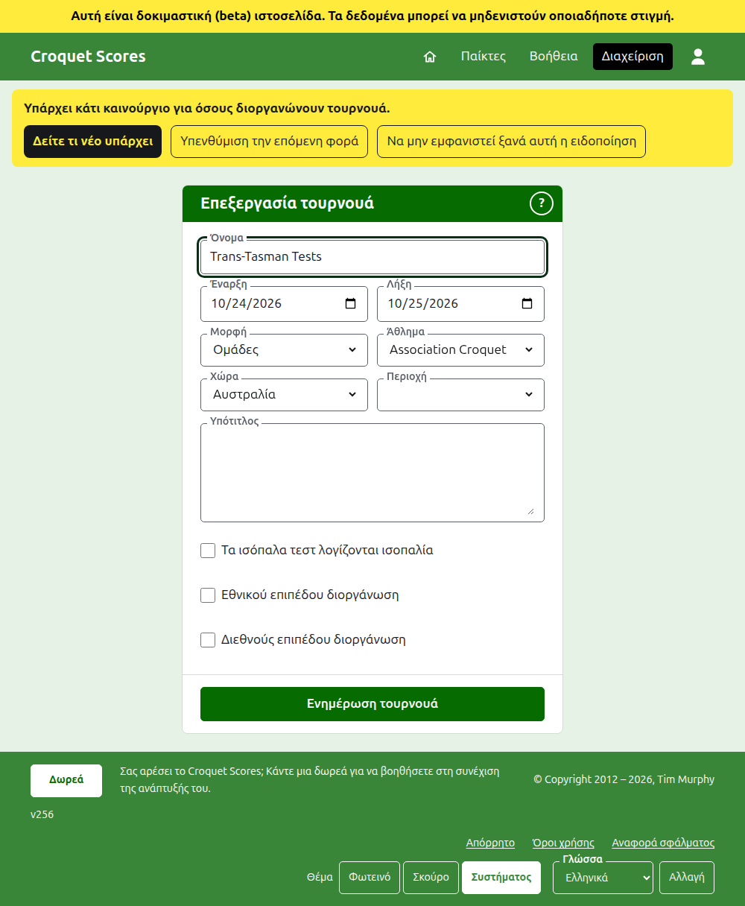
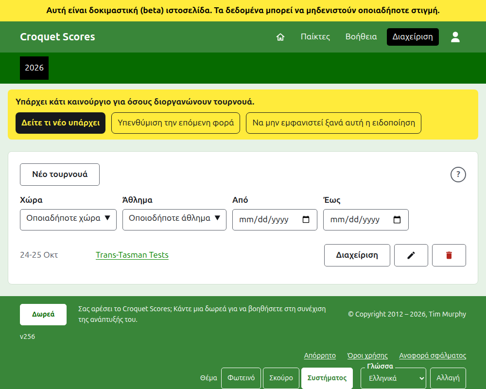

# Αλλαγή, αρχειοθέτηση και επαναφορά ενός τουρνουά

## Αλλαγή των στοιχείων του τουρνουά

Στη λίστα τουρνουά στη διαχείριση, πατήστε **Επεξεργασία** στο τουρνουά. Η φόρμα είναι αυτή που το δημιούργησε, συμπληρωμένη όπως είναι το τουρνουά. Αλλάξτε ό,τι είναι λάθος και πατήστε **Ενημέρωση τουρνουά**.

Οι ημέρες του τουρνουά μπορούν να διευρυνθούν εδώ όπου ένα τεστ χρειάζεται μια ημέρα έξω από αυτές, αφού ένα τεστ παίζεται μέσα στο τουρνουά του. Μόλις το τουρνουά έχει οποιαδήποτε ομάδα ή τεστ, μετρώντας και τα αρχειοθετημένα, η **Μορφή** του δεν μπορεί να αλλάξει καθόλου: ούτε στη μορφή Standard, που έχει αντί για αυτά παίκτες και αγωνίσματα, ούτε σε άλλη μορφή που παίζεται από ομάδες, αφού ένα τεστ μπορεί να είναι σε έναν όμιλο που η άλλη μορφή δεν έχει. Επιλέξτε τη μορφή όταν δημιουργείται το τουρνουά.

Ένα τουρνουά κρατά τη διεύθυνσή του όταν διορθωθεί το όνομά του, ώστε ένας σύνδεσμος που έχει ήδη στείλει κάποιος να το βρίσκει ακόμα. Αλλάζει μόνο όταν αλλάξει η χρονιά που ξεκινά ή το άθλημά του και τότε η παλιά διεύθυνσή του οδηγεί στη νέα. Η αποθήκευση σας πηγαίνει στο τουρνουά όπου βρίσκεται τώρα.

Μόνο ένας υπεύθυνος μπορεί να αλλάξει ένα τουρνουά. Ένας καταχωρητής, ή οποιοσδήποτε άλλος, ενημερώνεται γι' αυτό αντί να δει τη φόρμα.

## Η λίστα τουρνουά

Η διαχείριση παραθέτει μία χρονιά τη φορά, ξεκινώντας με τη φετινή, με το νεότερο τουρνουά πρώτο. Οι χρονιές στις οποίες έχετε ένα τουρνουά είναι καρτέλες στη σκούρα πράσινη γραμμή, με τις νεότερες πρώτες· όπου είναι περισσότερες από όσες χωρούν σε τηλέφωνο, οι παλαιότερες βρίσκονται σε μια αναπτυσσόμενη λίστα στο τέλος της σειράς. Η χρονιά βρίσκεται στη διεύθυνση, γι' αυτό μπορείτε να συνδεθείτε σε μια χρονιά. Κάτω από τα κουμπιά η λίστα μπορεί να περιοριστεί με **Χώρα**, **Περιοχή** και **Άθλημα**, και με τις ημέρες στις οποίες έχει τουρνουά, **Από** και **Έως**. Ένα στρογγυλό **;** δίπλα στο **Νέο τουρνουά** οδηγεί στη βοήθεια.

## Αρχειοθέτηση ενός τουρνουά

Η **Αρχειοθέτηση** σε ένα τουρνουά στη λίστα το παραμερίζει. Παρατίθεται ακόμα, διαγραμμισμένο και μετά τα τουρνουά που χρησιμοποιούνται, αλλά προσφέρει μόνο **Επαναφορά**: η σελίδα του στη διαχείριση, και οι δημόσιες σελίδες του, είναι κλειστές μέχρι να επαναφερθεί. Η αρχειοθέτηση δεν ρωτά πρώτα, αφού η επαναφορά την αναιρεί.

Επόμενο: [Τι βλέπει το κοινό](what-the-public-sees.md).
