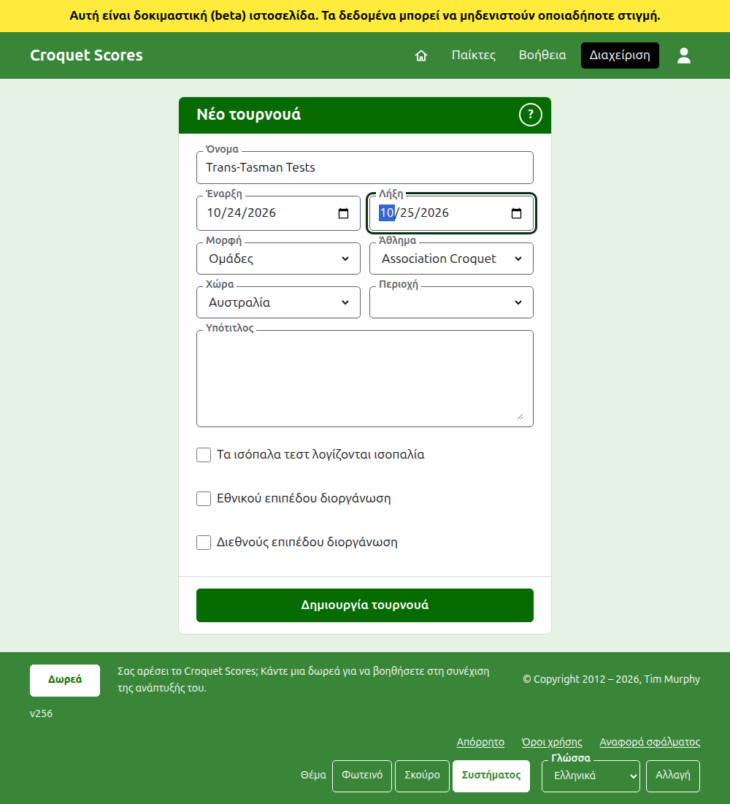
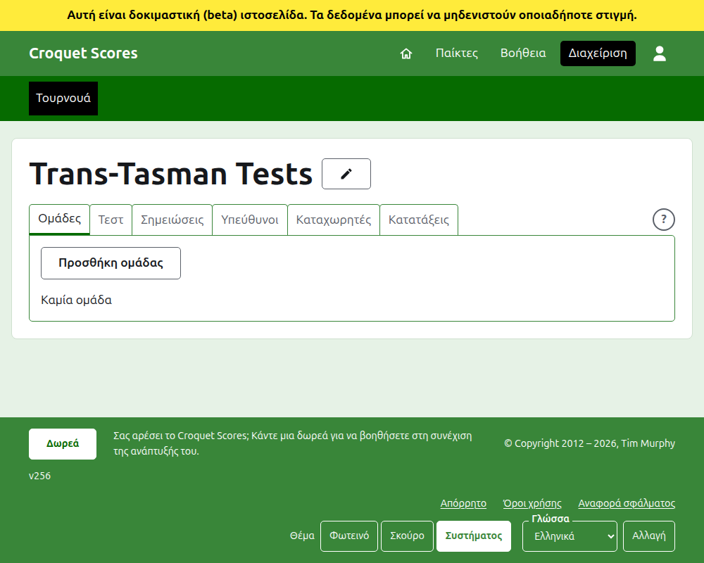

# Δημιουργία ενός τουρνουά

Πατήστε **Νέο τουρνουά** πάνω από τη λίστα τουρνουά στη διαχείριση. Βρίσκεται πάνω από τη λίστα και όχι κάτω, ώστε μια μακριά λίστα να μην το σπρώχνει έξω από την οθόνη ενός τηλεφώνου.

Η φόρμα ζητά ό,τι χρειάζεται για να ξεκινήσει ένα τουρνουά. Ό,τι έχει τη μεγαλύτερη σημασία εδώ είναι η **Μορφή**, που κάνει ένα τουρνουά να παίζεται από ομάδες.

## Τι ζητά η φόρμα

**Όνομα.** Ό,τι ψάχνουν οι αναγνώστες για να βρουν το τουρνουά, όπως "Trans-Tasman Tests". Έχει από 3 έως 254 χαρακτήρες. Ένα όνομα όλο με πεζά, ή όλο με κεφαλαία, απορρίπτεται, αφού θα έμοιαζε με λάθος σε κάθε σελίδα όπου εμφανίζεται. Δύο τουρνουά μπορεί να έχουν το ίδιο όνομα, αφού το ίδιο τουρνουά παίζεται κάθε χρόνο.

**Έναρξη** και **Λήξη.** Οι ημέρες που διαρκεί το τουρνουά. Κάθε τεστ παίζεται μέσα σε αυτές, γι' αυτό ορίστε τις ώστε να καλύπτουν ολόκληρη τη διοργάνωση. Ένα τουρνουά δεν μπορεί να λήξει πριν από την έναρξή του και δεν μπορεί να ξεκινήσει ή να λήξει μετά το τέλος του επόμενου έτους. Ένα τουρνουά ανήκει στη χρονιά που ξεκινά, που είναι και η χρονιά στη διεύθυνσή του.

**Μορφή.** Επιλέξτε μία από τις μορφές που παίζονται από ομάδες:

- Η μορφή **Ομάδες** είναι η γενική μορφή για κάθε διοργάνωση ανάμεσα σε ομάδες.
- Οι **Eire Cup**, **Interstate Shield** και **Παγκόσμιο πρωτάθλημα ομάδων Golf Croquet** είναι συγκεκριμένες διοργανώσεις, καθεμία κρατημένη ως δική της μορφή ώστε να διοργανώνεται όπως διοργανώνεται εκείνη η διοργάνωση.

Η Standard είναι η μία μορφή που δεν παίζεται από ομάδες και δεν είναι αυτό που θέλετε εδώ. Το Gateball Scores δεν προσφέρει μορφή, αφού κάθε τουρνουά εκεί είναι ένα standard τουρνουά gateball· ένα τουρνουά που παίζεται από ομάδες δημιουργείται στο Croquet Scores.

**Άθλημα.** Τα αθλήματα που προσφέρει η ιστοσελίδα, με τη σειρά της: Association Croquet, Golf Croquet, Αμερικανικό 6 τόξων και Ricochet.

**Χώρα** και **Περιοχή.** Πού παίζεται το τουρνουά. Μια περιοχή ζητείται μόνο όπου η χώρα που επιλέγετε χωρίζεται σε περιοχές, όπως οι πολιτείες της Αυστραλίας, και δεν χρειάζεται να επιλεγεί ούτε τότε.

**Υπότιτλος.** Ό,τι θέλετε να γνωρίζουν οι αναγνώστες και δεν έχει δικό του πεδίο: πού να παρκάρουν, πότε είναι το γεύμα, ποιον να πάρουν τηλέφωνο. Εμφανίζεται κάτω από το όνομα του τουρνουά σε κάθε δημόσια σελίδα. Γράφεται σε Markdown, γι' αυτό μια λέξη μπορεί να γίνει έντονη με αστερίσκους γύρω της και μια λίστα να γίνει με μια παύλα στην αρχή κάθε γραμμής. Μπορεί να έχει έως 2000 χαρακτήρες και μπορεί να μείνει κενός.

Πώς παίζονται και μετρούνται τα τεστ του, αν με χάντικαπ, με ισόπαλα αποτελέσματα και προς τις παγκόσμιες κατατάξεις, το λέει κάθε τεστ όταν προστίθεται.

**Τα ισόπαλα τεστ λογίζονται ισοπαλία.** Ζητείται μόλις επιλεγεί μια μορφή που παίζεται από ομάδες. Ένα τεστ του οποίου οι ομάδες κερδίζουν τον ίδιο αριθμό αγώνων κρίνεται από τα καθαρά παιχνίδια τους, μετά από τα καθαρά τόξα τους. Κάντε τικ σε αυτό και γίνεται ισοπαλία. Έχει τικ στην αρχή μόνο για το **Παγκόσμιο πρωτάθλημα ομάδων Golf Croquet**, που τα έκρινε πάντα ισοπαλία, και μπορεί να αλλάξει αργότερα.

**Εθνικού επιπέδου διοργάνωση** και **Διεθνούς επιπέδου διοργάνωση.** Ένα τουρνουά μπορεί να είναι το ένα, το άλλο ή κανένα, αλλά ποτέ και τα δύο: το τικ στο ένα αφαιρεί το τικ από το άλλο.

## Δημιουργία

Πατήστε **Δημιουργία τουρνουά**. Μεταφέρεστε στη σελίδα του τουρνουά στη διαχείριση, ανοιχτή στην καρτέλα Ομάδες, και είστε ο πρώτος υπεύθυνός του. Παρατίθεται στη διαχείριση κάτω από τη χρονιά που ξεκινά.

Η δημόσια διεύθυνση του τουρνουά φτιάχνεται από τη χρονιά, το άθλημα και το όνομά του, όπως `/2026/ac/trans-tasman-tests`. Κρατά αυτή τη διεύθυνση όταν το όνομά του διορθωθεί αργότερα, ώστε ένας σύνδεσμος που έχει ήδη σταλεί να το βρίσκει ακόμα· αλλάζει μόνο όταν αλλάξει η χρονιά που ξεκινά ή το άθλημά του.

## Αν κάτι απορριφθεί

Ό,τι απορρίπτεται λέγεται κάτω από το πεδίο στο οποίο αναφέρεται και ό,τι πληκτρολογήσατε μένει πληκτρολογημένο. Τίποτα δεν κρατιέται μέχρι να γίνει δεκτό κάθε πεδίο. Τα πράγματα που απορρίπτονται συχνότερα είναι ένα όνομα πληκτρολογημένο όλο με πεζά, μια λήξη πριν από την έναρξη και μια χώρα που δεν επιλέχθηκε.

Επόμενο: [Ομάδες](teams.md).
