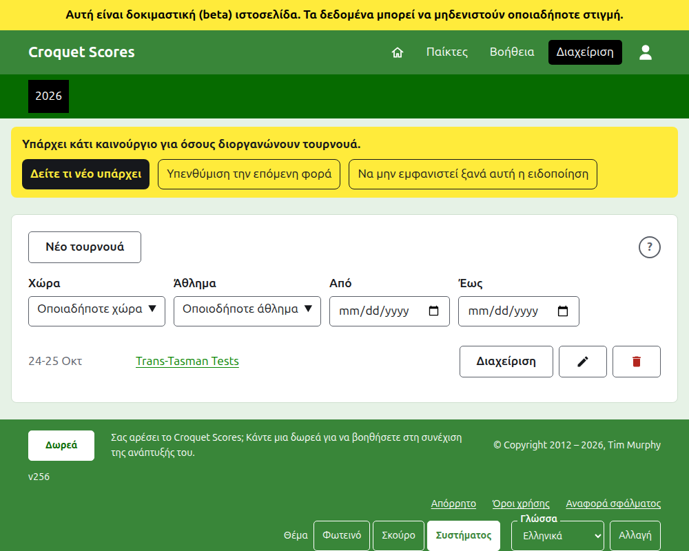
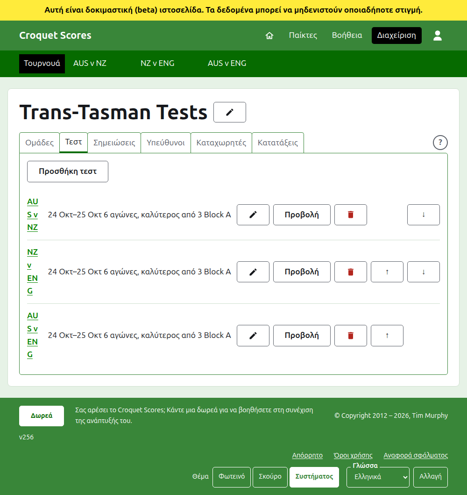

# Διοργάνωση ενός τουρνουά που παίζεται από ομάδες

Ένα τουρνουά που παίζεται από ομάδες είναι αυτό όπου συναντιούνται πλευρές, αντί για παίκτες που καταχωρίζονται έναν έναν: μια σειρά τεστ ανάμεσα σε δύο χώρες, ένα Interstate Shield, ένα παγκόσμιο πρωτάθλημα ομάδων. Οι ομάδες του στήνονται με τους παίκτες τους, προστίθενται τα τεστ ανάμεσα στις ομάδες και τα παιχνίδια κάθε τεστ ανεβαίνουν καθώς παίζονται. Αυτός ο οδηγός συνοδεύει έναν υπεύθυνο από τη σύνδεση μέχρι ένα τουρνουά με αποτελέσματα διαθέσιμα στο κοινό.

Στέκεται μόνος του. Τίποτα σε αυτόν δεν εξαρτάται από τον οδηγό για ένα standard τουρνουά, ο οποίος είναι γραμμένος χωριστά.

## Πριν ξεκινήσετε

Χρειάζεστε έναν λογαριασμό. Πατήστε [εδώ](/account/register) για να εγγραφείτε.

Ό,τι κάνει ένας υπεύθυνος γίνεται στο τμήμα διαχείρισης της ιστοσελίδας. Οι δημόσιες σελίδες, όπου οι παίκτες και οι θεατές παρακολουθούν το τουρνουά, σχεδιάζονται από ό,τι κρατά η διαχείριση, γι' αυτό τίποτα δεν χρειάζεται να δημοσιευτεί: ένα αποτέλεσμα που καταχωρίζεται βρίσκεται αμέσως στις δημόσιες σελίδες.

## Οι όροι

Μια **ομάδα** είναι μια πλευρά, όπως η Αυστραλία, με όνομα, ένα σύντομο όνομα όπως "AUS" και μια σημαία. Μια ομάδα έχει δικούς της **παίκτες**, που παίζουν για αυτήν και για κανέναν άλλον. Ένα **τεστ** είναι μια αναμέτρηση ανάμεσα σε δύο ομάδες, που λέγονται με τα σύντομα ονόματά τους, όπως "AUS v ENG", και αποτελείται από έναν αριθμό **αγώνων** ανάμεσα σε έναν παίκτη από κάθε ομάδα, με κάθε αγώνα να είναι ο καλύτερος από κάποιον αριθμό **παιχνιδιών**. Τα τεστ μπορεί να μπαίνουν σε **ομίλους**, όπως "Block A", όπου πολλές ομάδες παίζουν μεταξύ τους.

## Οι σελίδες με τη σειρά

1. [Δημιουργία ενός τουρνουά](creating-a-tournament.md): το όνομά του, οι ημέρες του, το άθλημά του, η μορφή του και πού παίζεται.
2. [Ομάδες](teams.md): προσθήκη των ομάδων, με τα σύντομα ονόματα και τις σημαίες τους.
3. [Οι παίκτες μιας ομάδας](team-players.md): καταχώριση των παικτών κάθε ομάδας στη δική της σελίδα.
4. [Τεστ](tests.md): προσθήκη των τεστ ανάμεσα σε ομάδες, των ημερών τους, πόσους αγώνες έχει το καθένα και των ομίλων τους.
5. [Αποτελέσματα](scores.md): καταχώριση των παιχνιδιών ενός τεστ, διόρθωσή τους και παραμερισμός όσων καταχωρίστηκαν κατά λάθος.
6. [Σημειώσεις](notes.md): ενημέρωση των παικτών για ό,τι πρέπει να γνωρίζουν καθώς προχωρά το τουρνουά.
7. [Υπεύθυνοι και καταχωρητές](managers-and-scorers.md): μοίρασμα της διοργάνωσης του τουρνουά και παραχώρηση σε κάποιον να καταχωρίζει αποτελέσματα χωρίς να μπορεί να αλλάξει τίποτα άλλο.
8. [Κατατάξεις](rankings.md): το αρχείο που στέλνεται στις παγκόσμιες κατατάξεις και τι μένει για να συμπληρώσετε.
9. [Αλλαγή, αρχειοθέτηση και επαναφορά ενός τουρνουά](changing-and-archiving.md): διόρθωση των στοιχείων του τουρνουά και παραμερισμός ενός τουρνουά.
10. [Τι βλέπει το κοινό](what-the-public-sees.md): οι σελίδες που παρακολουθούν οι παίκτες σας και πώς εμφανίζεται σε αυτές ό,τι καταχωρίζετε.

## Πώς είναι διαρρυθμισμένη η διαχείριση

Η εξώπορτα της διαχείρισης παραθέτει τα τουρνουά στα οποία έχετε μέρος, μία χρονιά τη φορά.

Το πάτημα του ονόματος ενός τουρνουά, ή της **Διαχείρισης**, ανοίγει τη σελίδα του. Ό,τι υπάρχει να διαχειριστείτε βρίσκεται σε έξι καρτέλες κάτω από το όνομά του: **Ομάδες**, **Τεστ**, **Σημειώσεις**, **Υπεύθυνοι**, **Καταχωρητές** και **Κατατάξεις**. Η καρτέλα **Κατατάξεις** υπάρχει μόνο όπου το τουρνουά μετράει για τις παγκόσμιες κατατάξεις. Η σελίδα ανοίγει στις Ομάδες, αφού οι ομάδες είναι το πρώτο που στήνεται.

Η σκούρα πράσινη γραμμή κάτω από την κεφαλίδα είναι για μετακίνηση ανάμεσα σε σελίδες. Στη σελίδα του τουρνουά και στη σελίδα ενός τεστ οδηγεί στο τουρνουά, ως **Τουρνουά**, και σε κάθε τεστ με το όνομά του. Στη σελίδα μιας ομάδας οδηγεί στο τουρνουά και σε κάθε ομάδα με το σύντομο όνομά της, αφού ένας υπεύθυνος στη σελίδα μιας ομάδας καταχωρίζει παίκτες ομάδα προς ομάδα. Η σελίδα στην οποία βρίσκεστε σημειώνεται με μαύρο. Όταν τα τεστ προστίθενται, αλλάζουν, μετακινούνται, αρχειοθετούνται ή επαναφέρονται στην καρτέλα Τεστ, η γραμμή ακολουθεί αμέσως.

## Πράγματα που ισχύουν παντού

**Τίποτα δεν διαγράφεται οριστικά εκτός από μια σημείωση.** Οι ομάδες, οι παίκτες, τα τεστ, τα αποτελέσματα και το ίδιο το τουρνουά αρχειοθετούνται αντί να διαγράφονται: παραμερίζονται, διαγράφονται με γραμμή και παρατίθενται κάτω από δική τους επικεφαλίδα, με την **Επαναφορά** για να επιστρέψουν. Η αρχειοθέτηση, η επαναφορά και η μετακίνηση πάνω και κάτω δεν ζητούν ποτέ επιβεβαίωση, επειδή καθεμία αναιρείται πατώντας την άλλη. Όσα δεν μπορούν να αναιρεθούν, όπως η διαγραφή μιας σημείωσης ή η αφαίρεση ενός υπευθύνου, ρωτούν πρώτα.

**Ένα παράθυρο πάνω από τη σελίδα δεν κρατά τίποτα μέχρι να πατήσετε το κουμπί του.** Το Άκυρο, ή το πλήκτρο Escape, το κλείνει και αφήνει τα πάντα όπως ήταν. Τα παράθυρα που προσθέτουν πράγματα, όπως η Προσθήκη ομάδας και η Προσθήκη αποτελέσματος, μένουν ανοιχτά μετά την προσθήκη κάθε ενός, ώστε μια λίστα να μπορεί να πληκτρολογηθεί ένα προς ένα.

**Ό,τι απορρίπτεται λέγεται δίπλα στο πεδίο στο οποίο αναφέρεται.** Τίποτα που απορρίφθηκε δεν κρατιέται και ό,τι πληκτρολογήσατε μένει πληκτρολογημένο, ώστε να διορθωθεί αντί να πληκτρολογηθεί ξανά.

**Η βοήθεια απέχει ένα πάτημα.** Ένα στρογγυλό **;** βρίσκεται στη γραμμή τίτλου της σελίδας που δημιουργεί ή αλλάζει ένα τουρνουά, στο τέλος της σειράς των καρτελών, δίπλα στο **Νέο τουρνουά** και σε κάθε παράθυρο. Ανοίγει το μέρος αυτού του οδηγού που αφορά ό,τι βλέπετε, σε άλλη καρτέλα, ώστε να διατηρείται ό,τι κάνατε.

**Η διαχείριση λειτουργεί σε τηλέφωνο.** Κάθε κουμπί είναι αρκετά μεγάλο για να πατηθεί με τον αντίχειρα και τίποτα δεν είναι πλατύτερο από την οθόνη.

Επόμενο: [Δημιουργία ενός τουρνουά](creating-a-tournament.md).
