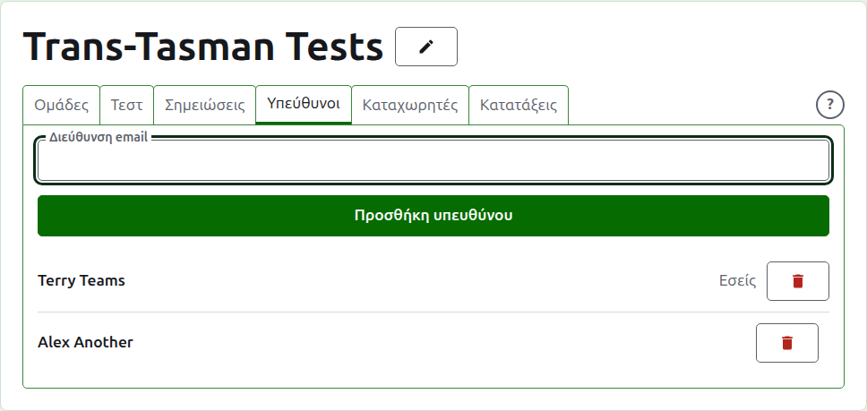
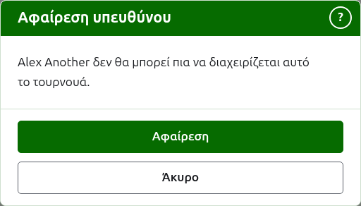
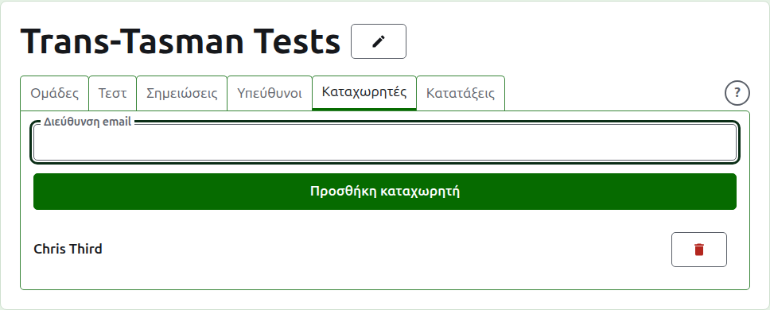
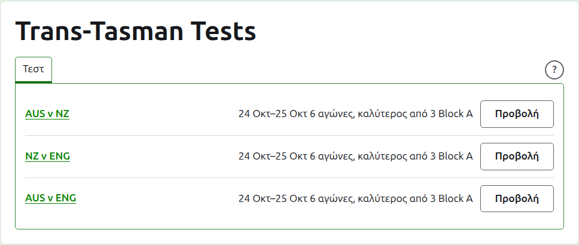

# Υπεύθυνοι και καταχωρητές

Ένα τουρνουά έχει υπευθύνους, που μπορούν να κάνουν ό,τι μπορεί να γίνει σε αυτό, και μπορεί να έχει καταχωρητές, που καταχωρίζουν τα αποτελέσματά του και τίποτα άλλο. Όποιος δημιούργησε το τουρνουά είναι ο πρώτος υπεύθυνός του.

## Υπεύθυνοι {#managers}

Η καρτέλα **Υπεύθυνοι** παραθέτει ποιοι διοργανώνουν το τουρνουά, με τη σειρά που έγιναν, με το δικό σας όνομα σημειωμένο ως δικό σας. Είναι εκεί όπου ένα τουρνουά μοιράζεται ή παραδίδεται.

Κάποιος γίνεται υπεύθυνος με τη διεύθυνση email του. Πληκτρολογήστε την στο πεδίο πάνω από τη λίστα και πατήστε **Προσθήκη υπευθύνου**. Η διεύθυνση πρέπει να ανήκει σε λογαριασμό που έχει εγγραφεί και επιβεβαιωθεί· μια διεύθυνση χωρίς τέτοιον απορρίπτεται κάτω από το πεδίο και η ιστοσελίδα δεν λέει περισσότερα από αυτό. Ένας καταχωρητής που γίνεται υπεύθυνος παύει να είναι καταχωρητής.

Η **Αφαίρεση** βγάζει έναν υπεύθυνο. Τίποτα δεν κρατιέται από έναν υπεύθυνο που αφαιρέθηκε, γι' αυτό η Αφαίρεση ρωτά πρώτα· γίνεται ξανά υπεύθυνος με τη διεύθυνσή του αν τον θέλετε πίσω. Ένα τουρνουά έχει πάντα έναν υπεύθυνο, γι' αυτό στον τελευταίο δεν προσφέρεται Αφαίρεση.

Μπορείτε να βγάλετε τον εαυτό σας. Η ερώτηση τότε λέει τι σημαίνει αυτό: χάνετε τον δικό σας δρόμο πίσω στο τουρνουά και κανείς στη σελίδα δεν μπορεί να το αναιρέσει για εσάς. Ένας άλλος υπεύθυνος μπορεί να σας κάνει ξανά υπεύθυνο.

## Καταχωρητές {#scorers}

Η καρτέλα **Καταχωρητές** είναι η καρτέλα Υπεύθυνοι για τους καταχωρητές και λειτουργεί με τον ίδιο τρόπο: μια διεύθυνση email και η **Προσθήκη καταχωρητή** πάνω από τη λίστα, και η **Αφαίρεση** σε καθέναν.

Ένας καταχωρητής βλέπει το τουρνουά στη δική του λίστα στη διαχείριση, με τα **Αποτελέσματα** στη θέση της Διαχείρισης, και του προσφέρονται μόνο τα τεστ του: όχι ομάδες, σημειώσεις, υπεύθυνοι, καταχωρητές ή κατατάξεις. Δεν μπορεί να ανοίξει τη σελίδα μιας ομάδας, αφού ποιος παίζει για μια ομάδα το λένε οι υπεύθυνοι. Στη σελίδα ενός τεστ μπορεί να καταχωρίζει, να διορθώνει, να αρχειοθετεί, να επαναφέρει και να αναδιατάσσει αποτελέσματα όπως ένας υπεύθυνος.

Ένας υπεύθυνος δεν γίνεται καταχωρητής, αφού ένας υπεύθυνος μπορεί ήδη να κάνει ό,τι μπορεί ένας καταχωρητής. Ένα τουρνουά δεν χρειάζεται καταχωρητή, γι' αυτό κάθε καταχωρητής μπορεί να αφαιρεθεί, ακόμα και ο τελευταίος.

Επόμενο: [Κατατάξεις](rankings.md).
