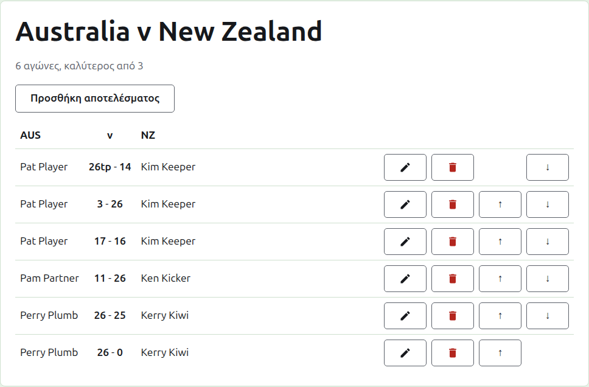
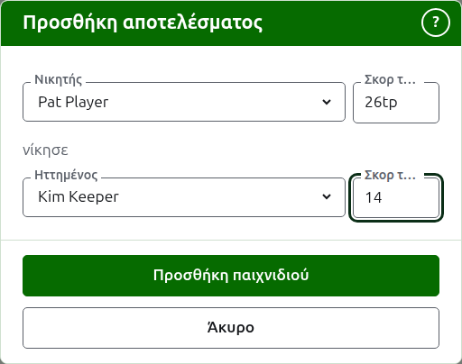

# Αποτελέσματα

Η σελίδα ενός τεστ ανοίγει από το όνομά του στην καρτέλα Τεστ ή από τη σκούρα πράσινη γραμμή. Έχει ως επικεφαλίδα τα πλήρη ονόματα των ομάδων του, όπως "Australia v New Zealand", με πόσους αγώνες αναμένεται να έχει και ποιος είναι ο καλύτερος από σε καθέναν από κάτω. Τα αποτελέσματά του είναι η σελίδα, χωρίς καρτέλες. Ένας υπεύθυνος και ένας καταχωρητής βλέπουν την ίδια σελίδα, αφού ένας καταχωρητής μπορεί να κάνει σε ένα αποτέλεσμα ό,τι μπορεί ένας υπεύθυνος.

## Πώς είναι στημένα τα αποτελέσματα

Τα αποτελέσματα είναι στημένα ανά ομάδα και όχι ανά νικητή, σε έναν πίνακα με επικεφαλίδα το σύντομο όνομα της πρώτης ομάδας, το "v" και το σύντομο όνομα της δεύτερης. Κάθε αποτέλεσμα είναι μια γραμμή: ο παίκτης της πρώτης ομάδας, μετά και τα δύο σκορ με πρώτο το σκορ της πρώτης ομάδας, όπως "26tp - 14", μετά ο παίκτης της δεύτερης ομάδας, όποιος από τους δύο και αν κέρδισε. Τα αρχειοθετημένα αποτελέσματα είναι στημένα με τον ίδιο τρόπο από κάτω.

## Καταχώριση ενός αποτελέσματος {#entering-a-score}

Πατήστε **Προσθήκη αποτελέσματος**, πάνω από τη λίστα. Το παράθυρο διαβάζεται όπως λέγεται φωναχτά ένα αποτέλεσμα: ο νικητής και το σκορ του, μετά το "νίκησε", μετά ο ηττημένος και το σκορ του.

Ο νικητής επιλέγεται από τους παίκτες και των δύο ομάδων σε χρήση, κάτω από το όνομα κάθε ομάδας, με τους παίκτες της πρώτης ομάδας πρώτους και κάθε ομάδας με τη σειρά της ομάδας. Κανείς δεν είναι επιλεγμένος στην αρχή. Μόλις επιλεγεί ο νικητής, ο ηττημένος προσφέρεται μόνο από την άλλη ομάδα, αφού ένα παιχνίδι ανάμεσα σε δύο παίκτες της ίδιας ομάδας δεν είναι παιχνίδι ανάμεσα στις ομάδες. Ένας αρχειοθετημένος παίκτης δεν προσφέρεται.

Ένα σκορ πληκτρολογείται όπως το έγραψε ο καταχωρητής: ο αριθμός των πόντων του και ό,τι ακολουθεί, που κρατιέται και εμφανίζεται όπως πληκτρολογήθηκε, όπως "26tp" για 26 τόξα και ένα τριπλό peel. Ο αριθμός είναι τα ψηφία με τα οποία αρχίζει το σκορ· ένα σκορ που δεν αρχίζει με ψηφίο απορρίπτεται.

Ένα παιχνίδι που κερδίζεται με ίσους πόντους, όπως όταν διακόπτεται λόγω χρόνου και κρίνεται με άλλον τρόπο, λέει ποιος το κέρδισε με μια σήμανση μετά το σκορ του νικητή: "6w" νίκησε το "6". Οι σημάνσεις είναι "w", "won" και "winner", οι αγγλικές λέξεις, επειδή αυτές αναγνωρίζει η ιστοσελίδα. Το σκορ του νικητή πρέπει να είναι μεγαλύτερο από του ηττημένου, ή σημασμένο, εκτός αν το τουρνουά επιτρέπει ισόπαλα αποτελέσματα, οπότε οι ίσοι πόντοι χωρίς σήμανση κρατιούνται ως ισοπαλία.

Αν οι παίκτες δεν μπορούν να διαβαστούν, το παράθυρο το λέει πάνω από τα πεδία, με το "Οι παίκτες δεν μπόρεσαν να διαβαστούν. Κλείστε αυτό το παράθυρο και ανοίξτε το ξανά.", αντί να μην προσφέρει κανέναν. Κάντε ό,τι λέει.

Πατήστε **Προσθήκη παιχνιδιού**. Το παιχνίδι προστίθεται, το παράθυρο λέει ποιο και τα πεδία αδειάζουν για το επόμενο, αφού τα αποτελέσματα έρχονται σε παρτίδα διαβασμένα από έναν πίνακα στο τέλος μιας συνεδρίας. Πατήστε **Άκυρο** όταν έχουν μπει όλα.

## Αγώνες

Δύο παίκτες που συναντιούνται παίζουν έναν αγώνα με τον καλύτερο από του τεστ. Τα παιχνίδια ανάμεσά τους είναι τα παιχνίδια αυτού του αγώνα και ένα παιχνίδι ανάμεσα σε δύο παίκτες των οποίων ο αγώνας έχει ήδη κριθεί απορρίπτεται: ο ένας από αυτούς έχει κερδίσει περισσότερα παιχνίδια από όσα θα μπορούσε ακόμα να κερδίσει ο άλλος, ή έχουν παιχτεί όλα τα παιχνίδια του.

Ένας αγώνας έχει ξεκινήσει όταν οι δύο παίκτες του έχουν ένα παιχνίδι σε χρήση. Ένα τεστ δεν ξεκινά περισσότερους αγώνες από όσους αναμένεται να έχει: μόλις έχουν ξεκινήσει τόσοι, ένα παιχνίδι ανάμεσα σε δύο παίκτες που δεν έχουν συναντηθεί απορρίπτεται, ενώ ένα άλλο παιχνίδι ενός αγώνα που έχει ήδη ξεκινήσει γίνεται δεκτό. Όπου το τεστ πρόκειται να έχει περισσότερους αγώνες, αλλάξτε το στην καρτέλα Τεστ ώστε να τους αναμένει.

## Διόρθωση ενός αποτελέσματος {#correcting-a-score}

Η **Επεξεργασία** ανοίγει το ίδιο παράθυρο για αυτό το αποτέλεσμα, με τίτλο Επεξεργασία αποτελέσματος, με τους παίκτες του επιλεγμένους και τα σκορ του όπως πληκτρολογήθηκαν. Οι παίκτες του μπορούν να αλλάξουν εκτός από τα σκορ του, επιλεγμένοι όπως όταν προσθέτετε. Πατήστε **Αποθήκευση** για να κρατήσετε τη διόρθωση και να κλείσετε το παράθυρο. Μια διόρθωση κρατά το αποτέλεσμα: ένα παιχνίδι που κερδήθηκε μένει κερδισμένο και ένα ισόπαλο παιχνίδι μένει ισόπαλο. Ένα παιχνίδι του οποίου το αποτέλεσμα ήταν λάθος αρχειοθετείται και καταχωρίζεται ξανά.

## Τοποθέτηση των αποτελεσμάτων σε σειρά

Τα αποτελέσματα έρχονται με όποια σειρά καταχωρίζονται, γι' αυτό κάθε αποτέλεσμα σε χρήση προσφέρει **Πάνω** και **Κάτω**, που το ανταλλάσσουν με το διπλανό αποτέλεσμα, ώστε η λίστα να μπει στη σειρά με την οποία παίχτηκαν τα παιχνίδια.

## Αρχειοθέτηση ενός αποτελέσματος

Η **Αρχειοθέτηση** παραμερίζει ένα αποτέλεσμα ώστε να μη μετράει για τίποτα. Παρατίθεται κάτω από τα **Αρχειοθετημένα αποτελέσματα**, διαγραμμισμένο, και προσφέρει μόνο **Επαναφορά**. Κανένα από τα δύο δεν ρωτά πρώτα, αφού το καθένα αναιρεί το άλλο. Κάθε αποτέλεσμα σε ένα τεστ μπορεί να αρχειοθετηθεί, αφού ένα τεστ δεν έχει γύρους που να εξαρτώνται ο ένας από τον άλλον.

Ένα αποτέλεσμα του οποίου ο παίκτης έχει αρχειοθετηθεί έκτοτε δεν επαναφέρεται μέχρι να επαναφερθεί ο παίκτης και η σελίδα το λέει.

Επόμενο: [Σημειώσεις](notes.md).
