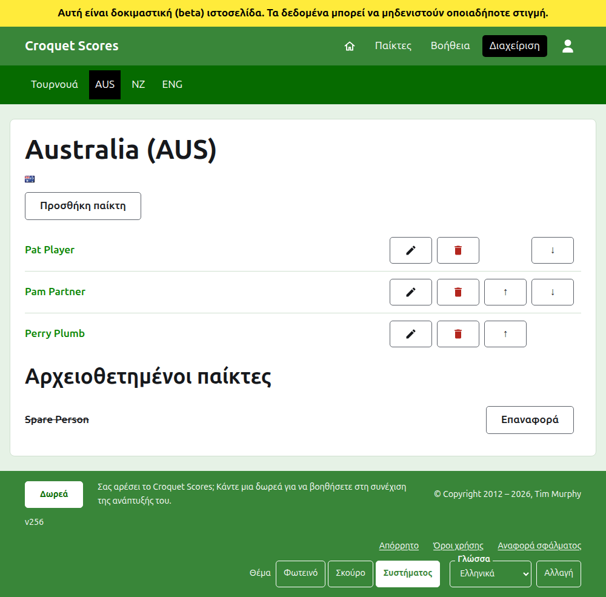
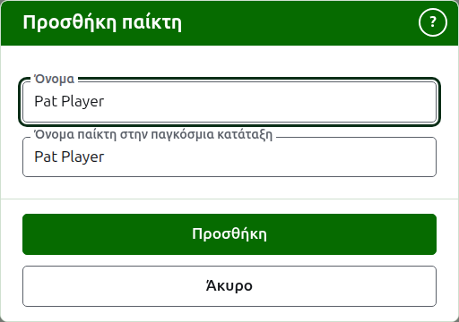

# Οι παίκτες μιας ομάδας

Η σελίδα μιας ομάδας ανοίγει από το όνομά της, ή την **Προβολή** της, στην καρτέλα Ομάδες. Έχει ως επικεφαλίδα το όνομα της ομάδας με το σύντομο όνομά της σε παρένθεση, και τη σημαία της, ώστε ένας υπεύθυνος που ήρθε σε λάθος ομάδα να το δει αμέσως. Έχει ένα πράγμα να δείξει, τους παίκτες της ομάδας, γι' αυτό η λίστα είναι η σελίδα.

Η σκούρα πράσινη γραμμή στη σελίδα μιας ομάδας οδηγεί στο τουρνουά και σε κάθε ομάδα σε χρήση με το σύντομο όνομά της, ώστε οι παίκτες να καταχωρίζονται ομάδα προς ομάδα χωρίς να επιστρέφετε στην καρτέλα Ομάδες.

Ένας παίκτης σε μια ομάδα ανήκει μόνο σε αυτή την ομάδα, εκπροσωπεί την ομάδα και φέρει τη σημαία της ομάδας αντί για δική του. Το ίδιο πρόσωπο που παίζει για δύο ομάδες, ή σε δύο τουρνουά, είναι παίκτης σε καθεμία.

## Προσθήκη ενός παίκτη {#adding-a-player}

Πατήστε **Προσθήκη παίκτη**, πάνω από τη λίστα. Ένα παράθυρο ανοίγει πάνω από τη σελίδα.

Το **Όνομα** είναι υποχρεωτικό, από 3 έως 254 χαρακτήρες. Δύο παίκτες στην ίδια ομάδα δεν μπορούν να έχουν το ίδιο όνομα, όπως και αν γράφεται με κεφαλαία· ένας παίκτης σε άλλη ομάδα μπορεί να το μοιράζεται.

Το **Όνομα παίκτη στην παγκόσμια κατάταξη** είναι το όνομα με το οποίο οι παγκόσμιες κατατάξεις γνωρίζουν τον παίκτη. Ζητείται μόνο σε ένα τουρνουά Association Croquet ή Golf Croquet, τα δύο αθλήματα των οποίων τους παίκτες κρατούν λίστα οι παγκόσμιες κατατάξεις. Οι παίκτες του Αμερικανικού 6 τόξων είναι γνωστοί στις κατατάξεις με τα δικά τους ονόματα, γι' αυτό δεν ζητείται εκεί και το όνομα παγκόσμιας κατάταξης κάθε παίκτη είναι πάντα το όνομά του. Όσο προσθέτετε έναν παίκτη ακολουθεί το όνομα καθώς το πληκτρολογείτε και πάψει να το ακολουθεί μόλις πληκτρολογήσετε μέσα σε αυτό. Αν μείνει κενό, κρατιέται ως το όνομα του παίκτη. Καθώς πληκτρολογείτε, προσφέρονται οι παίκτες που γνωρίζουν οι παγκόσμιες κατατάξεις και των οποίων τα ονόματα αρχίζουν έτσι, και δίπλα στο όνομα παγκόσμιας κατάταξης ένα τικ λέει ότι οι κατατάξεις γνωρίζουν το όνομα και ένα ερωτηματικό λέει ότι δεν το γνωρίζουν. Είναι μόνο συμβουλή: ένα όνομα που δεν γνωρίζουν οι κατατάξεις κρατιέται το ίδιο εύκολα με ένα που γνωρίζουν.

Ένας παίκτης δεν λέγεται ποτέ "Bye": ένα όνομα που είναι "Bye", ή "Bye" με έναν αριθμό, όπως "Bye 2", "Bye-2" ή "Bye (2)", απορρίπτεται. Ένα όνομα που μόνο αρχίζει με τη λέξη, όπως το "Bye / Bassett", είναι ενός προσώπου. Η λέξη αυτή είναι η αγγλική, επειδή είναι αυτή που αρνείται η ιστοσελίδα.

Πατήστε **Προσθήκη**. Ο παίκτης προστίθεται, το παράθυρο το λέει και τα πεδία του αδειάζουν για τον επόμενο, με τον δρομέα πίσω στο όνομα. Προσθέστε ολόκληρη την ομάδα έτσι και μετά πατήστε **Άκυρο** για να κλείσει το παράθυρο.

## Διόρθωση ενός παίκτη {#correcting-a-player}

Πατήστε το όνομα ενός παίκτη, ή την **Επεξεργασία** του, για να ανοίξει το ίδιο παράθυρο για αυτόν τον παίκτη, με τίτλο Επεξεργασία παίκτη. Πατήστε **Αποθήκευση** για να κρατήσετε την αλλαγή. Ένας παίκτης του οποίου το όνομα διορθώνεται κρατά το όνομα παγκόσμιας κατάταξης που είχε, εκτός από το Αμερικανικό 6 τόξων, όπου το όνομα παγκόσμιας κατάταξης ενός παίκτη είναι πάντα το όνομά του.

## Σειρά

Οι παίκτες παρατίθενται με τη σειρά της ομάδας, που είναι η σειρά με την οποία προσφέρονται όταν καταχωρίζεται το αποτέλεσμα ενός τεστ. Τα **Πάνω** και **Κάτω** μετακινούν έναν παίκτη μία θέση μέσα στην ομάδα.

## Αρχειοθέτηση ενός παίκτη

Η **Αρχειοθέτηση** παραμερίζει έναν παίκτη: που καταχωρίστηκε κατά λάθος ή δεν είναι πια με την ομάδα. Ένας αρχειοθετημένος παίκτης παρατίθεται κάτω από τους **Αρχειοθετημένους παίκτες**, διαγραμμισμένος, μετά τους παίκτες που χρησιμοποιούνται, και προσφέρει μόνο **Επαναφορά**. Η αρχειοθέτηση δεν ρωτά ποτέ πρώτα, αφού ένας παίκτης σε μια ομάδα δεν είναι καταχωρισμένος σε τίποτα άλλο και η επαναφορά του βάζει τα πάντα πίσω.

Ένας παίκτης που έχει παίξει οποιοδήποτε παιχνίδι σε χρήση σε ένα τεστ δεν μπορεί να αρχειοθετηθεί, αφού τα παιχνίδια θα ήταν τότε ενάντια σε κάποιον που δεν είναι πια εκεί, γι' αυτό σε έναν τέτοιο παίκτη δεν προσφέρεται Αρχειοθέτηση. Ένας παίκτης του οποίου τα μόνα παιχνίδια είναι αρχειοθετημένα μπορεί.

Επόμενο: [Τεστ](tests.md).
