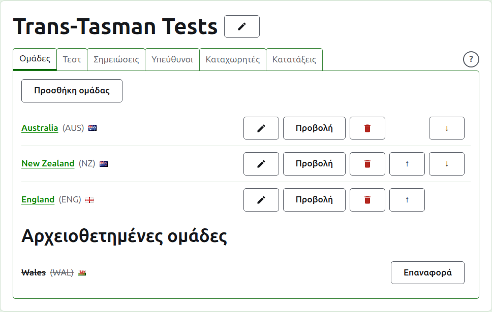
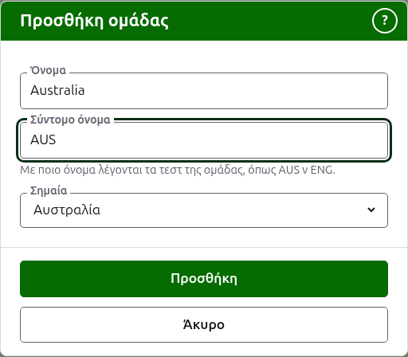
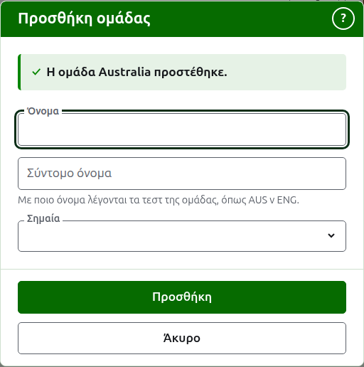
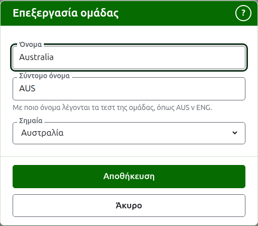

# Ομάδες

Η καρτέλα **Ομάδες** της σελίδας ενός τουρνουά είναι εκεί όπου οι ομάδες του προστίθενται, διορθώνονται, μπαίνουν σε σειρά και παραμερίζονται. Είναι η καρτέλα στην οποία ανοίγει η σελίδα, αφού οι ομάδες είναι το πρώτο που στήνεται. Ένα τεστ είναι ανάμεσα σε δύο ομάδες, γι' αυτό χρειάζονται τουλάχιστον δύο πριν προστεθεί οποιοδήποτε τεστ.

## Προσθήκη μιας ομάδας {#adding-a-team}

Πατήστε **Προσθήκη ομάδας**, πάνω από τη λίστα. Ένα παράθυρο ανοίγει πάνω από τη σελίδα.

Το **Όνομα** είναι υποχρεωτικό: το πλήρες όνομα της ομάδας, όπως "Australia", που αποτελεί την επικεφαλίδα της σελίδας της ομάδας και των πινάκων των δημόσιων σελίδων. Δύο ομάδες στο ίδιο τουρνουά δεν μπορούν να έχουν το ίδιο όνομα.

Το **Σύντομο όνομα** είναι επίσης υποχρεωτικό: αυτό με το οποίο λέγονται τα τεστ της ομάδας, όπως "AUS v ENG", και αυτό με το οποίο η σκούρα πράσινη γραμμή αποκαλεί την ομάδα. Έχει το πολύ 10 χαρακτήρες και δεν είναι μακρύτερο από το όνομα, αφού ένα σύντομο όνομα μακρύτερο από το όνομα που συντομεύει είναι τα δύο πληκτρολογημένα ανάποδα. Δύο ομάδες δεν μπορούν να έχουν ούτε το ίδιο σύντομο όνομα.

Η **Σημαία** εμφανίζεται δίπλα στο όνομα της ομάδας όπου εμφανίζεται. Μπορεί να μείνει σε κανένα, όπως για μια ομάδα ενός συλλόγου ή μιας περιοχής.

Πατήστε **Προσθήκη**. Η ομάδα προστίθεται, το παράθυρο το λέει και τα πεδία του αδειάζουν για την επόμενη. Προσθέστε ολόκληρη τη λίστα έτσι και μετά πατήστε **Άκυρο** για να κλείσει το παράθυρο. Το Άκυρο δεν κρατά τίποτα που δεν είχε ήδη προστεθεί.

## Διόρθωση μιας ομάδας {#correcting-a-team}

Πατήστε την **Επεξεργασία** μιας ομάδας για να ανοίξει το ίδιο παράθυρο για αυτή την ομάδα, με τίτλο Επεξεργασία ομάδας. Αλλάξτε ό,τι είναι λάθος και πατήστε **Αποθήκευση**. Μια ομάδα της οποίας αλλάζει το σύντομο όνομα λέγεται με το νέο παντού, γι' αυτό τα τεστ της μετονομάζονται μαζί της.

## Σειρά

Οι ομάδες παρατίθενται με τη σειρά του τουρνουά, που είναι η σειρά με την οποία προσφέρονται όταν προστίθεται ένα τεστ, η σειρά με την οποία τις έχει η σκούρα πράσινη γραμμή και η σειρά με την οποία τις παραθέτει η δημόσια σελίδα Παίκτες. Τα **Πάνω** και **Κάτω**, τα βέλη στο τέλος κάθε γραμμής, μετακινούν μια ομάδα μία θέση.

## Μετάβαση σε μια ομάδα

Το όνομα μιας ομάδας, ή η **Προβολή**, ανοίγει τη δική της σελίδα, όπου καταχωρίζονται οι παίκτες της. Δείτε [Οι παίκτες μιας ομάδας](team-players.md).

## Αρχειοθέτηση μιας ομάδας

Η **Αρχειοθέτηση** παραμερίζει μια ομάδα. Οι παίκτες της μένουν μαζί της και επιστρέφουν όταν επαναφερθεί, γι' αυτό η αρχειοθέτηση δεν ρωτά πρώτα. Μια αρχειοθετημένη ομάδα παρατίθεται κάτω από τις **Αρχειοθετημένες ομάδες**, διαγραμμισμένη, προσφέρει μόνο **Επαναφορά** και η σελίδα της είναι κλειστή μέχρι να επαναφερθεί.

Μια ομάδα που παίζει σε ένα τεστ σε χρήση δεν μπορεί να αρχειοθετηθεί, αφού το τεστ θα ήταν τότε ενάντια σε μια ομάδα που δεν είναι πια εκεί, γι' αυτό σε μια τέτοια ομάδα δεν προσφέρεται Αρχειοθέτηση. Μια ομάδα της οποίας τα μόνα τεστ είναι αρχειοθετημένα μπορεί.

Επόμενο: [Οι παίκτες μιας ομάδας](team-players.md).
