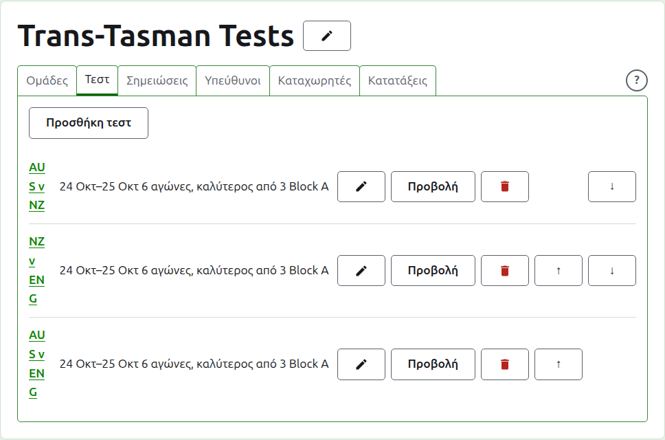
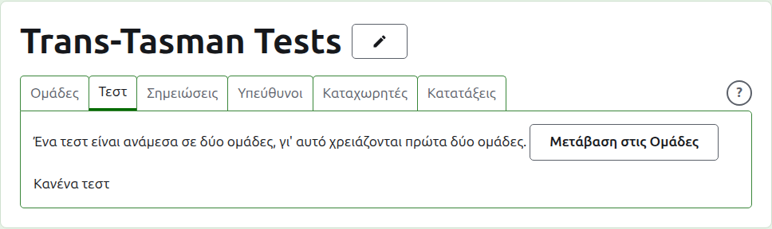
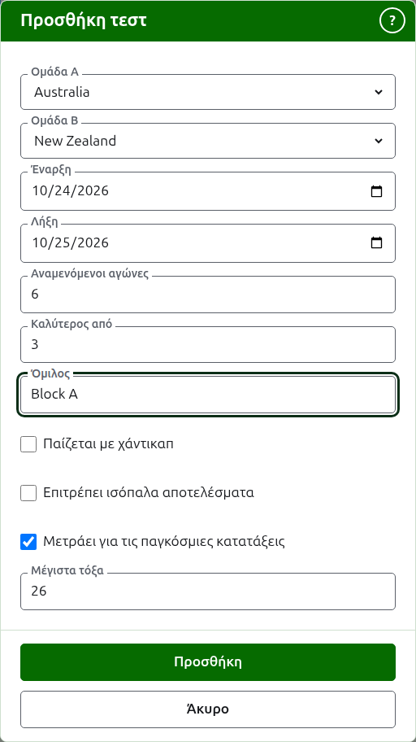
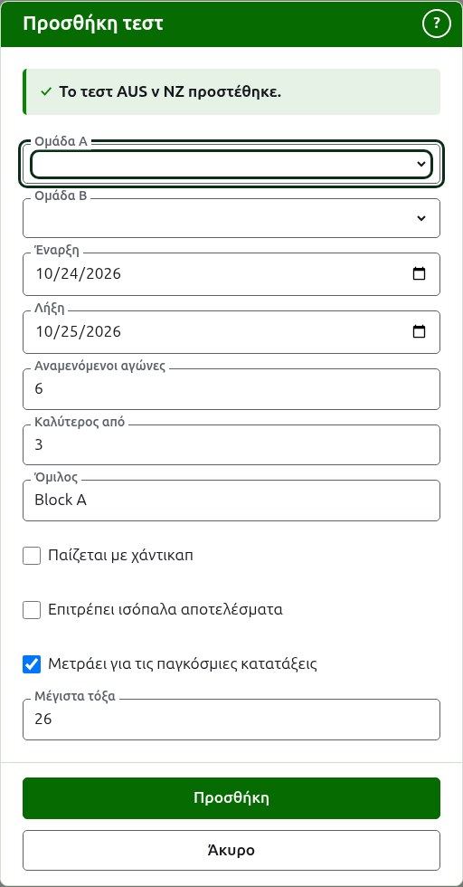
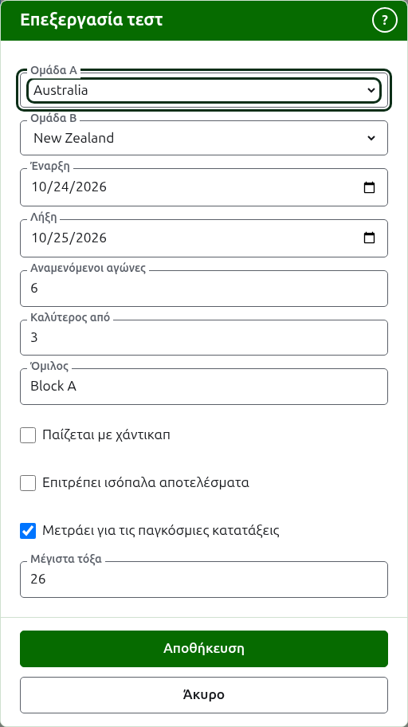

# Τεστ

Η καρτέλα **Τεστ** της σελίδας ενός τουρνουά είναι εκεί όπου τα τεστ ανάμεσα στις ομάδες του προστίθενται, αλλάζουν, μπαίνουν σε σειρά και παραμερίζονται. Ένα τεστ είναι ένα από τα αγωνίσματα του τουρνουά: μια αναμέτρηση ανάμεσα σε δύο ομάδες, που λέγονται με τα σύντομα ονόματά τους, όπως "AUS v NZ", και παίζεται ως ένας αριθμός αγώνων ανάμεσα σε έναν παίκτη από κάθε ομάδα. Κάθε τεστ έχει δική του σελίδα, όπου μπαίνουν τα αποτελέσματά του.

Κάθε τεστ λέει το όνομά του, τις ημέρες που παίζεται, πόσους αγώνες αναμένεται να έχει και ποιος είναι ο καλύτερος από σε καθέναν, όπως "6 αγώνες, καλύτερος από 3", και τον όμιλό του όπου βρίσκεται σε έναν.

## Πρώτα δύο ομάδες

Ένα τεστ είναι ανάμεσα σε δύο ομάδες σε χρήση, γι' αυτό όσο το τουρνουά έχει λιγότερες από δύο η καρτέλα το λέει εκεί όπου θα ήταν η Προσθήκη τεστ και οδηγεί στην καρτέλα Ομάδες.

## Προσθήκη ενός τεστ {#adding-a-test}

Πατήστε **Προσθήκη τεστ**, πάνω από τη λίστα. Ένα παράθυρο ανοίγει πάνω από τη σελίδα, που διαβάζεται με τη σειρά που λέγεται φωναχτά ένα τεστ.

Η **Ομάδα Α** και η **Ομάδα Β** επιλέγονται η καθεμία από τις ομάδες του τουρνουά σε χρήση, με το όνομά τους, με τη σειρά του τουρνουά. Καμία δεν είναι επιλεγμένη στην αρχή, ώστε ένα τεστ να μην προστίθεται ποτέ ανάμεσα σε ομάδες που δεν επιλέξατε. Η Ομάδα Β προσφέρει κάθε ομάδα εκτός από αυτήν που επιλέχθηκε ως Ομάδα Α, αφού μια ομάδα δεν παίζει τεστ εναντίον του εαυτού της. Η Ομάδα Α είναι η πρώτη ομάδα: οι παίκτες της είναι αριστερά στη σελίδα του τεστ και στη δημόσια σελίδα. Ένα τεστ δεν έχει δικό του όνομα να πληκτρολογηθεί· λέγεται με τα σύντομα ονόματα των ομάδων του.

Η **Έναρξη** και η **Λήξη** είναι οι ημέρες που παίζεται το τεστ, που ξεκινούν από την πρώτη ημέρα του τουρνουά. Ένα τεστ παίζεται μέσα στο τουρνουά του, γι' αυτό ημέρες πριν ξεκινήσει το τουρνουά ή αφότου λήξει απορρίπτονται.

Οι **Αναμενόμενοι αγώνες** είναι πόσους αγώνες πρόκειται να έχει το τεστ, όπως ορίζεται από τη διοργάνωση πριν ξεκινήσει, ώστε όποιος διαβάζει τα αποτελέσματά του να βλέπει πόσο έχει προχωρήσει. Είναι ένας ακέραιος αριθμός από το 1 και πάνω. Είναι και όριο: μόλις έχουν ξεκινήσει τόσοι αγώνες όσους αναμένεται να έχει το τεστ, ένα παιχνίδι που θα ξεκινούσε άλλον απορρίπτεται, ενώ οι αγώνες που έχουν ήδη ξεκινήσει παίζονται μέχρι το τέλος. Ένα τεστ που πρόκειται να έχει περισσότερους αλλάζει ώστε να τους αναμένει.

Ο **Καλύτερος από** είναι ο καλύτερος από πόσα είναι κάθε αγώνας. Μπορεί να είναι ζυγός, αφού ένας αγώνας μπορεί να μοιραστεί.

Τα **Παίζεται με χάντικαπ**, **Επιτρέπει ισόπαλα αποτελέσματα** και **Μετράει για τις παγκόσμιες κατατάξεις** ζητούνται όπως σε κάθε αγώνισμα. Το τελευταίο ζητείται μόνο όπου μπορεί να μετρήσει: ένα τεστ σε Association Croquet ή Golf Croquet που ούτε παίζεται με χάντικαπ ούτε επιτρέπει ισόπαλα αποτελέσματα. Έχει τικ στην αρχή.

Τα **Μέγιστα τόξα** είναι τα περισσότερα τόξα μέχρι τα οποία παίζεται ένα παιχνίδι στο τεστ. Ξεκινά στο συνηθισμένο για το άθλημα, 26, ή 13 στο Golf Croquet. Αδειάστε το για ένα παιχνίδι που δεν παίζεται μέχρι έναν αριθμό τόξων. Πρέπει να είναι ακέραιος αριθμός τουλάχιστον 1.

Ο **Όμιλος** είναι ο όμιλος στον οποίο βρίσκεται το τεστ, όπου η διοργάνωση παίζεται σε ομίλους, όπως "Block A". Είναι προαιρετικός: αν μείνει κενός, το τεστ δεν είναι σε κανέναν. Τα τεστ ενός ομίλου έχουν δική τους σελίδα στη δημόσια ιστοσελίδα, που δείχνει πώς βρίσκονται οι ομάδες του ομίλου. Το **Eire Cup** και το **Interstate Shield** δεν έχουν ομίλους, γι' αυτό το παράθυρο δεν ζητά έναν εκεί.

Πατήστε **Προσθήκη**. Το τεστ προστίθεται, το παράθυρο λέει ποιο με το όνομά του και οι ομάδες αδειάζουν για το επόμενο, με τις ημέρες, τους αναμενόμενους αγώνες, τον καλύτερο από και τον όμιλο να μένουν όπως ήταν: τα τεστ προστίθενται ένας γύρος τη φορά, ανάμεσα σε ομάδες που συναντιούνται την ίδια ημέρα, γι' αυτό το επόμενο τεστ του γύρου είναι μόνο οι δύο ομάδες του. Πατήστε **Άκυρο** όταν έχουν μπει όλα.

## Αλλαγή ενός τεστ {#changing-a-test}

Η **Επεξεργασία** ανοίγει το ίδιο παράθυρο για το τεστ, με τίτλο Επεξεργασία τεστ, συμπληρωμένο όπως είναι το τεστ. Πατήστε **Αποθήκευση** για να κρατήσετε την αλλαγή.

Ένα τεστ με παιχνίδια σε χρήση κρατά τις ομάδες του: το παράθυρο τις δείχνει αλλά δεν μπορούν να αλλάξουν. Τα υπόλοιπα μπορούν να αλλάξουν, μέσα σε ό,τι έχει παιχτεί: λιγότεροι αναμενόμενοι αγώνες από τους αγώνες που έχουν ήδη ξεκινήσει απορρίπτονται, και το ίδιο ένας καλύτερος από μικρότερος από τα περισσότερα παιχνίδια που έχουν παίξει δύο οποιοιδήποτε παίκτες.

## Σειρά

Τα τεστ παρατίθενται με τη σειρά του τουρνουά, που είναι η σειρά με την οποία εμφανίζονται στις δημόσιες σελίδες και στη σκούρα πράσινη γραμμή. Τα **Πάνω** και **Κάτω** μετακινούν ένα τεστ μία θέση.

## Μετάβαση σε ένα τεστ

Το όνομα ενός τεστ, ή η **Προβολή**, ανοίγει τη σελίδα του, όπου μπαίνουν τα αποτελέσματά του. Η σκούρα πράσινη γραμμή οδηγεί και αυτή εκεί, από τη σελίδα του τουρνουά ή από οποιοδήποτε άλλο τεστ.

## Αρχειοθέτηση ενός τεστ

Η **Αρχειοθέτηση** παραμερίζει ένα τεστ και αναιρείται με την **Επαναφορά**, γι' αυτό καμία δεν ρωτά πρώτα. Ένα αρχειοθετημένο τεστ παρατίθεται κάτω από τα **Αρχειοθετημένα τεστ**, διαγραμμισμένο, προσφέρει μόνο Επαναφορά και δεν βρίσκεται στις δημόσιες σελίδες.

Ένα τεστ με παιχνίδια σε χρήση έχει παιχτεί και δεν μπορεί να αρχειοθετηθεί μέχρι να αρχειοθετηθούν τα παιχνίδια του. Ένα τεστ του οποίου όλα τα παιχνίδια είναι αρχειοθετημένα μπορεί, αφού ένα αρχειοθετημένο παιχνίδι δεν μετράει για τίποτα. Ένα τεστ του οποίου μια ομάδα έχει αρχειοθετηθεί έκτοτε δεν επαναφέρεται μέχρι να επαναφερθεί η ομάδα και η καρτέλα το λέει.

Επόμενο: [Αποτελέσματα](scores.md).
