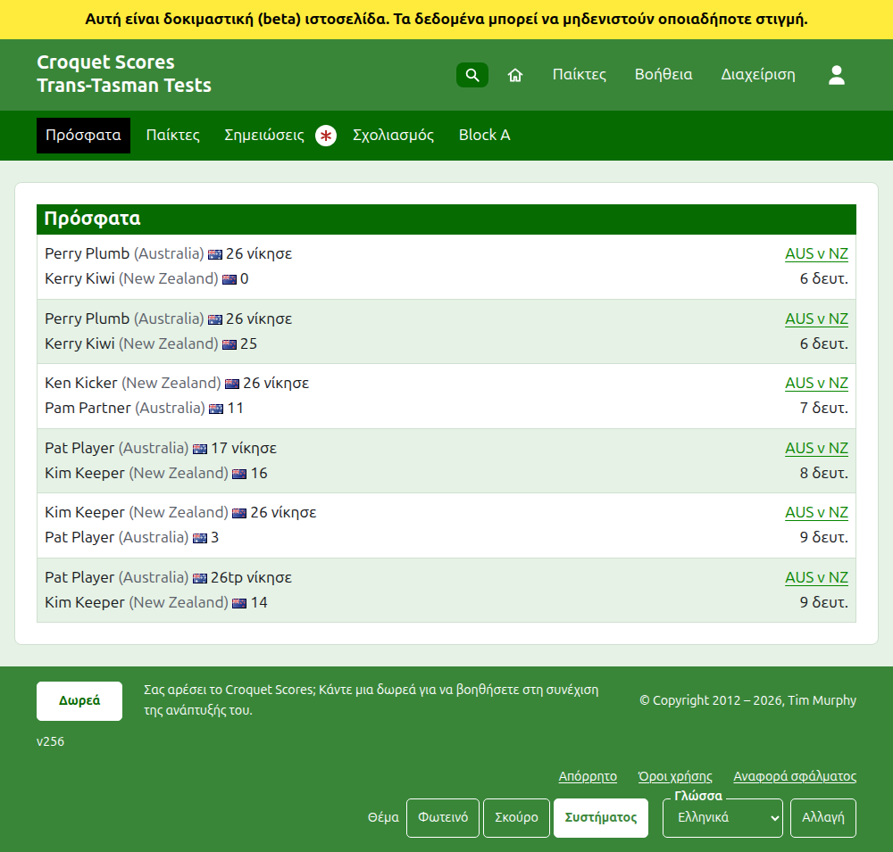
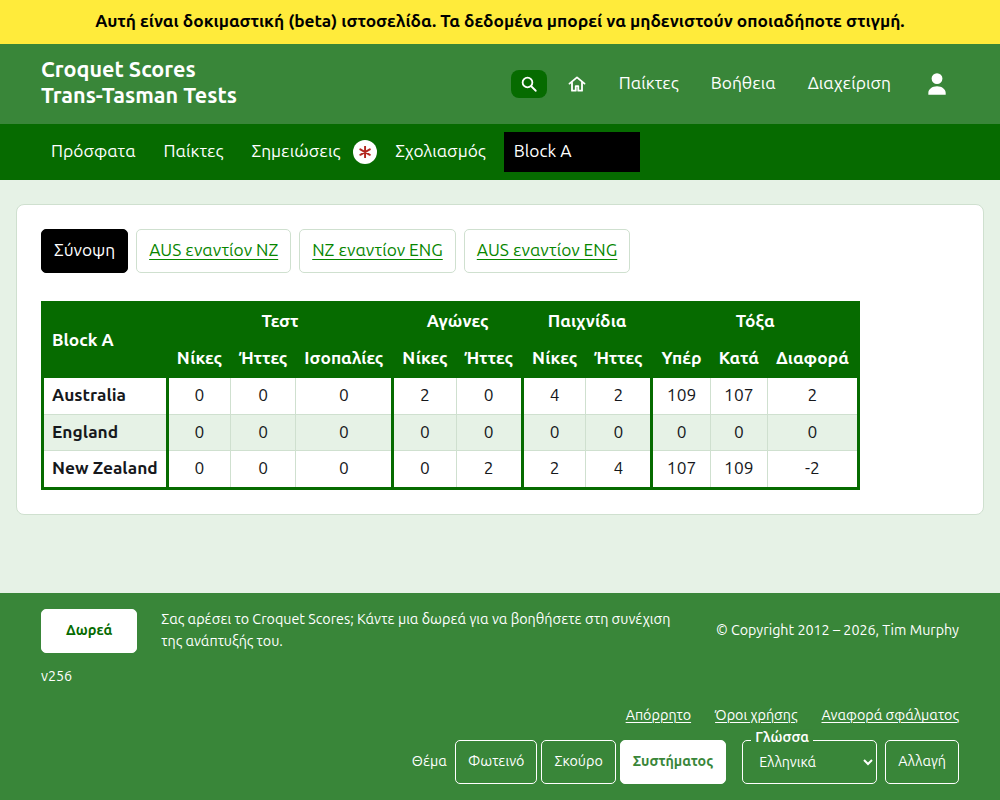
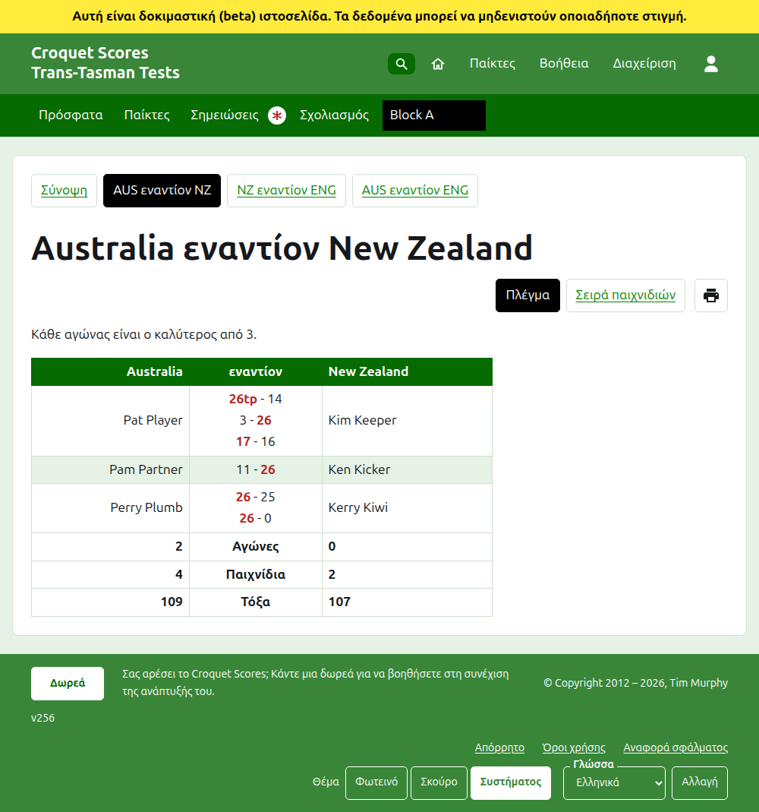
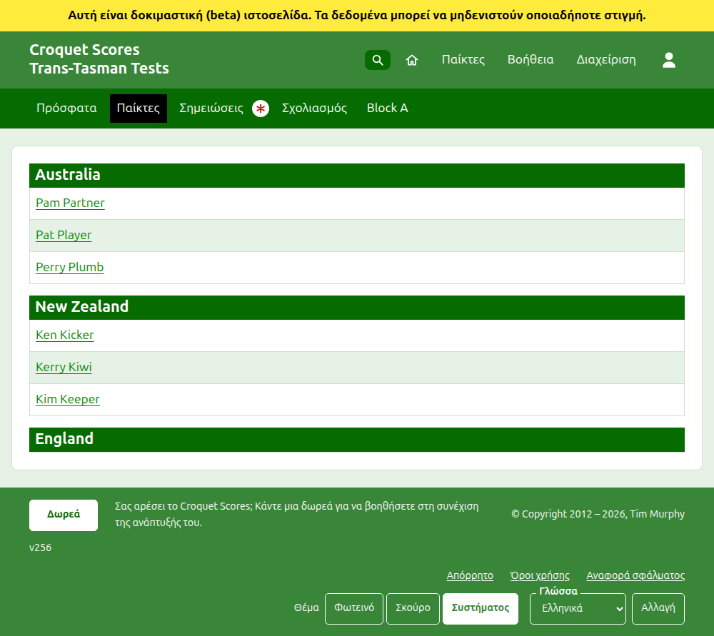

# Τι βλέπει το κοινό

Τίποτα δεν δημοσιεύεται: οι δημόσιες σελίδες σχεδιάζονται από ό,τι κρατά η διαχείριση, γι' αυτό ένα αποτέλεσμα που καταχωρίζεται βρίσκεται σε αυτές αμέσως. Δεν χρειάζονται λογαριασμό ούτε σενάρια (JavaScript) και είναι διαρρυθμισμένες για τηλέφωνο.

## Η σελίδα του τουρνουά

Η σελίδα του τουρνουά βρίσκεται στη χρονιά, το άθλημα και το όνομά του, όπως `/2026/ac/trans-tasman-tests`. Έχει ως επικεφαλίδα το όνομα του τουρνουά, με τον υπότιτλό του από κάτω. Παραθέτει κάθε παιχνίδι σε χρήση, το πιο πρόσφατα προστεθέν πρώτο, ώστε ένας αναγνώστης που επιστρέφει να βλέπει τι έχει συμβεί έκτοτε. Κάθε παιχνίδι λέει τον νικητή, την ομάδα του και το σκορ του, μετά τον ηττημένο και τα δικά του, με το τεστ στο οποίο παίχτηκε και πριν από πόση ώρα προστέθηκε.

Η σκούρα πράσινη γραμμή προσφέρει τις ενότητες του τουρνουά: **Πρόσφατα**, που είναι αυτή η σελίδα, **Σύνοψη**, **Παίκτες**, **Σημειώσεις** και **Σχολιασμός**, και μετά τα τεστ. Ένα τεστ λέγεται με τα σύντομα ονόματα των ομάδων του με το "εναντίον" ανάμεσα, όπως "AUS εναντίον NZ". Τα τεστ σε έναν όμιλο δεν προσφέρονται ένα προς ένα: ο όμιλος είναι μία ενότητα, με το όνομα του ομίλου, που στέκεται εκεί όπου θα ήταν το πρώτο τεστ του. Οι Σημειώσεις σημαδεύονται με κόκκινο αστερίσκο όσο υπάρχει μια σημείωση που ο αναγνώστης δεν έχει διαβάσει.

## Η σύνοψη

Ένα τουρνουά του οποίου τα τεστ δεν είναι σε κανέναν όμιλο έχει μια **Σύνοψη**: έναν πίνακα με κάθε ομάδα, κατατεταγμένη, με τα τεστ που έχει κερδίσει, χάσει και φέρει ισοπαλία, τα παιχνίδια που έχει κερδίσει και χάσει και τα τόξα υπέρ, κατά και τη διαφορά της. Όπου οι αγώνες οποιουδήποτε τεστ είναι ο καλύτερος από περισσότερα του ενός, οι αγώνες που κερδήθηκαν και χάθηκαν έρχονται μετά τα τεστ. Οι ομάδες κατατάσσονται με βάση τα τεστ που έχουν κερδίσει, μετά τους αγώνες που έχουν κερδίσει, μετά τα καθαρά παιχνίδια τους, μετά τα καθαρά τόξα τους και μετά με τη σειρά του τουρνουά. Ένα τεστ του οποίου οι ομάδες είναι ίσες στους αγώνες κρίνεται από τα καθαρά παιχνίδια, μετά τα καθαρά τόξα, ή είναι ισοπαλία όπου το τουρνουά έχει τικ στο **Τα ισόπαλα τεστ λογίζονται ισοπαλία**. Η σύνοψη είναι εκεί όπου ψάχνει ένας αναγνώστης κάθε ομάδα ως σύνολο.

Σε ένα **Interstate Shield** οι ομάδες κατατάσσονται με βάση τα τεστ που κερδήθηκαν, μετά τους καθαρούς αγώνες αντί για τους αγώνες που κερδήθηκαν, μετά τα καθαρά παιχνίδια, μετά τα καθαρά τόξα. Οι ομάδες που εξακολουθούν να είναι ίσες μπαίνουν σε σειρά με βάση τα τεστ που κέρδισαν μεταξύ τους. Η σύνοψή του δείχνει μια στήλη **Διαφορά** κάτω από τους Αγώνες και κάτω από τα Παιχνίδια όπως και κάτω από τα Τόξα, και το Shield δεν παίζεται ποτέ σε ομίλους.

Ένα τουρνουά με ένα τεστ σε έναν όμιλο δεν έχει Σύνοψη. Η σελίδα κάθε ομίλου δείχνει αντί για αυτό πώς βρίσκονται οι ομάδες αυτού του ομίλου, αφού ένας πίνακας ομάδων που διασχίζει ομίλους που δεν έπαιξαν ποτέ μεταξύ τους δεν θα κατέτασσε τίποτα.

## Ένας όμιλος

Η σελίδα ενός ομίλου δείχνει πώς βρίσκονται οι ομάδες του ομίλου, μετρώντας μόνο τα τεστ του ομίλου, στον πίνακα που χρησιμοποιεί η σύνοψη. Πάνω από τον πίνακα, σε μια δική του γραμμή, προσφέρει τη **Σύνοψη**, που είναι αυτή η σελίδα, και καθένα από τα τεστ του ομίλου, που οδηγεί στη σελίδα του τεστ.

## Ένα τεστ

Η σελίδα ενός τεστ έχει ως επικεφαλίδα τα πλήρη ονόματα των ομάδων του, όπως "Australia εναντίον New Zealand", και λέει ποιος είναι ο καλύτερος από σε κάθε αγώνα. Ο πίνακάς του έχει ως επικεφαλίδα τις δύο ομάδες, την πρώτη αριστερά. Κάθε αγώνας που έχει παιχτεί είναι μια γραμμή, με τη σειρά που άρχισε, με τον παίκτη της πρώτης ομάδας αριστερά, της δεύτερης ομάδας δεξιά, και τα παιχνίδια του αγώνα ανάμεσά τους, το καθένα με το σκορ της πρώτης πλευράς και μετά της δεύτερης, με τον νικητή σημασμένο. Κάτω από τους αγώνες είναι τα παιχνίδια και τα τόξα κάθε ομάδας και, όπου κάθε αγώνας είναι ο καλύτερος από περισσότερα του ενός, οι αγώνες που κέρδισε, στη δική της πλευρά.

Ένα τεστ εμφανίζεται με δύο τρόπους, που προσφέρονται στη γραμμή του ονόματός του: **Πλέγμα**, που είναι αυτός ο πίνακας, και **Σειρά παιχνιδιών**, που παραθέτει κάθε παιχνίδι του τεστ σε έναν πίνακα με επικεφαλίδες **Παιχνίδι** και **Ημερομηνία**, το παλαιότερο πρώτο στην αρχή. Το πάτημα μιας επικεφαλίδας ταξινομεί με βάση αυτήν και η ιστοσελίδα θυμάται πώς ταξινόμησε τελευταία ο αναγνώστης. Δίπλα στις προβολές ένα κουμπί εκτυπωτή, που εμφανίζεται όπου τα σενάρια είναι ενεργά, εκτυπώνει τη σελίδα χωρίς τις γραμμές. Ένα τεστ σε έναν όμιλο προσφέρει τη Σύνοψη και τα τεστ του ομίλου του σε μια γραμμή πάνω από την επικεφαλίδα του, με αυτό το τεστ σημασμένο.

## Παίκτες

Η σελίδα Παίκτες παραθέτει τους παίκτες ομάδα προς ομάδα: κάθε ομάδα κάτω από επικεφαλίδα με το όνομά της, με τη σειρά του τουρνουά για τις ομάδες του, και τους παίκτες της από κάτω με αλφαβητική σειρά.

## Σημειώσεις

Η σελίδα Σημειώσεις έχει ως επικεφαλίδα **Σημειώσεις υπευθύνων** και λέει "Καμία σημείωση ακόμα." όσο δεν υπάρχουν. Παραθέτει τις σημειώσεις του τουρνουά, την πιο πρόσφατα γραμμένη πρώτη, καθεμία από τις οποίες οδηγεί στη δική της σελίδα και λέει πριν από πόση ώρα γράφτηκε. Μια σημείωση που ο αναγνώστης δεν έχει διαβάσει σημαδεύεται με κόκκινο αστερίσκο μέχρι να την ανοίξει.

## Διευθύνσεις που μετακινούνται

Ένα τουρνουά κρατά τη διεύθυνσή του όταν διορθωθεί το όνομά του. Όπου μετακινείται, επειδή άλλαξε η χρονιά ή το άθλημά του, η παλιά διεύθυνσή του οδηγεί στη νέα, ώστε ένας σύνδεσμος που κρατήθηκε από πριν να λειτουργεί ακόμα. Οι σελίδες ενός αρχειοθετημένου τουρνουά δεν βρίσκονται μέχρι να επαναφερθεί.
