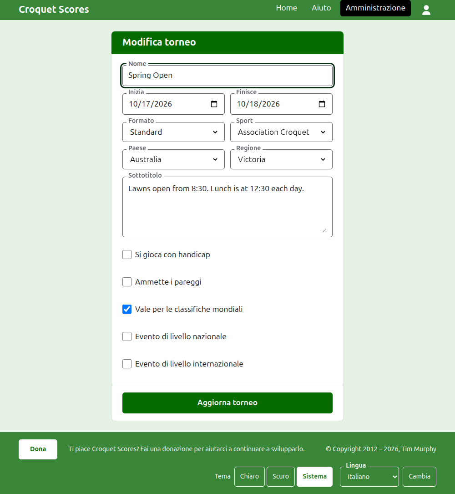
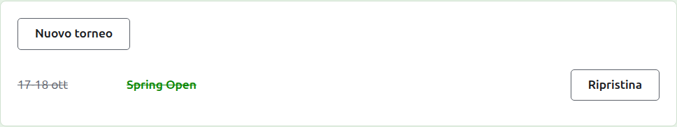

# Modificare, archiviare e ripristinare un torneo

## Modificare i dati del torneo

Nell'elenco dei tornei nell'amministrazione, premi **Modifica** sul torneo. Il modulo è quello che lo ha creato, già compilato com'è il torneo. Cambia ciò che non va e premi **Aggiorna torneo**.

Una volta che il torneo contiene un qualsiasi giocatore o una qualsiasi competizione, contando anche quelli archiviati, il suo formato non può più essere cambiato in uno a squadre, che ha squadre e test al loro posto.

Un torneo mantiene il suo indirizzo quando il nome viene corretto, così un link che qualcuno ha già inviato lo trova ancora. Si sposta solo quando cambia l'anno in cui comincia o il suo sport, e allora il vecchio indirizzo porta a quello nuovo. Salvare ti porta al torneo ovunque si trovi ora.

Solo un organizzatore può modificare un torneo. A un segnapunti, o a chiunque altro, viene detto così anziché mostrare il modulo.

## L'elenco dei tornei

L'amministrazione elenca un anno alla volta, cominciando da quest'anno, dal torneo più recente. Gli anni in cui hai un torneo sono schede nella barra verde scuro, dal più recente; dove ce ne sono più di quanti stiano su un telefono, i più vecchi sono in un menu a discesa alla fine della riga. L'anno è nell'indirizzo, quindi a un anno si può puntare con un link.

## Archiviare un torneo

**Archivia** su un torneo nell'elenco lo mette da parte. È ancora elencato, barrato e dopo i tornei in uso, ma offre solo **Ripristina**: la sua pagina nell'amministrazione, e le sue pagine pubbliche, sono chiuse finché non viene ripristinato. Archiviare non chiede prima, perché ripristinare lo annulla.

Avanti: [Che cosa vede il pubblico](what-the-public-sees.md).
