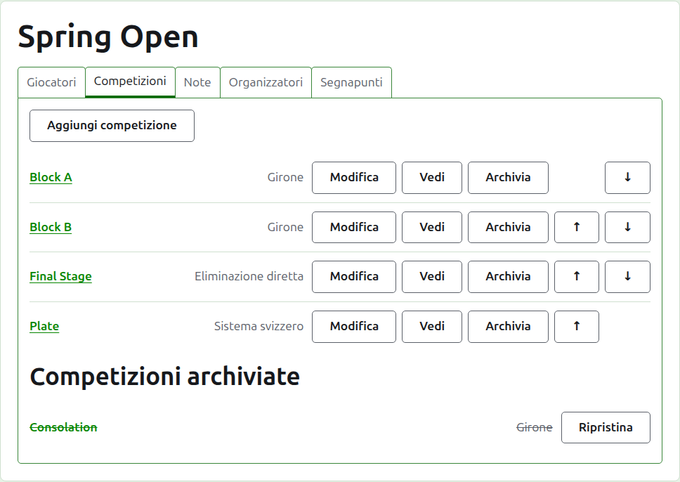
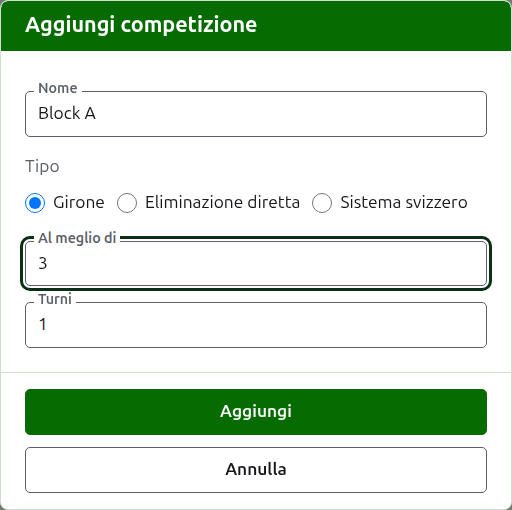
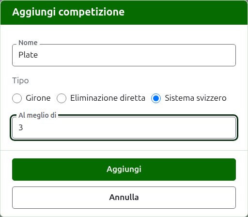
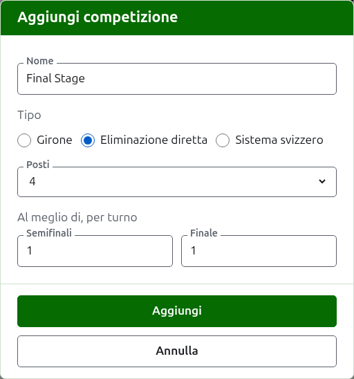

# Competizioni

La scheda **Competizioni** della pagina di un torneo è dove le sue competizioni vengono aggiunte, messe in ordine e messe da parte. Una competizione è un girone, un'eliminazione diretta o un sistema svizzero. Ciascuna ha una pagina sua, dove si inseriscono i suoi giocatori e i suoi punteggi.

## Aggiungere una competizione

Premi **Aggiungi competizione**, sopra l'elenco. Si apre una finestra di dialogo sopra la pagina, che chiede il nome della competizione, il suo tipo e la forma che quel tipo ha.

**Nome** è ciò che i giocatori cercano sulla pagina del torneo per trovare le loro partite. È lungo tra 1 e 254 caratteri, e basta anche una lettera sola, perché spesso un girone si chiama con una lettera. Due competizioni di uno stesso torneo non possono avere lo stesso nome.

**Tipo** è girone, eliminazione diretta o sistema svizzero. La finestra comincia su girone, che è ciò che è la maggior parte delle competizioni.

### Un girone o un sistema svizzero

Un girone e un sistema svizzero chiedono solo di quante partite è **al meglio di** ciascun incontro, che comincia da 1. Al meglio di 3 vince chi vince due partite. Può essere un numero pari, perché in un girone o in un sistema svizzero un giocatore è classificato per le partite che vince, e un incontro di due partite finito una a una è un risultato come un altro.

### Un'eliminazione diretta

Un'eliminazione diretta chiede quanti **posti** ha il suo tabellone, e di quante partite è al meglio ciascun turno. I posti offerti sono 2, 4, 8, 16, 32, 64 e 128, perché qualsiasi altro numero non potrebbe dimezzarsi turno dopo turno fino a una finale, e la finestra comincia su 8. I posti che restano una volta inseriti i giocatori vengono riempiti con dei bye, che si aggiungono dove si inseriscono i giocatori.

Un tabellone ha tanti turni quanti ne servono per dimezzare i suoi posti fino a uno, quindi un tabellone di 8 posti ha tre turni. La finestra chiede di quante partite è al meglio ciascuno, tutti insieme sotto **Al meglio di (per turno)**, nell'ordine in cui si giocano. Gli ultimi tre sono chiamati come si chiamano i turni di un tabellone, **Quarti**, **Semifinali** e **Finale**, e quelli prima con il loro numero, Turno 1 per primo. Scegliere più posti aggiunge turni all'inizio del tabellone, e sceglierne meno li toglie dall'inizio, così ciò che è stato scritto per la finale resta della finale. Ogni turno è al meglio di un numero impari di partite, perché un incontro a eliminazione diretta deve avere un vincitore.

### Come si gioca e come si conta

Ogni tipo chiede le stesse tre cose sotto la sua forma.

**Si gioca con handicap.** Spuntalo per una competizione giocata con handicap.

**Ammette i pareggi.** Spuntalo quando una partita può finire senza che nessuno dei due giocatori vinca. La maggior parte delle competizioni non lo ammette. Quando è spuntato, un punteggio inserito con punti pari e senza segno viene tenuto come pareggio; quando non lo è, una partita a punti pari deve dire chi l'ha vinta con un segno dopo il punteggio del vincitore, come "6w". L'incontro di un'eliminazione diretta ha sempre un vincitore, quindi una partita pareggiata non lo decide.

**Vale per le classifiche mondiali.** Viene chiesto solo quando può valere: una competizione di Association Croquet o di Golf Croquet che non si gioca con handicap e non ammette i pareggi. All'inizio è spuntato, quindi toglilo per una competizione che non deve valere.

### Aggiungerne diverse in una volta

Premi **Aggiungi**. La competizione viene aggiunta, la finestra lo dice, e il nome si svuota per la successiva, mentre il tipo e la sua forma restano com'erano: le competizioni aggiunte insieme sono per lo più simili, quindi per "Block B" dopo "Block A" basta il nome. Premi **Annulla** per chiudere la finestra quando ci sono tutte.

## Modificare una competizione

**Modifica** apre la stessa finestra sulla competizione, intitolata Modifica competizione, con il suo nome, la sua forma e il modo in cui si gioca e si conta com'è. Il tipo non viene chiesto, perché un girone non diventa un'eliminazione diretta modificandolo: una competizione del tipo sbagliato si archivia e si aggiunge di nuovo. Premi **Salva** per conservare la modifica e chiudere la finestra.

Un'eliminazione diretta che ha una partita ha dei giocatori collocati nel suo tabellone, e cambiare i suoi posti li sposterebbe, quindi viene rifiutato una volta inserita una partita. Si può ancora cambiare di quante partite è al meglio ciascun turno.

## Ordine

Le competizioni sono elencate nell'ordine del torneo, che è l'ordine in cui compaiono sulle pagine pubbliche e nella barra verde scuro. **Su** e **Giù** spostano una competizione di un posto.

## Andare a una competizione

Il nome di una competizione, o **Vedi**, apre la sua pagina, dove si inseriscono i suoi giocatori e i suoi punteggi. Anche la barra verde scuro sotto l'intestazione porta lì, da qualsiasi pagina del torneo.

## Archiviare una competizione

**Archivia** mette da parte una competizione, che abbia partite o no, le quali restano con lei e tornano quando viene ripristinata. Una competizione archiviata è elencata sotto **Competizioni archiviate**, barrata, offre solo **Ripristina** e non è sulle pagine pubbliche. Archiviare non chiede prima, perché ripristinare lo annulla.

Avanti: [Inserire i giocatori in una competizione](entering-players-in-a-competition.md).
