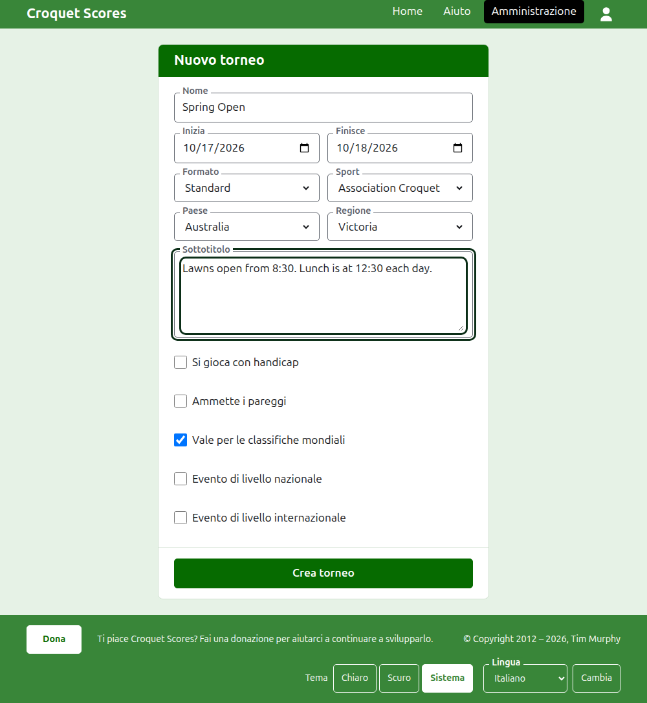

# Creare un torneo

Premi **Nuovo torneo** sopra l'elenco dei tornei nell'amministrazione. Sta sopra l'elenco anziché sotto, così un elenco lungo non lo spinge fuori dallo schermo di un telefono.

Il modulo chiede tutto ciò con cui un torneo comincia. Per un torneo del tipo comune bastano un nome, due giorni e un paese: tutto il resto è deciso per te e si può cambiare.

## Che cosa chiede il modulo

**Nome.** Ciò che i lettori cercano per trovare il torneo, come "Spring Open". È lungo tra 3 e 254 caratteri. Un nome tutto in minuscolo, o tutto in maiuscolo, viene rifiutato, perché sembrerebbe un errore su ogni pagina in cui compare. Due tornei possono avere lo stesso nome, perché lo stesso torneo si gioca ogni anno.

**Inizia** e **Finisce.** I giorni in cui si svolge il torneo. Un torneo non può finire prima di cominciare, e non può cominciare o finire dopo la fine dell'anno prossimo. Un torneo appartiene all'anno in cui comincia, che è anche l'anno nel suo indirizzo, quindi un torneo che si svolge a cavallo del nuovo anno è elencato nell'anno in cui comincia.

**Formato.** Scegli **Standard** per un torneo giocato tra giocatori. Gli altri formati sono per i tornei giocati tra squadre, che hanno una guida a parte.

**Sport.** Gli sport che il sito offre, nel suo ordine: Association Croquet, Golf Croquet, Croquet americano a 6 archetti e Ricochet su Croquet Scores. Gateball Scores non chiede né uno sport né un formato, perché ogni torneo lì è un torneo standard di gateball.

**Paese** e **Regione.** Dove si gioca il torneo. La regione viene chiesta solo quando il paese che scegli è diviso in regioni, come gli stati dell'Australia; un paese che è un'unica regione non la chiede. La regione si può non scegliere anche quando viene offerta.

**Sottotitolo.** Tutto ciò che vuoi far sapere ai lettori e che non ha un campo suo: dove parcheggiare, a che ora si pranza, chi chiamare. Compare sotto il nome del torneo su ogni pagina pubblica. Si scrive in Markdown, quindi una parola si mette in grassetto con degli asterischi intorno e un elenco si fa con un trattino all'inizio di ogni riga. Può arrivare a 2000 caratteri, e si può lasciare vuoto.

**Si gioca con handicap.** Spuntalo per un torneo a handicap.

**Ammette i pareggi.** Spuntalo quando una partita può finire senza che nessuno dei due giocatori vinca. La maggior parte dei tornei non lo ammette. Quando è spuntato, un punteggio inserito con punti pari e senza segno viene conservato come pareggio; quando non lo è, una partita a punti pari deve dire chi l'ha vinta con un segno dopo il punteggio del vincitore, come "6w".

**Vale per le classifiche mondiali.** Viene chiesto solo quando può valere: un torneo di Association Croquet, di Golf Croquet o di Croquet americano a 6 archetti che non si gioca con handicap e non ammette i pareggi. All'inizio è spuntato, quindi toglilo per un torneo che non deve valere.

**Evento di livello nazionale** ed **Evento di livello internazionale.** Un torneo può essere l'uno, l'altro, o nessuno dei due, ma mai entrambi: spuntare l'uno toglie la spunta all'altro.

## Crearlo

Premi **Crea torneo**. Vieni portato alla pagina del torneo nell'amministrazione, da dove si gestisce, e sei il suo primo organizzatore. È elencato nell'amministrazione sotto l'anno in cui comincia.

L'indirizzo pubblico del torneo è formato dal suo anno, dal suo sport e dal suo nome, come `/2026/ac/spring-open`. Mantiene quell'indirizzo quando il nome viene corretto più tardi, così un link già inviato lo trova ancora; si sposta solo quando cambia l'anno in cui comincia, o il suo sport.

## Se qualcosa viene rifiutato

Ciò che viene rifiutato è detto sotto il campo a cui si riferisce, e ciò che hai scritto resta scritto. Nulla viene conservato finché ogni campo non è accettato. Le cose rifiutate più spesso sono un nome scritto tutto in minuscolo, una fine prima dell'inizio e un paese non scelto.

Avanti: [Giocatori](players.md).
