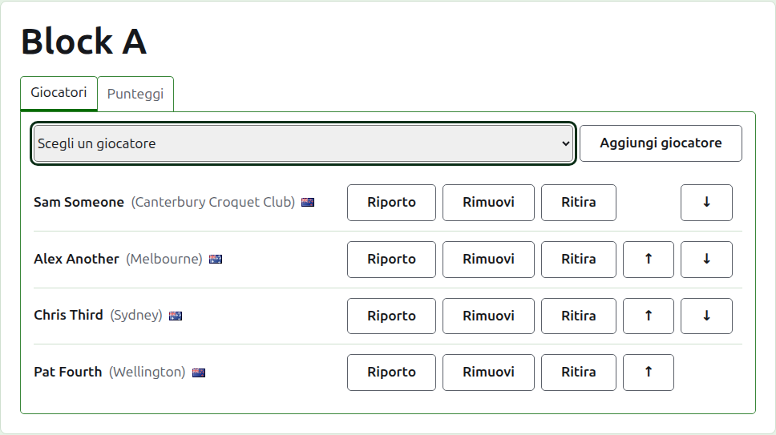
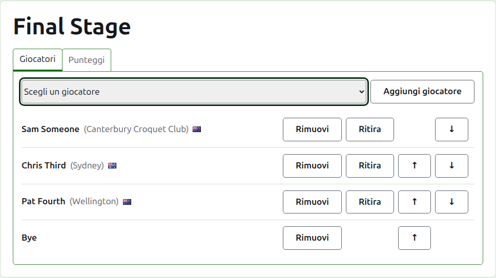
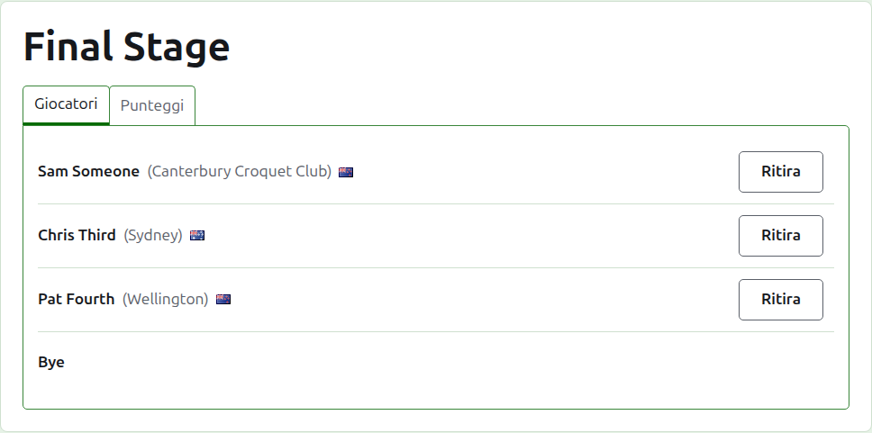
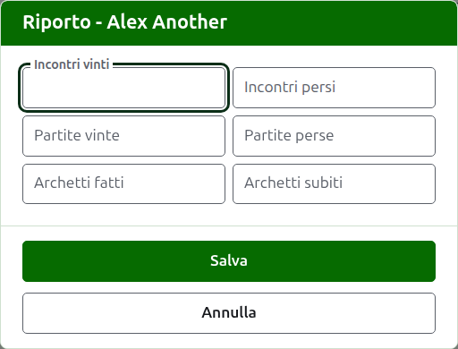
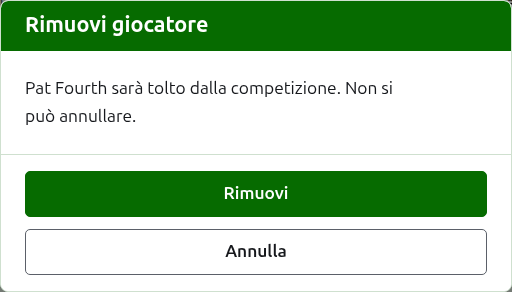
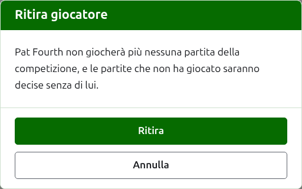
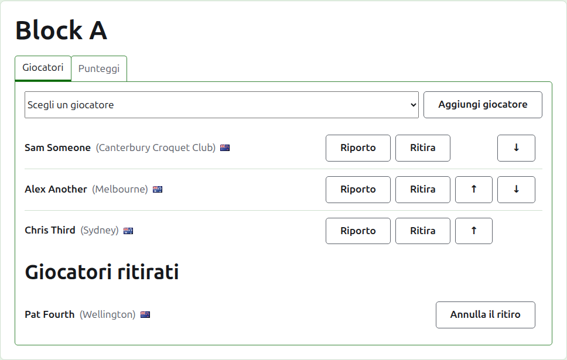

# Inserire i giocatori in una competizione

La pagina di una competizione si apre dal suo nome nella scheda Competizioni, o dalla barra verde scuro. È intestata con il nome della competizione, con due schede sotto: **Giocatori** e **Punteggi**. Si apre su Giocatori, perché i giocatori si inseriscono prima che si giochi qualunque cosa.

Un giocatore di una competizione è uno dei giocatori del torneo, quindi si inserisce scegliendolo anziché scrivendolo. Tutto ciò che lo riguarda, tranne il suo posto nella competizione e ciò che vi riporta, si cambia nella scheda Giocatori del torneo.

## Aggiungere un giocatore

Sopra l'elenco, un menu a discesa propone ogni giocatore del torneo che non è già nella competizione, nell'ordine del torneo. Scegline uno e premi **Aggiungi giocatore**. Il giocatore viene messo nell'ordine del torneo tra quelli già inseriti, il menu non lo propone più, e il cursore torna al menu così che il successivo si possa scegliere dalla tastiera. Quando ogni giocatore del torneo è nella competizione, il menu non viene mostrato e la scheda lo dice.

I giocatori archiviati del torneo non vengono proposti.

## I bye in un'eliminazione diretta {#byes-in-a-knockout}

Un'eliminazione diretta si gioca solo quando ogni posto del suo tabellone è occupato, e i posti che i suoi giocatori lasciano liberi vengono riempiti con dei bye. Quindi in un'eliminazione diretta il menu propone **Bye** per primo, prima dei giocatori, e continua a proporlo per quanti bye si aggiungano, perché un tabellone può averne bisogno di parecchi.

Un bye viene collocato nel tabellone come un giocatore: si può spostare su e giù e rimuovere, ma non si può ritirare, perché non gioca nulla. Un giocatore inserito in un'eliminazione diretta i cui posti sono tutti occupati viene rifiutato, e la scheda lo dice sotto il menu.

L'ordine dei giocatori di un'eliminazione diretta è il suo tabellone. I primi due posti si incontrano nel primo incontro, i due successivi nel successivo, e così via. Metti i giocatori nell'ordine in cui il tabellone va giocato prima di inserire qualsiasi punteggio, perché una volta che l'eliminazione diretta ha una partita in uso i suoi giocatori sono fissi: nessuno può essere aggiunto, rimosso o spostato. Un giocatore può ancora ritirarsi.

## Ordine

I giocatori sono elencati nell'ordine della competizione, che è l'ordine in cui si sorteggia un'eliminazione diretta e l'ordine in cui un girone è elencato sulla sua pagina pubblica. **Su** e **Giù** spostano un giocatore di un posto.

## Riporto {#carry-forward}

**Riporta avanti** dice ciò che un giocatore porta in una competizione da un gioco che questa non ha segnato: i risultati di una fase precedente, o di partite giocate prima che la competizione fosse segnata qui. Viene offerto in un girone e in un sistema svizzero, che hanno una classifica in cui contarlo, e non in un'eliminazione diretta.

La finestra chiede sei conteggi: incontri vinti e persi, partite vinte e perse, e archetti fatti e subiti. Ogni conteggio è facoltativo. Un conteggio lasciato vuoto non riporta nulla, il che non è lo stesso che riportare 0, così chi lo cambierà più tardi lo vede com'è stato lasciato. Premi **Salva** per conservare tutti e sei.

## Rimuovere un giocatore {#removing-a-player}

**Rimuovi** toglie un giocatore inserito per errore. Resta uno dei giocatori del torneo, e viene proposto di nuovo nel menu, ma del suo posto nella competizione non si conserva nulla, quindi Rimuovi chiede prima.

Un giocatore che ha una qualsiasi partita in uso nella competizione non può essere rimosso, perché le partite risulterebbero giocate contro qualcuno che non c'è più, e non gli viene offerto Rimuovi. Un giocatore le cui sole partite sono archiviate può esserlo, e i suoi punteggi archiviati se ne vanno con lui.

## Ritirare un giocatore {#withdrawing-a-player}

**Ritira** è per un giocatore che non giocherà più nella competizione. Resta dentro, con le partite che ha giocato, ed è elencato sotto **Giocatori ritirati** dopo quelli che giocano ancora. In un'eliminazione diretta, il suo avversario in un incontro non ancora deciso passa il turno.

Ritira chiede prima, perché cambia l'esito della competizione: le partite che il giocatore non ha giocato vengono decise senza di lui.

Un giocatore ritirato offre solo **Annulla il ritiro**, che lo rimette tra quelli che giocano, dopo quelli che sono rimasti, senza chiedere.

Avanti: [Punteggi](scores.md).
