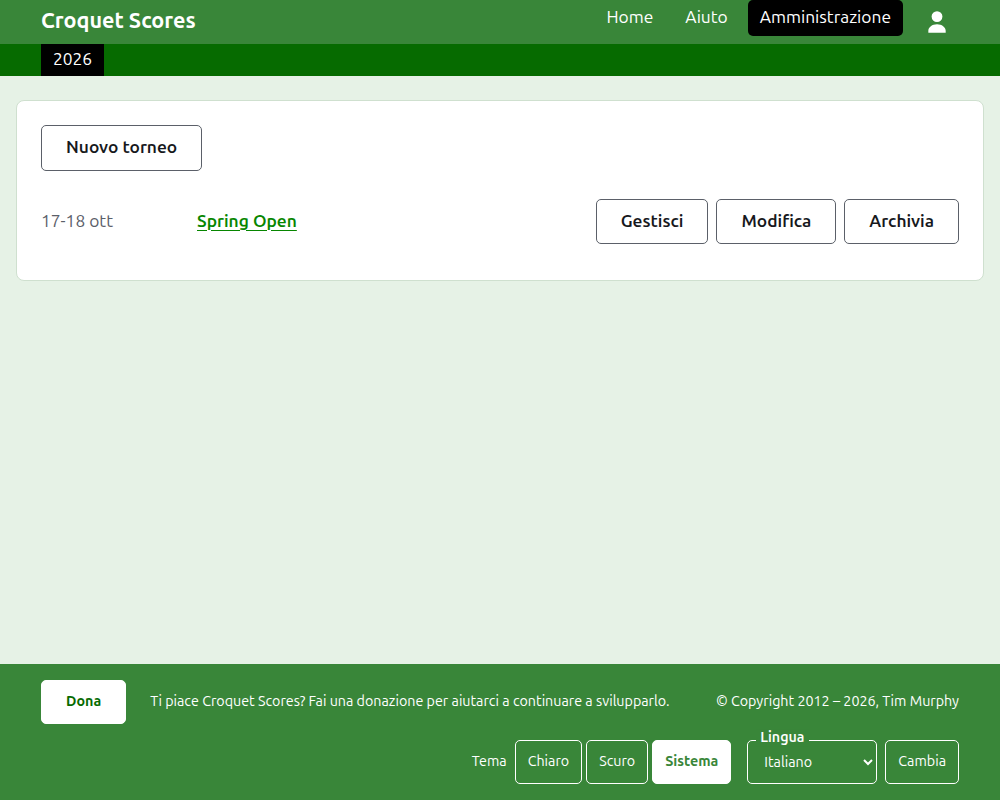
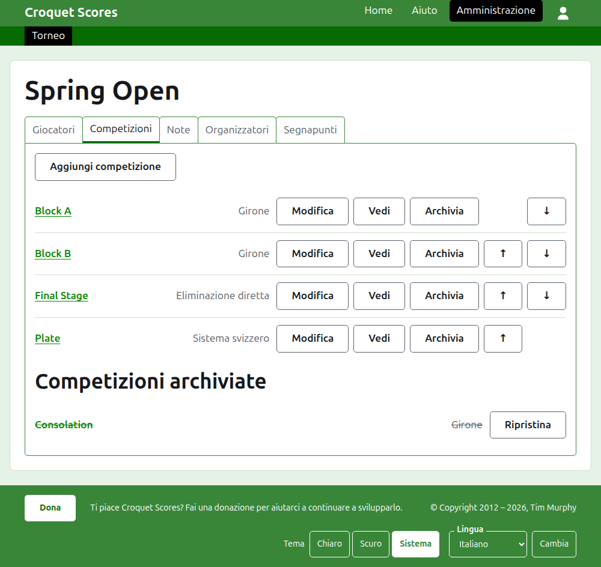

# Gestire un torneo standard

Un torneo standard è un torneo giocato tra giocatori iscritti uno a uno: un fine settimana di club, un open, un campionato. I suoi giocatori vengono inseriti in gironi, eliminazioni dirette e sistemi svizzeri, e i suoi punteggi vengono pubblicati man mano che si gioca. Questa guida accompagna un organizzatore dall'accesso fino a un torneo i cui risultati sono a disposizione del pubblico.

Sta in piedi da sola. Nulla di ciò che contiene dipende dalla guida al torneo a squadre, che è scritta a parte.

## Prima di cominciare

Ti serve un account. Clicca [qui](/account/register) per registrarne uno.

Tutto ciò che fa un organizzatore lo fa nella sezione di amministrazione del sito. Le pagine pubbliche, dove giocatori e spettatori seguono il torneo, sono ricavate da ciò che l'amministrazione contiene, quindi non c'è nulla da pubblicare: un punteggio inserito è subito sulle pagine pubbliche.

## Le pagine in ordine

1. [Creare un torneo](creating-a-tournament.md): il suo nome, i suoi giorni, il suo sport, dove si gioca e per che cosa vale.
2. [Giocatori](players.md): inserire i giocatori del torneo, correggerli e mettere da parte quelli inseriti per errore.
3. [Competizioni](competitions.md): aggiungere gironi, eliminazioni dirette e sistemi svizzeri, e metterli in ordine.
4. [Inserire i giocatori in una competizione](entering-players-in-a-competition.md): chi gioca in ciascuna competizione, i bye in un'eliminazione diretta, i riporti, la rimozione e il ritiro.
5. [Punteggi](scores.md): inserire i risultati, correggerli e mettere da parte quelli inseriti per errore.
6. [Note](notes.md): dire ai giocatori ciò che devono sapere mentre il torneo va avanti.
7. [Organizzatori e segnapunti](managers-and-scorers.md): condividere la gestione del torneo, e lasciare che qualcuno inserisca i punteggi senza poter cambiare nient'altro.
8. [Modificare, archiviare e ripristinare un torneo](changing-and-archiving.md): correggere i dati del torneo, e mettere da parte un torneo.
9. [Che cosa vede il pubblico](what-the-public-sees.md): le pagine che i tuoi giocatori seguono, e come ciò che inserisci vi compare.

## Com'è organizzata l'amministrazione

La porta d'ingresso dell'amministrazione elenca i tornei in cui hai un ruolo, un anno alla volta.

Premendo il nome di un torneo, o **Gestisci**, si apre la sua pagina. Tutto ciò che c'è da gestire sta in cinque schede sotto il suo nome: **Giocatori**, **Competizioni**, **Note**, **Organizzatori** e **Segnapunti**. La pagina si apre su Giocatori, perché i giocatori sono la prima cosa che si inserisce.

La barra verde scuro sotto l'intestazione serve a spostarsi tra le pagine. Porta al torneo, come **Torneo**, e a ciascuna delle sue competizioni per nome, così puoi passare dal torneo a una competizione e da una competizione all'altra senza tornare dalla scheda Competizioni. La pagina in cui ti trovi è segnata in nero.

## Cose che valgono ovunque

**Nulla viene eliminato del tutto, tranne una nota.** Giocatori, competizioni, punteggi e il torneo stesso vengono archiviati anziché eliminati: messi da parte, barrati ed elencati sotto un'intestazione tutta loro, con **Ripristina** per riportarli indietro. Archiviare, ripristinare e spostare su e giù non chiedono mai conferma, perché ciascuna di queste azioni si annulla premendo quella opposta. Le cose che non si possono annullare, come togliere un giocatore da una competizione o eliminare una nota, chiedono prima.

**Una finestra di dialogo sopra la pagina non conserva nulla finché non premi il suo pulsante.** Annulla, o il tasto Esc, la chiude e lascia tutto com'era. Le finestre che aggiungono qualcosa, come Aggiungi giocatore e Aggiungi punteggio, restano aperte dopo ogni aggiunta, così un elenco si può scrivere tutto di seguito.

**Ciò che viene rifiutato è detto accanto al campo a cui si riferisce.** Nulla di ciò che è rifiutato viene conservato, e ciò che hai scritto resta scritto, così si può correggere anziché scriverlo di nuovo.

**L'amministrazione funziona su un telefono.** Ogni pulsante è abbastanza grande da premere con un pollice, e nulla è più largo dello schermo.

Avanti: [Creare un torneo](creating-a-tournament.md).
